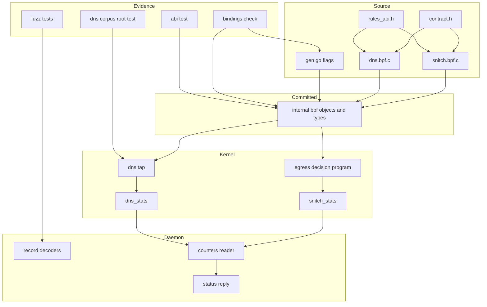
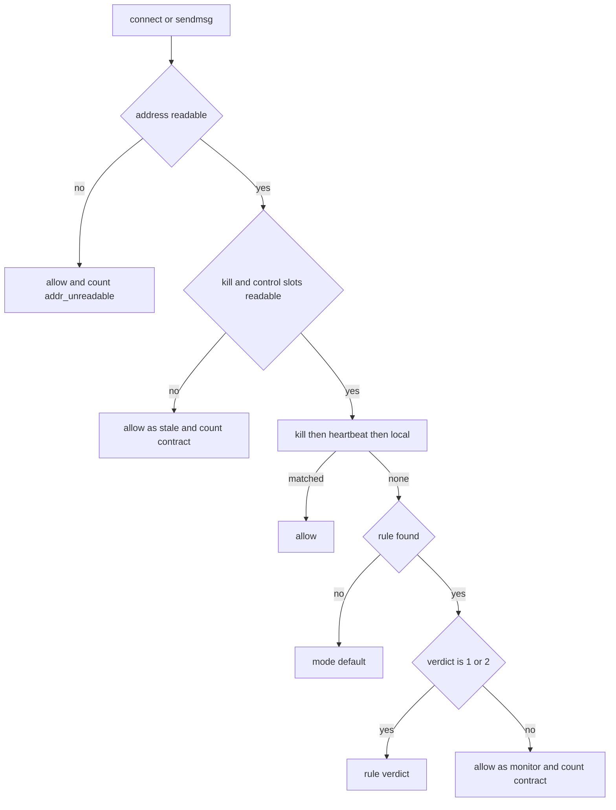
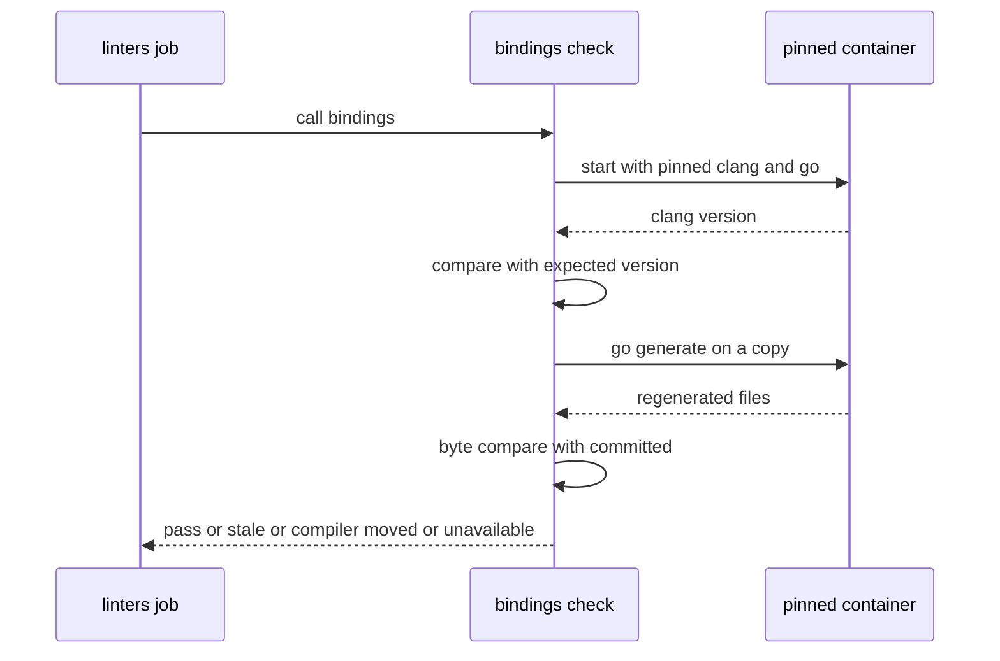

# Design Document — c-hardening

## Overview

**Purpose**: make the kernel programs and the daemon code that consumes them defensible to a
reviewer. The compiler reports more and is heard, shared layouts and limits are pinned at
build time, a false assumption at run time allows and is counted, hostile DNS input is
exercised with stated outcomes, the committed kernel objects are shown to match their source,
and the daemon's decoders are fuzzed.

**Users**: the maintainer (build, tests, pipeline), operators (status counters), reviewers
(evidence).

**Impact**: both `.bpf.c` files and their bindings change; the status reply gains one
additive field; the check pipeline gains one check that runs clang as an observer. No allow
or deny decision changes on any input for which no contract is violated.

### Goals
- Zero warnings under the extended set including `-Wconversion`, in authored code.
- No suppression that stands for a known defect.
- Build failure on unintended layout or limit changes.
- Counted, fail-open runtime contracts in both kernel programs, readable from the status.
- A hostile-input corpus in the root tests.
- A byte-identity check of bindings against source.
- Fuzz tests for the four decoders, with decoders that reject instead of panicking.

### Non-Goals
- The CodeQL build-mode change, the deb dependency fields, `-buildmode=pie`.
- New verdict values, events, hooks, rule features; any change to modes or the decision order.
- Loading kernel programs in hosted CI.
- A pipeline function that writes regenerated bindings into the tree.

## Boundary Commitments

### This Spec Owns
- The compiler flag set in `internal/bpf/gen.go` and the include form of `vmlinux.h`.
- `bpf/contract.h` and `bpf/rules_abi.h` (new), and the contract statements in both programs.
- The `snitch_stats` map and the contract tail of `dns_stats`, including their index order
  as ABI.
- The `counters` field of the status reply.
- `TestDNSProgCorpus` and its frame mutators.
- The `bindings` check in the pipeline module and its pins.
- The fuzz tests and their seed corpora; the error-returning form of the two record decoders.
- The cppcheck suppressions list entries this feature removes or re-anchors.
- `docs/c-hardening.md`; the amendments to `tech.md`, `docs/ci-debs.md`, `examples/api.md`,
  `CLAUDE.md` and `.kiro/handover.md` that this feature makes necessary.

### Out of Boundary
- `.github/workflows/codeql.yml`, `.github/codeql-config.yml`, `packaging/`.
- The release chain (`release.yml`, the build and deb lanes): untouched; it keeps building
  from committed bindings without a C compiler.
- The existing eleven `dns_stat` indices and `dns.Stats`; the `dns` status object.
- The tray, the Python client, `internal/ask`, `internal/client`: they must keep working
  without change.
- The decision order and every fail-safe in `decide()`.

### Allowed Dependencies
- C: libbpf headers, `vmlinux.h`, C11 `_Static_assert`. No new header from outside the tree.
- Go: standard library `testing` fuzzing; `cilium/ebpf` (already present) for collection
  specs and BTF in tests. No new module dependency.
- Pipeline: the existing Dagger module, `debian:forky`, the pinned checks image; apt
  packages `clang`, `llvm`, `libbpf-dev`.
- `internal/api` keeps importing nothing from the daemon; `cmd/snitchd` maps counters to
  the wire type.

### Revalidation Triggers
- Any change to a struct in `bpf/rules_abi.h` or to a `-type` struct: bindings, Go mirrors
  (`rules.RuleKey`, `rules.RuleVal`, `dns.Slot`), and the ABI test.
- Any change to counter index order: the Go name tables and `examples/api.md`.
- A new clang in the pinned environment: regenerate, re-pin, re-run the root tests.
- Any edit to `bpf/dns.bpf.c`: `sudo scripts/dns-progtest.sh` (verifier budget).
- Renaming or removing a key under `counters`: clients that read it.

## Architecture

### Existing Architecture Analysis
- The kernel decides alone; the daemon configures and reads; clients read the daemon. This
  feature adds no path between layers.
- Bindings are committed build inputs; today nothing verifies them against the source.
- The tap already counts outcomes in `dns_stats`; the egress program counts nothing.
- `rule_key` and `rule_val` exist twice; `rules.RuleKey` / `rules.RuleVal` mirror them by hand.
- The pipeline has seven checks; `linters` (golangci, cppcheck) skips on release tags.

### Architecture Pattern & Boundary Map



**Architecture Integration**:
- Pattern: contracts at three levels with one outcome each — build fails, kernel allows and
  counts, daemon rejects input with an error (programming errors still exit through
  `internal/contract`, which detaches the programs).
- Existing patterns preserved: one `decide()`, fixed decision order, committed bindings,
  delegates over interfaces, table-driven root tests, pins in `pins.go`.
- New components: two headers, one map, one status field, one pipeline check, test files.
- Steering compliance: fail-safes 1–5 untouched; "CI never runs clang" is amended to the
  observer rule (9.4).

### Technology Stack

| Layer | Choice / Version | Role in Feature | Notes |
|-------|------------------|-----------------|-------|
| Kernel programs | C11, clang 21.1.8 (Debian forky), libbpf-dev 1:1.7.0-1 | flags, contracts, counters | version the drift verdict is tied to |
| Bindings | bpf2go via `go tool`, cilium/ebpf v0.22 | regenerate, compare | byte-reproducible, measured |
| Daemon | Go (go.mod), `testing.F` | decoders, counters, fuzz | no new dependency |
| Pipeline | Dagger module, engine 0.21.12 | `bindings` check | `linters` job, skipped on tags |
| Analysis | cppcheck 2.22.0-1 | zero unsuppressed findings | list shrinks by six entries |

## File Structure Plan

### Directory Structure
```
bpf/
├── contract.h                 # NEW: CONTRACT_SIZE / CONTRACT_OFFSET / CONTRACT_CONST, CONTRACT()
├── rules_abi.h                # NEW: the one definition of rule_key, rule_val + their contracts
├── snitch.bpf.c               # MOD: includes, snitch_stats, 4 runtime contracts, warning fixes
├── dns.bpf.c                  # MOD: includes, 2 runtime contracts, contract tail, pkt_init void, fixes
└── cppcheck-suppressions.txt  # MOD: 4 deferred + 2 pkt_init entries removed
internal/bpf/
├── gen.go                     # MOD: extended flags, -isystem
├── abi_test.go                # NEW: BTF sizes vs Go types and hand mirrors; counter map sizes
└── *_bpfel.{go,o}             # REGENERATED
internal/dns/
├── record.go                  # MOD: exact-size Decode; Contracts + DecodeContracts
├── prog_corpus_root_test.go   # NEW: corpus table + TestDNSProgCorpus
├── prog_mangle_root_test.go   # NEW: byte-level frame mutators
├── prog_helpers_root_test.go  # MOD: progContracts helper
└── fuzz_test.go               # NEW: FuzzDecode
internal/api/
├── types.go                   # MOD: Status.Counters, CountersStatus, ProgramCounters
└── fuzz_test.go               # NEW: FuzzParse, FuzzLineReader
internal/rules/
└── fuzz_test.go               # NEW: FuzzParse, FuzzParseOverlay
cmd/snitchd/
├── decode.go                  # MOD: decodeEvent returns (event, error)
├── events.go                  # MOD: skip and count an undecodable record
├── counters.go                # NEW: egress counter names, per-CPU sum, api.CountersStatus
├── counters_test.go           # NEW
├── api.go                     # MOD: Status.Counters wired
├── dns.go, dnsfacts.go        # MOD: contracts reader beside stats
└── fuzz_test.go               # NEW: FuzzDecodeEvent
.dagger/
├── bindings.go                # NEW: Bindings check + container
├── pins.go                    # MOD: forky digest, clang/llvm pins, expected clang version
└── composites.go              # MOD: LintAll includes bindings
docs/c-hardening.md            # NEW: the contract approach, regeneration, fuzz commands
```
Seed corpora live in `testdata/fuzz/<FuzzName>/` beside each fuzz test.

### Modified Files
- `.github/workflows/lint.yml` — third dispatch (`bindings`) in the `linters` job.
- `.dagger/build.go`, `.dagger/deb.go` — comments that say "seven checks" become eight.
- `examples/api.md` — the `counters` object and what a non-zero contract counter means.
- `docs/ci-debs.md` — the four findings no longer open; the eighth check.
- `.kiro/steering/tech.md` — observer rule replaces "CI never runs clang".
- `CLAUDE.md` — layout lines for the headers, the check and the fuzz commands.
- `.kiro/handover.md` — points closed by this feature removed.
- `scripts/api-check.sh` — asserts the `counters` object is present.

## System Flows



- The order kill → heartbeat → local → rules → mode default is the existing code; the two
  contract diamonds add only allow exits (4.6, 4.7).
- Tap: `read_qname` → name-shape contract → offsets contract → reserve record → walk. A
  violated contract returns 1 before the reservation: no insert, no record (4.2).



## Requirements Traceability

| Requirement | Summary | Components | Interfaces | Flows |
|-------------|---------|------------|------------|-------|
| 1.1, 1.2 | extended set, fail on warning | Generation flags | `gen.go` cflags, `-Werror` | — |
| 1.3, 1.4 | generated headers exempt, authored not | Generation flags | `<vmlinux.h>` via `-isystem`, quote includes | — |
| 1.5 | sources clean, per-site annotations only | Warning fixes | casts, `unused` attribute, commented pragma | — |
| 1.6 | verifier still accepts | Root load test | `TestDNSProgLoads`, bounded monitor run | — |
| 2.1, 2.2, 2.3 | four findings fixed, list honest, zero findings | Warning fixes, Suppressions list | `Cppcheck` check | — |
| 2.4 | line-bound entries re-anchored | Suppressions list | — | — |
| 2.5 | docs no longer list them open | Records | `docs/ci-debs.md` | — |
| 3.1, 3.2 | size and offset contracts | Contract header, Shared trie ABI | `CONTRACT_SIZE`, `CONTRACT_OFFSET` | — |
| 3.3 | limit relations | Contract header, Tap | `CONTRACT_CONST` | — |
| 3.4 | trie ABI cannot diverge | Shared trie ABI | `rules_abi.h` | — |
| 3.5 | daemon view equals kernel view | ABI test | `abi_test.go` | — |
| 3.6 | no added instructions | Contract header | `_Static_assert` | — |
| 4.1, 4.6, 4.7 | egress violation allows; order kept | Egress contracts | `CONTRACT()` | egress flow |
| 4.2 | tap violation passes, no insert | Tap contracts | `CONTRACT()` | tap note |
| 4.3, 4.5 | counter per contract; egress counters | Egress counters, Tap contracts | `snitch_stats`, `dns_stats` tail | — |
| 4.4 | never deny on violation | Egress contracts, Tap contracts | fail-open branch at each site | egress flow |
| 4.8 | tap counters unchanged | Tap contracts | indices 0–10 fixed | — |
| 5.1, 5.2, 5.4 | counters in status, totals, zeros shown | Counters reader, Status wire type | `CountersStatus` | — |
| 5.3, 5.7 | additive, same readers | Status wire type | `Status.Counters` | — |
| 5.5 | unavailable is marked | Counters reader | `ProgramCounters.Available` | — |
| 5.6 | documented | Records | `examples/api.md` | — |
| 6.1, 6.5, 6.6 | corpus content, limits, statements | DNS corpus | `corpusCase` | — |
| 6.2, 6.3, 6.4 | pass, no entry, counters | DNS corpus | `checkCorpusCase` | — |
| 6.7, 6.8 | script runs all, refuses non-root | DNS corpus | `scripts/dns-progtest.sh` unchanged | — |
| 7.1, 7.2, 7.3, 7.4 | check, stale, tampered, stable | Bindings check | `Bindings` | drift sequence |
| 7.5, 7.8 | compiler named, unavailable fails | Bindings check, pins | `bindingsClangVersion` | drift sequence |
| 7.6, 7.7 | observer only, release unchanged | Bindings check | no export; `release.yml` untouched | — |
| 8.1, 8.2 | four fuzz areas, no panic | Fuzz tests | `Fuzz*` | — |
| 8.3 | wrong size rejected | Record decoders | `decodeEvent`, `dns.Decode` | — |
| 8.4, 8.5 | seeds run in `go test`, failures kept | Fuzz tests | `testdata/fuzz` | — |
| 8.6, 8.7 | commands documented, defects fixed | Records, Fuzz tests | `docs/c-hardening.md` | — |
| 9.1 | decisions unchanged | Egress contracts, Warning fixes | byte-compare of non-contract paths in review; enforce-test on request | — |
| 9.2, 9.3 | existing checks pass, no enforce | Verification plan | Testing Strategy | — |
| 9.4, 9.5, 9.6 | steering, docs, handover | Records | — | — |

## Components and Interfaces

| Component | Domain | Intent | Req Coverage | Key Dependencies | Contracts |
|-----------|--------|--------|--------------|------------------|-----------|
| Generation flags | build | extended warnings, system-header split | 1.1–1.4 | clang (P0) | Batch |
| Warning fixes | kernel C | clean sources, deferred findings | 1.5, 2.1 | Generation flags (P0) | — |
| Contract header | kernel C | build-time and runtime contract macros | 3.1–3.3, 3.6 | — | Service |
| Shared trie ABI | kernel C | one `rule_key` / `rule_val` | 3.4 | Contract header (P0) | State |
| Egress contracts and counters | kernel C | fail-open checks, `snitch_stats` | 4.1, 4.3–4.7 | Contract header (P0) | State |
| Tap contracts | kernel C | pre-insert checks, counter tail | 4.2–4.4, 4.8 | Contract header (P0) | State |
| ABI test | Go test | daemon view equals kernel view | 3.5 | bindings (P0) | — |
| Record decoders | daemon | exact-size, error-returning | 8.3 | bindings (P0) | Service |
| Counters reader | daemon | maps → `CountersStatus` | 5.1, 5.2, 5.4, 5.5 | Egress counters, Tap contracts (P0) | Service |
| Status wire type | API | additive `counters` | 5.3, 5.7 | — | API |
| DNS corpus | root test | hostile input with outcomes | 6.1–6.8 | Tap (P0) | — |
| Bindings check | pipeline | source ↔ bindings byte identity | 7.1–7.8 | pins (P0) | Batch |
| Fuzz tests | Go test | decoders do not crash | 8.1, 8.2, 8.4–8.7 | Record decoders (P1) | — |
| Records | docs | documents stay true | 2.5, 5.6, 8.6, 9.4–9.6 | — | — |

### Kernel C

#### Generation flags
**Responsibilities & Constraints**
- Both `go:generate` lines gain `-Wextra -Wshadow -Wvla -Wundef -Wpointer-arith
  -Wimplicit-fallthrough -Wstrict-prototypes -Wnull-dereference -Wconversion`; existing
  flags stay; `-- -I../../bpf` becomes `-- -isystem ../../bpf`.
- Sources include `<vmlinux.h>`; authored headers are included with quotes and therefore
  remain user headers (measured).

**Implementation Notes**
- Validation: a deliberate lossy conversion placed temporarily in `contract.h` must fail the
  generation (proves 1.3); remove it before commit.
- Risk: cppcheck resolves `<vmlinux.h>` through its `-I bpf`; confirm zero new findings.

#### Warning fixes
- `snitch.bpf.c`: `addrlen`, `size` marked unused; a commented diagnostic region around the
  two `BPF_PROG` hooks for the macro-declared `ctx`; explicit casts at the `sk_protocol` and
  `tgid` reads; the three pointers cppcheck named become pointers to const.
- `dns.bpf.c`: the loop callback's index marked unused; explicit casts at the two
  sign-compare sites and the five conversion sites; `sl` becomes pointer to const;
  `pkt_init` returns `void` and the two dead error branches go.
- Constraint: each cast spells out the conversion the compiler performs today, so the
  generated instructions do not change; the regenerated object is reviewed for size.

#### Contract header (`bpf/contract.h`)
**Contracts**: Service [x]

```c
#define CONTRACT_SIZE(type, bytes)            /* _Static_assert on sizeof(type) */
#define CONTRACT_OFFSET(type, member, bytes)  /* _Static_assert on offsetof */
#define CONTRACT_CONST(expr, msg)             /* _Static_assert on a relation of constants */
#define CONTRACT(cond, on_violation)          /* 1 if cond holds; else runs on_violation, 0 */
```
- Preconditions: `on_violation` is a counter increment with no other effect.
- Postconditions: `CONTRACT` never returns from the enclosing function and never changes a
  verdict; the site writes the fail-open branch.
- Invariants: the three build-time macros emit no code (3.6); every message names the type
  or relation, so a failing build names the violated contract (3.2).

Build-time contracts stated with them:

| Subject | Contract |
|---------|----------|
| `event`, `exe_key`, `control_state`, `byte_count` | size; offset of every member the daemon reads or writes |
| `rule_key`, `rule_val` (in `rules_abi.h`) | size; offset of every member; `prefixlen` covers the 64 fixed bits |
| `domain_key`, `domain_slot`, `domain_val`, `resolver_key`, `q_key`, `q_val`, `dns_answer_record` | size; offset of every member |
| limits | `NAME_MAX` is a power of two and a multiple of 8; `STEPS_MAX` ≤ the kernel's `bpf_loop` limit (1 << 23); `slots` has `LEVELS_MAX * SLOTS_MAX` elements; `LABELS_MAX` ≥ `LEVELS_MAX`; `RR_MAX` ≥ `ADDRS_MAX` |
| counters | `SS_MAX` and `ST_MAX` equal the map sizes |

Sizes are taken from the compiler at implementation time and written as literals.

#### Shared trie ABI (`bpf/rules_abi.h`)
- The only definition of `rule_key` and `rule_val`, with their contracts; included by both
  programs. Each object keeps its own BTF reference so bpf2go emits both Go types as today.

#### Egress contracts and counters
**Contracts**: State [x]

```c
enum snitch_stat {          /* index order is ABI */
    SS_DECISIONS = 0,       /* decide() reached the verdict chain */
    SS_ADDR_UNREADABLE,     /* destination could not be read: allowed, no event */
    SS_NO_EXE,              /* no executable file: program 0 */
    SS_EVENT_LOST,          /* ring buffer full: verdict stands, event missing */
    SC_KILL_SLOT,           /* contract: kill slot readable */
    SC_CONTROL_SLOT,        /* contract: control slot readable */
    SC_RULE_VERDICT,        /* contract: a found rule's verdict is 1 or 2 */
    SC_MODE,                /* contract: mode is 0 or 1 */
    SS_MAX
};
```
- `snitch_stats`: per-CPU array, `SS_MAX` entries of `__u64`, not pinned.

| Contract | On violation | Event verdict |
|----------|--------------|---------------|
| kill slot readable | allow | `V_ALLOW_STALE` |
| control slot readable | allow (today's behaviour, now counted) | `V_ALLOW_STALE` |
| rule verdict is 1 or 2 | allow, in every mode | `V_ALLOW_MONITOR`, rule id kept |
| mode is 0 or 1 | treated as monitor (today's behaviour, now counted) | `V_ALLOW_MONITOR` |

- Invariants: the contract checks sit where the code reads the value today; kill, heartbeat
  and local checks keep their position and conditions (4.6, 4.7). The only decision that
  differs from today is the rule-verdict violation in enforce mode, which denied and now
  allows; it requires a violated contract, so 9.1 holds.
- `count_egress` is unchanged.

#### Tap contracts
**Contracts**: State [x]

```c
/* appended after ST_RINGBUF_FULL (index 10); indices 0..10 unchanged */
    ST_C_NAME_SHAPE,        /* contract: 1 <= labels <= LABELS_MAX and 0 < wire < NAME_MAX */
    ST_C_DOT_RANGE,         /* contract: every dots[k], k < labels, is < NAME_MAX */
    ST_MAX
```
- Both are evaluated in `dns_answer` after `read_qname` succeeds and before the ring buffer
  reservation; `ST_C_NAME_SHAPE` also in `dns_query` before the question is stored. A
  violation returns 1.
- The masks that exist for the verifier stay; the contracts make a mask that would have
  changed a value visible.

### Daemon

#### Record decoders
**Contracts**: Service [x]

```go
// cmd/snitchd
func decodeEvent(raw []byte) (snitchbpf.SnitchEvent, error)
// internal/dns
func Decode(raw []byte) (Record, error)
type Contracts struct{ NameShape, DotRange uint64 }
const ContractsCount = 2
func DecodeContracts(values []uint64) (Contracts, error) // values[StatsCount:]
```
- Preconditions: none; any byte slice is accepted as input.
- Postconditions: `len(raw)` different from the record size yields an error (8.3); no panic.
- The event reader logs once per kind and counts an undecodable record, then continues.

#### Counters reader (`cmd/snitchd/counters.go`)
**Contracts**: Service [x]

```go
type perCPULookup func(key uint32, out *[]uint64) error
func egressCounters(lookup perCPULookup) api.ProgramCounters
func dnsContractCounters(read func() (dns.Contracts, error), on bool, reason string) api.ProgramCounters
func countersStatus(egress, dnsTap api.ProgramCounters) *api.CountersStatus
```
- Sums per-CPU values; a failed lookup yields `Available: false` with a reason and no maps
  (5.5). An off tap yields `Available: false`, reason as in the `dns` object.
- Names are a Go table in enum order; `abi_test.go` ties its length to the map size.

#### Status wire type (`internal/api/types.go`)
**Contracts**: API [x]

```go
type Status struct {
    // ... existing fields unchanged ...
    Counters *CountersStatus `json:"counters,omitempty"` // absent only on older daemons
}
type CountersStatus struct {
    Egress ProgramCounters `json:"egress"`
    DNS    ProgramCounters `json:"dns"`
}
type ProgramCounters struct {
    Available bool              `json:"available"`
    Reason    string            `json:"reason,omitempty"`
    Counters  map[string]uint64 `json:"counters,omitempty"`  // egress: decisions, addr_unreadable, no_exe, event_lost
    Contracts map[string]uint64 `json:"contracts,omitempty"` // every contract, zero included
}
```

| Program | `contracts` keys |
|---------|------------------|
| egress | `kill_slot`, `control_slot`, `rule_verdict`, `mode` |
| dns | `name_shape`, `dot_range` |

- The tap's own eleven counters stay in the `dns` object. Values are totals since the
  programs were loaded (5.2). Access: every reader of `status` (5.7).

### Evidence

#### ABI test (`internal/bpf/abi_test.go`)
- Loads the two embedded collection specs (no root), reads each shared struct's size from
  BTF and compares it with the generated Go type, with `rules.RuleKey` / `rules.RuleVal`,
  and the `dns_stats` / `snitch_stats` sizes with the Go name tables. A mismatch names the
  structure (3.5).

#### DNS corpus (`internal/dns/prog_corpus_root_test.go`)
```go
type corpusCase struct {
    name    string
    probes  string                               // what it probes, expected outcome (6.6)
    frame   func(t *testing.T) []byte            // well-formed builder, then mutators
    slots   []Slot
    skipQ   bool                                 // false: the question must have been recorded
    stats   Stats                                // expected counters (6.4)
    record  *Record                              // nil: no record (6.3)
    entries map[rules.RuleKey]rules.RuleVal      // exact trie content (6.3, 6.5)
}
```
- `checkCorpusCase` asserts program return 1 (6.2), stats, zero contract counters (6.4),
  exact trie, record or none.
- Mutators in `prog_mangle_root_test.go`: `truncateAt`, `setU16At`, `overwriteAt`,
  `appendRaw`, each on a frame the existing builder produced.

| Group | Entries |
|-------|---------|
| truncation | cut inside the Ethernet, IPv4, IPv6, UDP and DNS headers; inside the question; inside a record header; inside record data |
| lengths | UDP length below header + 12; UDP length beyond the frame; IPv4 header length below 20 |
| compression | owner pointer to itself; pointer forward; pointer beyond the frame; pointer in the question; reserved label types 0x40 and 0x80 |
| name limits | 64-byte name; 17 labels; 63-byte label that overruns the frame |
| record data | A with rdlen 3, 5, 16; AAAA with rdlen 4; rdlen beyond the frame |
| counts | ancount 2 with one record; ancount 33; ancount 65535; qdcount 0 and 2 |
| question | answer with no recorded question; question name differing in case and in content |
| at the limits (well-formed) | 63-byte name; 16 labels; 32 records; 8 addresses; 9 addresses (ninth ignored) |

#### Bindings check (`.dagger/bindings.go`)
**Contracts**: Batch [x]
- Trigger: `dagger call bindings`; third dispatch of the `linters` job; part of `LintAll`.
- Input: the repository directory. Output: pass or fail with one of three messages.
- Steps: start the pinned container (failure → "bindings: environment unavailable");
  compare `clang --version` with `bindingsClangVersion` (mismatch → "bindings: compiler is
  X, verdict is tied to Y"); copy the tree; `go generate ./internal/bpf/`; compare every
  file of `internal/bpf/` byte for byte (difference → "bindings are stale: <files>").
- Idempotency: read-only on its input; nothing is exported (7.6).
- Pins: forky by digest, `clang` and `llvm` by apt version, existing `aptLibbpfDev`, Go
  copied from `imageGoChecks`.

#### Fuzz tests
| Target | Package | Property |
|--------|---------|----------|
| `FuzzDecodeEvent` | `cmd/snitchd` | value or error; accessors (`addrOf`, `pathOf`, `commOf`, `verdictName`) do not panic on any decoded value |
| `FuzzDecode` | `internal/dns` | value or error; a decoded record has 1–8 addresses and a valid name |
| `FuzzParse`, `FuzzLineReader` | `internal/api` | reply or `*Error`; lines beyond `LineLimit` are rejected without unbounded buffering |
| `FuzzParse`, `FuzzParseOverlay` | `internal/rules` | file or error; a parsed base and overlay merge or return an error |

Seeds: the examples from `examples/rules.toml` and `examples/api.md`, one valid record of
each kind, and the boundary sizes ±1.

## Data Models

### Data Contracts & Integration
- Kernel ↔ daemon: `snitch_stats` (per-CPU array, key `__u32`, value `__u64`, `SS_MAX`
  entries); `dns_stats` grows from 11 to 13 entries. Neither is pinned, so a daemon restart
  loads matching programs and maps together; there is no migration.
- Daemon ↔ clients: `counters` as specified above; additive, optional for readers.

## Error Handling

### Error Strategy
| Level | Trigger | Response |
|-------|---------|----------|
| Build | warning, violated build-time contract | generation fails, names the site or contract |
| Kernel | violated runtime contract | allow / pass, counter incremented |
| Daemon input | record of wrong size, malformed line or file | error returned, record skipped or request answered with `error` |
| Daemon programming error | `internal/contract` violation | process exits, programs detach (unchanged) |
| Pipeline | stale bindings, moved compiler, no environment | check fails with a distinct message |
| Status | counters unreadable | reply still sent, `available: false` |

### Monitoring
- `counters.*.contracts` in the status: any non-zero value is a defect to report.
- `counters.egress.counters.event_lost` complements the existing API drop count.

## Testing Strategy

### Unit Tests
- `abi_test.go`: each shared struct's BTF size equals its Go type and hand mirror; counter
  name tables match map sizes (3.5).
- `counters_test.go`: per-CPU sums; unreadable map → `available: false` and no zeros; off
  tap → unavailable with reason; all contract keys present at zero (5.1, 5.4, 5.5).
- `decode_test.go`, `record_test.go`: size − 1 and size + 1 are errors (8.3).
- `types_test.go`: a status without `counters` and one with it both round-trip; existing
  fields byte-identical in JSON (5.3).
- Fuzz seeds run as ordinary cases in the `go` check (8.4).

### Integration Tests (root, `sudo scripts/dns-progtest.sh`)
- `TestDNSProgLoads` after every C change (1.6).
- `TestDNSProgParser` and `TestDNSProgQuery` unchanged and passing (4.8, 9.2).
- `TestDNSProgCorpus`: every entry, per-entry result (6.1–6.7).
- Bounded monitor run `sudo /tmp/snitchd -mode monitor -duration 10s`, then
  `scripts/api-check.sh` with the `counters` assertion (5.1, 9.2).

### Pipeline Tests
- `dagger call bindings` passes on the committed tree, twice (7.4).
- Negative proofs on a scratch copy, not committed: a one-line C change without regeneration
  fails as stale (7.2); a flipped byte in an object fails (7.3); a wrong expected version
  fails as compiler moved (7.5); an uninstallable pin fails as unavailable (7.8).
- `dagger call cppcheck`: zero findings with the shortened list (2.3).
- Build failure proofs, not committed: a padded struct member fails `CONTRACT_SIZE` (3.2); a
  changed `rules_abi.h` member fails both objects (3.4); a lossy conversion in `contract.h`
  fails the generation (1.3).

### Not run by this feature
- No enforce-mode step (9.3). The rule-verdict contract is argued from the flow and the code
  diff; `scripts/enforce-test.sh` remains the operator's attended test, on request.

## Security Considerations
- The tap's input is attacker-shaped; the corpus fixes the expected outcome per malformation
  and the contracts are placed before any insert, so a violated assumption cannot add an
  allow entry.
- A violated contract never denies. A map with a garbage rule verdict now allows instead of
  denying in enforce mode — the answer the fail-safe review asks for.
- The pipeline compiler has no write path to the repository or to release assets.
- The new status field exposes counts only; no addresses, names or paths.

## Performance & Scalability
- Egress path: one per-CPU increment per decision and one comparison per contract; no added
  map lookup beyond the counter slot, no daemon round trip.
- Tap: two bounded checks outside `bpf_loop`. The verifier budget is the constraint to watch,
  not run time.

## Migration Strategy
- Order: flags and warning fixes → headers and build-time contracts → runtime contracts and
  counters → regenerate once per step and run the root tests → daemon and API → corpus and
  fuzz → pipeline check → records.
- Rollout: a normal release; a new daemon loads the new programs. Older clients ignore
  `counters`.
- Rollback: revert the commits; no persistent state changes shape.
