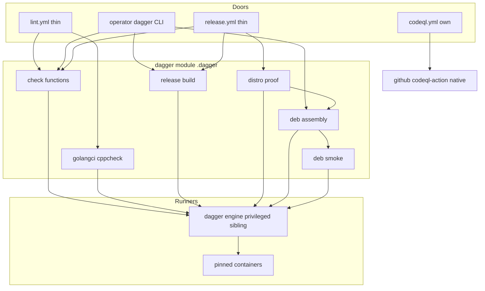
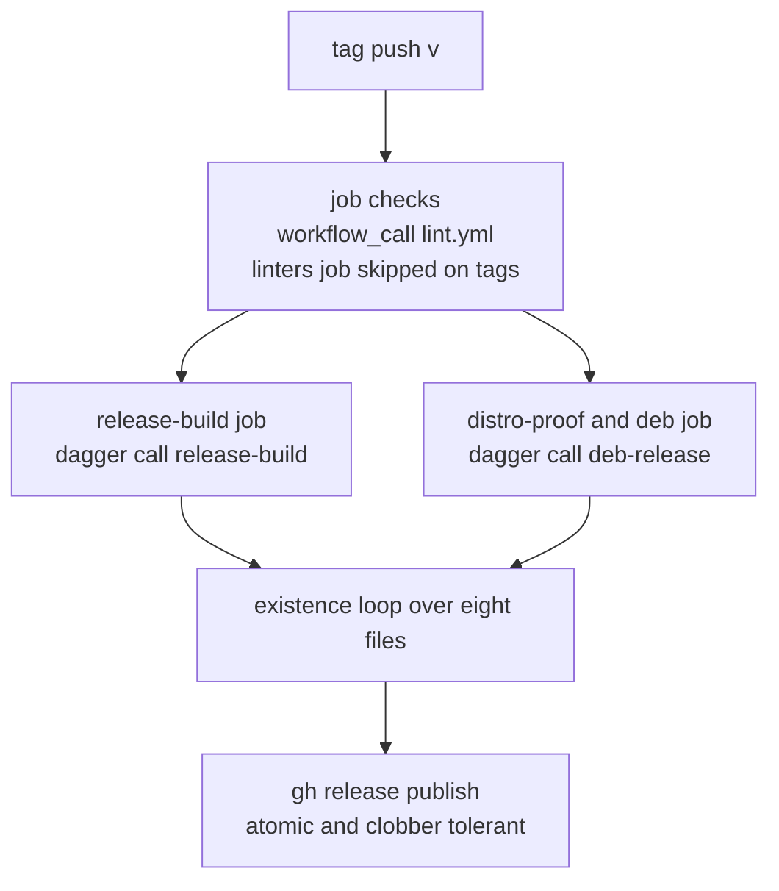
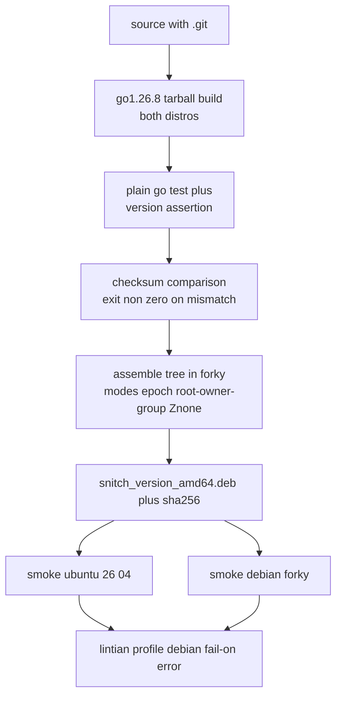

# Design Document — ci-debs

## Overview

**Purpose**: This feature moves the entire pipeline into one Dagger module so CI and the operator's terminal
run the same functions with the same passing criteria; it adds a golangci-lint + cppcheck linter layer and
GitHub CodeQL security-extended dataflow scanning; and it adds one distro-agnostic
`snitch_<version>_amd64.deb` package, built and byte-proven inside Ubuntu 26.04 and Debian Forky containers,
smoke-tested in each, and appended to the release without renaming or touching the six pinned assets.

**Users**: the repository owner (CI author and release publisher), the operator (runs the same pipeline
functions locally over the workstation's container runtime, reproduces release artifacts), and the
administrator of an Ubuntu/Debian host who installs snitch from a package instead of hand-copying assets.

**Impact**: `.github/workflows/lint.yml` and `release.yml` become thin dispatchers; a new CodeQL workflow runs
alongside; the release gains two artifacts (deb + sha256). Daemon, tray, units and deployment flows are
untouched: the deb ships the existing binaries and unit files at the paths their frozen contracts already name.

### Goals
- One pipeline, two doors (R1): module functions are the only place check logic lives; workflows and the
  operator's `dagger call` invoke identical functions.
- Broader static analysis pass-today (R2) and dataflow scanning that surfaces findings for review (R3).
- One honestly proven, reproducible deb (R4, R5, R7), published without disturbing pins (R6).

### Non-Goals
- Enabling or starting snitch on any host: enablement stays the operator's/pyinfra's step (deploy-service contract).
- Shipping the legacy Python-client units (`snitch-trial.*`, `snitch-watch`) or the Python client itself in the deb.
- BPF LSM attach in CI beyond documented limitation assertions (host-global effect; runner kernels do not offer it).
- TUI, fleet features, Nix flake, homebrew, rpm — other specs' territory.
- Renaming `snitch`, `snitchd`, any release asset, or any path a deployed unit or consuming repo pins.

## Boundary Commitments

### This Spec Owns
- The Dagger module: every pipeline check function, the artifact build functions, the deb assembly recipe, the
  distro-proof, the in-container deb smoke, and their tool/image pins (in `.dagger/`, `dagger.json`).
- Thin workflow dispatching: `lint.yml`, `release.yml` job structure and dispatch steps; the `codeql.yml`
  workflow and CodeQL configuration; the release publish step and its asset list (six existing + two new).
- Committed linter and analyzer configuration: `.golangci.yaml`, `bpf/cppcheck-suppressions.txt`, and the
  committed cppcheck invocation; the lintian threshold and shipped lintian overrides.
- The deb: its metadata (`packaging/control`, `conffiles`, `lintian-overrides`), assembled payload (binaries,
  the two deploy-service units, the desktop entry, the license/copyright, changelog, md5sums, sample rules
  conffile), its reproducibility properties, and its sha256 checksum file.
- The feature's documentation `docs/ci-debs.md`: coverage limitations, findings-review expectation, packaging
  semantics, smoke limitation states, below-threshold lintian tags, adjacency records, local reproduction.
- Assertions only this spec defines: "expected state" of shipped units inside headless CI containers.

### Out of Boundary
- `/etc/snitch` content on deployed hosts: owned by the deploy-service pyinfra flow and the operator
  (`scripts/setup.sh` owns the operator file). The deb ships a conffile sample and never author-destroys.
- Unit file semantics, `ExecStart` paths, enable/disable and ordering contracts: owned by deploy-service;
  this spec ships the units unchanged and copies bytes.
- The VM repository's pins (tag + sha256 of `snitchd`) and any consuming pin checker: consumers update pins
  deliberately; this spec's publish step produces stable names and byte-stable construction.
- Daemon/tray behavior and the kernel-side trial state machine: no binary behavior changes in this spec.
- CodeQL finding triage records: findings live in code scanning for human review, not in this repo.
- golangci-lint/cppcheck finding fixes to daemon/tray code are *adjacent edits this spec may require to pass*
  (R2 acceptance); anything beyond zero-findings triage (refactors, features) is out of scope.

### Allowed Dependencies
- Dagger engine v0.21.x (GitHub-hosted docker in CI; locally verified over the workstation's podman —
  rootless podman 5.7.0 boots engine v0.21.12 in practice, while upstream still documents rootful
  podman/docker as the supported path — both facts recorded in `docs/ci-debs.md`).
- Public container images pinned once in `.dagger/pins.go`: `ubuntu:26.04`, `debian:forky`, `golang:1.26.8`,
  `golangci/golangci-lint` (digest-pinned), `koalaman/shellcheck` (tag-pinned), an uv-providing image
  (tag-pinned), forky apt for `cppcheck=2.22.0-1` + `libbpf-dev` (exact-version pins).
- The go.dev-distributed `go1.26.8.linux-amd64.tar.gz` (sha256-pinned) for distro build containers.
- GitHub Actions: existing checkout/setup-go versions (unchanged), `github/codeql-action@v4`,
  `dagger/dagger-for-github@v8.4.1` with `version: "0.21.12"`, the `gh` CLI for publication (as today).
- Repository inputs consumed read-only: `systemd/snitchd.service`, `systemd/snitchd-trial-boot.service`,
  `desktop/snitch-tray.desktop`, `examples/rules.toml`, `LICENSE`, `tools/caps` + `scripts/caps.sh`,
  `scripts/tray-check.sh` (small `--bin/--fake` flags added), `tools/fakedaemon`.
- go.mod of the application stays untouched; the module's `go.mod` imports only the Dagger SDK.

### Revalidation Triggers
- Any change to `ExecStart` paths or unit names (deploy-service coupling, deb payload, smoke asserts).
- Any rename of a release asset (VM repo and `tui` pins re-check; publish step's frozen list).
- `go.mod` version floor changes → toolchain pins, golangci image choice, CodeQL Go support.
- Dagger major/minor bumps (CLI/action contract), codeql-action major bumps (workflow syntax).
- New helper-include usage in `bpf/*.c` (cppcheck recipe), libbpf-dev version changes.
- Any future apt/dpkg policy change affecting the committed deb recipe or lintian threshold.

## Architecture

### Existing Architecture Analysis
- CI today: four parallel jobs in `lint.yml` (ruff via pinned `uvx ruff@0.16.10`; go build+vet×3 (`root`,`live`)
  +test+caps via runner-setup Go; shellcheck; actionlint) called by `release.yml` as a reusable workflow;
  `release.yml` builds two static binaries with `CGO_ENABLED=0 GOOS=linux GOARCH=amd64 go build -trimpath
  -ldflags "-s -w -X main.version=${GITHUB_REF_NAME}"`, asserts `-version`, writes bare-filename sha256 files,
  and publishes six assets atomically (existence loop + `gh release upload --clobber`/`create`).
- Ownership seams respected: VM repo deploys binary + units + operator file via pyinfra; `/etc/snitch` and its
  rules are the deployment's; the daemon tolerates a missing rules file at startup (starts with no rules);
  `snitchd check -rules` validates a file without root or kernel objects; the full daemon cannot attach BPF
  LSM inside CI containers (kernel is host-global and GHA runners exclude `bpf` from the LSM list — official).
- Constraints carried over: CI never runs clang (bpf2go artifacts committed); no cgo; all lint tool versions are
  pinned; the repo root `snitch` name belongs to the Python client.

### Architecture Pattern & Boundary Map
**Selected pattern**: pipelines-as-code behind a single module facade ("one pipeline, two doors"). All state
transitions live in containerized functions; the workflow layer and the operator's CLI are two equivalent
dispatchers over the same functions. The packaging pipeline is a deterministic data-flow: sources → pinned
toolchain builds (per distro) → checksum proof → single deb assembly → per-distro smoke → atomic publish.



**Key decisions** (evidence in `research.md`):
- `dagger/dagger-for-github@v8.4.1` + CLI `0.21.12` (stable v0.21.x; 1.0-beta deliberately not adopted). The
  action's `verb: call` with pinned `version:` is the only runner-side machinery; engine boot is per-job and
  ephemeral (accepted cost).
- Per-check functions mirror today's four lint jobs; the new linter layer is a fifth job **skipped on
  `refs/tags/v*`** so releases are gated only on the existing checks (6.2). Composites `lint-core` and
  `lint-all` exist for dispatch economy and local ergonomics, not as separate logic.
- CodeQL stays a native workflow (never inside Dagger, never in the release chain): its managed dataflow
  engine and failure semantics are exactly the ones 3.1–3.4 describe — infra/extraction errors fail the job,
  findings surface for review.
- The deb is hand-rolled `dpkg-deb` (no debhelper/fpm): the tree is assembled with explicit modes, touched to
  the epoch, `--root-owner-group --uniform-compression -Znone`, `SOURCE_DATE_EPOCH` = HEAD commit time — the
  byte-identical recipe verified locally in both distros. Binaries are built in **both** distro containers from
  the sha-pinned go1.26.8 tarball (`GOTOOLCHAIN=local`) and checksum-compared (5.1); the deb is assembled
  **once, in debian:forky** (dpkg-deb 1.23.11 = the pinned reproducibility property, 7.2).
- Byte-parity with today's assets (6.1): same toolchain version, same flags, and the **VCS stamp preserved**
  (build source includes `.git`; the build function asserts a clean tree and that `version` matches the tag on
  HEAD so the stamp is deterministic locally too).

**Steering compliance**: committed generated code (module bindings) like `internal/bpf`; checks remain
containerized with pinned tool versions; delegates-over-interfaces not applicable (no app-code change);
fail-safe untouched (nothing here can deny traffic; the smoke never attaches host-global BPF).

### Technology Stack

| Layer | Choice / Version | Role in Feature | Notes |
|-------|------------------|-----------------|-------|
| Pipeline engine | Dagger v0.21.12 (Go SDK, action v8.4.1) | all checks, builds, deb, smoke | rootful runtime required locally |
| Go toolchain (builds) | go1.26.8 tarball, sha256-pinned | distro builds, release binaries | = go.mod floor; GOTOOLCHAIN=local |
| Go toolchain (checks) | golang:1.26.8 image | fmt/vet/test/caps container | same version as builds |
| Linter (Go) | golangci-lint v2.15.0 (image digest-pinned) | 2.1 layer | `.golangci.yaml` v2 |
| Linter (C) | cppcheck 2.22.0-1 (forky apt, pinned) | 2.2 layer over bpf/*.c | + libbpf-dev pinned |
| Static analysis | github/codeql-action@v4 | 3.1–3.4 | security-extended; matrix |
| Deb tooling | dpkg-deb 1.23.x (base images) | 4.x packaging | recipe per 5.1/7.2 |
| Policy check | lintian 2.144/2.129 + `--profile debian` | 5.4 threshold=error | both distros |
| Init in smoke | systemd (per-distro apt) + policy-rc.d | 5.3 unit asserts | docker/podman recipes |
| Publication | gh CLI (runner step) | 6.1 atomic 8 assets | as today, extended |

## File Structure Plan

### Directory Structure
```
dagger.json                    # NEW: module manifest (sdk go, source .dagger)
.dagger/                       # NEW: Go SDK module (own go.mod; imports dagger.io/dagger only)
  main.go                       # module entry: the pipeline facade struct
  checks.go                     # existing checks: fmt, go checks, shellcheck, ruff, actionlint
  linters.go                    # golangci, cppcheck (committed recipes)
  composites.go                 # lint-core, lint-all (aggregation only)
  build.go                      # release-build, distro-build, checksum proof
  deb.go                        # deterministic tree assembly + dpkg-deb
  smoke.go                      # per-distro install + systemd + lintian + tray smoke
  pins.go                       # single registry of image/tool/version pins
  dagger.gen.go                 # generated bindings (committed, like internal/bpf)
  go.mod / go.sum               # module deps (Dagger SDK only)
.github/
  codeql-config.yml             # NEW: minimal paths config
  workflows/
    codeql.yml                  # NEW: matrix scan (go, c-cpp, python)
    lint.yml                    # MODIFIED: thin dispatch + new linters job
    release.yml                 # MODIFIED: dispatch jobs + 8-asset publish
.golangci.yaml                  # NEW: committed Go lint config (R2)
bpf/
  cppcheck-suppressions.txt     # NEW: committed, commented suppressions (R2)
packaging/
  control                       # NEW: control fields (Version injected at build)
  conffiles                     # NEW: /etc/snitch/rules.toml
  lintian-overrides             # NEW: → /usr/share/lintian/overrides/snitch
docs/
  ci-debs.md                    # NEW: limitations, expectations, adjacency, local repro
.gitignore                      # MODIFIED: add /dist/ (artifact export target)
```

### Modified Files
- `.github/workflows/lint.yml` — job bodies reduced to one dispatch step each (+ new `linters` job with
  `if: ${{ !startsWith(github.ref, 'refs/tags/v') }}`); triggers and `workflow_call` contract unchanged.
- `.github/workflows/release.yml` — build steps become dispatches (`release-build` job, `distro-proof+deb+smoke`
  job); publish step extended from six to eight assets (existence loop + atomic `gh` publish, unchanged pattern).
- `scripts/tray-check.sh` — small additive `--bin`/`--fake` flags so the installed `/usr/bin/snitch` can be
  exercised against a pipeline-provided fakedaemon (harness and asserts unchanged).
- `.gitignore` — add `/dist/`.

### Unchanged Repository Inputs (bytes shipped, not modified)
- `systemd/snitchd.service`, `systemd/snitchd-trial-boot.service` (payload of the deb)
- `desktop/snitch-tray.desktop` (payload of the deb)
- `examples/rules.toml` (source of the shipped sample conffile; adjusted only if `snitchd check` demands)
- `LICENSE` (→ `/usr/share/doc/snitch/copyright`), `tools/caps`, `scripts/caps.sh`, `tools/fakedaemon`
- application go.mod, go.sum, all `cmd/` and `internal/` code (except zero-findings triage edits per R2 acceptance)

## System Flows

### Release chain (tag push → eight assets or nothing)

- `checks` remains the reusable lint.yml call (existing contract; 6.2). `release-build` and `deb-release` are
  sibling jobs gated only by `checks` (6.2: construction of existing assets picks up no new-phase dependency).
- The single publish job needs both artifact sets, asserts all eight exist, then publishes in one step
  (6.3, all-or-nothing as today). A failed distro/deb/smoke phase means nothing is published at all.
- `snitch` and `snitch-trial` are published from the checkout as today; the deb and its sha256 are exported by
  the deb job into the workspace, forming the 7th and 8th publish inputs.

### Distro proof and deb smoke (per distro, inside the pipeline)

- Each smoke: install deb over a pre-authored `/etc/snitch/rules.toml` (assert: preserved + `.dpkg-new`
  parked), `systemd-analyze verify` both units, `systemctl start snitchd-trial-boot.service` → assert
  `Result=success`, `systemctl start snitchd.service` → assert journal carries the BPF limitation signature and
  no missing-file error, `snitchd check -rules /etc/snitch/rules.toml` → 0, `snitch -version` from PATH,
  tray-vs-fakedaemon headless exercise on a private session bus (5.3's "as far as a headless container
  allows"), lintian (5.4).

## Requirements Traceability

| Requirement | Summary | Components | Interfaces | Flows |
|-------------|---------|------------|------------|-------|
| 1.1 | CI invokes pipeline as Dagger modules; workflows only dispatch | workflows (lint.yml/release.yml), module functions | dispatch contracts (thin steps) | release chain |
| 1.2 | Local runs of the same functions have the same passing criteria | module functions, `dagger call` | function signatures (source defaults + pinned toolchain) | — |
| 1.3 | Non-zero exit + named failing check; pass names each check | check functions | banner + exit contracts | — |
| 1.4 | Every existing check still runs and must pass | checks.go (fmt/build/vet×3/test/caps, shellcheck, ruff, actionlint), lint-core composite | per-check function + container contracts | dispatch map |
| 2.1 | golangci-lint with committed config passes with zero findings | linters.go + `.golangci.yaml` | committed config contract | linter flow |
| 2.2 | cppcheck on BPF C with committed config passes at configured strictness | linters.go + `bpf/cppcheck-suppressions.txt` | committed invocation contract | linter flow |
| 2.3 | Config changes are reviewable; pass criterion follows config | `.golangci.yaml`, suppressions, pins.go | repo-diff reviewability | — |
| 2.4 | No host-installed tooling; analyzers in pipeline containers only | module container contracts (Linter) | — | — |
| 3.1 | CodeQL go security-extended completes on push/PR and posts to code scanning | codeql.yml matrix (go) | codeql-action inputs | codeql flow |
| 3.2 | Databases cover go, BPF C, python; limitation recorded where not | codeql.yml (c-cpp none, python none), docs/ci-debs.md | codeql-config.yml | codeql flow |
| 3.3 | Infra/extraction errors fail visibly; findings surface without halting | codeql.yml (no `continue-on-error`, analyze defaults) | failure semantics contract | codeql flow |
| 3.4 | Findings never halt the release; review expectation documented | release chain (codeql not referenced), docs/ci-debs.md | workflow topology | release chain |
| 4.1 | One `snitch_<version>_amd64.deb`, version from release tag | deb.go (assembly + version derivation) | version param contract | distro proof |
| 4.2 | Ships snitchd at `/usr/local/sbin`, tray in PATH dir, desktop entry, units, license | deb.go payload table | package tree contract | assembly flow |
| 4.3 | Leaves operator-authored `/etc/snitch` alone; sample starts fresh install | deb.go conffile mechanism + sample; smoke asserts | conffile contract | smoke flow |
| 4.4 | Units find binaries + sample; `snitch tray` resolves from PATH | deb.go paths + smoke.go asserts | package tree + asserts | smoke flow |
| 4.5 | Metadata declares only what static binaries need | packaging/control contract | control fields (no scripting runtime / libc / DE depends) | — |
| 4.6 | Upgrade semantics preserve authored config (conffiles govern) | packaging/conffiles + dpkg conffile semantics | conffile contract | smoke flow (fresh-vs-authored asserts) |
| 5.1 | Builds in both distro containers; identical checksums or fail | build.go (distro param), checksum comparison | distro-build contract | distro proof |
| 5.2 | Each distro: source build, plain go tests, `-version` answers | build.go assertions | distro-build contract | distro proof |
| 5.3 | Deb installed in each distro; units started and expected state verified; tray exercise; lintian | smoke.go | smoke contract (assert list) | smoke flow |
| 5.4 | Lintian above committed threshold fails; below recorded in docs | smoke.go (lintian invocation + threshold), docs/ci-debs.md | committed threshold + overrides | smoke flow |
| 5.5 | That deb is the single published deb | deb-release job → publish | artifact handoff | release chain |
| 6.1 | Publishes exactly the six existing assets (identical-result steps) + two new | release-build job (byte-parity flags), publish step | build contract (VCS stamp + clean-tree asserts) | release chain |
| 6.2 | Existing assets not gated on new linter/CodeQL/distro (existing lint contract stays); phases chain so nothing publishes on earlier failure | lint.yml tag-skip + release.yml topology + publish needs | job graph contract | release chain |
| 6.3 | Publication all-or-nothing, never half-way | publish step (8-file existence loop, single gh step) | publish contract | release chain |
| 6.4 | Adjacency recorded in feature documentation | docs/ci-debs.md | documentation duty | — |
| 7.1 | Local release functions reproduce CI binary checksums for same commit | build.go (pinned toolchain + stamp asserts), docs | local run contract | distro proof |
| 7.2 | Local deb checksum matches CI or reproducibility properties pinned | deb.go recipe (SDE=commit time, forky builder, -Znone), docs | pinned properties contract | distro proof |
| 7.3 | Operator needs only runtime + Dagger CLI + checkout | module (self-contained containers), docs/ci-debs.md | prerequisites contract | — |

## Components and Interfaces

### Summary

| Component | Domain/Layer | Intent | Req Coverage | Key Dependencies | Contracts |
|-----------|--------------|--------|--------------|------------------|-----------|
| Check functions | pipeline/checks | run today's checks in containers | 1.1–1.4 | golang image, uv image, shellcheck image | Service |
| Linter functions | pipeline/linters | golangci + cppcheck over repo | 2.1–2.4 | golangci image, forky apt cppcheck | Service |
| Composites | pipeline/dispatch | lint-core / lint-all aggregation | 1.3, 1.4, 6.2 | check + linter functions | Service |
| Release build | pipeline/artifacts | static binaries + sha256s | 6.1, 7.1 | go1.26.8 tarball | Service / Batch |
| Distro build + proof | pipeline/artifacts | per-distro build, tests, checksum compare | 5.1, 5.2 | distro images, go tarball | Service / Batch |
| Deb assembly | packaging | deterministic package tree → deb | 4.1–4.6, 7.2 | dpkg-deb (forky), packaging/ inputs | Service |
| Deb smoke | packaging/verification | install + units + lintian + tray per distro | 4.3, 4.4, 5.3, 5.4 | systemd-in-container recipes, fakedaemon | Service (asserts) |
| Workflows (lint/release/codeql) | dispatch | thin CI wiring + atomic publish | 1.1, 3.1–3.4, 6.1–6.3 | dagger-for-github, codeql-action, gh | Job graph |
| Feature documentation | docs | record limitations, expectations, adjacency | 3.2, 3.4, 4.3, 5.4, 6.4, 7.1–7.3 | — | Document |

### Pipeline facade (module)

#### Check functions (`checks.go`)
| Field | Detail |
|-------|--------|
| Intent | Run each existing check with today's exact commands and tool pins, containerized |
| Requirements | 1.1, 1.2, 1.3, 1.4 |

**Responsibilities & Constraints**
- One function per today's check area: `fmt` (gofmt -l zero-dirty), `go` (build, vet default/`root`/`live`,
  test, caps — today's single-job sequence), `shellcheck` (`snitch-trial scripts/*.sh`), `ruff`
  (`uvx ruff@0.16.10 check --output-format github snitch`), `actionlint` (via `actionlint-py` as today).
- Commands and pins are byte-identical to current lint.yml steps; the containing image changes (runner →
  pinned container), the logic does not.

**Contracts**: Service ✓ / API ☐ / Event ☐ / Batch ☐ / State ☐
##### Service Interface
- `fmt(source *dagger.Directory) error`, `go(source *dagger.Directory) error`, and siblings — every function:
  - **Preconditions**: source is the repository root (default path `/`), including `.git`.
  - **Postconditions**: exit 0 ⟺ its check passed; the check's banner line is printed to stdout
    (`check <name>: PASS`), and on failure the failing check is named in output before the non-zero exit.
  - **Invariants**: no host state mutation beyond the engine's caches; no result drift between doors (1.2).
  - Errors: a check's tool failure propagates as the invocation's non-zero exit and names the check (1.3).

**Implementation Notes**
- Integration: golang-class container mounts source, runs the command sequence; caps runs `tools/caps` via
  the pinned toolchain (gocyclo@v0.6.0) as `scripts/caps.sh` does today.
- Validation: each function is verified by running it against the repository (pass) and against a seeded
  failure (its banner + non-zero exit).
- Risks: image-level `go` version vs go.mod floor — pinned `golang:1.26.8` matches the build toolchain.

#### Linter functions (`linters.go`)
| Field | Detail |
|-------|--------|
| Intent | The R2 layer: golangci-lint over Go packages; cppcheck over `bpf/*.c` |
| Requirements | 2.1, 2.2, 2.3, 2.4 |

**Responsibilities & Constraints**
- `golangci(source)`: image with v2.15.0 (digest-pinned), repo-mounted, `.golangci.yaml` committed at root;
  standard set + copyloopvar + misspell; generated bindings excluded (regex + their `DO NOT EDIT` headers);
  explicit timeout; zero findings = pass, any finding = fail (exit 1).
- `cppcheck(source)`: debian:forky container with apt-pinned `cppcheck=2.22.0-1` + `libbpf-dev`; invocation:
  `--std=c11 --platform=unix64 --check-level=normal --enable=warning,style,performance,portability
  --inline-suppr --error-exitcode=1`, include paths `-I bpf -I /usr/include`, the four
  `-D__has_*(x)=0` predefines, both `bpf/snitch.bpf.c` and `bpf/dns.bpf.c`; suppressions from
  `bpf/cppcheck-suppressions.txt` (opens with `*:bpf/vmlinux.h`, libbpf helper shim, per-idiom entries with
  written reasons).
- Finding triage policy (2.3): real defect → fix code; BPF-idiom mismatch → commented suppression; third-party
  header noise → file-scoped suppression. Loosening anything is a reviewable diff to a committed file.

**Contracts**: Service ✓
##### Service Interface
- Preconditions as above; postcondition: zero unsuppressed findings ⟺ pass; banner + exit contract as 1.3.
- Invariant: the invocation and configuration live in the repository (nothing implicit on the host) (2.4).

#### Composites (`composites.go`)
- `lint-core` = fmt + go + shellcheck + ruff + actionlint (dispatch economy for release tags and quick local
  runs); `lint-all` = lint-core + linters. Aggregation only: no aggregation-owned thresholds or logic; each
  constituent's banner/exit contract composes (failing check named by that constituent).
- 1.1–1.4, 2.x, 6.2 (dispatch topology).

#### Release build (`build.go`)
| Field | Detail |
|-------|--------|
| Intent | The byte-true static asset build (today's flags), reproducible anywhere |
| Requirements | 1.2, 6.1, 7.1 |

**Responsibilities & Constraints**
- `release-build(source, version string) *dagger.Directory`: builds `snitchd` and the tray binary with
  today's exact flags (`CGO_ENABLED=0 GOOS=linux GOARCH=amd64 go build -trimpath -ldflags "-s -w
  -X main.version=<version>"`), asserts each `-version` equals the version param, writes bare-filename
  sha256 files, exports everything under `dist/`.
- Determinism guards: source includes `.git`; asserts clean tree (`git status --porcelain` empty) and that
  `version` equals the tag on HEAD; preserved `-buildvcs` stamping keeps bytes equal to today's construction.

**Contracts**: Service ✓ / Batch ✓
##### Service / Batch
- Trigger: dispatch by release.yml (version `${GITHUB_REF_NAME}`) or locally (`--version=<tag>`).
- Output: directory artifact set (`snitchd`, `snitchd.sha256`, `snitch-linux-amd64`,
  `snitch-linux-amd64.sha256`).
- Idempotency: same commit + same version ⟹ identical bytes (7.1); assertion failures fail loudly.
- Validation hooks: `-version` assertions (as today) inside the pipeline; checksum identity is the release
  job's assertion, cross-checked against local docs procedure.

#### Distro build and proof (`build.go`)
- `distro-build(source, distro enum[ubuntu-26.04, debian-forky], version) *dagger.Directory` + report string:
  from the distro image, install the sha-pinned go1.26.8 tarball (`GOTOOLCHAIN=local`), run plain
  `go test ./...`, build both binaries with release flags, assert `-version` — 5.1, 5.2.
- `distro-proof(...)`: runs distro-build in both distros, compares the artifacts' sha256 lists, exits non-zero
  naming first mismatch (5.1). Committed pin: dpkg-deb builder = debian:forky (7.2 property: SDE=HEAD commit
  time, `-Znone`, `--root-owner-group`, exact modes/touches; build the deb once from the proven binaries).
- Validation: the proof *is* the executable test; local invocation re-verifies (7.1/7.2).

#### Deb assembly (`deb.go`) and packaging inputs
| Field | Detail |
|-------|--------|
| Intent | One deterministic, distro-agnostic package |
| Requirements | 4.1–4.6, 5.1, 6.1, 7.2 |

**Responsibilities & Constraints**
- Payload contract (all under the package root; units and desktop entry shipped byte-identical to repo files):

| Path in package | Source | Mode | Notes |
|---|---|---|---|
| `/usr/local/sbin/snitchd` | built snitchd | 0755 | frozen unit contract |
| `/usr/bin/snitch` | built tray binary | 0755 | PATH for `snitch tray` (4.4), desktop entry `Exec` |
| `/usr/lib/systemd/system/snitchd.service` | repo unit | 0644 | unpacked, never enabled |
| `/usr/lib/systemd/system/snitchd-trial-boot.service` | repo unit | 0644 | unpacked, never enabled |
| `/usr/share/applications/snitch-tray.desktop` | repo desktop file | 0644 | 4.2 |
| `/etc/snitch/rules.toml` | sample (examples/rules.toml, tuned if needed) | 0644 | declared conffile (4.3, 4.6) |
| `/usr/share/doc/snitch/copyright` | LICENSE | 0644 | 4.2 |
| `/usr/share/doc/snitch/changelog.Debian.gz` | generated (version + SDE date) | 0644 | `gzip -9n` |
| `/usr/share/lintian/overrides/snitch` | packaging/lintian-overrides | 0644 | justified deviations only |
| `DEBIAN/control` | packaging/control + version | 0644 | 4.5: no Depends beyond static needs |
| `DEBIAN/conffiles` | packaging/conffiles | 0644 | lists `/etc/snitch/rules.toml` |
| `DEBIAN/md5sums` | generated | 0644 | shipped files, canonical order |

- Control fields: `Package: snitch`, `Version: <tag without v>`, `Architecture: amd64`, `Maintainer: <repo
  author identity>`, `Homepage: <repo url>`, `Section: net`, `Priority: optional`, `Installed-Size: <computed>`,
  `Description:` (synopsis + long). No dependency on scripting runtimes, C libraries, or desktop environments
  (4.5 — static binaries, D-Bus provided by the session at runtime, never Depends).
- Version derivation (4.1): version = release tag with the leading `v` stripped (`v0.4.0` → `0.4.0`);
  asset name `snitch_0.4.0_amd64.deb` + its bare-filename `.sha256`.
- Reproducibility properties (5.1/7.2, all source-verified locally): `SOURCE_DATE_EPOCH = git log -1
  --pretty=%ct` of HEAD; explicit `install -m` modes under `umask 022`; exact `touch -h -d @$SDE` over the
  tree; `dpkg-deb --root-owner-group --uniform-compression -Znone`; assembly in debian:forky (dpkg-deb
  1.23.11). Below-threshold lintian tags and these properties are recorded in `docs/ci-debs.md`.

**Contracts**: Service ✓ / Batch ✓
- Precondition: distro-proof passed (same binaries); inputs are the repo files as listed above.
- Postcondition: artifact `snitch_<version>_amd64.deb` + `.sha256` exported; recipe deterministic.
- Idempotency & recovery: rebuild in a clean forky container reproduces the exact sha256 (7.2); any
  nondeterminism surfaces as the proof's mismatch failure (5.1 applies to the deb too via local re-run docs).

#### Deb smoke (`smoke.go`)
| Field | Detail |
|-------|--------|
| Intent | Prove the package *on* each distro: install, units, config, tray, policy |
| Requirements | 4.3, 4.4, 5.3, 5.4 |

**Responsibilities & Constraints**
- Smoke container recipe: systemd + dbus + policy-rc.d → init as PID 1 (docker flags per research; local
  podman note in docs); then assertions, all named and individually reported in the summary:
  1. `dpkg -i --force-confdef --force-confold` over a **pre-authored rules.toml** ⟹ authored content
     preserved, maintainer sample parked (4.3; asserts the mechanism directly).
  2. `dpkg -i <deb>` on a fresh container ⟹ success (no deps, units unpacked, sample in place).
  3. `systemd-analyze verify` on both shipped units ⟹ no unit errors.
  4. `systemctl start snitchd-trial-boot.service` ⟹ `Result=success`, `ExecMainStatus=0` (oneshot fully runs:
     no kernel objects needed; the daemon `end -at-boot` path).
  5. `systemctl start snitchd.service` ⟹ journal contains the daemon's BPF-limitation startup failure
     (pin-dir/load/attach) and contains **no** missing-binary/missing-config error — the defined expected state
     of a headless container without BPF LSM (5.3; environment-limitation recorded in docs).
  6. `snitchd check -rules /etc/snitch/rules.toml` ⟹ exit 0 (shipped sample parses; 4.3's fresh-install start
     condition proven as far as headless).
  7. `snitch -version` resolves from PATH and answers the version (4.4, 5.3).
  8. Tray phase: with a pipeline-built fakedaemon on a private socket and `dbus-run-session`, the installed
     tray registers its item, presents initial state, and exits cleanly under SIGTERM (tray-check pattern with
     `--bin`/`--fake`; "as far as a headless container allows").
  9. Lintian (both distros): `lintian --profile debian --display-info --show-overrides --color never --fail-on
     error <deb>` ⟹ exit 0 required (5.4 threshold); warnings/info emitted to the log and listed in
     `docs/ci-debs.md` (below-threshold record).
- The smoke never attaches BPF LSM (host-global effect; impossible on GHA runners regardless — official).

**Contracts**: Service ✓ (assert list)
- Preconditions: deb artifact + built fakedaemon passed in; systemd-capable container recipe pinned.
- Postconditions: all 9 assertion groups pass or the invocation exits non-zero naming the failing group.
- Invariants: assertion 1 and 2 both use the same deb as published (5.5).

#### Workflows
- `lint.yml` (1.1, 1.4, 6.2): today's four jobs, each a single `dagger/dagger-for-github@v8.4.1` dispatch
  (`verb: call`, `call: <function>`, `version: "0.21.12"`), plus the new `linters` job with the tag-skip
  condition; triggers/reusable-call contract unchanged.
- `release.yml` (6.1–6.3): `checks` (workflow_call) → `release-build` and `deb-release` (parallel dispatches)
  → `publish` (needs both; contents:write only; existence loop over the eight files; single `gh release
  upload --clobber` / `create --verify-tag --generate-notes` as today).
- `codeql.yml` (3.1–3.4): matrix `go|c-cpp|python`, `fail-fast: false`; go: `setup-go` from go.mod then
  `build-mode: manual` + `go build ./...`; c-cpp and python: `build-mode: none`; `queries:
  security-extended`; per-language `category: /language:<lang>`; triggers push(main)/PR/weekly; token
  permissions minimal; no `continue-on-error`; not referenced by the release chain.
- `.github/codeql-config.yml`: `paths-ignore` for non-source trees (`.kiro`, `docs`, bundled images,
  `.dagger` — pipeline code whose build is outside the traced Go module; documented).

#### Feature documentation (`docs/ci-debs.md`)
Single file recording (the R-duties): CodeQL coverage limitation for the extension-less client (shebang regex,
not extracted; ruff keeps covering it) and the none-mode macro-accuracy caveat (3.2); the findings-review
expectation (3.4); deb semantics (sample conffile, upgrade behavior, what is never shipped: operator file,
enablement) (4.3, 4.6); smoke expected states and the BPF-LSM limitation (5.3); lintian threshold + the
below-threshold tag list (expected: man-page, hardening on static binaries) (5.4); the adjacency records:
pyinfra owns `/etc/snitch` and deployed rules + deploy-service deploys/imperative-enables units,
`scripts/setup.sh` owns the operator file, the VM repo pins tag+sha256 of the `snitchd` asset and holds unit
copies (6.4); local reproduction instructions incl. the rootful-runtime requirement, Dagger CLI install, the
command set, and the pinned reproducibility properties (7.2, 7.3).

## Data Models

### Artifact sets (the release contract)
- Six existing assets (frozen names): `snitchd`, `snitchd.sha256`, `snitch` (Python client, from checkout),
  `snitch-trial` (from checkout), `snitch-linux-amd64`, `snitch-linux-amd64.sha256`.
- Two new: `snitch_<version>_amd64.deb`, `snitch_<version>_amd64.deb.sha256` (bare-filename form).
- sha256 files: produced by `sha256sum <name> > <name>.sha256` in the containing directory (checksum-verify
  compatible, unchanged form).

### Package tree (assembly model)
- Exactly the payload table under Deb assembly; `DEBIAN/` as listed. Directory mtimes are normalized to the
  SDE; all modes explicit; ordering and ar headers handled by dpkg-deb's deterministic build.

### Deterministic properties (pinned, documented)
| Property | Value | Rationale |
|---|---|---|
| SOURCE_DATE_EPOCH | HEAD commit time | same in both doors for the same commit |
| compression | `-Znone` | liblzma 5.8.3/5.8.4 skew across distros removed |
| owners | `--root-owner-group` | builder uid/gid must not leak |
| modes | explicit `install -m` + `umask 022` | dpkg-deb does not normalize modes |
| mtimes | exact `touch -h -d @SDE` | SDE clamps, does not set |
| builder | debian:forky (dpkg-deb 1.23.11) | the pinned property recorded for 7.2 |
| toolchain | go1.26.8 tarball, sha-pinned | distro apt toolchains diverge (1.26 vs 1.27) |
| VCS stamp | preserved (`-buildvcs` default) + clean-tree and tag asserts | 6.1 byte-parity with today's assets |

## Error Handling

**Error strategy**: every phase fails fast with a named check/phase in its banner and a non-zero exit
(1.3-shaped everywhere); the workflow chain then publishes nothing (6.3). Infrastructure errors (engine boot,
image pull, apt, network) surface as the invocation's failure — never retried into false passes. CodeQL is the
only review-not-gate lane (3.3, 3.4): infra/extraction errors fail its job; findings only post alerts.

**Categorized failures**:
- Check failures (1.4, 2.1, 2.2): exited non-zero by the owning tool; the composites name the constituent.
- Build/proof mismatches (5.1): checksum mismatch names the differing artifact and both hashes; exit non-zero.
- Smoke assert failures (5.3, 5.4): the failing assertion group is named (of the 9); lintian exit = above-
  threshold findings (5.4).
- Determinism asserts (6.1, 7.1): dirty tree, untagged HEAD, or version/HEAD mismatch → named failure before
  any build runs.
- Publish (6.1, 6.3): any of the eight files missing → the existence loop fails before `gh` runs; reader-side
  pins therefore never observe a partial state.

## Testing Strategy

- **Unit-scale (pipeline)**: each check function's banner/exit contract verified against pass and seeded-fail
  inputs (implementation-phase matrix; "seeded fail" = a purpose-built bad fixture run once per function).
- **Integration**: the linter layer run against the real tree — triage outcome is itself the acceptance
  evidence for 2.1/2.2 (zero findings with committed configs).
- **E2E-1 (release parity)**: after implementation, on a throwaway tag or local `--version`: `release-build`
  artifacts byte-equal the old workflow's artifacts for the same commit (sha256 compare; 6.1, 7.1).
- **E2E-2 (distro proof)**: `distro-proof` green on both distros; deb sha256 reproduced by a second, clean
  local invocation (7.2).
- **E2E-3 (smoke)**: the 9 assertion groups green on both distros; the conffile-keep assertion (group 1)
  executed against a pre-authored fixture file (4.3).
- **Publish rehearsal**: on the implementation branch, a dry invocation of the publish loop logic against a
  fake artifact directory (no `gh` call) — asserting only path/name plumbing.
- **Manual verification (7.x door)**: documented operator run of lint->build->deb locally on the workstation
  (rootful podman socket or docker), recording hash parity vs CI in the implementation notes.

## Security Considerations

- Credential boundary: the `GH_TOKEN` stays in the publish job; pipeline functions receive no secrets (no
  engine-held credentials, no cloud).
- CodeQL permissions minimized (`security-events: write` + reads only); public repo — free tier, no runner cost.
- Lintian overrides are security-relevant review records: each override line carries a written justification;
  the threshold `--fail-on error` stays committed.
- The deb ships root-owned, non-enabled units and no maintainer scripts (postinst/prerm absent by design);
  conffile handling is dpkg's, not scripts.
- The tray smoke exercises the installed binary only against a loopback private session bus and private socket.

## Supporting References
- Evidence, probes, and decision IDs: `research.md` (same directory; the seven named Decision blocks).
- Workflow skeletons discussed were verified against (official) docs current as of 2026-11-24. In particular:
  `dagger check`/action inputs, codeql-action failure semantics, `build-mode: none` GA, dpkg `SOURCE_DATE_EPOCH`
  semantics, and the runner kernel BPF LSM limitation (actions/runner-images#14783).
- Local hands-on probe evidence summarized in research.md (both distros, session 2026-11-24).
