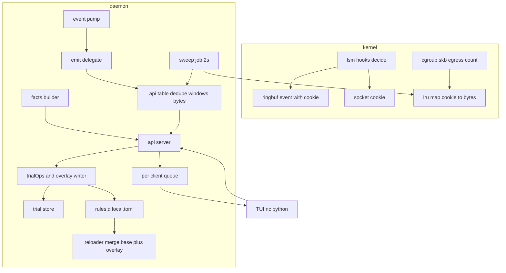
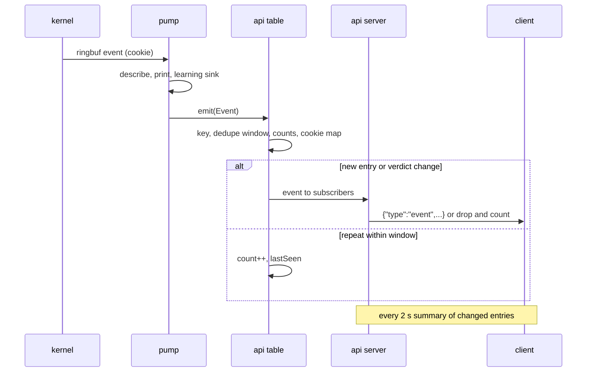
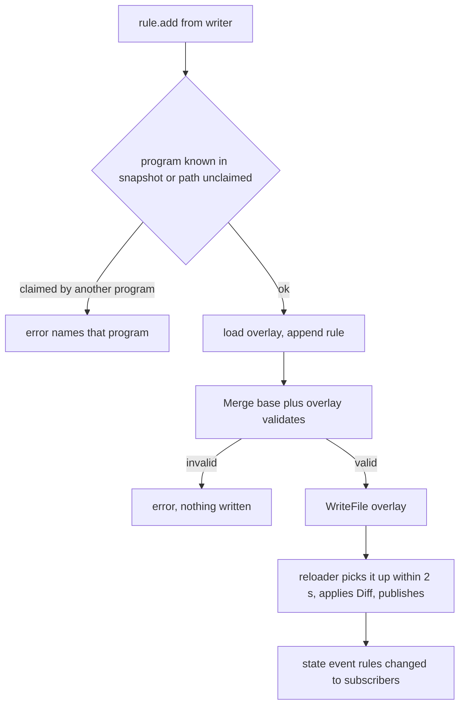

# Technical Design: daemon-api

## Overview

**Purpose**: snitchd gets a local channel the desktop tools read without root and the operator
writes through within the fail-safes: one unix socket speaking one JSON object per line, behind
it a deduplicated event stream, a bounded connection table with per-connection byte counts and
rates, the daemon's facts, the trial verbs and rule edits into a local overlay file.

**Users**: the bubbletea TUI, the popups and the tray (next specs), the operator with `nc -U` or
a few lines of Python today, later the OpenObserve exporter.

**Impact**: a new package `internal/api`; a cookie in the kernel event and a counting program on
the cgroup v2 root (counting only, never a verdict); a second rules file merged with precedence
(`internal/rules` gains `Merge` and `Source`); the trial verbs' decision logic moved behind a seam
both the CLI and the API call; the runtime directory becomes traversable so the socket is
reachable while the status file stays private; an operator file names the desktop user.

### Goals
- A reader connects as any user and receives events within 1 s, a summary every 2 s and a
  snapshot on request; a slow reader loses messages, never the daemon.
- Root and the operator get the trial verbs and rule edits with the verbs' bounds and refusals;
  nothing on the socket writes the kill or control maps, the trial or kept files, or the
  deployed rules file.
- Bytes per connection appear within 5 s of being sent, attributed through the socket cookie;
  the counting program only ever returns "allow".
- A schema document with one example per message, tests without root for the protocol, a proof
  that a blocked client cannot stall the pump, and a verification on the dev VM.

### Non-Goals
- The TUI, popups, tray; a Python-client adapter; domain rules; the process trace beyond pid,
  ppid, comm and path; Velociraptor/OpenObserve export; inbound; bytes received.

## Boundary Commitments

### This Spec Owns
- `internal/api`: the wire types and their JSON names, the codec and line limit, peer-credential
  authorization, per-client queues with drop accounting, the dispatcher, the connection table
  (dedupe, windows, bytes, eviction), the status facts type the API serves.
- The socket's path, mode and lifetime (`/run/snitch/api.sock`, created by the daemon, 0666,
  unlinked on exit), the `-api` and `-overlay` flags, the operator file `/etc/snitch/operator`.
- The cookie field of the kernel event, the `cgroup_skb/egress` counting program, its LRU map,
  the attach and the 2 s sweep that joins cookies to table entries.
- `internal/rules.Merge` and `Source` on programs and rules; the overlay file's lifecycle
  (load, precedence, validation, write by the API with a neutral header).
- The seam `trialOps` that the CLI verbs and the API both call.
- `examples/api.md` (the schema) and `scripts/api-check.sh` (the VM verification).

### Out of Boundary
- The kernel decision, the maps, the heartbeat and staleness (unchanged; the counting program is
  additive and non-deciding).
- The trial decision table, the trial/kept/status file formats (persistent-trial); the verbs'
  CLI behaviour (refactored behind the seam, byte-identical output).
- The rules file format, validator, resolver, encoder, reload cadence (rule-loading); `Merge` is
  a pure function in front of the unchanged pipeline.
- The deployment of the unit change and the operator file (the VM repo's task; recorded as a
  deploy-service revalidation trigger, done as a follow-up commit there).
- Rate limiting of events in the kernel (a `quiet` flag bit is noted for later).

### Allowed Dependencies
- Go: stdlib `net`, `encoding/json`, `bufio`, `os/user`; `golang.org/x/sys/unix`
  (`GetsockoptUcred`, already a dependency); `cilium/ebpf` `link.AttachCgroup`,
  `ebpf.AttachCGroupInetEgress`, `Map.BatchLookup`/`Iterate`. No new module.
- `internal/api` may import `internal/rules`, `internal/trial`, `internal/contract`,
  `internal/jobs`. It must not import `internal/bpf` or anything under `cmd/`: the daemon
  converts the kernel event into `api.Event`.
- Kernel: `bpf_get_socket_cookie(struct sock *)` in LSM programs (5.12+), `cgroup_skb/egress`
  at the cgroup v2 root `/sys/fs/cgroup` (detected from `/proc/mounts`), `SO_PEERCRED`.
- Host paths: `/run/snitch/api.sock`, `/etc/snitch/rules.d/local.toml`, `/etc/snitch/operator`.

### Revalidation Triggers
- A change to the wire types or JSON names (the TUI, popups, tray and exporter specs read them).
- A change to the kernel event layout (`cookie` added here; `decode.go` and the bindings).
- A change to the runtime directory mode or the socket path (deploy-service units and README).
- A change to `Merge`'s precedence or the overlay path (the TUI's `x` and the DNS tap spec).
- A change to the trial seam's refusals or texts (CLI tests and the enforce test grep them).

## Architecture

### Existing Architecture Analysis
- `pump` (events.go) is the only ringbuf reader: decode → describe → print → learning sink. The
  fan-out is a second delegate `d.emit func(api.Event)` called per event; it must return without
  blocking (the API's per-client queues absorb or drop).
- `jobList` (daemon.go) assembles jobs; `daemon.go` is at 268/300 lines, so API wiring lives in
  new files and `jobList` gains one call.
- `state.snapshot{res, ent}` published atomically; `reloader` keeps the previous snapshot on any
  load error; `loadRules(path, notice)` is the single loader. Two paths flow through one merged
  `File`, one `Resolved`, one `Diff`.
- `ctl_verbs.go` (286 lines) mixes CLI parsing, probes (maps), status-record checks and the file
  operations. The file operations and their refusal texts move to `trialops.go`; the CLI keeps
  its probes and parsing.
- `status.writeAtomic` creates `/run/snitch` 0700 when missing; the API listener creates or
  re-modes it 0755 before listening (the status file is 0600 regardless).
- The C `decide()` holds `sock` and `exe`; adding `e->cookie = bpf_get_socket_cookie(BPF_CORE_READ(sock, sk))`
  is one line plus a struct field; bpf2go regenerates with the existing `-type event`.

### Architecture Pattern & Boundary Map



**Architecture Integration**:
- Pattern: a fan-out behind a delegate; one in-memory table as the single source for events'
  dedupe, summaries, snapshots and bytes; request handlers as a verb table (as `ctl.go`), each a
  small function; writes funnel through two seams (`trialOps`, overlay writer) that the CLI
  shares or that validate through the existing loader.
- Boundaries: `internal/api` knows nothing about BPF, files or the daemon; it receives getters
  and delegates. The daemon owns the conversion from kernel event to `api.Event`, the sweep,
  the facts, and the two write seams.
- Preserved: jobs/delegates/contracts shape, caps, one snapshot, the reloader's keep-previous
  rule, the verbs' texts.
- Fail-safes by construction: the API has no handle to the kill or control maps (the server
  receives only getters and the two seams); the counting program's only return is 1; a full
  queue drops, never blocks.

### Technology Stack

| Layer | Choice / Version | Role in Feature | Notes |
|-------|------------------|-----------------|-------|
| Kernel | BPF LSM (existing) + `cgroup_skb/egress`, `bpf_get_socket_cookie`, LRU hash | cookie in events, bytes per socket | counting program returns 1 always |
| Daemon | Go 1.26, cilium/ebpf v0.22 (`link.AttachCgroup`), x/sys/unix (peercred) | API server, table, sweep, writes | no new module |
| Wire | newline-delimited JSON, `type`/`id` envelope, 64 KiB line limit | TUI, nc, python | `examples/api.md` is the contract |
| Files | `/run/snitch/api.sock` 0666 in a 0755 dir; `/etc/snitch/rules.d/local.toml`; `/etc/snitch/operator` | socket, overlay, operator | unit `RuntimeDirectoryMode=0755` |
| Verification | bash + `nc -U` + python3 | `scripts/api-check.sh` | shellcheck in CI |

## File Structure Plan

### Directory Structure
```
bpf/snitch.bpf.c                 # + `__u64 cookie` in event; cookie set in decide(); + SEC("cgroup_skb/egress") count; + map bytes (LRU)
internal/bpf/                    # regenerated (go generate); gen.go + `-type byte_count`
internal/api/
├── types.go                     # NEW wire types: Event, Entry, Summary, Status, RuleView, ProgramView, requests, replies, errors
├── codec.go                     # NEW line reader with limit, encoder; request parsing (type, id, fields)
├── auth.go                      # NEW Role (reader/writer) from Ucred and operator uid; the write-set check
├── client.go                    # NEW per-client queue, writer goroutine, drop counter, write deadline
├── server.go                    # NEW Listener job: accept loop, dispatcher (verb table), subscriptions, state events
├── table.go                     # NEW connection table: key, entry, dedupe, counts, bytes, LRU eviction, snapshot
├── window.go                    # NEW per-entry minute/hour buckets and window queries (15m 30m 1h 24h 7d), rate
├── bytes.go                     # NEW cookie → key join, unknown bucket, sweep input type
└── *_test.go                    # one per file; net.Pipe/unix socket in t.TempDir()
internal/rules/
├── merge.go                     # NEW Merge(base, overlay) with precedence and Source; expandedKeys shared with validate
├── file.go                      # + Source on Program and Rule
├── decode.go                    # + Source = name
├── validate.go                  # expandedKeys extracted; duplicate error names both sources
├── resolve.go                   # conflict error names Source
├── write.go                     # WriteFile gains a header parameter; neutral temp prefix
└── merge_test.go                # NEW
cmd/snitchd/
├── api.go                       # NEW wiring: operator file, listener, getters, emit delegate, state hooks, job
├── apiwrite.go                  # NEW the API's write handlers: trial seam calls, overlay add/remove with pre-checks, audit log
├── counting.go                  # NEW cgroup root detection, attach, sweep job (2 s), cookie join feed
├── trialops.go                  # NEW trialOps: start/keep/unkeep/end on the store with the verbs' texts and refusals
├── ctl_verbs.go                 # calls trialOps; CLI parsing, probes and record checks stay
├── events.go                    # pump calls d.emit(toEvent(e, snap, now)); toEvent lives here or in apievent.go if the cap bites
├── state.go                     # loadRules(base, overlay, notice) via Merge; reloader records lastErr for the facts
├── reload.go                    # watchFile stamps both paths
├── config.go                    # + -api (default /run/snitch/api.sock, "" off), -overlay (default /etc/snitch/rules.d/local.toml); checks
├── daemon.go                    # + emit field, + api job in jobList (minimal lines)
└── *_test.go
systemd/snitchd.service          # RuntimeDirectoryMode=0755 (status file stays 0600)
examples/api.md                  # NEW the schema: every type both directions, one example each, limits
scripts/api-check.sh             # NEW VM verification as the desktop user
README.md                        # API paragraph; Service paragraph: operator file and the directory mode
CLAUDE.md                        # status
```

### Modified Files (summary)
- snitch: C and bindings, `internal/rules` (merge, source, write header), `cmd/snitchd`
  (config, state, reload, events, daemon, ctl_verbs), unit, README, CLAUDE.md.
- VM repo (follow-up commit, not in this spec's tasks): unit copy, `files.put` of
  `/etc/snitch/operator` with the desktop user; recorded in deploy-service as a revalidation.

## System Flows

### An event reaches a subscribed client



Decisions: the pump calls `emit` synchronously; `emit` does a map update under the table's mutex
and hands a message to each subscriber's queue with a non-blocking send; the per-client writer
goroutine serialises JSON off the pump's path. A repeat within the dedupe window (10 s) is not an
event; it shows in the next summary.

### Bytes join the table

```mermaid
sequenceDiagram
    participant L as lsm decide
    participant E as cgroup skb egress
    participant M as lru map
    participant W as sweep job 2s
    participant T as table
    L->>L: cookie = bpf_get_socket_cookie(sk), in event
    E->>M: bytes[cookie] += skb len, pkts++, last_ns
    W->>M: batch lookup
    W->>T: add(cookie, bytes delta)
    T->>T: cookie known: entry.bytesSent += delta, rate; unknown: entry "unknown"
```

### A rule edit from the TUI



### Decision table: role and request

| Request | reader | writer (uid 0 or operator) |
|---|---|---|
| status, rules, programs, learned, snapshot, subscribe, unsubscribe | allowed | allowed |
| trial, keep, unkeep, end | `error: write requires the operator` | `trialOps` with the verbs' refusals, incl. "not following the files" (daemon run with `-mode`) and "zero rules" without `yes` |
| rule.add, rule.remove | same error | overlay flow; deployed rules refused with the file name |
| anything else | `error: unknown type` | same |

## Requirements Traceability

| Requirement | Summary | Components | Interfaces | Flows |
|---|---|---|---|---|
| 1.1 | socket in the runtime dir, any user reads | server.go, api.go, unit | `Listen(path)`, 0755/0666 | |
| 1.2 | gone with the daemon | server.go (`SetUnlinkOnClose`), jobs.Run | | |
| 1.3 | peercred roles | auth.go, api.go (operator file) | `Role(ucred, operator)` | decision table |
| 1.4 | reader write refused, connection kept | server.go dispatcher | error envelope | decision table |
| 1.5 | many clients | server.go, client.go | | |
| 1.6 | bounded backlog, drops counted, stuck client closed, never blocks | client.go | `send` non-blocking, `dropped` field, 5 s deadline | event flow |
| 1.7 | JSON lines, type, id | types.go, codec.go | envelope | |
| 1.8 | bad input errors | codec.go, server.go | error envelope, 64 KiB | |
| 1.9 | `-api` off, soft listen failure | config.go, api.go | | |
| 2.1 | events within 1 s, fields | events.go `toEvent`, types.go Event | | event flow |
| 2.2 | dedupe window | table.go | 10 s | event flow |
| 2.3 | exclude local | server.go subscribe options | `local: bool` | |
| 2.4 | 2 s summary | table.go dirty set, server.go | Summary | |
| 2.5 | snapshot | table.go `Snapshot(window)` | | |
| 2.6 | field names | types.go | names table | |
| 3.1 | table fields | table.go, window.go | Entry | |
| 3.2 | bytes within 5 s | counting.go sweep, bytes.go | | bytes flow |
| 3.3 | counting never decides, soft failure | C `count` returns 1; counting.go attach soft | | |
| 3.4 | unknown bucket | bytes.go | | bytes flow |
| 3.5 | windows | window.go | `Snapshot(window)` | |
| 3.6 | bounded, eviction counted | table.go LRU | Status.evictions | |
| 3.7 | feasibility gate | task 1.1 (C + attach + monitor run) | | |
| 4.1 | status facts | api.go facts, types.go Status | | |
| 4.2 | rules with source | types.go RuleView, rules.Source | | |
| 4.3 | programs | types.go ProgramView | | |
| 4.4 | learned read-only | learn.go `Observations()` projection | | |
| 4.5 | state events | api.go hooks on setMode/publish | State | |
| 4.6 | 100 ms, no root | in-memory | | |
| 5.1 | trial verbs via seam | trialops.go, apiwrite.go | `trialOps` | decision table |
| 5.2-5.3 | overlay add/remove | apiwrite.go, rules.Merge, WriteFile | | rule edit flow |
| 5.4 | overlay precedence, validation, survives deploy | merge.go, state.go, reload.go | | |
| 5.5 | audit line | apiwrite.go | `d.log` | |
| 5.6 | no other writes | server verb table | | decision table |
| 5.7 | write failure | apiwrite.go | error | |
| 6.1 | schema doc | examples/api.md | | |
| 6.2-6.3 | tests, pump never blocked | `*_test.go`, client_test pump test | | |
| 6.4-6.5 | VM verification, commands documented | scripts/api-check.sh, api.md | | |

## Components and Interfaces

| Component | Domain | Intent | Req | Key Dependencies | Contracts |
|---|---|---|---|---|---|
| api.Server | internal/api | accept, authorize, dispatch, subscriptions, state events | 1.x, 2.3-2.5, 4.5 | Table (P0), auth (P0) | Service, Event |
| api.Client queue | internal/api | bounded delivery, drops, deadline | 1.5-1.6 | | State |
| api.Table | internal/api | dedupe, counts, bytes, windows, eviction, snapshot | 2.2, 2.4-2.5, 3.1-3.6 | window.go (P0) | State |
| api types | internal/api | wire shapes | 1.7, 2.1, 2.6, 4.x | | API |
| counting | kernel + cmd/snitchd | cookie, skb count, sweep | 3.2-3.4, 3.7 | cilium/ebpf (P0) | Batch |
| trialOps | cmd/snitchd | the verbs' file operations and texts | 5.1 | internal/trial (P0) | Service |
| overlay | internal/rules + cmd/snitchd | Merge, Source, write, reload | 4.2, 5.2-5.4, 5.7 | rules pipeline (P0) | Service, State |
| facts | cmd/snitchd | Status from memory | 4.1 | | State |
| docs + check | examples, scripts | schema, VM verification | 6.x | nc, python3 (P1) | |

### internal/api

#### Wire types (types.go)

```go
// Envelope: every line has Type; requests carry Id > 0, replies echo it, unsolicited use 0.
type Request struct{ Type string; Id int; /* per type: */ Window string; Events, Local, Summary bool;
    Duration string; Extend bool; Program, Path, To, Proto, Note, Verdict string; Port int }
type Reply  struct{ Type string `json:"type"` /* "reply" */; Id int; Ok bool; Text string; Dropped int; /* payload fields below */ }
type Error  struct{ Type string /* "error" */; Id int; Error string }

type Event struct { // "event", id 0
    Time string; Program string; Path string; Pid, Ppid uint32; Comm string
    Addr string; Port uint16; Protocol string // "tcp" | "udp"
    Verdict string // allow-local | allow-rule | deny-rule | allow-monitor | deny-default | allow-stale | allow-kill
    Rule *RuleRef // {Id, Note, Source} or null
    Hook string   // connect | sendmsg
    Cookie uint64
}
type Entry struct { // table row, in Summary and Snapshot
    Program, Path, Addr string; Port uint16; Protocol string
    AllowCount, DenyCount uint64; FirstSeen, LastSeen, LastAllowed, LastBlocked string
    BytesSent uint64; Rate float64 // bytes per second over the last 10 s
    Verdict string // last verdict
}
type Summary struct{ Type string /* "summary" */; Id int; Since string; Entries []Entry; Dropped int }
type State struct{ Type string /* "state" */; Id int; Mode, Trial string; Kept bool; RulesChanged bool; Reason string }
type Status struct{ Running bool; Pid int; Version, Mode, Source, Trial string; Kept, Kill, Learning bool;
    Rules RulesSummary; RulesError string; Clients, Dropped, Entries, Evictions int; Started string; Counting bool }
type RuleView struct{ Id int; Program, To, Protocol string; Port int; Verdict, Note, Source string }
type ProgramView struct{ Name string; Paths []string; Resolved bool; Executables int; Source string }
type Observation struct{ Program, Path, Addr, Protocol string; Port int; Count int; First, Last string }
```
JSON names are lowerCamel (`bytesSent`, `lastAllowed`, `lastBlocked`, `allowCount`, `denyCount`,
`program`, `path`, `addr`, `port`, `protocol`, `verdict`): the Python client's names where they
map, `deepAllowCount/deepDenyCount` become `allowCount/denyCount`, `primaryExecutable` is `path`.
Request types: `status`, `rules`, `programs`, `learned`, `snapshot` (`window`), `subscribe`
(`events`, `local`, `summary`), `unsubscribe`, `trial` (`duration`, `extend`), `keep`, `unkeep`,
`end`, `rule.add` (`program` or `path`, `to`, `proto`, `port`, `verdict`, `note`), `rule.remove`
(`program`, `to`, `proto`, `port`).

#### Server (server.go) and Client queue (client.go)

| Field | Detail |
|---|---|
| Intent | Accept connections, decide the role once, dispatch requests, fan out events, summaries and state |
| Requirements | 1.1-1.9, 2.3-2.5, 4.5, 5.6 |

**Service Interface**
```go
type Deps struct {
    Operator uint32            // 0 = none configured; root is always a writer
    Table    *Table
    Facts    func() Status
    Rules    func() ([]RuleView, []ProgramView)
    Learned  func() ([]Observation, bool)   // bool: learning on
    Trial    func(req Request, who uint32) (text string, err error) // writer only; wraps trialOps
    RuleEdit func(req Request, who uint32) (text string, err error) // writer only; overlay flow
    Log      func(string)
    Now      func() time.Time
}
func New(d Deps) *Server
func (s *Server) Job(l net.Listener) jobs.Job          // accept loop; returns ctx.Err() on close
func (s *Server) Emit(e Event)                          // called by the pump; never blocks
func (s *Server) StateChanged(st State)                 // called on mode/trial/rules change
const LineLimit = 64 << 10; const Backlog = 1024; const WriteDeadline = 5 * time.Second
const SummaryEvery = 2 * time.Second; const MaxClients = 64
```
- Preconditions: `Deps.Table`, `Facts`, `Log`, `Now` non-nil (`contract.Require`). `Emit` with a
  zero `Time` is a violation.
- Postconditions: every request line yields exactly one reply or error with the same `Id`; a
  subscriber receives each event at most once; `dropped` counts exactly the messages not sent.
- Role: `auth.Role(ucred unix.Ucred, operator uint32) Role` → reader unless uid 0 or operator;
  unknown creds (getsockopt error) → reader. The write set is the four verbs plus the two rule
  requests; the dispatcher checks role before the handler.
- Queue: `chan []byte` of `Backlog`; `send` is `select { case q <- b: default: drops++ }`; the
  writer goroutine sets `SetWriteDeadline(now+WriteDeadline)` per write; a deadline error closes
  the client. The next successful message carries `dropped` and resets it.
- Summary job: every `SummaryEvery`, one pass under the table's lock builds the changed-entries
  list and refreshes a cached `[]Entry` per window; subscribers get the summary; `snapshot`
  replies are served from the cache without taking the table's lock, so a client in a request
  loop cannot park the pump on the mutex. Encoding always happens outside any lock, on the
  client's writer goroutine, from a message marshalled once in `Emit`.
- Clients are capped (`MaxClients` = 64): the 65th connection is closed after one error line.
  The accept loop never returns on an accept error other than the listener's close: it logs once,
  sleeps 100 ms and continues (a local user exhausting descriptors must not end the daemon).
- Subscribe options: `events` (default true), `local` (default false: local-net verdicts are
  filtered out), `summary` (default true).

#### Table (table.go, window.go, bytes.go)

| Field | Detail |
|---|---|
| Intent | One in-memory table behind events, summaries, snapshots and bytes |
| Requirements | 2.2, 2.4, 2.5, 3.1, 3.2, 3.4, 3.5, 3.6 |

**State Management**
```go
type Key struct{ Program, Path, Addr string; Port uint16; Proto uint8 }
type entry struct{ Entry; buckets window; lastEvent time.Time; lastVerdict string; dirty bool }
type Table struct{ mu sync.Mutex; m map[Key]*entry; lru list; cookies map[uint64]Key; Max int; Dedupe time.Duration; evictions int }
func (t *Table) Observe(e Event) (fresh bool)   // dedupe decision, counts, lastSeen/Allowed/Blocked, cookie→key
func (t *Table) AddBytes(cookie uint64, delta uint64, at time.Time) // unknown cookie → Key{Program:"unknown"}
func (t *Table) Changed(since time.Time) []Entry // dirty entries, clears dirty; also refreshes the window caches
func (t *Table) Snapshot(window time.Duration) []Entry // from the cache built by Changed: no table lock
func (t *Table) Len() int; func (t *Table) Evictions() int
```
- Dedupe: `fresh` is true when the key is new, the last event is older than `Dedupe` (10 s), or
  the verdict differs from the last one; otherwise counts and times update only.
- Windows: per entry, 60 minute buckets (bytes, allow, deny) for the last hour and 168 hourly
  buckets for 7 days, as fixed-size rings indexed by time (no allocation per event);
  `Snapshot(window)` sums the buckets inside the window and drops entries with no activity in
  it; entries idle longer than 7 days are removed on the sweep. Rate: bytes of the last 10 s
  from the minute ring's current and previous buckets, divided by 10.
- Bound: `Max` = 4096 entries; insertion beyond `Max` evicts the least recently seen entry
  (`lru`) and increments `evictions`. Worst case memory ≈ 4096 × (228 buckets × 24 B + entry)
  ≈ 24 MB; the typical table is a few hundred entries.
- Cookies: `cookies[cookie] = key` on `Observe` (cookie ≠ 0); entries removed drop their cookies.
  `AddBytes` for a cookie not yet seen by `Observe` parks the bytes in `pending[cookie]` for two
  sweeps (the first packet can be counted before the pump has read the connect event); `Observe`
  drains `pending` into the new entry; what is still pending after two sweeps moves to the entry
  `Key{Program: "unknown"}` (sockets older than the daemon).
- Invariants (contracts): `len(m) ≤ Max`; every cookie in `cookies` maps to a present key; a
  bucket index is within the ring.

### Kernel and counting (bpf/snitch.bpf.c, cmd/snitchd/counting.go)

| Field | Detail |
|---|---|
| Intent | Cookie in the event; bytes per socket counted on egress; joined every 2 s |
| Requirements | 3.2, 3.3, 3.4, 3.7 |

- C: `struct event` gains `__u64 cookie` (after `rule`, before `path`; the Go decoder follows the
  regenerated layout). In `decide()`: `struct sock *sk = sock->sk; e->cookie = sk ?
  bpf_get_socket_cookie(sk) : 0;` — the direct BTF walk from the trusted LSM argument is a
  trusted pointer the helper accepts; a `BPF_CORE_READ(sock, sk)` would be a scalar and is
  rejected (the `bpf_d_path` lesson). The gate task records the verifier's message if it still
  refuses. New map
  `struct { __uint(type, BPF_MAP_TYPE_LRU_HASH); __uint(max_entries, 65536); __type(key, __u64); __type(value, struct byte_count); } bytes`
  with `struct byte_count { __u64 bytes; __u64 pkts; __u64 last_ns; }` (declared for BTF, `-type byte_count`).
  New program `SEC("cgroup_skb/egress") int count_egress(struct __sk_buff *skb)`: cookie from
  `bpf_get_socket_cookie(skb)`; if 0 return 1; lookup or insert; `__sync_fetch_and_add`; **always
  `return 1`**.
- Attach: `counting.go` finds the cgroup2 root in `/proc/mounts` (field 3 == `cgroup2`), opens
  it, `link.AttachCgroup{Path, Attach: ebpf.AttachCGroupInetEgress, Program: objs.CountEgress}`;
  any error → `d.log("byte counting off: <err>")`, `Status.Counting = false`, the link list is
  not extended. The link is not pinned: it dies with the daemon.
- Sweep: `jobs.Every(2 s)`: `BatchLookup` (fallback `Iterate`) over `bytes`; for each cookie the
  delta against the last sweep's value (kept in a Go map with the last `last_ns`) is added via
  `Table.AddBytes`; when the current value is below the last one the kernel LRU recreated the
  entry, so the delta is the current value (never a negative or wrapped delta); cookies not seen
  for 10 minutes are dropped from the Go map; the kernel LRU evicts on its own.
- Gate (task 1.1): the C change compiles, `go generate` regenerates, a 10 s monitor run on this
  VM shows `cookie != 0` in a curl event and a `bytes` entry for that cookie, and the counting
  attach succeeds. On failure the task records the verifier message in research.md and the spec
  proceeds with `Counting = false` (bytes unknown).

### Writes (cmd/snitchd/trialops.go, apiwrite.go; internal/rules/merge.go)

#### trialOps

```go
type trialOps struct{ store trial.Store; now func() time.Time; boot func() (string, error); learning bool; kill func() bool
    following bool            // false when the daemon runs with -mode: nobody follows the files
    rules func() int }        // effective rule count: zero needs the explicit yes
func (o trialOps) start(d time.Duration, extend, yes bool) (string, error) // "enforce until …; end early: snitchd end"
func (o trialOps) keep() (string, error)                              // "enforce kept …; rm …"
func (o trialOps) unkeep() (string, error)
func (o trialOps) end(atBoot bool) (string, error)
```
- The refusals the verbs have today that depend only on the store, learning, kill, following
  and the rule count move here (kill set, learning, not following the files, trial running
  without extend, nothing to keep, bounds, zero rules without yes); the CLI keeps the checks that
  need its probes (daemon running, status record age) and its prompt (which sets `yes`), and
  prints the returned text. CLI outputs stay byte-identical (the existing tests pin them).
- The API passes `learning = d.cfg.learn`, `kill` reading `d.objs.Kill`, `following = d.follow !=
  nil` (a daemon started with `-mode` does not follow the files, so a trial file nobody follows
  would arm the next service start: refused with the CLI's sentence), `rules` from the snapshot,
  the daemon's store and boot id. The `trial` request carries `yes`; with zero effective rules
  and no `yes` the reply is the CLI's confirm sentence as an error, so the TUI asks the operator
  the same question.

#### Overlay (rules.Merge, apiwrite.go)

```go
// internal/rules
func Merge(base, overlay *File) (*File, error) // programs: base then overlay (same name: error);
    // rules: base rules whose expanded keys intersect an overlay rule's keys are dropped, overlay appended; validate re-runs
func WriteFile(path string, f *File, header string) error
// Program and Rule gain Source string (the file path)
```
- Precedence is per base rule: an overlay rule replaces every base rule whose expanded keys it
  touches (an `any`-proto overlay rule for a port removes the base's tcp and udp rules for that
  key alike); the `rules` listing shows what is effective with its source. Residual key
  synthesis is deliberately not done (documented in `examples/api.md`).
- `loadRules(base, overlay, notice)`: base missing → empty with notice (as today); overlay
  missing → no merge; overlay invalid at startup → base only, `rulesError` set, logged; on
  reload an invalid overlay keeps the previous snapshot (existing behaviour) and sets
  `reloader.lastErr`, cleared on success, exposed in `Status.RulesError`.
- `rule.add`: resolve `program` by name in the current snapshot, or `path` → `ExeKey` via the
  resolver; if that executable is already mapped to a program, error "executable is program X:
  use that name"; else the overlay declares a program named after the path's base name (suffix
  on collision). Load overlay → append → `Merge(base, overlay)` → `WriteFile(overlay, header
  "local rules written by snitchd's API")` → the 2 s watch reloads → state event.
- `rule.remove`: by key (`program`, `to`, `proto`, `port`); a matching rule with `Source` equal to
  the deployed file is refused with "edit <file>"; else removed from the overlay and written.
- Audit: `d.log(fmt.Sprintf("api: uid %d %s: %s", who, req.Type, outcome))` for every write.
- Precondition contracts: `Merge` requires non-nil files; `rule.add` requires a verdict in
  {allow, deny}; `WriteFile` requires a non-empty header.

### Facts and state hooks (cmd/snitchd/api.go)

- `facts()` builds `api.Status` from memory: `d.mode`, the follower's store (trial deadline,
  kept), `d.cfg.learn`, `d.objs.Kill` lookup, snapshot counts (`counts()`), `version`, pid,
  start time, `reloader.lastErr`, `server.Clients/Dropped`, `table.Len/Evictions`, `Counting`.
- Operator: `/etc/snitch/operator` holds one user name; read at startup (`os/user.Lookup` → uid)
  and re-read on the 2 s file stamp like the rules file; missing file → no operator (root only);
  a file not owned by root or writable by group or others is ignored with one log line (the
  sudoers rule), so a loose mode cannot promote a user.
- Hooks: `setMode` gains a delegate `onMode func(mode, reason)` (nil-safe) the API sets to send
  a `state` event; the reloader's publish gains `onPublish func()` for `rulesChanged`.
- Listener: `-api` path; create or `chmod` the directory 0755, remove a stale socket, `Listen`,
  `chmod 0666`, `SetUnlinkOnClose(true)`; a failure logs and skips the job (Req 1.9).

### Docs and verification

- `examples/api.md`: envelope, every request with reply, every unsolicited type, the field-name
  table against the Python client, limits (line 64 KiB, backlog 1024, deadline 5 s, dedupe 10 s,
  summary 2 s, windows), authorization, and the `nc -U` / python3 one-liners used by the check.
- `scripts/api-check.sh` (run as the desktop user, not root): connect; `status` reply has
  `running: true` and `version`; `subscribe` then `curl https://9.9.9.9/` → an event for curl
  within 1 s with `verdict: allow-monitor`; `curl -o /dev/null https://1.1.1.1/` → bytes for
  that entry grow within 5 s (when `counting`); `rule.add` as the user → refused unless the user
  is the operator (the script says which it expects from `/etc/snitch/operator`); as the
  operator: `rule.add` deny curl → 9.9.9.9, the next curl event shows `verdict: deny-rule` in
  monitor mode (not denied), `rule.remove` restores; `trial` as a non-operator → refused; the
  heartbeat age in `status` stays ≤ 2 s throughout.

## Implementation Rules (binding)

- Code shape per `tech.md`; `internal/api` files ≤ 300 lines each; `daemon.go` gains at most the
  `emit` field and one job-list line.
- `internal/api` never imports `internal/bpf` or `cmd/`; the daemon converts events.
- The counting program's only return value is 1; the sweep never writes the map.
- The API holds no handle to the control or kill maps or to the trial store except through
  `trialOps`; no handler writes the deployed rules file.
- The pump calls `Emit` and nothing else of the API; `Emit` has no blocking path (contract test
  with a full queue).
- CLI verbs keep their exact outputs; `ctl_verbs_test.go` is the proof.
- Every write over the API logs one audit line before replying.

### Contracts
- `api.New`: `Require` non-nil `Table`, `Facts`, `Log`, `Now` (`TestNewRequiresDeps`).
- `Server.Emit`: `Require(!e.Time.IsZero())`; `Ensure` no blocking: the test fills a client's
  queue and times `Emit` under 1 ms (`TestEmitNeverBlocks`); `TestObserveUnderSnapshotStorm`
  keeps a hot `snapshot` loop running and requires `Observe` p99 under 1 ms;
  `TestAcceptErrorDoesNotEndJob` injects accept errors and the job keeps running.
- `Table`: `Invariant(len(m) <= Max)` after insert (`TestTableEvictsAtMax`); cookie map keys
  present (`TestCookiesFollowEntries`); window index in range (`TestWindowIndex`).
- `auth.Role`: `Ensure` reader for unknown creds (`TestRoleUnknownIsReader`).
- `rules.Merge`: `Require` non-nil files; `Ensure` dense ids after merge and every rule has a
  `Source` (`TestMergeContracts`).
- `trialOps`: `Require` store dir non-empty; outputs equal the CLI's incl. "not following" and
  "zero rules" (`TestTrialOpsTextsMatchCLI`).
- `WriteFile`: `Require(header != "")`.

## Error Handling

| Situation | Behaviour |
|---|---|
| Listen fails (dir not writable, path in use) | logged, API off, daemon runs (1.9) |
| Peer creds unavailable | reader |
| Bad JSON / unknown type / missing field / line too long | `error` with the id if parsed, connection kept (1.8) |
| Reader sends a write | `error: write requires the operator`, connection kept (1.4) |
| Queue full | message dropped, `dropped` on the next sent message (1.6) |
| Write deadline exceeded | client closed, logged once |
| Cookie helper rejected by the verifier / attach fails | counting off, `Status.Counting=false`, bytes stay 0 and `bytesSent` is reported with `"countingOff": true` in status |
| Unknown cookie bytes | entry "unknown" (3.4) |
| Overlay invalid on write | `Merge` error returned, file untouched (5.4, 5.7) |
| Overlay invalid on disk at reload | previous snapshot kept, `rulesError` in status (5.4) |
| Overlay invalid at startup | base only, `rulesError`, logged |
| Trial refused (kill, learning, running, bounds) | `trialOps` error text, same as the CLI (5.1) |
| Table at Max | LRU eviction, `evictions` counter (3.6) |

## Testing Strategy

### Unit (no root)
- codec: line limit, bad JSON, unknown type, id echo.
- auth: uid 0, operator, other, unknown creds.
- client: backlog drop counting, `dropped` carried, write deadline closes.
- server: dispatch per role, subscribe filters (local), summary cadence with a fake clock,
  snapshot, state events; a full queue does not block `Emit` (timed).
- table: dedupe window and verdict change, counts and times, windows across rings and
  boundaries, rate, eviction at Max with counter, cookie join and unknown bucket, idle removal.
- rules: `Merge` precedence (base shadowed by overlay key), same-name program error, Source on
  every record, dense ids, duplicate across files names both sources; `WriteFile` header and
  round trip.
- trialOps: texts equal the CLI's for every refusal and success (table shared with
  `ctl_verbs_test.go`); CLI tests unchanged and green.
- daemon: `toEvent` field mapping incl. verdict names and rule ref; `loadRules` with base only,
  base+overlay, invalid overlay at startup (base only + error), reloader `lastErr` set/cleared.
- counting: cgroup root detection from a fake `/proc/mounts`; sweep delta logic with a fake map
  reader (interface over `BatchLookup`).

### Root (dev VM, operator present)
- Gate (task 1.1): monitor run shows cookies and bytes.
- `scripts/api-check.sh` as the desktop user (6.4); `scripts/enforce-test.sh --check-only` and
  `deploy-check.sh` still pass (the unit mode change and the operator file deployed via the VM
  repo first, as a follow-up commit there with the operator's go).

## Security Considerations
- The socket is world-connectable by design; readers see connection metadata of every process
  on the host (the same the journal shows root). Writers are root and the operator only, decided
  by kernel peer credentials, never by a token.
- Writes are confined to the trial flow (bounded, boot revert) and the overlay file; the deployed
  rules, the kill switch and the control map are unreachable from the socket.
- The counting program is read-only on packets and returns allow; its failure cannot affect
  decisions.
- Every write is journaled with the uid.
