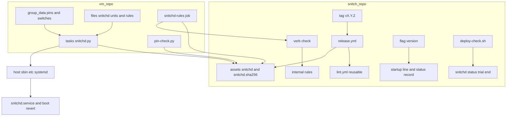
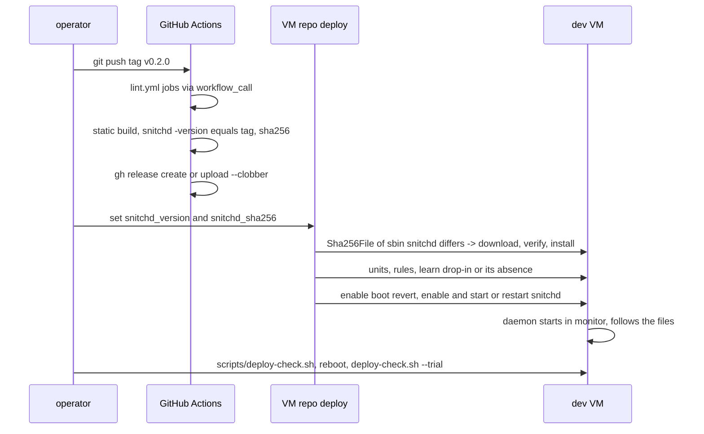
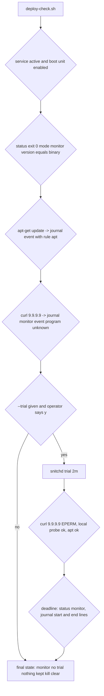

# Technical Design: deploy-service

## Overview

**Purpose**: snitchd becomes a released, checksummed binary that the VM repo's pyinfra deploy
installs and enables, so the daemon runs from boot in monitor mode with the rules the operator
already trusts, and a trial can be started on a deployed host the same way the test script did
it on a hand-built one.

**Users**: the operator of the dev VM (today) and of fleet hosts (later, one base rules file).

**Impact**: two repositories. snitch gains a release workflow, a `-version` flag, a root-less
`check` verb, a `version` line in the status record and `snitchd status`, and a deploy check
script. hyperland-forky-worker-vm gains a `snitchd` task with four group-data values, copies of
the two unit files, the rules file, a pin-check entry, a CI job that validates the rules file
with the pinned binary, and README text. Nothing in the daemon's decisions, maps, fail-safes or
units changes.

### Goals
- A tag `vX.Y.Z` on snitch produces release assets `snitchd` and `snitchd.sha256` after the
  lint workflow's checks; the binary prints the tag with `-version`.
- The VM deploy installs or updates snitchd from two pinned values, idempotently, with a switch
  for off, never passing a mode, a duration, or touching the kill, trial or kept files.
- `/etc/snitch/rules.toml` on the VM holds the Python client's address, any-destination and
  local-network rules with their programs, the domain rules as deferred comments, no curl.
- A learning run can be switched on and off from group data.
- The first deploy is verified on the VM by `scripts/deploy-check.sh` before and after one
  reboot, then a two-minute trial, with the serial console open and the operator's go.

### Non-Goals
- Domain rules (DNS tap spec). Fleet overlays per host. The Nix flake. Removing the Python
  client from the snitch repo (it stays until TUI parity; its files ride along as release
  assets). Any change to the daemon's mode logic, the units' directives, the rules model.

## Boundary Commitments

### This Spec Owns
- **snitch**: `.github/workflows/release.yml` and the `workflow_call` trigger on `lint.yml`;
  `-version` (ldflags-set `version` variable, the flag, the startup journal line); the `check`
  verb; the `version` key of the status record and the `version:` line of `snitchd status`;
  `scripts/deploy-check.sh`; the README's release and deployment paragraphs.
- **hyperland-forky-worker-vm**: `tasks/snitchd.py`; the group-data values `snitchd_enabled`,
  `snitchd_version`, `snitchd_sha256`, `snitchd_learn`; `files/snitchd/{snitchd.service,
  snitchd-trial-boot.service,rules.toml}`; the `deploy.py` entry; the `tools/pin-check.py`
  tuple; the `snitchd-rules` CI job; the README section and the task-table row.
- The content of the VM's rules file (translation of the Python client's rules, deferred list).
- The verification procedure and its record in `research.md`.

### Out of Boundary
- The daemon's mode source, follower, trial/kept files, verbs' semantics (persistent-trial).
- The rules model, resolver, encoder and reload (rule-loading). `check` only calls them.
- The unit files' directives: the VM repo carries verbatim copies, snitch stays the source.
- Domain rules; the learned file's content beyond "written here, reviewed by hand, never
  deployed"; fleet hosts; Little Snitch's packages (gone from the VM repo already).
- The kill switch and the serial console (fail-safes, unchanged, relied on).

### Allowed Dependencies
- snitch: no new Go module. `internal/rules` (`Load`, `Resolve`, `OSFS`) and the daemon's
  `summary` from the `check` verb; `internal/status` for the `version` key. GitHub Actions:
  `actions/checkout@v4`, `actions/setup-go@v5`, the runner's `gh` with `GH_TOKEN`.
- VM repo: pyinfra 3.10.0 operations `files.put`, `files.directory`, `files.file`,
  `server.shell` (with `_if`), `systemd.service`; facts `Sha256File`, `SystemdEnabled`,
  `SystemdStatus`. `curl` and `sha256sum` on the host. GitHub release URL
  `https://github.com/norandom/snitch/releases/download/v<ver>/snitchd`.
- Host paths fixed by the units: `/usr/local/sbin/snitchd`, `/etc/snitch/rules.toml`,
  `/var/lib/snitch`, `/run/snitch`.

### Revalidation Triggers
- A change of the asset names, the tag scheme (`v*`) or the sha256 file format: the VM task
  and pin-check read them.
- A change of the status record keys (the TUI/API spec will read it; persistent-trial's design
  lists twelve keys, this spec makes it thirteen).
- A change of the verb names or exit codes (`check` joins the table; the CI job and the deploy
  check call them).
- A change of the unit files in snitch: the VM copies must follow (a CI diff is a later
  cleanup; for now the README names the duplication).
- Rules model changes (new keys, a `domain` field): the rules file and the deferred comments
  are rewritten by the DNS tap spec.

## Architecture

### Existing Architecture Analysis
- `lint.yml` has four jobs on push and PR; `release.yml` must not duplicate them (1.4): a
  reusable workflow is the GitHub-native way (`on: workflow_call`, `uses: ./.github/workflows/
  lint.yml`).
- `cmd/snitchd/main.go` dispatches a first argument without a leading dash to `runCtl`;
  `ctl.go` holds the verb table `[]verb{name, run}` and `dispatch`, which insists on root for
  every verb. `check` needs no root: the table gains a `root bool`.
- `config.go` `parseFlagsTo` parses the daemon flags; `-version` is a flag that prints and
  exits before `check()` (the configuration check), like `-h`.
- `daemon.go` prints the startup line `snitchd: mode … hooks … maps pinned in …`; the version
  is added there. `follow.go` writes the status record from `counts()`; `internal/status`
  `keys` is the ordered key list, `Read` rejects unknown and missing keys.
- VM repo conventions (research.md): root binaries via `server.shell` with `curl -fsSL` and
  `sha256sum`, system units via `files.put` + `systemd.service`, switches as `if host.data.x`,
  `_sudo=True` on every root op, `# Managed by debian-hypr` headers, `_if=op.did_change` gates.
- `scripts/enforce-test.sh` owns the hand-started daemon flow with temp paths; the deployed
  service needs a separate read-only checklist that touches `/var/lib/snitch` only through the
  verbs.

### Architecture Pattern & Boundary Map



**Architecture Integration**:
- Pattern: release-then-pin. snitch publishes immutable assets; the VM repo pins one version
  and one checksum and converges the host to them. The host never builds.
- Boundaries: snitch owns what the binary does and prints; the VM repo owns what is on the
  host and when it runs; the rules file content is owned here but lives in the VM repo.
- Preserved: pyinfra op shapes, the verb table, the status record's key=value format, the
  units' directives (copied, not edited), the jobs/delegates/contracts code shape and caps.
- New components: `release.yml` (1.1-1.4), `version.go` + `-version` (1.2), `ctl_check.go`
  (3.1), `deploy-check.sh` (5.1-5.6), `tasks/snitchd.py` (2.1-2.8, 3.5), `files/snitchd/`
  (2.2, 3.1-3.6), CI job (3.1), docs (4.1-4.3).
- Steering: fail-safes untouched; monitor mode by default; enforce only through the verbs with
  the operator present; the serial console is the way back; code shape caps apply to the Go.

### Technology Stack

| Layer | Choice / Version | Role in Feature | Notes |
|-------|------------------|-----------------|-------|
| CI | GitHub Actions, `actions/setup-go@v5` with `go-version-file: go.mod` (reads `go 1.26.8`), runner `gh` | checks, static build, release | `permissions: contents: write` only on the release job |
| Build | `CGO_ENABLED=0 GOOS=linux GOARCH=amd64 go build -trimpath -ldflags "-s -w -X main.version=$TAG"` | 6.9 MB static ELF | verified locally; no clang (BPF object committed) |
| Daemon / CLI | Go 1.26, existing packages | `-version`, `check`, `version` status key | no new module |
| Deploy | pyinfra 3.10.0, Python 3.11+ | `tasks/snitchd.py` | `files.download` exists with `sha256sum=` but the repo's pattern is `server.shell` + `sha256sum -c`; the task follows the repo (one idiom) |
| Host | Debian forky, systemd, curl, sha256sum, dhcpcd | install target | `/var/lib/snitch`, `/run/snitch` created by the units |
| Verification | bash, curl, journalctl, `snitchd status` | `scripts/deploy-check.sh` | shellcheck in CI |

## File Structure Plan

### Directory Structure (snitch)
```
.github/workflows/
├── lint.yml               # + `workflow_call:` trigger; jobs unchanged
└── release.yml            # NEW: on tag v*: checks (uses lint.yml) -> build -> publish
cmd/snitchd/
├── version.go             # NEW: `var version = "dev"` and the startup/version strings
├── config.go              # + `-version` flag: print version, exit 0, before check()
├── daemon.go              # + version in the startup line; counts() passes it to the record
├── follow.go              # + Version in the status record it writes
├── ctl.go                 # verb gains `root bool`; dispatch honours it; table + {"check", runCheck, false}
├── ctl_check.go           # NEW: the check verb (parse, resolve, summary, exit codes)
├── ctl_check_test.go      # NEW
├── ctl_status.go          # + `version:` line from the record
├── ctl_status_test.go     # + version line cases
├── config_test.go         # + -version case
└── ctl_test.go            # + dispatch: check runs without root, others still refuse
internal/status/
├── status.go              # + Version field, `version` key (last)
└── status_test.go         # + body and round trip with version
scripts/
└── deploy-check.sh        # NEW: read-only checks of the deployed service; trial phase behind [y/N]
README.md                  # + Release paragraph; Service paragraph points at the VM repo
CLAUDE.md                  # status: deployed via the VM repo
```

### Directory Structure (hyperland-forky-worker-vm)
```
group_data/all.py          # + snitchd_enabled, snitchd_version, snitchd_sha256, snitchd_learn
deploy.py                  # + "snitchd" after "services"
tasks/snitchd.py           # NEW: the task (see component)
files/snitchd/
├── snitchd.service        # NEW: copy of snitch/systemd/snitchd.service, one header comment
├── snitchd-trial-boot.service  # NEW: copy, one header comment
└── rules.toml             # NEW: the VM's rules file
tools/pin-check.py         # + ("snitchd", "norandom/snitch", "v", d["snitchd_version"], "snitchd_version")
.github/workflows/lint.yml # + job snitchd-rules
README.md                  # + task-table row, section "Egress firewall: snitchd", rewrite of the "once it ships" line
```

### Modified Files (summary)
- snitch: `lint.yml`, `config.go`, `daemon.go`, `follow.go`, `ctl.go`, `ctl_status.go`,
  `internal/status/status.go`, tests, `README.md`, `CLAUDE.md`.
- VM repo: `group_data/all.py`, `deploy.py`, `tools/pin-check.py`, `.github/workflows/lint.yml`,
  `README.md`.
- persistent-trial `design.md`: one line in the status record section (thirteen keys, the
  `version` key) recorded as a deviation made by this spec.

## System Flows

### A tag becomes a pinned deploy



Flow decisions:
- The checksum is verified in a temp dir before `install`; a mismatch prints the seen and the
  expected digest and exits 1 with nothing replaced (2.3).
- The restart is gated on `did_change` of the binary, the units or the drop-in, never on the
  rules file (2.6: the daemon reloads it itself).
- The boot-revert unit is enabled but never started by the deploy (it would end a live trial,
  2.7). The service restart does not touch the trial or kept files; the follower reads them.
- Off: stop and disable both units, leave every file (2.5).

### Deploy check, two invocations around the reboot



## Requirements Traceability

| Requirement | Summary | Components | Interfaces | Flows |
|-------------|---------|------------|------------|-------|
| 1.1 | static amd64 build, assets binary + sha256 | release.yml | build step, `gh release` | tag flow |
| 1.2 | `-version` prints the tag; status and journal say it | version.go, config.go, daemon.go, status record, ctl_status.go | `-version`, `version=` key, `version:` line | tag flow |
| 1.3 | nothing published on failure | release.yml | `needs:` chain | tag flow |
| 1.4 | same checks as lint | lint.yml `workflow_call`, release.yml `uses:` | | tag flow |
| 2.1 | switch and pins in group data | group_data/all.py | names below | |
| 2.2 | download, verify, install, units, rules, enable | tasks/snitchd.py | ops table | tag flow |
| 2.3 | mismatch fails before replacing, names the digest | tasks/snitchd.py install op | shell contract | |
| 2.4 | new version → install + restart, back within 5 s | tasks/snitchd.py | `_if` on Sha256File, `restarted=` | |
| 2.5 | off stops and disables, keeps files | tasks/snitchd.py off branch | | |
| 2.6 | rules change → replaced, daemon reloads | tasks/snitchd.py rules op | no restart gate | |
| 2.7 | never mode/duration/kill/trial/kept | tasks/snitchd.py, drop-in content | review item + CI grep | |
| 2.8 | idempotent | `_if` facts on every shell op | | |
| 3.1 | rules file in the VM repo, validated in CI | files/snitchd/rules.toml, `check` verb, CI job | `snitchd check -rules F` | |
| 3.2 | address, any-destination, local rules translated | rules.toml | translation table | |
| 3.3 | domain rules as deferred comments | rules.toml | comment format | |
| 3.4 | Claude Code → Anthropic ranges, warning | rules.toml | | |
| 3.5 | learning run after a working day | `snitchd_learn`, drop-in | | |
| 3.6 | curl stays out | rules.toml | | |
| 4.1 | snitch README | README.md | | |
| 4.2 | VM README task section | VM README.md | | |
| 4.3 | "once it ships" line, task table | VM README.md | | |
| 5.1 | active, enabled, status 0, startup lines | deploy-check.sh | | check flow |
| 5.2 | rule event and monitor event | deploy-check.sh | apt and curl probes | check flow |
| 5.3 | one reboot, back in monitor, RDP back | operator step + deploy-check.sh second run | | check flow |
| 5.4 | two-minute trial | deploy-check.sh --trial | verbs | check flow |
| 5.5 | final state recorded | deploy-check.sh summary → research.md | | |
| 5.6 | failure path: switch off or fail-open.sh | README (VM), fail-open.sh | | |

## Components and Interfaces

| Component | Domain | Intent | Req | Key Dependencies | Contracts |
|-----------|--------|--------|-----|------------------|-----------|
| release.yml | CI (snitch) | tag → checked static build → assets | 1.1, 1.3, 1.4 | lint.yml (P0), gh (P0) | Batch |
| version | daemon/CLI | the build's tag in the binary, journal, status | 1.2 | ldflags (P0) | Service |
| check verb | CLI | parse + resolve a rules file without root | 3.1 | internal/rules (P0) | Service |
| status version | daemon/CLI | `version` key and line | 1.2 | internal/status (P0) | State |
| tasks/snitchd.py | deploy (VM) | converge the host to the pins and the switch | 2.1-2.8, 3.5 | release assets (P0), units/rules files (P0) | Batch |
| files/snitchd/rules.toml | rules content | the VM's rules | 3.1-3.4, 3.6 | rules model (P0) | State |
| CI job snitchd-rules | CI (VM) | the pinned binary validates the rules file | 3.1 | check verb (P0) | Batch |
| deploy-check.sh | verification | read-only checks, trial behind a prompt | 5.1-5.6 | verbs (P0), journalctl (P1) | Batch |
| docs | both READMEs | deploy, update, trial, off | 4.1-4.3 | | |

### CI (snitch)

#### release.yml

| Field | Detail |
|-------|--------|
| Intent | On a `v*` tag: run the lint workflow, build the static binary, publish assets |
| Requirements | 1.1, 1.3, 1.4 |

**Batch / Job Contract**
- Trigger: `push: tags: ['v*']`. Top-level `permissions: contents: read`.
- Job `checks`: `uses: ./.github/workflows/lint.yml` (lint.yml adds `workflow_call:` to its
  `on:`; its jobs do not change).
- Job `release`: `needs: checks`, `permissions: contents: write`, `runs-on: ubuntu-latest`.
  Steps: checkout; setup-go with `go-version-file: go.mod`; build to `dist/snitchd` with the
  stack's command and `-X main.version=${GITHUB_REF_NAME}`; assert
  `[ "$(dist/snitchd -version)" = "$GITHUB_REF_NAME" ]`; `(cd dist && sha256sum snitchd >
  snitchd.sha256)` (content `<hex>  snitchd`, the form `sha256sum -c` reads); publish with
  `gh release view "$TAG" >/dev/null 2>&1 && gh release upload "$TAG" dist/snitchd
  dist/snitchd.sha256 --clobber || gh release create "$TAG" dist/snitchd dist/snitchd.sha256
  --verify-tag --generate-notes`, `GH_TOKEN: ${{ github.token }}`.
- The Python client's `snitch` and `snitch-trial` are added to the same asset list so a release
  stays complete for the TUI's users (plain files from the checkout).
- Idempotency: re-running the workflow for the same tag replaces the assets (`--clobber`).
- Failure: any failing check or build step stops the chain before `release` (`needs:`), so
  nothing is published (1.3).

**Implementation Notes**
- Validation: actionlint in lint.yml covers the new file. The first real run is the `v0.2.0`
  tag after the Go changes land; the asset is downloaded and `-version` compared by hand (task).
- Risk: the runner's `gh` version is whatever `ubuntu-latest` ships; `--verify-tag` exists since
  gh 2.21. `--generate-notes` on a tag that already has a hand-written release is not reached
  (the `view` branch uploads instead).

### Daemon and CLI (snitch)

#### version

| Field | Detail |
|-------|--------|
| Intent | One variable, set at link time, printed by `-version`, in the startup line, in the status record |
| Requirements | 1.2 |

**Service Interface**
```go
// cmd/snitchd/version.go
var version = "dev" // -ldflags "-X main.version=vX.Y.Z"; "dev" for go build/go run
```
- `snitchd -version` prints `version` followed by a newline to stdout and exits 0, before the
  configuration check (so `-version` alone is valid; combining it with other flags is allowed
  and ignored).
- Startup line: `snitchd <version>: mode <m> (<source>), hooks …, maps pinned in …`.
- Status record: `follow.go` sets `Record.Version = version`.
- Contract: `contract.Ensure(version != "", "version: empty")` at the one place it is read for
  output (a build with `-X main.version=` would otherwise print an empty line).

#### check verb

| Field | Detail |
|-------|--------|
| Intent | Validate a rules file the way the daemon loads it, without root or BPF |
| Requirements | 3.1 |

**Service Interface**
```go
// cmd/snitchd/ctl_check.go
// snitchd check [-rules /etc/snitch/rules.toml]
// exit 0: valid; stdout: the daemon's summary line (programs, resolved, executables, rules)
//         plus one "unresolved: <program> <pattern> (<reason>)" line per pattern without a match
// exit 1: invalid; stderr: the parser's or resolver's error (file:line: reason)
// exit 2: usage (bad flag; the file not existing is exit 1 with "does not exist")
func runCheck(c *ctl, args []string) int
```
- `verb` gains `root bool`; `dispatch` refuses non-root only when `v.root`. The table becomes
  `{"trial", runTrial, true}, … {"status", runStatus, true}, {"check", runCheck, false}`.
- `check` uses `rules.Load` then `rules.Resolve(f, rules.OSFS(warn))` and the daemon's
  `summary(snapshot)`; warnings from the resolver (mountinfo fallback) go to stderr. A missing
  file is an error here (the daemon treats it as empty; a deploy must not ship a missing file).
- `-state-dir`/`-status` are still accepted (shared parse) and ignored.
- Contracts: `contract.Require(path != "", "check: empty rules path")`.

#### status version

| Field | Detail |
|-------|--------|
| Intent | The running daemon's build visible in `snitchd status` |
| Requirements | 1.2 |

**State Management**
- `status.Record` gains `Version string`; `keys` gains `"version"` as the last key (after
  `written`). `Write` emits it; `Read` requires it (an old record without it is "unreadable",
  which the CLI already treats as "not following": the new daemon rewrites the record within
  2 s of its start). Newline check applies as for the other string fields.
- `snitchd status` prints `version:   <record.Version>` after `status:` as the ninth line;
  without a record: `unknown (no status record)`, the pattern the other lines use. The CLI's own
  `version` is not printed (the record says what runs; the binary is the same file).
- persistent-trial `design.md` gets one sentence: the record has thirteen keys since this spec.

### Deploy (hyperland-forky-worker-vm)

#### group data

```python
# group_data/all.py — "Egress firewall" block, after serial_console
snitchd_enabled = True          # snitchd from boot in monitor mode (snitchd trial turns deny on, bounded)
snitchd_version = "0.2.0"       # tag without the v; sha256 = the snitchd asset's digest
snitchd_sha256 = "<64 hex>"
snitchd_learn = False           # True: run with -learn, learned rules in /var/lib/snitch/learned.toml (never deployed)
```

#### tasks/snitchd.py

| Field | Detail |
|-------|--------|
| Intent | Converge the host: binary, units, rules, learning drop-in, enabled or off |
| Requirements | 2.1-2.8, 3.5 |

**Batch / Job Contract** (operations in order; every op `_sudo=True`)

| # | Operation | Condition | Change gate |
|---|-----------|-----------|-------------|
| 1 | `files.directory` `/etc/snitch` mode 755 | always | pyinfra |
| 2 | `files.put` `files/snitchd/rules.toml` → `/etc/snitch/rules.toml` mode 644 | always (on and off: the file stays current) | content |
| 3 | `server.shell` download + verify + install | enabled | `_if=lambda: host.get_fact(Sha256File, path="/usr/local/sbin/snitchd") != host.data.snitchd_sha256` |
| 4 | `files.put` both units → `/etc/systemd/system/` mode 644 | enabled | content |
| 5 | learn drop-in: `files.directory` `/etc/systemd/system/snitchd.service.d` + `files.put(StringIO(...))` `learn.conf` when `snitchd_learn`; else `files.file(present=False)` of `learn.conf` | enabled | content / presence |
| 6 | `systemd.service` `snitchd-trial-boot.service` `enabled=True, running=False, daemon_reload=<4 or 5 .changed>` | enabled | pyinfra |
| 7 | `systemd.service` `snitchd.service` `running=True, enabled=True, daemon_reload=<4 or 5 .changed>` (no `restarted=`) | enabled | pyinfra |
| 7b | `server.shell` `systemctl restart snitchd.service` | enabled | `_if=lambda: any(o.did_change() for o in (op3, op4a, op4b, op5))` |
| 8 | `server.shell` `systemctl disable --now snitchd.service snitchd-trial-boot.service` | not enabled | `_if=lambda: any enabled or active`, from `SystemdEnabled`/`SystemdStatus` facts |

Gate semantics (pyinfra 3.10.0, verified in its source): `files.put(...).changed` is known at
parse time from facts and may feed `daemon_reload=`; `server.shell` is always "will change"
at parse time, so anything downstream of op 3 must be gated at execution time with `_if=`
callables, never with a bool computed from `.changed`. A list given to `_if` is combined
with "all", so "restart when any of them changed" must be one lambda over `any(...)`. A
`--dry` run therefore always lists ops 3, 7b and 8 as pending; the idempotency proof (2.8)
reads the executed run's summary. A `_if` lambda runs before the op's sudo context: the
`Sha256File` fact of a 755 binary needs none.

- Op 3's shell: `set -e; t=$(mktemp -d); trap 'rm -rf "$t"' EXIT; curl -fsSL -o "$t/snitchd"
  https://github.com/norandom/snitch/releases/download/v{ver}/snitchd; got=$(sha256sum
  "$t/snitchd" | cut -d' ' -f1); [ "$got" = "{sha}" ] || { echo "snitchd v{ver}: sha256 $got,
  expected {sha}" >&2; exit 1; }; install -m 755 -o root -g root "$t/snitchd"
  /usr/local/sbin/snitchd`. Nothing on the host changes before the comparison (2.3).
- Op 6 never starts the oneshot (`running=False` on an inactive oneshot is a no-op); the deploy
  therefore never runs `snitchd end` (2.7). Op 7's restart does not remove trial or kept files
  (the follower reads them; a kept enforce comes back as kept).
- The drop-in content is exactly `[Service]\nExecStart=\nExecStart=/usr/local/sbin/snitchd
  -rules /etc/snitch/rules.toml -learn -learned /var/lib/snitch/learned.toml\n`. No other flag
  is ever written by the task (2.7); the CI job fails if a command line in the task carries
  `-mode` or `-duration` (`grep -nE 'snitchd[^#]*(-mode|-duration)'`, so comments explaining
  the rule stay allowed) or if `/sys/fs/bpf` appears anywhere in it; each grep in an
  `if grep …; then exit 1; fi` (a `! grep` line is exempt from `bash -e` and only the step's
  last line would decide).
- Idempotency (2.8): ops 1, 2, 4, 5, 6, 7 are pyinfra-idempotent; 3, 7b and 8 are gated at
  execution time, so a second run with nothing changed executes zero operations.
- Deploy order: `"snitchd"` after `"services"` in `deploy.py`. The rules file names programs
  installed by later tasks; the daemon re-resolves every 10 s and lists them as unresolved
  until they exist, which is not an error.

**Implementation Notes**
- Validation: `uv run pyinfra -y inventory.py tasks/snitchd.py --dry` prepares without
  changing the host; ruff via the repo's lint.yml; the real run is the on-VM phase.
- Risks: a kept-enforce host without a domain rule for github.com cannot download the next
  version (the deploy's curl is denied). Documented in the README; the DNS tap spec removes it.

#### files/snitchd/rules.toml

| Field | Detail |
|-------|--------|
| Intent | The VM's rules: the Python client's rules that the daemon can express today |
| Requirements | 3.1, 3.2, 3.3, 3.4, 3.6 |

**State** (content rules; the exact file is a task deliverable, this is its contract)
- Header comment: source (the Python client's BASELINE and DEV_TOOLS), what is deferred, the
  warning that a trial without the `claude` rule cuts the operator's own session (3.4), and
  that curl is deliberately absent (3.6).
- `[[program]]` for every Python rule's executable, `~` written as `/home/*`, globs kept,
  one program per executable set: `claude`, `codex` (both paths), `copilot`, `gh`, `git`
  (`/usr/lib/git-core/git-remote-http`), `ssh`, `node`, `uv`, `python` (both pip paths),
  `cargo`, `go` (both), `podman`, `helm`, `kube` (kubectl, k9s, ktop), `hypr-agent-quota`,
  `hypr-rdp`, `timesyncd`, `apt` (methods http and https). Each with `note` naming the Python
  rule. Programs with only deferred or local-network rules are declared without rules, so
  monitor events and the learned file name them.
- `[[rule]]` entries:
  - `any` → `160.79.104.0/23` and `2607:6bc0::/48`, note "baseline: Anthropic for any program".
  - `claude` → the same two ranges, note "dev tool: Claude Code; without this a trial cuts the
    operator's session".
  - `hypr-rdp` → `0.0.0.0/0` and `::/0`, note "baseline: never block".
  - `any` port 53 → `0.0.0.0/0` and `::/0` (proto omitted: tcp and udp), note "baseline: DNS".
  - `any` udp port 67 → `255.255.255.255/32`, note "baseline: DHCP broadcast (dhcpcd; discover
    uses a raw socket, renewals are unicast to the local server)".
  - `timesyncd` udp port 123 → `0.0.0.0/0` and `::/0`.
  - `apt` → `0.0.0.0/0` and `::/0`, note "baseline and dev tool: repositories vary, apt checks
    signatures".
  - All `verdict = "allow"`.
- Deferred block per program, as comments: `# deferred (DNS tap spec): <program> -> <domains>`
  for claude, codex, copilot, gh, git, ssh, node, uv, python, cargo, go, podman, helm,
  hypr-agent-quota (3.3). Local-network rows (helm, kube to the cluster; local network for any
  program) as a comment "allowed inside the BPF program, no rule needed".
- Validity: `snitchd check -rules files/snitchd/rules.toml` exits 0 (the CI job); no duplicate
  expanded keys (the two `any` Anthropic rules and the `claude` ones differ by program).

#### CI job snitchd-rules (VM lint.yml)

- Steps: checkout; read `snitchd_version` and `snitchd_sha256` from `group_data/all.py` with
  `python3 -c 'import runpy; d = runpy.run_path("group_data/all.py"); print(d["snitchd_version"], d["snitchd_sha256"])'`;
  `curl -fsSL` the asset into a fresh dir; `sha256sum -c`; `chmod +x`; `./snitchd check -rules
  files/snitchd/rules.toml`; then the 2.7 guard, one `if grep …; then exit 1; fi` per pattern
  (`grep -nE 'snitchd[^#]*(-mode|-duration)' tasks/snitchd.py`, `grep -n '/sys/fs/bpf'
  tasks/snitchd.py`): a negated `! grep` line is exempt from `bash -e`, so it must not be used.
- Runs on push and PR like the other jobs; fails the build on any non-zero step (3.1).

### Verification (snitch)

#### scripts/deploy-check.sh

| Field | Detail |
|-------|--------|
| Intent | Prove the deployed service step by step, read-only except through the verbs |
| Requirements | 5.1-5.6 |

**Batch / Job Contract**
- Usage: `sudo scripts/deploy-check.sh [--trial] [-x <deny addr>] [-l host:port]`. Root (the
  verbs need it). Steps print `PASS`/`FAIL` as in enforce-test.sh; exit 1 on any failure.
- Phase A (always): `systemctl is-active snitchd.service`; `is-enabled snitchd.service` and
  `snitchd-trial-boot.service`; then, before anything else reads the record, `^version:` of
  `snitchd status` equal to `/usr/local/sbin/snitchd -version` (on a mismatch the script says
  `the daemon runs another build: sudo systemctl restart snitchd.service` and stops: an old
  record without the key reads as "not following" and `trial` would refuse with a parser
  message); `snitchd status` exit 0, `^mode: *monitor`, `^trial: *none`, `^kept: *no`,
  `^kill: *clear`;
  `journalctl -u snitchd -b` has the startup line and a `rules:` summary; `apt-get update -o
  Acquire::Retries=0 >/dev/null` then a new journal line matching `program apt` with `rule`
  (5.2 rule event); `curl -sS --max-time 5 -o /dev/null https://9.9.9.9/` then a new journal
  line with `allow (monitor)` and `program /usr/bin/curl` (5.2 monitor event). Journal checks
  use a cursor taken before the probe (`journalctl --show-cursor` / `--after-cursor`).
- Phase B (`--trial`, after `[y/N]`, trap runs `snitchd end` and prints the final state):
  `snitchd trial 2m` exits 0 and prints `enforce until`; status `^mode: *enforce`; curl to the
  deny address fails with EPERM (the enforce test's detector); the local probe (if given) and
  `apt-get update` still succeed; wait up to 130 s for `^mode: *monitor`; journal has
  `mode: enforce (trial until` and `mode: monitor (trial ended at its deadline)`.
- Final line (both phases): `state: service <active> mode <m> trial <none|…> kept <no|yes>
  kill <clear|SET>`; the operator pastes it into research.md (5.5).
- Never writes under `/var/lib/snitch` or `/run/snitch` except through `snitchd trial`/`end`;
  never touches the kill map; never restarts the service.

**Implementation Notes**
- Procedure (README): deploy → `deploy-check.sh` → reboot (RDP drops once, the operator
  reconnects) → `deploy-check.sh` → `deploy-check.sh --trial` with the serial console open. If
  a step fails: record it in research.md, then `snitchd_enabled = False` + deploy, or
  `scripts/fail-open.sh` from the console (5.6).
- Risk: `apt-get update` needs the apt methods to connect; on a host with no reachable
  repository it fails and so does the step. The deny address defaults to `9.9.9.9` as in the
  enforce test.

### Documentation

- snitch `README.md`: a **Release** paragraph (tag `vX.Y.Z` → lint checks → static build →
  assets `snitchd`, `snitchd.sha256`, plus the Python client's files; `snitchd -version`);
  the **Service** paragraph gains "deployed by the VM repo's `snitchd` task, see its README";
  the **Trial** paragraph mentions `deploy-check.sh --trial` for a deployed host (4.1).
- VM `README.md`: task-table row `| snitchd | egress firewall: snitchd from a pinned release,
  rules in files/snitchd/rules.toml, boot revert; switches snitchd_enabled, snitchd_learn |`;
  section **Egress firewall: snitchd** with the switch, the pins and how to bump them (tag,
  asset digest from the release page or `sha256sum`), the rules file and the deferred list,
  the learning run (switch on, a working day, read `/var/lib/snitch/learned.toml`, merge by
  hand, switch off), the trial (`sudo snitchd trial 10m`, `status`, `end`, the serial console
  and the kill switch as the way back; "if `status` or `trial` says the record is missing a
  key, the daemon is an older build: `sudo systemctl restart snitchd.service`"), off
  (`snitchd_enabled = False`), and the kept-enforce caveat for downloads (4.2). Lines 411-412 become "Little Snitch is retired; snitchd (Go,
  eBPF egress firewall) watches egress from boot in monitor mode, switch `snitchd_enabled`"
  (4.3).

## Implementation Rules (binding)

- Code shape per `tech.md`: functions ≤ 40 lines, cyclomatic ≤ 10, files ≤ 300 lines
  (`scripts/caps.sh`); delegates for OS seams in tests; contracts for programming errors.
- Go changes are small and additive; no behaviour of the follower, the verbs' refusals or the
  units changes. `ctl_verbs.go` (286 lines) is not touched; `check` lives in its own file.
- The VM task follows the repo's idioms (`_sudo=True`, `# Managed by debian-hypr`, `_if`
  gates, one-line style under ruff's settings) and is a single file.
- The unit copies in the VM repo differ from snitch's only by the first line
  `# Managed by debian-hypr: copy of snitch/systemd/<name>, do not edit here`.
- Nothing in either repo passes `-mode` or `-duration` to the service or writes the kill, trial
  or kept files; the CI grep enforces the task side.
- Every on-VM step that can affect the operator's session (deploy with the switch on, reboot,
  trial) waits for the operator's explicit go in the conversation, with the serial console open.

### Contracts
- `version`: `Ensure(version != "")` where printed (`-version`, startup line); test with the
  variable set to "" in a test binary (table-driven through a `printVersion(w, v)` helper).
- `check`: `Require(path != "")`; exit codes 0/1/2 as specified; tests with a valid file, an
  invalid file (file:line in stderr), a missing file, a bad flag, and a non-root euid.
- `dispatch`: `check` runs with euid ≠ 0; every other verb still refuses with exit 2.
- `status.Record`: `Write` then `Read` round-trips `Version`; a body without `version=` is an
  error naming `version`; a `Version` with a newline trips the precondition.

## Error Handling

| Situation | Behaviour |
|-----------|-----------|
| Lint or build fails on a tag | no release job runs; the tag can be deleted and re-pushed after a fix |
| Release exists for the tag | assets replaced with `--clobber` |
| Asset download fails on the host | op 3 exits 1 with curl's message; nothing replaced; the deploy stops at that op |
| Checksum mismatch | op 3 prints seen and expected digest, exits 1; nothing replaced |
| Rules file invalid | CI job fails before merge; on a host the daemon keeps the last snapshot and logs the error (rule-loading) |
| `check` on a missing file | exit 1 "does not exist" |
| Service fails to start after an update | `Restart=on-failure` retries; `deploy-check.sh` fails at the first step; off switch or fail-open.sh |
| Old status record without `version` | read as unreadable for ≤ 2 s after the restart; if the restart did not happen (rollback to an older pin, manual install), `status` and `trial` say "missing key version" and the README names the remedy: restart the service |

## Testing Strategy

### Unit (no root, `go test ./...`)
- `-version`: prints the variable and exits 0; `check()` not reached; empty variable trips the
  contract.
- `check` verb: exit codes and messages per the contract; non-root allowed; `-rules` default
  `/etc/snitch/rules.toml`; summary line equals the daemon's `summary` for the same file.
- `dispatch`: root gate per verb.
- status: body with `version=` last; round trip; malformed cases extended.
- `snitchd status`: `version:` line from the record and the "unknown" form.

### Static
- `gofmt`, `go vet`, `scripts/caps.sh`, shellcheck on `deploy-check.sh`, actionlint on
  `release.yml`; VM repo: ruff on `tasks/snitchd.py`, the `snitchd-rules` job against the
  pinned asset (the first run uses `v0.2.0` once it exists).

### Release
- Tag `v0.2.0` after the Go changes: the workflow publishes; download the asset, `sha256sum -c
  snitchd.sha256`, `./snitchd -version` prints `v0.2.0`, `./snitchd check -rules
  examples/rules.toml` exits 0. Record the digest for the VM pin.

### VM (operator present, serial console open)
- `--dry` prepare (ops 3, 7b, 8 always show as pending there); deploy with the switch on (go);
  `deploy-check.sh` phase A; second deploy executes zero operations (2.8, read from the
  executed run's summary); rules file edit (a note) → deploy → journal summary within 5 s, no
  restart (2.6); switch off → deploy → inactive and disabled, files present (2.5); switch on →
  deploy (no download, 2.4/2.5); reboot (go, RDP drops once) → phase A again (5.3);
  `deploy-check.sh --trial` (go) (5.4); final state line into research.md (5.5).
- The learning run (3.5) is a later session: `snitchd_learn = True` → deploy → one working day
  → read the learned file → merge → `snitchd_learn = False` → deploy. The spec's verification
  ends with the first learned file written and reviewed; merged rules are a follow-up commit.

## Security Considerations
- The binary runs as root from `/usr/local/sbin`; the deploy verifies the sha256 before
  `install`, and the pin lives in the repo (reviewable diff). The release is built by GitHub
  Actions from the tagged commit with a read-only token except for the publish job.
- No secrets anywhere: `GH_TOKEN` is the workflow's own token; the VM task downloads anonymously.
- The deploy never writes mode, duration, kill, trial or kept state (2.7); enforce stays an
  operator action through the verbs with the fail-safes of persistent-trial.
