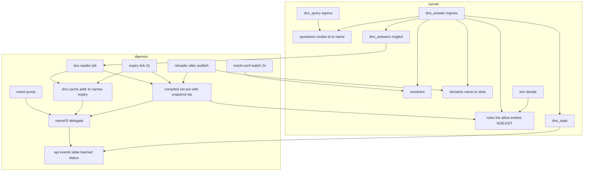
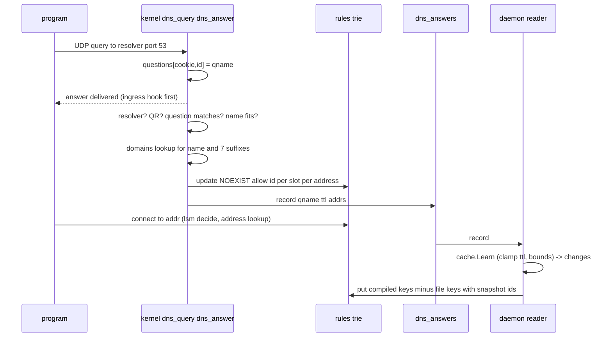
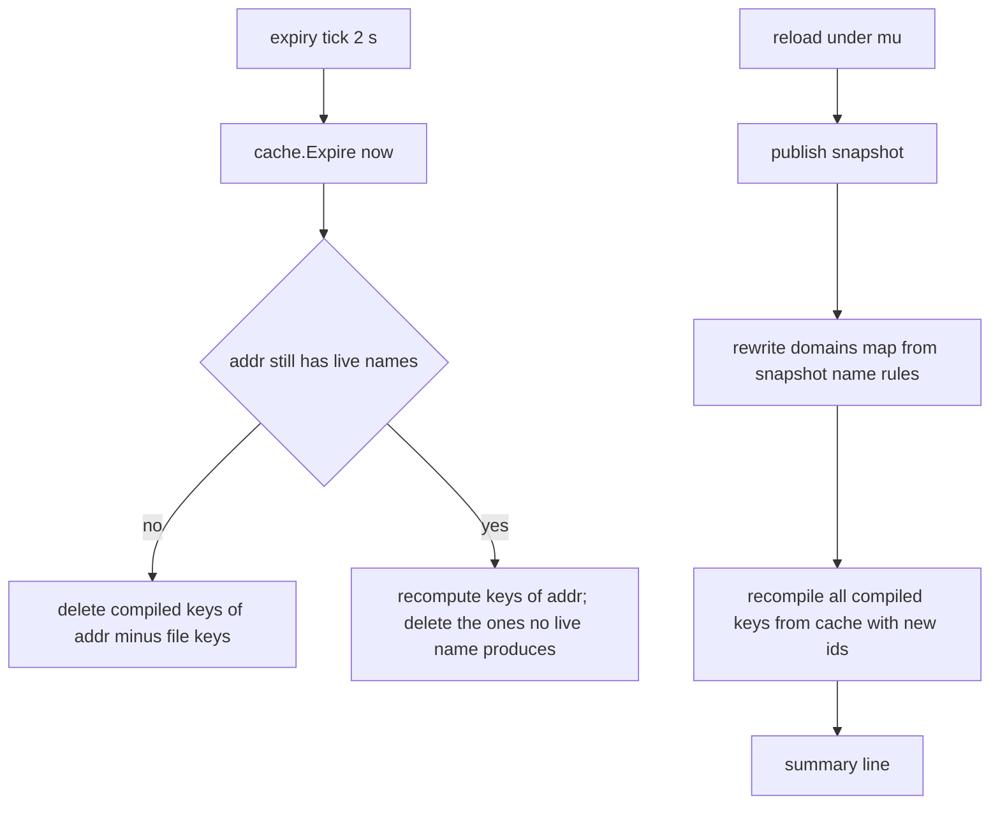

# Technical Design: dns-tap

## Overview

**Purpose**: snitchd learns which names resolved to which addresses from the DNS answers its
programs already receive, lets a rule say `to = "github.com"`, and turns such a rule into
address entries of the kernel's trie as answers arrive and expire. The connect path stays an
address lookup; the daemon never resolves, never delays an answer, and a name can only add
allows.

**Users**: the operator of the dev VM (today) and fleet hosts (later): the 16 deferred lines of
the deployed rules file become rules, a trial no longer cuts gh, git, uv, cargo, go; the TUI and
popups (next spec) read the name next to the address.

**Impact**: a second BPF object with two `cgroup_skb` programs at the cgroup2 root (an egress
question recorder and an ingress answer parser that writes allow entries into the existing
`rules` trie and mirrors each answer to a ring buffer); a `Name` on `rules.Rule` with its parse,
identity, write and skip-in-`Encode`; a new pure package `internal/dns` (cache, compiler, kernel
key encodings); daemon files for attach, the reader, expiry, the resolver watch and the reload
hook; `name` on the API's events, entries, observations and rules view; a `dns` block in the
status; the VM repo's rules file converted; a DNS phase in the check scripts; fail-safe 1 reworded
in the steering.

### Goals
- A connect right after an answer is matched by the name rule (the entry is in the trie before
  the answering datagram reaches the program); nothing waits on the daemon.
- Names expire with their TTL (60 s floor, 24 h ceiling), the cache is bounded (8192 addresses,
  4 names each), compiled entries never outlive their entry by more than one tick.
- Rule ids stay consistent: every compiled entry carries the current snapshot's id; a reload
  recompiles before it is reported.
- Only answers from the configured resolvers, to a socket that asked (same cookie, id and
  name), are learned; everything else inbound is untouched.
- Deny by name is refused everywhere; the file's entries always win capacity.
- Tests without root for the cache, the compiler, the parse and the API shapes; a root test that
  runs the kernel parser on crafted datagrams (`BPF_PROG_TEST_RUN`); the dev VM check and the
  dev-tool trial.

### Non-Goals
- Resolving; TCP 53, DoH, DoT, `/etc/hosts`; deny by name; per-process names; TLS server name;
  persisting the cache; the Public Suffix List; popups/TUI; Velociraptor; rate-limiting events.

## Boundary Commitments

### This Spec Owns
- `bpf/dns.bpf.c`: `dns_query` (egress) and `dns_answer` (ingress), the maps `resolvers`,
  `domains`, `questions`, `dns_answers`, `dns_stats`, and the layout of `domain_key`,
  `domain_val`, `dns_answer_record` (bpf2go refuses a struct named like the program `dns_answer`); the bindings `internal/bpf` `Dns*`.
- `internal/dns`: the address-to-name cache with lifetimes and bounds, the compiler from name
  rules and addresses to trie keys, the domain-key and resolver encodings, the resolv.conf
  parser; its JSON-free, BPF-free types.
- `rules.Rule.Name`, `rules.ParseName`, `Rule.Dest()`, the identity of a name rule in
  duplicates and `Merge`, `formatRule` for names, `Encode` skipping name rules, the deny-by-name
  refusal in the validator and in `rule.add`.
- The daemon's compiled entry set: who writes, re-puts, deletes and recompiles trie entries that
  did not come from the file; the `-dns` flag; the `domains` and `resolvers` map contents.
- `Name` on `api.Event`, `api.Entry`, `api.Observation`, `api.RuleView.To` showing a name, the
  `dns` block of `api.Status`, the `dns` key of the status record and the `snitchd status` line.
- The DNS phase of `scripts/api-check.sh`, the dev-tool run in `scripts/deploy-check.sh --trial`,
  the docs (`examples/rules.toml`, `examples/api.md`, README), the steering rewording of fail-safe
  1, and the VM repo's rules file conversion (as a follow-up commit there, recorded as a
  deploy-service revalidation).

### Out of Boundary
- The LSM decision, `decide()`, the local-net check, heartbeat, kill switch, trial, modes.
- The rules file format beyond `to` accepting a name; the resolver (`Resolve`), the overlay
  mechanics (`Merge`'s algorithm), the reload cadence; the API's transport, roles, table windows.
- Parsing DNS in Go (the kernel parses; the daemon receives records).
- The deploy task and the unit (`deploy-service`); only the rules file changes there.

### Allowed Dependencies
- `internal/dns` imports `internal/rules` (for `Rule`, `RuleKey`, `RuleVal`, `Proto`) and
  `internal/bpf` (for the generated `Dns*` structs), `internal/contract`; never `internal/api`
  or `cmd/`.
- `internal/rules` is unchanged in its imports. `internal/api` gains fields only.
- `cmd/snitchd` imports all. Kernel: `cgroup_skb` ingress and egress at the cgroup2 root
  (`multi`), `bpf_skb_load_bytes`, `bpf_loop`, `bpf_get_socket_cookie`, `bpf_map_update_elem` on
  the LPM trie with `BPF_NOEXIST`, ring buffer. cilium/ebpf v0.22: `CollectionOptions.MapReplacements`
  (share `rules`), `link.AttachCgroup`, `ringbuf.Reader`, `Program.Run` in tests. Test-only
  dependency `golang.org/x/net/dns/dnsmessage` to build datagrams.
- Host: `/etc/resolv.conf` (read), `/sys/fs/cgroup` root, the existing pinned maps untouched.

### Revalidation Triggers
- A change to the `dns_answer_record` record or the `domain_key` layout (bindings, `internal/dns`).
- A change to `RuleKey`/`RuleVal` (both objects declare the trie; `MapReplacements` checks the
  spec at load).
- A change to the API field names `name`, `dns` (the TUI and popups read them).
- A change to the compiled-entry ownership rule (any future producer of non-file entries).
- A change to the rules file grammar for `to` (the VM repo's CI runs `snitchd check`).

## Architecture

### Existing Architecture Analysis
- One snapshot `{res, ent, rulesErr}` behind an atomic pointer; `reload(full)` under `mu`
  computes `Diff(cur.ent, next.ent)`, applies puts then deletes, publishes. Compiled entries are
  not in `ent`: they are a second set the reloader must not delete and must recompile after
  `publish` (same `mu`, before the summary line).
- Rule ids are dense per snapshot and renumbered on reload (`validate.go:29`, `assertDenseIDs`);
  `RuleVal.Id` is copied into events. Compiled values must carry the current snapshot's ids, so
  the daemon re-puts every record's keys and recompiles on reload.
- `encodeRule` requires a valid prefix (`encode.go:70`); `Encode` skips name rules, and a
  dedicated compiler produces their entries from addresses.
- `count_egress` shows the shape for a soft-failing cgroup program (`attachCountingWith` with
  delegates for mounts and attach, a log line "off: reason", a job with `read`/`add`/`prune`
  delegates). `pump` is the only ring-buffer reader and is not faked in tests; the DNS reader
  takes a `recordSource` delegate so it is.
- `daemon.go` 290, `reload.go` 177, `apiwrite_rules.go` 272, `learn.go` 272, `types.go` 198:
  new code goes to new files; existing files take fields and one-line calls.

### Architecture Pattern & Boundary Map



**Architecture Integration**:
- Pattern: the kernel does the one thing user space cannot do in time (insert the allow entry
  as the answer is delivered) and reports it; the daemon is the authority (cache, lifetimes,
  ids, recompile, deletes) and corrects the kernel's fast path on every record. Two producers
  of trie entries (file via `Diff`, compiled via the compiled set) with disjoint ownership: the
  kernel never overwrites a file key (`BPF_NOEXIST`), the daemon never deletes a file key from
  the compiled set (it subtracts `ent.Rules` before every put and delete).
- Boundaries: `internal/dns` is pure (no syscalls, no JSON); the daemon owns attach, jobs and the
  trie handle; `internal/rules` knows a name as a destination and nothing about DNS.
- Preserved: jobs, delegates, contracts, caps, one snapshot, keep-previous on error, soft attach.
- Fail-safes by construction: both programs return 1 on every path and write only verdict 1;
  the local-net check precedes the trie lookup; a dead daemon detaches both programs with the
  LSM links; `-dns=false` or a failed attach leaves the daemon exactly as today.

### Technology Stack

| Layer | Choice / Version | Role in Feature | Notes |
|---|---|---|---|
| Kernel | `cgroup_skb/ingress` + `/egress` at the cgroup2 root, `bpf_loop`, `bpf_skb_load_bytes`, LPM trie update, ring buffer | parse answers, record questions, insert entries | Linux >= 6.12 already required; verified on 7.2.6 (26k insns) |
| Bindings | bpf2go second object `Dns` (`-type dns_answer_record -type domain_key -type domain_val -type domain_slot -type resolver_key -type q_key -type q_val`, cflags `-mcpu=v3` on this object only) | Go structs for maps and records | `rules` declared in both objects, shared via `MapReplacements` |
| Daemon | Go 1.26, cilium/ebpf v0.22 | attach, reader, ticks, map writes | no new runtime module |
| Pure logic | `internal/dns` | cache, compiler, encodings, resolv.conf | tests without root |
| Tests | `golang.org/x/net/dns/dnsmessage` (test-only), `Program.Run` | datagrams for the kernel parser | root test under `scripts/dns-progtest.sh` |
| Wire | `name` on events/entries/observations, `dns` on status | TUI, popups | `examples/api.md` |
| Files | `/etc/resolv.conf` (read), `/etc/snitch/rules.toml` + overlay (names in `to`) | resolvers, rules | |

## File Structure Plan

### Directory Structure
```
bpf/dns.bpf.c                    # NEW dns_query (egress), dns_answer (ingress); maps resolvers, domains, questions, dns_answers, dns_stats, rules (shared)
bpf/snitch.bpf.c                 # unchanged (decide, count_egress)
internal/bpf/gen.go              # + second go:generate line: object Dns from ../../bpf/dns.bpf.c with its -type flags
internal/bpf/dns_x86_bpfel.{go,o}# generated
internal/dns/
├── name.go                      # NEW covers(rule, name), key(name) [64]byte (".github.com" form); the grammar lives in rules.ParseName
├── cache.go                     # NEW Cache: Learn(name, addrs, ttl, now) []Change, Expire(now) []Change, Names(addr), Len, Evict, bounds, eviction counters
├── compile.go                   # NEW Slots(resolved rules) (map[[NameMax]byte][SlotsMax]Slot, error); Compiled: Compute, Apply, Recompile, NameOf, Len; entries carry ids and names, cache owns expiry
├── resolv.go                    # NEW Resolvers(r io.Reader) []netip.Addr from resolv.conf "nameserver" lines; ResolverKey(addr)
├── record.go                    # NEW Record{Name, TTL, Addrs, Slots} from bpf.DnsDnsAnswerRecord (Decode, bounds), Stats and StatsCount from the counters array
└── *_test.go                    # name_test, cache_test + cache_bounds_test, compile_test + compile_recompile_test, resolv_test, record_test (split to stay under 300)
internal/rules/
├── file.go                      # + Rule.Name string; Dest() string; IsName() bool
├── decode.go                    # convertRule: ParsePrefix, else dns-free ParseName (lives in rules: nameparse.go); deny-by-name refusal
├── nameparse.go                 # NEW ParseName grammar (rules owns the grammar; internal/dns re-exports or imports it)
├── validate.go                  # ruleKey gains name; message uses Dest(); at most 8 rules per exact name
├── write.go                     # formatRule writes Dest()
├── encode.go                    # Encode skips IsName(); EncodeAddr(rule, program, addr) reusing encodeRule; ProgramID(res, name) and Expand(rule) exported for the compiler
├── learn.go                     # learnKey.name, Observation.Name, Observed.Name
├── learn_name.go                # NEW the name branches of NewLearned seed and File() (learn.go is at 272 lines)
└── *_test.go                    # extended
cmd/snitchd/
├── dns.go                       # NEW load Dns object with MapReplacements{rules} (65536 NO_PREALLOC spec, no PinPath), attach both at the cgroup root (soft), resolvers writer, dnsState, evictSome
├── dnsreader.go                 # NEW ring-buffer reader job: read delegate (rd.Read().RawSample) -> Decode -> handle under mu: Learn, Compute, Apply minus file keys, delete unwanted recorded slot keys
├── dnsjobs.go                   # NEW expiry tick (2 s): cache.Expire -> deletes; resolv.conf watch (2 s stamp) -> resolvers map; dnsJobs(); recompile hook for the reloader
├── dnsfacts.go                  # NEW api.DNSStatus from stats map + cache + compiled; status record line; nameOf delegate
├── reload.go                    # + after func(*snapshot) called under mu after publish (the recompile hook)
├── state.go                     # summary(): "+ N compiled" entries; apply(..., onFull func() bool): ENOSPC on a file put -> onFull then retry once
├── events.go                    # describe/ruleText use Dest(); observation carries Name via nameOf
├── apievent.go                  # toEvent(e, snap, exe, now, nameOf) sets Name; rulesView To: Dest(); learnedView Name
├── apiwrite_rules.go            # editKey gains name; parseEditKey tries ParseName; matches by Dest; deny-by-name refusal text
├── config.go                    # + -dns (default true); -dns=false turns the tap off
├── daemon.go                    # + dns dnsState field; startup: loadDNS after attach and r.after = d.dns.recompile; jobList: dnsJobs (one field, three calls)
├── ctl_status.go                # + "dns:" line from the record
├── ctl_check.go                 # unchanged (Encode skips names)
└── *_test.go                    # dns_test (attach soft failure, resolvers), dnsreader_test (fake source, re-put, file-key subtraction, stale id), dnsjobs_test (expiry, resolv watch), dnsfacts_test
internal/api/
├── types.go                     # + Event.Name, Entry.Name, Observation.Name, Status.DNS *DNSStatus, DNSStatus{On, Reason, Seen, Ignored, Entries, Names, Compiled, Evictions}
└── table.go                     # entry.name set on Observe when non-empty; view copies it
internal/status/status.go        # + Record.DNS string key "dns" (before version)
.kiro/steering/fail-safes.md     # rule 1 reworded (approved with the requirements)
examples/rules.toml              # name rules documented; examples/api.md: name, dns, limits; README
scripts/api-check.sh             # + phase C: status dns on, curl by name -> event with rule and name, curl by address -> no name, expiry/restart
scripts/deploy-check.sh          # --trial runs gh api, git ls-remote, uv pip download, cargo search, go list -m during the 2 min trial
scripts/dns-progtest.sh          # NEW root: go test -run DNSProg -tags root (Program.Run on crafted frames with test_skip_question; one real-socket join test in a test cgroup)
```

### Modified Files (summary)
- snitch: the files above. The VM repo (follow-up commit after the release): `files/snitchd/rules.toml`
  gains 16 lines' worth of name rules and loses the deferred comments; recorded in deploy-service.

## System Flows

### An answer arrives

- The kernel's insert makes the first connect match; the daemon's put corrects the id if a
  reload happened between the `domains` write and the insert, and records expiry.
- A record for a name no rule covers still updates the cache (names on events) and compiles
  nothing.

### Expiry and reload

- `Recompile` puts every key the cache and the new rules produce (new ids) and deletes keys the
  old compiled set had that the new one lacks; file keys are subtracted from both.
- Capacity: compiled entries are capped at 16384; beyond it the cache evicts the address
  closest to expiry. If a file `Put` fails with `ENOSPC`, the daemon evicts compiled entries and
  retries once (file rules win capacity, Req 4.7).

## Requirements Traceability

| Requirement | Summary | Components | Interfaces | Flows |
|---|---|---|---|---|
| 1.1 | learn A/AAAA under the asked name | dns_answer, Reader, Cache | `Cache.Learn` | answer |
| 1.2 | never query, hold, drop, modify | dns_answer returns 1, read-only skb; no resolver code | contract: no `net.Resolver` import | answer |
| 1.3 | only answers to a sent question, from a resolver | dns_query, questions map, resolvers map | `dns_stats` ignored counters | answer |
| 1.4 | CNAME: addresses under the asked name | dns_answer (skips CNAME, record carries qname) | `Record` | answer |
| 1.5 | resolv.conf change within 10 s | resolv watch 2 s | `Resolvers`, resolvers map | |
| 1.6 | truncated/TCP/encrypted not learned | dns_answer flags check, UDP only | `dns_stats` | |
| 1.7 | tap off: log, status, names match nothing | `loadDNS` soft, `DNSStatus.On/Reason` | `-dns` | |
| 1.8 | only UDP from port 53 of a resolver inspected | parse_l34 early returns, resolvers lookup before anything | | |
| 2.1 | TTL clamp 60 s..24 h | `Cache.Learn` | | |
| 2.2 | relearn extends, keeps names | `Cache.Learn` | | |
| 2.3 | expiry forgets and uncompiles | `Cache.Expire`, expiry tick | | expiry |
| 2.4 | 8192 addrs x 4 names | `Cache` bounds | `DNSStatus.Entries/Names` | |
| 2.5 | evict closest expiry, count | `Cache` eviction | `DNSStatus.Evictions` | |
| 2.6 | empty at start | `Cache` zero value; maps unpinned | | |
| 2.7 | connect-time decision only | unchanged `decide()` | | |
| 3.1 | name covers subdomains, case, trailing dot | `ParseName`, `Covers`, kernel suffix walk, `Key` | | |
| 3.2 | names in file, overlay, API; allow only | `convertRule`, `parseEditKey` | | |
| 3.3 | deny by name refused | validator, `ruleAdd` | error texts | |
| 3.4 | malformed name refused | `ParseName` | error text quotes value | |
| 3.5 | identity program+name+proto+port | `ruleKey.name`, `Merge` | | |
| 3.6 | rules view shows the name; counted once | `rulesView`, `summary` | `RuleView.To` | |
| 3.7 | docs | `examples/rules.toml`, README | | |
| 3.8 | at most 8 rules per exact name | validator | error text | |
| 4.1 | entry in place before the program can use the answer | dns_answer in-kernel insert | | answer |
| 4.2 | expired entries removed within 10 s | expiry tick 2 s | | expiry |
| 4.3 | rule change recompiles in the same reload | `reloader.after` -> `Recompile` | | expiry |
| 4.4 | address-only verdict | unchanged `decide()` | design constraint | |
| 4.5 | never a deny from a name | `domain_slot` has no verdict; kernel writes 1; compiler writes `Allow` | contract | |
| 4.6 | fail-safes 2-5 unchanged; 1 scoped | steering edit; attach soft; return 1 | | |
| 4.7 | capacity: file wins | compiled cap 16384, ENOSPC evict+retry | `DNSStatus.Compiled` | expiry |
| 5.1 | one name per event | `nameOf(addr, ruleID)` | `Event.Name` | |
| 5.2 | rule ref is the name rule | compiled values carry the rule id | `RuleRef` | |
| 5.3 | table carries the name | `entry.name` | `Entry.Name` | |
| 5.4 | learned under the name | `Observation.Name`, `learnKey.name`, `File()` | | |
| 5.5 | status reports the tap | `dnsfacts`, status record `dns` | `Status.DNS`, `snitchd status` | |
| 5.6 | every local user reads names; docs | unchanged roles; api.md | | |
| 6.1 | VM rules file converted | VM repo follow-up after release | `snitchd check` in its CI | |
| 6.2 | docs | rules.toml, api.md, README | | |
| 6.3 | api-check phase C | script | | |
| 6.4 | dev-tool trial | deploy-check --trial | | |
| 6.5 | release, pin, deploy, record | task 4.x | | |

## Components and Interfaces

| Component | Layer | Intent | Req | Key dependencies | Contracts |
|---|---|---|---|---|---|
| dns_query / dns_answer | kernel | record questions; parse answers, insert allow entries, mirror | 1.1-1.4, 1.6, 1.8, 4.1, 4.5 | rules trie (P0), ring buffer (P1) | Event, State |
| `internal/dns.Cache` | pure | addr -> names with expiry, bounds, eviction | 2.1-2.6, 5.1 | none | Service |
| `internal/dns.Compiler` | pure | domains map content; keys per rule x addr; compiled set with ids; recompile | 3.1, 4.3, 4.5, 4.7, 5.2 | rules (P0) | Service |
| `internal/dns` name/resolv/record | pure | grammar, key encoding, resolv.conf, record decode | 1.5, 3.1, 3.4 | bpf types (P1) | Service |
| `rules.Rule.Name` | rules | a name destination through parse, validate, merge, write, learn | 3.2-3.6, 3.8, 5.4 | | Service |
| `cmd/snitchd/dns*.go` | daemon | load+attach (soft), reader job, expiry tick, resolv watch, recompile hook, facts, nameOf | 1.5, 1.7, 2.3, 4.2, 4.3, 4.7, 5.1, 5.5 | reloader (P0), api (P1) | Batch, State |
| API fields | api | `name`, `dns` | 5.1, 5.3, 5.5, 5.6 | | API |
| Docs, scripts, VM file, steering | ops | 3.7, 6.1-6.5, 4.6 | | | |

### Kernel (bpf/dns.bpf.c)

| Field | Detail |
|---|---|
| Intent | Observe DNS without touching it; insert allow entries at delivery; report |
| Requirements | 1.1, 1.2, 1.3, 1.4, 1.6, 1.8, 4.1, 4.5 |

**Responsibilities & Constraints**
- Reference shape: `dnsprobe.bpf.c` next to this design (verified on 7.2.6: 26,212 insns, 496 B
  stack). Binding rules from the probe: one `bpf_loop` per program; the step machine (one label
  or one RR per iteration); SWAR lowercase; record reserved before the walk; `bpf_skb_load_bytes`;
  lengths derived from the RR type; `buf` 8-aligned and twice `NAME_MAX`.
- Both programs return 1 on every path. `dns_answer` writes only `rule_val{verdict=1, id}` with
  `BPF_NOEXIST` (never over an existing key: a file key stays the file's). `EEXIST` is counted
  `exists`, other errors `update_fail`.
- Accept only: UDP, not fragmented, source port 53, source address in `resolvers`, QR=1, TC=0,
  RCODE=0, QDCOUNT=1, question name within bounds and without compression, and a `questions`
  entry for `(receiving socket cookie, id)` whose name equals the question and is at most 5 s
  old (then deleted); an older entry counts as `no_question`.
- The dns object declares `rules` exactly as `snitch.bpf.c` does (LPM trie, 65536,
  `BPF_F_NO_PREALLOC`) so `MapReplacements` accepts the shared handle; no `PinPath` on this object
  (all its maps die with the daemon, Req 2.6).
- Bounds (`#define`s, mirrored as constants in `internal/dns`): `NAME_MAX` 64, `LABELS_MAX` 16,
  `LEVELS_MAX` 8, `SLOTS_MAX` 8, `RR_MAX` 32, `ADDRS_MAX` 8, `questions` 4096 LRU, `resolvers` 16,
  `domains` 4096, `dns_answers` 256 KiB.
- `dns_stats` array (u64 per index): `seen, not_resolver, not_answer, no_question, name_too_long,
  parsed, updates, exists, update_fail, queries, ringbuf_full`.

**Contracts**: Event [x] / State [x]
- Event: `dns_answer_record` `{qname[64] (key form), ttl u32 (min over collected RRs), n u8,
  family[8], addrs[8][16], slots[LEVELS_MAX*SLOTS_MAX] domain_slot}`: the slots the kernel
  inserted for this answer (zero id = unused; the same slots apply to every address), submitted
  only when `n > 0`. The record is reserved before the walk; when the ring buffer is full nothing
  is compiled and `ringbuf_full` counts it, so every kernel insert has a record.
- State: `domains` key `[64]u8` `.label.label` lowercase zero-padded; value 8 slots
  `{program u32 (0 any), proto u8 (0 any), port u16 (0 any), id u32 (0 empty)}`; `resolvers` key
  `[16]u8` (v4 in `[0..3]`); `questions` key `{cookie u64, id u16}`.

**Implementation Notes**
- Separate object loaded with `MapReplacements{"rules": objs.Rules}`; the dns object declares
  `rules` with the same key, value, max entries and flags (cilium checks the spec).
- gen.go: second `go:generate` line; `-type` for every struct the Go side reads; the unused
  pointer trick for BTF as in CLAUDE.md.
- Risks: a kernel without `bpf_loop` in cgroup_skb (not the case here) → attach fails soft; the
  LPM `max_entries` accounting counts compiled entries (cap in the daemon).

### internal/dns

| Field | Detail |
|---|---|
| Intent | The pure logic the daemon and the tests share |
| Requirements | 1.5, 2.1-2.6, 3.1, 3.4, 4.3, 4.5, 4.7, 5.1, 5.2 |

##### Service Interface
```go
// name.go (as built: the kernel bounds, exported only where the daemon reads them)
const NameMax = 64; SlotsMax = rules.NameSlots (8)   // labelsMax 16, levelsMax 8, addrsMax 8 unexported; a test pins the C defines
// the grammar is rules.ParseName (one parser); covers(rule, name) and key(name) are package-private
// (the kernel walks the suffixes; the daemon never needs them)

// cache.go
type Cache struct{ ... }                      // zero value ready; maxAddrs 8192, maxNames 4 (unexported)
type Change struct{ Addr netip.Addr; Names []string; Gone bool }
func (c *Cache) Learn(name string, addrs []netip.Addr, ttl time.Duration, now time.Time) []Change  // clamps the TTL to [60 s, 24 h]; never expires
func (c *Cache) Expire(now time.Time) []Change
func (c *Cache) Evict() (netip.Addr, bool)    // the address whose latest expiry is soonest, counted
func (c *Cache) Names(addr netip.Addr) []string   // live names, most recently learned first
func (c *Cache) Len() (addrs, names int)
func (c *Cache) Evictions() uint64            // address evictions only

// compile.go (Slot lives in record.go)
func Slots(res *rules.Resolved) (map[[NameMax]byte][SlotsMax]Slot, error)  // name rules -> domains content, one slot per Expand(rule) pair; error if > SlotsMax for one name (validator refuses first)
type Entry struct{ ID uint32; Name string }   // no expiry: lifetimes belong to the cache
type Compiled struct{ ... }                   // addr -> RuleKey -> Entry; Max 16384 (the daemon evicts)
func (c *Compiled) Compute(res *rules.Resolved, addr netip.Addr, names []string) map[rules.RuleKey]Entry  // every name rule covering a live name of addr, expanded over proto/port like encodeRule, id = rule.ID
func (c *Compiled) Apply(addr netip.Addr, want map[rules.RuleKey]Entry, file map[rules.RuleKey]rules.RuleVal) (puts map[rules.RuleKey]rules.RuleVal, dels []rules.RuleKey)  // diff against what it holds for addr, minus file keys
func (c *Compiled) Recompile(res *rules.Resolved, cache *Cache, file map[rules.RuleKey]rules.RuleVal) (puts, dels)
func (c *Compiled) NameOf(addr netip.Addr, ruleID uint32) (string, bool)   // the name through which ruleID matched addr
func (c *Compiled) Len() int

// resolv.go
func Resolvers(r io.Reader) []netip.Addr     // "nameserver" lines, zones dropped, dedup, max 16
func ResolverKey(a netip.Addr) [16]byte

// record.go
type Slot struct{ Program uint32; Proto rules.Proto; Port uint16; ID uint32 }
type Record struct{ Name string; TTL time.Duration; Addrs []netip.Addr; Slots []Slot }  // Slots: the slots the kernel attempted
func Decode(raw []byte) (Record, error)       // from bpf.DnsDnsAnswerRecord; key form -> name
const StatsCount = 11
func DecodeStats(values []uint64) (Stats, error)
type Stats struct{ Seen, NotResolver, NotAnswer, NoQuestion, NameTooLong, Parsed, Updates, Exists, UpdateFail, Queries, RingbufFull uint64 }
```
- Preconditions: `Learn` requires a parsed name and valid addrs (contract); `Compute` requires
  `res != nil`. Postconditions: `Learn` never exceeds the bounds (Ensure); `Apply` never returns a
  file key in puts or dels, and a key the file holds is neither written nor remembered (Ensure);
  every put value has `Verdict == rules.Allow` (Invariant).
- Capacity: when `Compiled.Len() > Max`, `handle` evicts the address with the soonest expiry
  (cache and compiled together) until under `Max`, counted in `Evictions`.
- `Cache` entry: `addr -> {names [≤4]{name, expiry}}`; expiry per name; an address is gone when
  its last name expires; eviction picks the address whose latest expiry is soonest (a heap or a
  scan over ≤ 8192: a scan at 2 s is fine, measured in a benchmark).

### internal/rules changes

| Field | Detail |
|---|---|
| Intent | A name is a destination like a prefix, everywhere a prefix is handled |
| Requirements | 3.2, 3.3, 3.4, 3.5, 3.6, 3.8, 5.4 |

- `Rule.Name string` (`To` is the zero prefix when set); `func (r Rule) Dest() string` returns
  `Name` or `To.String()`; `IsName() bool`.
- `convertRule`: `ParsePrefix` first; on failure `rules.ParseName` (`rules/nameparse.go`, the only
  parser: lowercase, trailing dot removed, labels of `[a-z0-9-]` 1..63 each, no leading dot, no
  `*`); both failing → `to %q: not an address, prefix or domain name`; a name over 62 characters
  or 16 labels → `to %q: a name has at most 62 characters and 16 labels` (the kernel's bounds;
  Req 3.4 amended accordingly). A name rule matches at most 8 levels of subdomain below it
  (documented). A name with `Verdict == Deny` → `rule %d: a deny by name is not supported (deny
  stays a timed trial)`.
- `ruleKey{program, to, name, proto, port}`; duplicate message prints `Dest()`; a parent and a
  child name are distinct keys. New check: more than `SlotsMax` rules sharing one exact name →
  `name %q: at most 8 rules (protocol and port combinations) per name` (8 = `rules.NameSlots`, mirrored by
  `dns.SlotsMax` and the C define; six programs share github.com on the dev VM, so 4 was too few).
- `Encode` skips `IsName()` rules; `EncodeAddr(rule *Rule, program uint32, addr netip.Addr) (RuleKey, RuleVal)`
  exports the key construction for the compiler (same `fixedKeyBits + bits`, `protosOf`, `portsOf`
  expansion happens in the compiler via `Expand(rule) []struct{Proto; Port}`).
- `formatRule`: `to = quote(r.Dest())`. `learnKey.name`, `Observation.Name`, `Observed.Name`;
  `NewLearned` seeds name rules by name; `File()` writes `Name` when set, else the /32 or /128.
- Tests to adjust (pinned today): `apiwrite_rules_test.go:188,189,226` (`nowhere`/`x` become
  valid names: use `bad..name` and `-x`), `prefix_test.go` unchanged (ParsePrefix alone),
  `TestEncodeContracts` unchanged, `types_test.go` key sets, `status_test.go` version-last.

### Daemon (cmd/snitchd/dns.go, dnsreader.go, dnsjobs.go, dnsfacts.go)

| Field | Detail |
|---|---|
| Intent | Attach softly, mirror and correct the kernel, expire, watch resolv.conf, recompile on reload, serve facts |
| Requirements | 1.5, 1.7, 2.3, 4.2, 4.3, 4.7, 5.1, 5.5 |

```go
type dnsState struct {
    on      bool; reason string
    objs    *bpf.DnsObjects          // nil when off
    cache   dns.Cache
    comp    dns.Compiled
    mu      sync.Mutex               // cache+comp; held briefly, never while reading the ring buffer
    rules   putDel                   // the shared trie (mapOps(d.objs.Rules))
    domains putDel; resolvers putDel
    stats   func() (dns.Stats, error)
    now     func() time.Time
    log     func(string)
}
func loadDNS(d *daemon) dnsState                          // off when -dns=false; MapReplacements; attach egress+ingress at cgroupRoot; soft: "dns tap off: <err>"
func (s *dnsState) handle(rec dns.Record)                 // under mu: snap := st.current(); Learn -> Compute per address; Apply(minus snap.ent.Rules) -> puts/dels; delete every recorded slot key Compute does not want; log once per failure streak
func (s *dnsState) expire(ctx) error                      // 2 s: Expire -> Apply(gone) -> dels
func (s *dnsState) recompile(snap *snapshot)              // reloader.after, holding mu from the domains rewrite (put new, delete stale) through Recompile -> puts/dels
func (s *dnsState) watchResolv(ctx) error                 // 2 s stamp of /etc/resolv.conf -> resolvers map (put new, delete gone)
func (s *dnsState) nameOf(addr netip.Addr, ruleID uint32) string   // comp.NameOf, else cache.Names(addr)[0], else ""
func (s *dnsState) facts() *api.DNSStatus
func (d *daemon) dnsJobs(r *reloader) []jobs.Job          // reader, expire, watchResolv when on
// read is a delegate: rd.Read().RawSample in the daemon, a slice source in tests
read func() ([]byte, error)
```
- Reader job: `read` → `dns.Decode` → `handle(rec)`. The reader never blocks on the API (it
  writes maps only). File keys are subtracted using the snapshot's `ent.Rules`.
- `reloader.after func(*snapshot)` is invoked inside `reload` after `publish` and before the
  summary (under `reloader.mu`); `recompile` holds `dnsState.mu` from the `domains` rewrite
  through `Recompile`. Lock order: `reloader.mu` then `dnsState.mu`. `handle` loads the snapshot
  pointer only after taking `dnsState.mu`, so a record is processed entirely under the old
  snapshot (and the recompile that follows re-puts its keys with new ids) or entirely under the
  new one; no put with a stale id can follow the recompile.
- A rule removed while its record is in flight: the record carries the slots the kernel
  inserted; `handle` deletes every recorded key that `Compute` under the current snapshot does
  not want, so no kernel insert outlives its rule.
- The file's deletes run before the compiled re-put in a reload (a sub-millisecond window in
  which a name-allowed address shared with a removed file rule has no entry); accepted.
- Startup order: `loadRules` → objects → `apply` file entries → `publish` → `attach` LSM →
  `loadDNS` (replacements need `objs.Rules`) → `recompile(snap)` once (domains + resolvers
  written before any answer can be learned).
- `-dns` flag (default true); `checkFiles` unchanged. Off or failed: `facts().On=false` with the
  reason; `nameOf` returns ""; `summary` omits compiled.
- Capacity: `Compiled.Max 16384` (policy above); `apply` (state.go) on `ENOSPC` for a file put →
  `onFull func() bool` (the daemon's `evictSome`, soonest expiry first) then retry once; the
  delegate keeps `state.go` testable without DNS.

### API and status fields

- `api.Event.Name string json:"name,omitempty"` after `Addr`; `api.Entry.Name` the same;
  `api.Observation.Name`; `api.RuleView.To` carries `Dest()`; `api.Status.DNS *DNSStatus
  json:"dns,omitempty"` with `On bool; Reason string; Seen, Ignored, Entries, Names, Compiled,
  Evictions uint64` (`Ignored = NotResolver + NotAnswer + NoQuestion + NameTooLong`).
- `table.Observe`: `if e.Name != "" { en.name = e.Name }`; `view` copies.
- `status.Record.DNS string` (key `dns`, value `off: <reason>` or `on seen N ignored N cache N
  names N compiled N`), before `version`; `snitchd status` prints `dns: ...`.
- `toEvent(e, snap, exe, now, nameOf)`; `observation(...)` gains `Name`.

### Docs, scripts, VM file, steering
- `examples/rules.toml`: a name rule example and the semantics (subdomains, plain UDP only, CDN
  sharing, no deny, no PSL, 8 rules per name). `examples/api.md`: `name` on event/entry/
  observation, `dns` on status, the `remoteName` row updated, the `rule.add` `to` accepting a
  name, limits table rows (cache 8192x4, compiled 16384, TTL clamp).
- `scripts/api-check.sh` phase C (operator): C1 `status.dns.on`; C2 `rule.add path=/usr/bin/curl
  to=example.org verdict=allow` (the deployed file has no curl rule; the trap removes it), then
  `curl https://www.example.org/` → event within 1 s with `rule.id` and a `name` ending in
  `example.org` (a name not curled earlier in the run, because of the 10 s dedupe); C3
  `curl http://<an address no lookup on this host produced>/` → event with no `name` (the
  cache is host-wide and keyed by address, so the address C2 learned would carry its name for
  the TTL; the script uses its B-phase literal on port 80); C4 `rule.remove`; C5 `status.dns.compiled` decreases within
  TTL + 10 s after C4 (the rule is gone, so the recompile drops the entries: this exercises 4.3;
  2.3's expiry is covered by the unit tests and the progtest, since public TTLs exceed the floor).
- `scripts/deploy-check.sh --trial`: during the 2 min trial run `gh api /rate_limit`,
  `git ls-remote https://github.com/norandom/snitch`, `uv pip download --no-deps -d /tmp/x
  six`, `cargo search --limit 1 serde`, `go list -m -versions golang.org/x/sys`; pass = exit 0
  each and no `deny` event for their programs in the journal window.
- `scripts/dns-progtest.sh`: `sudo go test ./internal/dns/... ./cmd/snitchd -run 'DNSProg' -tags
  root`: loads the Dns object with a throwaway trie, runs `dns_answer` with `Program.Run` on
  datagrams built with `dnsmessage` (A, AAAA, CNAME chain, compression, truncated, wrong
  resolver, no question), asserts trie contents and stats.
- Steering `fail-safes.md` rule 1: "Egress decisions only. Nothing decides on `accept()` or
  inbound traffic; inbound RDP and SSH are never in scope. The DNS tap reads answers addressed
  to this host's own sockets, alters nothing, and can only add allow entries."
- VM repo: `files/snitchd/rules.toml` deferred lines → `[[rule]] program = "<p>" to = "<domain>"
  verdict = "allow"` per domain (line 44's duplicates skipped), header updated; CI `snitchd
  check` with the new pinned version.

## Implementation Rules (binding)
- Caps as in tech.md; new files for new behaviour; `daemon.go` takes one field and three calls.
- `handle` loads the snapshot after taking `dnsState.mu`; `recompile` holds `dnsState.mu` across
  the `domains` rewrite and `Recompile`; the reader never takes `reloader.mu`.
- The Dns bpf2go line passes no `-type rule_key`/`rule_val`: the shared trie is addressed with
  `rules.RuleKey`/`RuleVal`.
- Both kernel programs: every `return` inside the bodies of the two `SEC("cgroup_skb/ingress")`/
  `SEC("cgroup_skb/egress")` functions is `return 1` (`TestDNSFailSafeShape` in
  `internal/dns/shape_test.go` strips comments and checks each body; helpers and the `bpf_loop`
  callback may `return 0`).
- No deny from a name anywhere: `domain_slot` has no verdict field; `Compiled` values are
  `Allow` by construction (Invariant); the validator and `ruleAdd` refuse `deny` names.
- File keys are subtracted before every compiled put and delete (Ensure in `Apply`).
- The reader never takes `reloader.mu`; `recompile` runs only from `reloader.after`.
- The daemon never parses DNS bytes; `Decode` reads the kernel's record only.

### Contracts
- `dns.Cache.Learn`: Require a non-empty parsed name and valid addresses (violation tests `TestContractLearnNeedsAName`, `TestContractLearnNeedsValidAddresses`); Ensure cache bounds. The bounds are untrippable through the public API because Learn evicts before inserting (`TestCacheNeverExceedsBounds`).
- `dns.Compiled.Apply`/`Recompile` call `compiledOutputs`: Ensure no file key in puts/deletes (violation test `TestContractApplyNeverTouchesFileKeys`); Invariant every put is Allow (violation test `TestCompiledInvariantRejectsDeny`, behaviour test `TestCompiledValuesAreAllow`).
- `rules.Encode` calls `prefixKey`: Require valid canonical prefixes (violation test `TestEncodeContracts`); name rules are skipped before that check (`TestEncodeSkipsNameRules`).
- `rules.convertRule` refuses deny by name and `checkNameSlots` (called by `validate`) refuses more than 8 protocol/port combinations per name (`TestValidateRefusesDenyByName`, `TestValidateRefusesFiveRulesOnOneName`, `TestValidateCountsProtocolPortCombinationsPerName`). These are operator-error returns, not panic contracts, so no contract violation is trippable.
- `dnsState.handle`: Require a snapshot accessor and non-nil snapshot (violation tests `TestContractHandleNeedsAnAccessor`, `TestContractHandleNeedsASnapshot`).
- `reloader.reload` calls `reloader.after` with the published snapshot (`TestReloadCallsAfterWithTheNewSnapshot`). This sequencing guarantee has no panic check to trip; the behaviour test checks snapshot identity and publication inside the hook.

## Error Handling
- Attach or load failure: log `dns tap off: <err>` once, `DNSStatus{On:false, Reason}`, daemon
  continues; name rules compile nothing (documented).
- Ring buffer read error: log once per streak (as `sweeper.noteRead`), continue.
- Trie put/delete errors in the reader: counted, logged once per streak; a later record or the
  next recompile retries. `ENOSPC` on a file put: evict compiled and retry once; still failing →
  reload fails as today (previous snapshot kept).
- Resolv.conf unreadable or empty: resolvers map emptied (nothing learned), status reason
  `no resolvers`.
- Malformed record (short, bad counts): dropped and counted.
- Operator errors: `to` not parseable, deny by name, 5th rule on a name, name too long: the
  messages above, via `check`, load (previous kept), overlay (base kept) and API (error reply).

## Testing Strategy
### Unit (no root)
- `internal/dns`: ParseName grammar table; Covers/Suffixes/Key; Cache clamp, extend, bounds,
  eviction order, expiry changes; Compiler Slots (4 cap), Compute expansion (proto/port, any
  program), Apply minus file keys, Recompile id changes, NameOf; Resolvers parsing; Decode.
- `internal/rules`: name through parse → validate (dup, deny, 5th) → merge (shadow by name) →
  write round trip → learn with names; Encode skips names; EncodeAddr equals encodeRule for a /32.
- `cmd/snitchd`: reader with a fake source (re-put with current id after a fake reload; file key
  subtraction; stale-id correction), expiry deletes, resolv watch puts/deletes, recompile via
  `reloader.after`, facts, nameOf precedence (rule name over most recent), status line, `-dns`
  off path, soft attach log; `toEvent` name; table name.
- `internal/api`: JSON key sets with `name` and `dns`.
### Root (dev VM)
- `scripts/dns-progtest.sh`: the kernel parser on crafted datagrams (trie contents, stats).
  `Program.Run` on cgroup_skb takes an Ethernet frame and gives the program a fresh dummy socket
  per run, so the `questions` join cannot pass there: the parser tests set the rodata variable
  `const volatile __u32 test_skip_question` through `CollectionSpec.Variables` before load (never
  set by the daemon). The join itself is proved by one real-socket test: a fake resolver on
  127.0.0.1:53 (the test adds it to `resolvers`), both programs attached to a test cgroup the
  test creates and enters, a UDP query and answer, then the trie and `questions` are inspected.
- `scripts/api-check.sh` phase C and `scripts/deploy-check.sh --trial` with the dev tools.
### Load
- Benchmark: `Cache.Learn` and `Expire` at 8192 addresses; `Compiled.Recompile` with 50 name
  rules x 8192 addresses under 50 ms.

## Security Considerations
- Spoofing: an answer is learned only from a configured resolver's address and port, to the
  socket that asked, with the same id and name (RFC 5452 checks minus the source port of the
  query, which the receiving socket implies). A forged answer that passes can only add allows for
  the named program, for one clamped TTL.
- No new privilege: the maps are unpinned and root-only; the API exposes names to every local
  user as it exposes addresses (documented as a lookup log).
- Resource bounds: cache 8192x4, compiled 16384, questions 4096 LRU, ring buffer 256 KiB.
