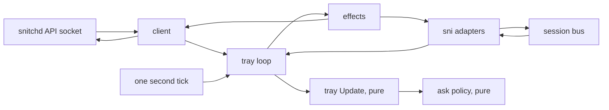
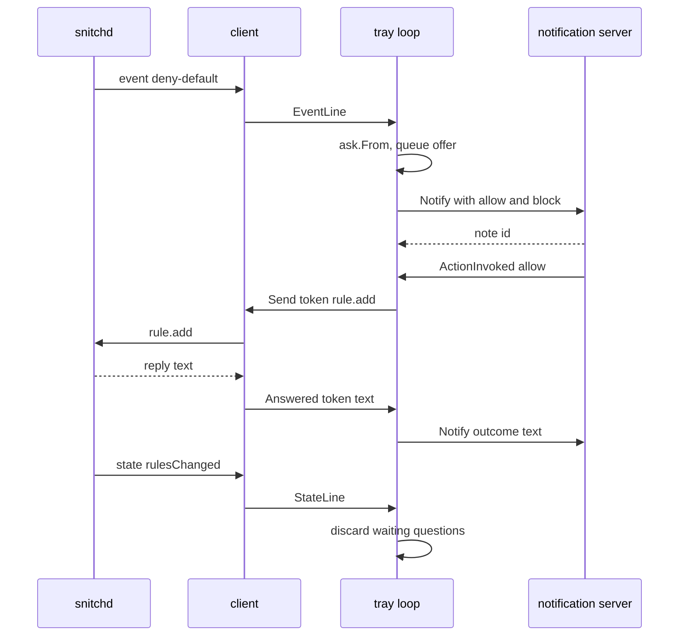
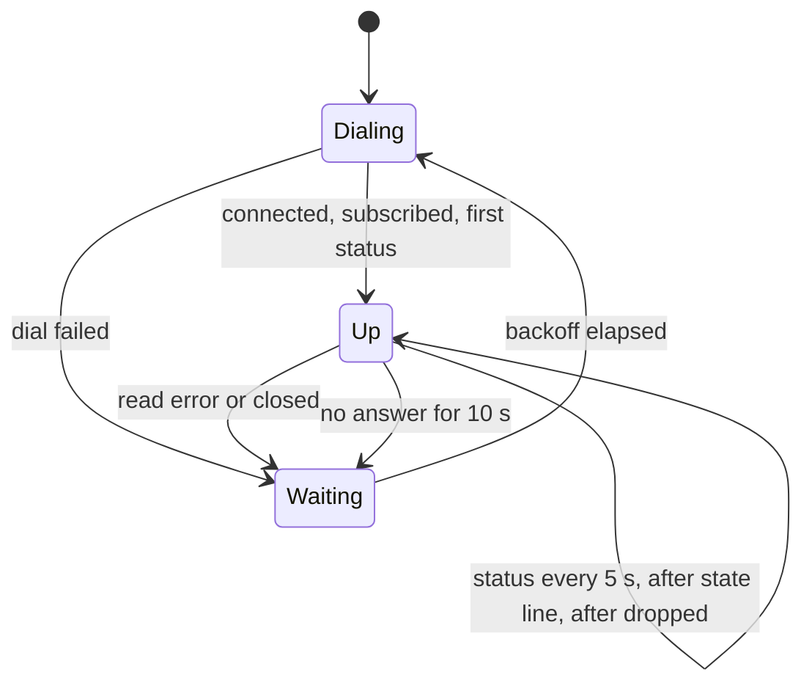

# Design Document: kde-tray

## Overview

**Purpose**: `snitch tray` puts the daemon's state into the KDE Plasma system tray and asks, as
a desktop notification with Allow and Block, about connections no rule covers. It is the first
verb of the Go user binary `snitch`.

**Users**: the operator on a KDE Plasma host. They read the icon, open the menu for the
daemon's facts, and answer questions; the answer is an ordinary overlay rule.

**Impact**: adds `cmd/snitch` and four packages under `internal/`, one dependency
(`github.com/godbus/dbus/v5`), one release asset and one check script. `snitchd`, the API and
the BPF programs are not changed.

### Goals
- One tray item with six states, a menu of facts, and questions with two explicit answers.
- An API client and a question policy that `popups-trace` and `tui` reuse unchanged.
- Every rule of the requirements provable without root, a kernel program or a desktop.
- No path by which the tray can change the mode or write a rule the operator did not choose.

### Non-Goals
- Trial verbs, kill switch, rule listing or removal from the tray.
- The process trace, the terminal popup, the waybar verb, the TUI.
- Installing snitchd or activating BPF LSM on the KDE host.
- Desktops other than Plasma, a configuration file, persistence of snooze or pause.

## Boundary Commitments

### This Spec Owns
- The binary `snitch` with the verb `tray` and `-version`, its flags and exit codes.
- `internal/client`: the connection to the daemon's API (dial, subscribe, status poll,
  request and answer by token, reconnect, resync) and the local guess of the user's role.
- `internal/ask`: which event becomes a question, the question's key, the waiting list with
  its limits, and the `rule.add` request an answer stands for.
- `internal/tray`: the model, the six states and their order, tooltip and menu rows, the
  state notices, and the loop that turns messages into effects.
- `internal/sni`: the session-bus adapters (tray item, menu, notifications, single instance)
  and the icons.
- The stand-in daemon `tools/fakedaemon`, `scripts/tray-check.sh`, the autostart entry
  `desktop/snitch-tray.desktop`, and the release asset `snitch-linux-amd64`.

### Out of Boundary
- Anything inside `snitchd`: authorization, overlay merge, validation, wording of outcomes.
  The tray shows the daemon's `text` and `error` strings and never parses them, with one
  exception stated under Client (the refusal that reveals the role).
- `examples/api.md` and `internal/api`: read, imported for the wire types, not edited.
- Mode changes of any kind, the kill switch, the trial files.
- Rule evaluation: the tray never decides whether a rule covers a connection.
- The existing release assets (`snitchd`, `snitchd.sha256`, `snitch`, `snitch-trial`).

### Allowed Dependencies
- `internal/api` for wire types, `LineReader` and `Encode`; `internal/jobs`;
  `internal/contract`; the standard library; `golang.org/x/sys/unix`;
  `github.com/godbus/dbus/v5` (only inside `internal/sni`).
- The session bus services `org.kde.StatusNotifierWatcher` and
  `org.freedesktop.Notifications`. Never the system bus.
- Forbidden for `cmd/snitch` and everything it imports: `internal/bpf`,
  `github.com/cilium/ebpf`, `internal/rules`, `internal/trial`, `internal/dns`, the `net`
  package's dialers other than the unix socket. A test pins this import set.
- `tools/fakedaemon` may additionally use `internal/api`'s server (`api.New`, `Server.Job`).

### Revalidation Triggers
- A change to `client.Msg` types or `Client.Send`: `popups-trace` and `tui` re-check.
- A change to `ask.Key`, `ask.From` or `ask.RuleFor`: `popups-trace` re-checks.
- A change in `examples/api.md` to `status`, `state`, `event`, `subscribe`, `rule.add`, the
  refusal text `write requires the operator`, or the operator file's acceptance rules: this
  spec re-checks.
- A new verb of `snitch` that writes anything other than `rule.add`: requirement 8.1 and
  the import pin are re-read.
- A rename of the asset `snitch-linux-amd64`: `tui` and the VM repo re-check.

## Architecture

### Existing Architecture Analysis
- The daemon serves JSON lines on `/run/snitch/api.sock`; the role comes from peer
  credentials. `internal/api` holds the wire types and a server built from function values.
- `tech.md` binds the shape: functions at most 40 lines, files at most 300, delegates as
  function values, every loop a `jobs.Job`, immutable values, contracts for programming
  errors, operator errors as `error`.
- `cmd/snitchd/main.go` is the model for a `main`: verb or flags, `run` with the contract
  violation handler (exit 70), a version linked in with `-X main.version`.
- Nothing user-side exists in Go. The root file `snitch` is the Python client; `go build -o
  snitch ./cmd/snitch` in the repo root would overwrite it, so documentation and scripts
  build to `/tmp/snitch` or `dist/`.

### Architecture Pattern & Boundary Map

One loop owns the model. Adapters on both sides turn traffic into messages and run effects.



**Architecture Integration**:
- Selected pattern: one event loop with a pure update function and effects as function
  values. Three event sources and several timers make shared mutable state the main risk;
  the loop removes it and makes the rules testable without a bus.
- Dependency direction, left imports nothing to its right:
  `api (types) → client → ask → tray → sni → cmd/snitch`. `ask` imports `api` only; `tray`
  imports `api`, `client` (message types) and `ask`; `sni` imports `tray` (view and note
  types) and godbus; `cmd/snitch` wires all of them. `tools/fakedaemon` imports `api`.
- Existing patterns preserved: jobs under one `jobs.Run`, delegates, contracts, the
  violation exit, the version link flag.
- New components: `client` (reused by the next two specs), `ask` (reused by `popups-trace`),
  `tray` (the rules), `sni` (the only code that knows D-Bus).
- Steering compliance: "kernel decides, daemon configures, TUI displays": the tray is a
  display with one write, `rule.add`, on an explicit click.

### Technology Stack

| Layer | Choice / Version | Role in Feature | Notes |
|-------|------------------|-----------------|-------|
| CLI | Go 1.26, `cmd/snitch` | verb `tray`, `-version` | static, no cgo |
| Session bus | `github.com/godbus/dbus/v5` v5.2.4 | item, menu, notifications, single instance | new dependency, BSD-2-Clause, pure Go |
| Daemon channel | unix socket, JSON lines, `internal/api` types | status, state, events, `rule.add` | API unchanged |
| Desktop | Plasma 6.6: `org.kde.StatusNotifierWatcher`, `com.canonical.dbusmenu`, `org.freedesktop.Notifications` 1.2 | where the item, menu and notifications appear | measured on chandali |
| Runtime | XDG autostart entry | starts the tray with the session | `desktop/snitch-tray.desktop` |
| Release | `release.yml`: second static build | asset `snitch-linux-amd64` + `.sha256` | existing assets untouched |

## File Structure Plan

### Directory Structure
```
cmd/snitch/
├── main.go            # verb dispatch (tray), -version, usage, violation exit 70
├── version.go         # version var, printVersion (same shape as snitchd's)
├── tray.go            # tray flags, wiring: bus, client, loop, tick, signals under jobs.Run
├── tray_test.go       # flags, exit codes, wiring against the stand-in daemon and a fake bus
└── imports_test.go    # the forbidden-import pin for the snitch binary
internal/client/
├── client.go          # Config, Client, New, Job: dial, session, reconnect with backoff
├── session.go         # one connection: subscribe line, reader, status poll, answer wait
├── msg.go             # Msg types: Up, Down, Facts, StateLine, EventLine, Answered
├── role.go            # Role: uid 0 or the operator file with the daemon's acceptance rules
├── clienttest/
│   └── standin.go     # the stand-in daemon: api.Server with scripted facts, operator uid as a parameter
└── *_test.go          # against the stand-in on a temp socket and a raw scripted listener; role cases
internal/ask/
├── question.go        # Key, Question, From (which event asks), local-network guard
├── rule.go            # Answer, RuleFor: the rule.add request of an answer
├── queue.go           # Queue value: offer, next, settle, flush, limits, counters
└── *_test.go
internal/tray/
├── model.go           # Model, Options, State, Facts; Msg and Effect types
├── update.go          # Update: dispatch per message type
├── facts.go           # daemon up, down, facts, state line: model changes and notices
├── questions.go       # event to question, show next, answer, outcome, capabilities
├── discard.go         # closed, timeout, flushes on rules, mode and down, pause
├── view.go            # Render: state order, tooltip, menu rows
├── notes.go           # Note texts: questions, outcomes, notices; markup escape
├── run.go             # Run: the loop job, Effects delegates
└── *_test.go
internal/sni/
├── bus.go             # Open the session bus, claim the instance name, watch name owners
├── item.go            # the StatusNotifierItem object, registration and re-registration
├── menu.go            # the flat com.canonical.dbusmenu object
├── notify.go          # Notify, CloseNotification, ActionInvoked, NotificationClosed, capabilities
├── tray.go            # the constructor: exports item and menu, returns the loop's delegates and the job
├── icons.go           # six states drawn as 22 and 44 px ARGB pixmaps
├── live_test.go       # build tag live: the real session bus of the KDE host, run by hand
├── snitest/           # test helper, godbus only, never imports sni: private dbus-daemon,
│                      # fake watcher, fake notification server
└── *_test.go          # against the private bus through DBUS_SESSION_BUS_ADDRESS; skipped without dbus-daemon
tools/fakedaemon/
└── main.go            # the stand-in of internal/client/clienttest as a tool: commands on stdin, rule.add requests on stdout
desktop/
└── snitch-tray.desktop  # autostart entry (Exec=snitch tray)
scripts/
└── tray-check.sh      # the host check of 9.5
```

### Modified Files
- `go.mod`, `go.sum` — `github.com/godbus/dbus/v5`.
- `.github/workflows/release.yml` — second build step, `snitch-linux-amd64` and its checksum
  appended to the asset list; the `-version` check for it.
- `.github/workflows/lint.yml` — `go vet -tags live ./...` so the live tests keep compiling;
  shellcheck already covers `scripts/*.sh`; the sni tests skip without `dbus-daemon`.
- `README.md` — section "The tray" (states, menu, questions, autostart, what it cannot do).
- `.kiro/steering/tech.md`, `structure.md`, `CLAUDE.md` — the `snitch` binary, the packages,
  the dependency, the build path warning.
- `.kiro/steering/roadmap.md` — the icon decision (pixmaps, not theme names), spec ticked
  when done.

## System Flows

### A question from event to rule



Key decisions: the question is closed by the tray as soon as an answer arrives, before the
daemon replies; a failed `rule.add` lifts the snooze for that key (6.8); an `ActionInvoked`
for an id that is not the open question is ignored (6.11).

### Connection life



Backoff starts at 1 s, doubles, stops at 30 s, and resets on `Up` (4.5). `Down` is sent once
per loss with the reason `not running` or `not answering` (4.3, 4.4).

## Requirements Traceability

| Requirement | Summary | Components | Interfaces | Flows |
|-------------|---------|------------|------------|-------|
| 1.1 | item appears, no privilege | cmd/snitch, sni.Item | `Bus.Open`, `Item.Register` | |
| 1.2 | single instance | sni.Bus | `Bus.Claim` | |
| 1.3 | appears or reappears with the host | sni.Item | watcher `NameOwnerChanged` | |
| 1.4 | quit and signals | tray.Update, cmd/snitch | `Quit` effect, `jobs.OnSignal` | |
| 1.5 | no session: exit non-zero | cmd/snitch, sni.Bus | `Bus.Open` error | |
| 1.6 | `-version` | cmd/snitch | `printVersion` | |
| 1.7 | start with the session | desktop file, README | | |
| 2.1, 2.2 | six states, order | tray.Render, sni.icons | `State`, `Render` | |
| 2.3 | needs attention | tray.Render, sni.Item | `View.Attention`, `Status` | |
| 2.4, 2.5, 2.6 | tooltip, time left, learning | tray.Render, tick | `View.Tooltip` | |
| 2.7 | legible on both panels | sni.icons | pixmaps with halo | |
| 3.1, 3.2, 3.3 | menu facts, error text, nothing stale | tray.Render, sni.Menu | `View.Menu` | |
| 3.4 | Quit, pause switch | tray.Update, sni.Menu | `MenuClick` | |
| 3.5 | no mode entries | tray.Render | row set is closed, test | |
| 3.6 | menu as fresh as the icon | tray.Render | one `View` per change | |
| 4.1 | state lines | client, tray facts | `StateLine` | Connection life |
| 4.2 | kill, rules error, learning | client poll | `Facts` every 5 s | Connection life |
| 4.3, 4.4 | gone, not answering | client | `Down` | Connection life |
| 4.5 | retry | client | backoff | Connection life |
| 4.6 | dropped | client | status after `dropped` | |
| 4.7 | no other way to read state | cmd/snitch | import pin | |
| 4.8 | unknown line | client | ignore, log once | |
| 5.1, 5.2 | question texts | ask.From, tray notes | `Question`, `Note` | Question flow |
| 5.3 | what never asks | ask.From | verdict filter, local guard | |
| 5.4 | no repeat within 10 min | ask.Queue | `Key`, snooze | |
| 5.5, 5.6 | one open, 32 waiting, counts | ask.Queue, tray notes | `Queue.Offer`, `Stats` | |
| 5.7 | 60 s timeout | tray questions, tick | `Tick` | |
| 5.8 | discard when the reason is gone | tray questions | `Queue.Flush` | Question flow |
| 5.9 | `-ask enforce` | cmd/snitch, ask.From | `Scope` | |
| 5.10 | pause | tray questions, view | `Paused` | |
| 5.11 | nothing from before | client | events only, no snapshot | |
| 6.1, 6.9 | answers only for the operator | client.Role, tray notes | `Model.Writer` | |
| 6.2, 6.3, 6.4, 6.5 | what an answer writes | ask.RuleFor | `RuleFor` | Question flow |
| 6.6 | note on the rule | ask.RuleFor | `Request.Note` | |
| 6.7, 6.8 | outcome, refusal, no answer | client, tray questions | `Answered` | Question flow |
| 6.10 | only buttons write | sni.Notify, tray | no `default` action | |
| 6.11 | stale answer ignored | tray questions | open note id match | |
| 6.12 | only `rule.add` | tray Effects, import pin | `Send` call sites | |
| 7.1, 7.2, 7.3, 7.4, 7.5 | notices | tray facts | diff of `Facts` | |
| 7.6 | gone for 10 s, back | tray facts, tick | `GoneSince` | |
| 7.7 | not at start, not for reloads | tray facts | baseline | |
| 7.8 | notices never wait | tray notes | separate from queue | |
| 8.1 | no mode verbs | tray Effects, test | request types pinned | |
| 8.2 | absent tray changes nothing | architecture | client only | |
| 8.3 | never the local network | ask.From | local guard | |
| 8.4 | no root | cmd/snitch | no privilege code | |
| 8.5 | nothing leaves the session | import pin | no dialer but unix | |
| 8.6 | no notification service or no buttons | sni.Notify, tray | `Capabilities` | |
| 8.7 | idle cost | client, tray | 1 s tick, 5 s poll, view diff | |
| 9.1, 9.2 | docs | README, steering, CLAUDE.md | | |
| 9.3 | tests without root or desktop | tests of client, ask, tray | | |
| 9.4 | release asset | release.yml | | |
| 9.5 | host check | scripts/tray-check.sh, tools/fakedaemon | | |
| 9.6 | caps and lint | all new packages | `scripts/caps.sh` | |

## Components and Interfaces

| Component | Layer | Intent | Req Coverage | Key Dependencies | Contracts |
|-----------|-------|--------|--------------|------------------|-----------|
| client | daemon channel | typed messages from the API, requests by token, reconnect | 4.1, 4.2, 4.3, 4.4, 4.5, 4.6, 4.7, 4.8, 5.11, 6.1, 6.7, 6.8, 6.9 | internal/api (P0) | Service, Event, State |
| ask | policy, pure | event to question, waiting list, answer to rule | 5.1, 5.2, 5.3, 5.4, 5.5, 5.6, 5.9, 6.2, 6.3, 6.4, 6.5, 6.6, 8.3 | internal/api types (P0) | Service, State |
| tray | core, pure plus loop | model, update, view, notices | 1.4, 2.1, 2.2, 2.3, 2.4, 2.5, 2.6, 3.1, 3.2, 3.3, 3.4, 3.5, 3.6, 5.7, 5.8, 5.10, 6.1, 6.7, 6.8, 6.9, 6.10, 6.11, 6.12, 7.1, 7.2, 7.3, 7.4, 7.5, 7.6, 7.7, 7.8, 8.1, 8.6 | client msgs, ask (P0) | Service, State |
| sni | session bus | item, menu, notifications, instance, icons | 1.1, 1.2, 1.3, 1.4, 1.5, 2.1, 2.3, 2.7, 3.4, 6.10, 8.6 | godbus (P0), watcher and notification server (P1) | Service, Event |
| cmd/snitch | binary | flags, wiring, exit codes | 1.1, 1.4, 1.5, 1.6, 1.7, 4.7, 5.9, 8.4, 8.5 | all of the above | Batch |
| tools/fakedaemon | dev tool | the API with scripted facts | 9.3, 9.5 | api.Server (P0) | |

### Daemon channel

#### client

| Field | Detail |
|-------|--------|
| Intent | One connection to the daemon's API, kept alive, as messages |
| Requirements | 4.1, 4.2, 4.3, 4.4, 4.5, 4.6, 4.7, 4.8, 5.11, 6.1, 6.7, 6.8, 6.9 |

**Responsibilities & Constraints**
- Dials the unix socket, sends the subscribe line, requests `status`, then reads lines.
- The subscribe line is written literally, `events: true, local: false, summary: false`:
  `api.Request` cannot marshal a false option and the daemon's default for `summary` is true.
- Requests `status` every `Poll` (5 s), once after each `state` line and once after
  `dropped`, never more than one request per 2 s except requests passed to `Send` (8.7).
- A request without its answer after `AnswerWait` (10 s): a `status` request means the
  daemon is not answering (the session ends with `Down{"not answering"}`); a `Send` request
  is answered `Answered{Err: "the daemon did not answer"}` and the session stays.
- Ids on the wire are the client's; callers see their own token.
- Lines that do not parse or have an unknown `type` are dropped; the first such line per
  session is logged once (4.8).
- Reads events only from the subscription; it never requests `snapshot` (5.11).
- `Sink` may block; the daemon then drops for this client and the `dropped` line resyncs.

**Dependencies**
- Outbound: `internal/api` — wire types, `NewLineReader`, `Encode` (P0)
- External: the daemon's socket (P0)

**Contracts**: Service [x] / API [ ] / Event [x] / Batch [ ] / State [x]

##### Service Interface
```go
package client

type Config struct {
    Path       string                                              // /run/snitch/api.sock
    Dial       func(ctx context.Context, path string) (net.Conn, error)
    Sink       func(Msg)                                           // the loop's inbox
    Log        func(string)
    Now        func() time.Time
    Poll       time.Duration                                       // 5 s
    AnswerWait time.Duration                                       // 10 s
    BackoffMin time.Duration                                       // 1 s
    BackoffMax time.Duration                                       // 30 s
}

func New(cfg Config) *Client
func (c *Client) Job() jobs.Job
// Send queues one request for the current session. Exactly one Answered with the same
// token follows: the reply's text, the daemon's error, or a local reason when there is no
// session or no answer.
func (c *Client) Send(token uint64, req api.Request)

// Role guesses what the daemon will grant this user: Writer for uid 0, and for the user
// named on the first line of the operator file when that file is a regular file owned by
// root and not writable by group or others; Reader otherwise, also on any read error.
func Role(uid uint32, user string, stat func(string) (os.FileInfo, error),
    read func(string) ([]byte, error), path string) api.Role
```
- Preconditions: `New` requires every delegate and positive durations (contract).
- Postconditions: between a `Down` and the next `Up` no `Facts`, `StateLine` or `EventLine`
  is sent; every `Send` gets exactly one `Answered`.
- Invariants: at most one session; at most one `status` request in flight.

##### Event Contract
```go
type Msg interface{ isMsg() }
type Up struct{}                          // subscribed, first status follows as Facts
type Down struct{ Reason string }         // "not running" | "not answering"
type Facts struct{ Status api.Status }
type StateLine struct{ State api.State }
type EventLine struct{ Event api.Event }
type Answered struct {
    Token uint64
    Text  string                          // the daemon's outcome sentence
    Err   string                          // the daemon's error or a local reason; "" on success
    Role  bool                            // true when Err is the operator refusal
}
```
- Ordering: messages arrive in the order of the daemon's lines; `Up` precedes the first
  `Facts` of a session.
- `Answered.Role` is the one place a daemon text is interpreted: the suffix
  `write requires the operator` (documented in `examples/api.md`, a revalidation trigger).

##### State Management
- State model: the session (connection, next id, pending requests by id with their deadline)
  belongs to the session goroutine; `Send` hands requests over a channel.
- Concurrency: one reader goroutine and one writer per session, ended together.

**Implementation Notes**
- Integration: tests run against `api.New(Deps)` on a socket in `t.TempDir()`.
- Validation: reconnect after the server closes; `Down{"not answering"}` with a server that
  accepts and stays silent; one status after `dropped`; the unknown line logged once.
- Risks: a role guess that is wrong (the daemon corrects it).

### Policy

#### ask

| Field | Detail |
|-------|--------|
| Intent | Which connection becomes a question, when, and what an answer writes |
| Requirements | 5.1, 5.2, 5.3, 5.4, 5.5, 5.6, 5.9, 6.2, 6.3, 6.4, 6.5, 6.6, 8.3 |

**Responsibilities & Constraints**
- `From` accepts only the verdicts `deny-default` and `allow-monitor` (5.3). With scope
  `Enforce` only `deny-default` (5.9). It refuses a destination on the local network by the
  prefix list of fail-safe 2 (also for IPv4-mapped addresses), although the kernel never
  reports such a connection with these verdicts (8.3, defence in depth).
- The key: who (the program name, or the path when the program is `unknown`), destination
  (the name when the event has one, else the address), protocol, port (5.4).
- `Queue` is an immutable value. Limits: one open, 32 waiting, snooze 10 min, counters for
  waiting and dropped (5.5, 5.6).
- `RuleFor`: Allow goes to the name when the event has one, else to the address; Block goes
  to the address; both carry the event's protocol and port; `program` for a declared
  program, `path` for `unknown`; no request when `unknown` has no path (6.2 to 6.5). The
  note is `snitch tray <local time, minute precision>` (6.6).
- No clock of its own: every function takes `now`.

**Contracts**: Service [x] / API [ ] / Event [ ] / Batch [ ] / State [x]

##### Service Interface
```go
package ask

const (
    Snooze     = 10 * time.Minute
    MaxWaiting = 32
)

type Scope int      // All | Enforce
type Answer int     // Allow | Block
type Outcome int    // Answered | Unanswered | Failed

type Key struct {
    Who, Dest, Proto string
    Port             uint16
}

type Question struct {
    Key     Key
    Event   api.Event
    Blocked bool        // deny-default: the connection was blocked
}

func From(ev api.Event, scope Scope) (Question, bool)
func Answerable(q Question) bool                              // false: unknown program without a path
func RuleFor(q Question, a Answer, now time.Time) api.Request // requires Answerable(q)

type Queue struct{ /* open *Question, waiting []Question, snoozed map, dropped int */ }
type Stats struct{ Waiting, Dropped int }

func (q Queue) Offer(x Question, now time.Time) Queue   // ignores a key that is open, waiting or snoozed
func (q Queue) Next() (Queue, Question, bool)           // oldest waiting becomes open; false when one is open or none waits
func (q Queue) Open() (Question, bool)
func (q Queue) Settle(o Outcome, now time.Time) Queue   // closes the open one; Answered and Unanswered snooze, Failed does not
func (q Queue) Flush(keep func(Question) bool) Queue    // drops waiting questions, no snooze
func (q Queue) Stats() Stats                            // dropped resets when nothing waits
```
- Preconditions: `RuleFor` requires `Answerable(q)`; `Settle` requires an open question.
- Postconditions: `Offer` never grows waiting beyond `MaxWaiting`; the 33rd drops the oldest
  waiting one and counts it. Expired snooze entries are removed on `Offer`.
- Invariants: a key is in at most one of open, waiting, snoozed.

**Implementation Notes**
- Validation: table tests for the seven verdicts, the local prefixes, name against address
  keys, the four rule forms, the limits.
- Risks: none beyond the trade-offs recorded in `research.md` (key by name).

### Core

#### tray

| Field | Detail |
|-------|--------|
| Intent | The tray's whole behaviour as a pure update over one model, plus the loop |
| Requirements | 1.4, 2.1, 2.2, 2.3, 2.4, 2.5, 2.6, 3.1, 3.2, 3.3, 3.4, 3.5, 3.6, 5.1, 5.2, 5.6, 5.7, 5.8, 5.10, 6.1, 6.7, 6.8, 6.9, 6.10, 6.11, 6.12, 7.1, 7.2, 7.3, 7.4, 7.5, 7.6, 7.7, 7.8, 8.1, 8.6 |

**Responsibilities & Constraints**
- `State` order, first that holds: `Gone`, `Kill`, `RulesError`, `Kept`, `Trial`, `Monitor`
  (2.2). `Attention` for the first three (2.3).
- `Render` produces one `View` (state, title, tooltip, menu rows) from the model and `now`;
  icon and menu therefore never disagree (3.6). The loop shows a view only when it differs
  from the last one shown (8.7).
- Tooltip: the state in words, every other condition that holds, the trial's deadline in
  local time and the minutes left, learning, questions paused, `not answering` (2.4 to 2.6,
  4.4, 5.10). The 1 s tick keeps the minutes current (2.5).
- Menu rows, a closed set (3.5): header (state), mode, trial, kept, kill switch, learning,
  programs and rules, rules file, overlay file, DNS tap, daemon version and start, role;
  the rules error in full when set; `questions cannot be answered here` when the
  notification service lacks buttons or is absent (8.6); separator; `Pause questions`
  (checkmark); `Quit`. With the daemon gone: header and the three last rows only (3.3).
- Facts: `Facts` replaces the status; `StateLine` updates mode, trial and kept at once.
- Notices (7.1 to 7.7) are the diff between the previous and the new facts: trial started,
  enforcement ended (with the state line's reason when one arrived), kept, unkept, kill set
  or cleared, rules error appeared (its text) or cleared. The first facts after the tray
  starts are the baseline and notify nothing; facts after a reconnect are compared with the
  last known ones. `Down` records `GoneSince`; the tick notifies once when 10 s have passed
  and once on the next `Up`; a shorter gap notifies nothing. A reload that changes neither
  mode nor error notifies nothing.
- Notices are posted at once and are never queued behind questions (7.8); they carry no
  actions and close on their own (10 s; 30 s for attention states).
- Questions: an `EventLine` goes through `ask.From` and `Queue.Offer` unless paused; when no
  question is open, the next is posted. The note names program, path, name, address, port,
  protocol, whether it was blocked or allowed, and the waiting and dropped counts (5.1, 5.2,
  5.6). A writer's note has the actions `allow` and `block`; a reader's has none and says
  only the operator can decide; an unanswerable one says the program cannot be identified
  (6.1, 6.5, 6.9).
- An answer (`Pressed`) counts only for the open question's note id (6.11): the note is
  retracted, `Send(token, ask.RuleFor(...))` is issued, the queue settles `Answered`.
  `Answered` with text posts the daemon's sentence (6.7); with an error it posts the error
  and lifts the snooze for that key (6.8); with `Role` it also sets the model to reader.
- `Closed` (dismissed, expired, or closed by the server) and the tray's own 60 s timeout
  settle `Unanswered` and write nothing (5.7, 6.10).
- Discards (5.8): `StateLine` with `rulesChanged` flushes all waiting; a mode change flushes
  waiting questions whose `Blocked` no longer fits the mode and retracts an open one that no
  longer fits; `Down` flushes waiting and retracts the open one.
- Pause (5.10): retracts the open question, flushes waiting, ignores events until resumed.
- The only requests the core ever emits are `rule.add` (6.12, 8.1); a test enumerates the
  `Send` effects over every message type.
- `MenuClick` on Quit and the `Stop` message (a signal) emit `Retract` for every open note
  and `Quit` (1.4).

**Dependencies**
- Inbound: client messages, sni messages, tick (P0)
- Outbound: `ask` (P0)

**Contracts**: Service [x] / API [ ] / Event [ ] / Batch [ ] / State [x]

##### Service Interface
```go
package tray

type State int // Gone | Kill | RulesError | Kept | Trial | Monitor

type Options struct {
    Scope  ask.Scope   // -ask all | enforce
    Writer bool        // client.Role at start
}

type Model struct{ /* opts, facts *api.Status, gone, goneSince, goneNoticed, notAnswering,
    paused, canNotify, canAct, queue ask.Queue, openNote uint32, openSince time.Time, notices (ids of posted notices until closed),
    pending map[uint64]ask.Key, nextToken uint64, lastReason string */ }

func NewModel(o Options) Model

// Messages: every client.Msg, plus:
type Tick struct{}
type Stop struct{}                                   // termination signal
type Capabilities struct{ Available, Actions bool }  // notification service at start and on change
type Posted struct{ Token uint64; NoteID uint32 }    // a Post effect succeeded
type PostFailed struct{ Token uint64 }
type Pressed struct{ NoteID uint32; Action string }  // "allow" | "block"
type Closed struct{ NoteID uint32 }
type MenuClick struct{ Row RowID }

// Effects:
type Show struct{ View View }
type Post struct{ Token uint64; Note Note }
type Retract struct{ NoteID uint32 }
type Send struct{ Token uint64; Req api.Request }
type Quit struct{}

func Update(m Model, msg any, now time.Time) (Model, []any)
func Render(m Model, now time.Time) View

type View struct {
    State     State
    Attention bool
    Title     string
    Tooltip   string
    Menu      []Row
}
type RowID int // RowQuit, RowPause, and the fact rows
type Row struct {
    ID        RowID
    Label     string
    Separator bool
    Enabled   bool
    Check     bool // a checkmark row
    Checked   bool
}
type Note struct {
    Summary, Body string        // plain text; the adapter escapes for body-markup
    Actions       []Action      // none, or allow and block
    Timeout       time.Duration
    Urgent        bool
}
type Action struct{ Key, Label string }

type Effects struct {
    Show    func(View)
    Post    func(Note) (uint32, error)
    Retract func(uint32)
    Send    func(uint64, api.Request)
    Now     func() time.Time
}
func Run(in <-chan any, fx Effects, m Model) jobs.Job // ends with nil after Quit
```
- Preconditions: `Update` panics with a contract violation on a message type it does not
  know (a wiring error); `Run` requires every delegate.
- Postconditions: `Update` returns at most one `Post` with actions, and only when no
  question is open; every `Send` request has `Type == "rule.add"`.
- Invariants: `openNote != 0` exactly when the queue has an open question that was posted.

##### State Management
- State model: `Model` is a value; `Update` returns a new one. `Run` holds the current
  model and the last shown view.
- Concurrency: one goroutine. `Post` returns the note id synchronously; `Run` feeds
  `Posted` or `PostFailed` back into `Update` before the next message.

**Implementation Notes**
- Integration: `update.go` dispatches by message type to `facts.go` and `questions.go` so
  each stays under the caps.
- Validation: the state order as a table over all 32 combinations of the five conditions;
  the notices as a table of fact pairs; the question rules as message scripts with a fake
  clock.
- Risks: a `Post` that blocks (bounded by the adapter's 2 s call timeout; a failure is
  `PostFailed`, which settles the question `Failed` so it can ask again).

### Session bus

#### sni

| Field | Detail |
|-------|--------|
| Intent | The only code that speaks D-Bus: item, menu, notifications, instance name, icons |
| Requirements | 1.1, 1.2, 1.3, 1.5, 2.1, 2.3, 2.7, 3.4, 6.10, 8.6 |

**Responsibilities & Constraints**
- `Open` connects to the session bus; an error is "no desktop session" (1.5). Loss of the
  bus later ends the bus job with an error (the tray exits 1).
- `Claim` requests `io.github.norandom.snitch.Tray` without queueing; when it is taken, the
  error names the owner's pid (1.2).
- The item: object `/StatusNotifierItem`, interface `org.kde.StatusNotifierItem`, bus name
  `org.kde.StatusNotifierItem-<pid>-1`. Properties: `Category` `SystemServices`, `Id`
  `snitch`, `Title`, `Status` (`Active`, or `NeedsAttention` with `View.Attention`),
  `IconName` empty, `IconPixmap` and `AttentionIconPixmap` from `icons.go`, `ToolTip`,
  `ItemIsMenu` true, `Menu` `/StatusNotifierItem/menu`. `Show(view)` sets them and emits
  `NewIcon`, `NewAttentionIcon`, `NewStatus`, `NewTitle`, `NewToolTip` for what changed.
  `Activate`, `SecondaryActivate`, `ContextMenu` and `Scroll` exist and do nothing.
- Registration: `RegisterStatusNotifierItem(name)` at start when the watcher has an owner,
  and again on every `NameOwnerChanged` that gives the watcher name a new owner (1.3). A
  failed call is retried on the next change; nothing polls.
- The menu: `com.canonical.dbusmenu` at `/StatusNotifierItem/menu`, flat. `GetLayout`,
  `GetGroupProperties`, `GetProperty`, `AboutToShow`, `AboutToShowGroup`, `Event`,
  `EventGroup`; properties `Version` 3, `Status` `normal`, `TextDirection` `ltr`. A changed
  row set bumps the revision and emits `LayoutUpdated(revision, 0)`. `Event(id, "clicked")`
  on an enabled row becomes `tray.MenuClick`.
- Notifications: `Post` calls `Notify` with app name `snitch`, the pixmap-free app icon
  `security-medium`, the escaped body, the note's actions as key and label pairs and never a
  `default` key (6.10), hints `urgency`, `transient` true and `desktop-entry` `snitch-tray`,
  and the note's timeout. `Retract` calls `CloseNotification`. `ActionInvoked` and
  `NotificationClosed` for ids this process posted become `tray.Pressed` and `tray.Closed`;
  other ids are ignored. `GetCapabilities` at start and whenever the notification service
  changes owner becomes `tray.Capabilities` (8.6).
- Icons: `Pixmaps(state)` returns a 22 px and a 44 px ARGB32 image in network byte order.
  All six share a shield outline; they differ in shape as well as colour: monitor (outline),
  trial (filled lower half), kept (filled), kill switch (outline with a slash), rules error
  (outline with an exclamation mark), gone (dashed outline with a cross). Dark strokes carry
  a light halo (2.1, 2.7).
- Every call has a 2 s timeout.

**Dependencies**
- Inbound: `tray` view and note types (P0)
- External: `github.com/godbus/dbus/v5` (P0); `org.kde.StatusNotifierWatcher` (P1: absent
  means no item yet); `org.freedesktop.Notifications` (P1: absent means no questions)

**Contracts**: Service [x] / API [ ] / Event [x] / Batch [ ] / State [ ]

##### Service Interface
```go
package sni

type Bus struct{ /* conn */ }

func Open() (*Bus, error)                          // session bus only
func (b *Bus) Claim() error                        // "already running (pid N)"
func (b *Bus) Close()

// Tray exports the item and the menu and returns the delegates the loop needs.
// Messages for the loop (tray.MenuClick, tray.Pressed, tray.Closed, tray.Capabilities)
// go to sink.
func (b *Bus) Tray(sink func(any), log func(string)) (*Tray, error)

func (t *Tray) Show(v tray.View)
func (t *Tray) Post(n tray.Note) (uint32, error)
func (t *Tray) Retract(id uint32)
func (t *Tray) Job() jobs.Job                      // signals: watcher owner, notification signals, bus loss
func (t *Tray) Remove()                            // unregister: release the item name (1.4)

func Pixmaps(s tray.State) []Pixmap
type Pixmap struct{ W, H int; ARGB []byte }
```
- Preconditions: `Tray` is called once per `Bus`.
- Postconditions: after `Remove`, the item's bus name is released, which makes the watcher
  drop the item.

**Implementation Notes**
- Integration: the first task reads the godbus v5.2.4 source for `prop`, `introspect`,
  `ExportMethodTable` and signal matching, and proves item and menu on chandali before the
  rest builds on them.
- Validation: tests on a private `dbus-daemon` with a fake watcher (records registrations)
  and a fake notification server (records `Notify`, emits `ActionInvoked`); skipped when
  `dbus-daemon` is not installed.
- Risks: host-specific menu expectations (see `research.md`, Risks).

### Binary

#### cmd/snitch

**Responsibilities & Constraints**
- `snitch tray [-api PATH] [-ask all|enforce] [-operator-file PATH]`; `snitch -version`.
  Defaults: `/run/snitch/api.sock`, `all`, `/etc/snitch/operator`. Any other verb or flag is
  a usage error.
- Wiring under one `jobs.Run`: `client.Job`, `sni.Tray.Job`, `tray.Run`, a 1 s
  `jobs.Every` that sends `Tick`, `jobs.OnSignal` (SIGINT, SIGTERM) that sends `Stop`. One
  buffered channel (256) is the loop's inbox; `client.Config.Sink` and the sni sink write
  to it.
- Exit codes: 0 after Quit or a signal; 1 for no session bus, a lost bus, or an instance
  already running (with the message); 2 for usage; 70 for a contract violation.
- Log lines go to stderr (the session's journal under autostart). They carry no more than
  the notifications do (8.5).
- Runs no privileged call and never re-executes itself (8.4).

**Contracts**: Batch [x]

##### Batch / Job Contract
- Trigger: session autostart (`desktop/snitch-tray.desktop`, copied to
  `~/.config/autostart/`) or by hand.
- Idempotency & recovery: a second start exits 1; a crash leaves no state behind (snooze and
  pause are in memory); the item disappears when the bus name is released by the exit.

#### tools/fakedaemon (summary)
`fakedaemon -api PATH`: `api.New` with facts held in memory, the operator set to the invoking
uid, `RuleEdit` that prints the request as one JSON line on stdout and answers with a rule
sentence. Commands on stdin, one per line: `mode monitor|enforce`, `trial 10m`, `end`,
`keep`, `unkeep`, `kill on|off`, `error TEXT|none`, `learning on|off`, `event PROGRAM PATH
ADDR[=NAME] PORT PROTO VERDICT`, `refuse on|off` (answers `rule.add` with an error), `quit`.
It is a development tool: not released, not installed, and it loads no kernel program.

## Data Models

### Domain Model
- **Facts**: the daemon's `api.Status` as last received, or none (gone).
- **Question**: an uncovered connection with its key; **Queue**: one open, up to 32 waiting,
  snoozed keys with their time.
- **View**: what the desktop shows now. **Note**: one notification.
- Invariants are listed with `ask.Queue` and `tray.Model`.

### Data Contracts & Integration
- To the daemon, all documented in `examples/api.md`: the literal subscribe line; `status`;
  `rule.add` with `program` or `path`, `to`, `proto`, `port`, `verdict`, `note`.
- `rule.add` forms:

| Answer | Event has a name | `to` | `verdict` |
|--------|------------------|------|-----------|
| Allow | yes | the name | `allow` |
| Allow | no | the address | `allow` |
| Block | either | the address | `deny` |

  `proto` and `port` are the event's; `program` is the event's program, or `path` is the
  event's path when the program is `unknown`.
- Nothing is stored on disk.

## Error Handling

### Error Strategy
The tray degrades and says so; it never exits because the daemon or the notification service
misbehaves, and it never retries a write on its own.

### Error Categories and Responses
- **Operator errors** (usage, second instance, no session): one line on stderr, exit 1 or 2.
- **Daemon gone or silent**: state `Gone`, questions flushed, reconnect with backoff.
- **Daemon refuses or does not answer a `rule.add`**: the daemon's text, or `the daemon did
  not answer`, as a notice; the key may ask again; nothing is written locally.
- **Notification service absent or without buttons**: state and menu keep working; the menu
  says questions cannot be answered here; questions are posted without actions, or not at
  all when the service is absent.
- **Watcher absent**: the tray waits for it; no error.
- **Bus lost**: exit 1 (the session is ending or broken).
- **Programming errors**: contract violation, exit 70, as in snitchd. The kernel is
  unaffected in every case.

### Monitoring
stderr lines: start (version, socket, role), each `Up` and `Down`, each `rule.add` sent with
its outcome, the first unparsable line per session, registration with the watcher.

## Testing Strategy

### Unit Tests
- `tray.Render`: all 32 combinations of gone, kill, rules error, kept, trial yield the state
  of the order in 2.2 and `Attention` per 2.3; the menu's row set contains no trial, kill or
  mode entry (3.5) and no fact rows when gone (3.3).
- `ask.From`: the seven verdicts, scope `Enforce`, every local prefix of fail-safe 2
  including an IPv4-mapped one (5.3, 5.9, 8.3).
- `ask.Queue`: same key open, waiting, snoozed, and asked again after 10 min; the 33rd drops
  the oldest and counts it; `Failed` leaves no snooze (5.4 to 5.6, 6.8).
- `ask.RuleFor`: the three rows of the table above, `program` against `path`, the note, and
  `Answerable` false without a path (6.2 to 6.6).
- `tray.Update` scripts with a fake clock: timeout at 60 s (5.7); flush on `rulesChanged`,
  mode change and `Down` (5.8); pause (5.10); a `Pressed` for another id writes nothing
  (6.11); `Closed` writes nothing (6.10); the set of `Send` request types over all scripts
  is exactly `rule.add` (6.12, 8.1); reader and no-actions notes (6.9, 8.6).
- `tray` notices: each pair of facts of 7.1 to 7.5, the baseline, a reload without change
  (7.7), gone for 9 s against 11 s (7.6).
- `client.Role`: root, the named user, another user, a file writable by group, a file not
  owned by root, a missing file: the same cases as snitchd's operator tests.

### Integration Tests
- `client` against `api.Server` on a temp socket: `Up` then `Facts`; a state line triggers
  one status; `Down{"not running"}` when the server closes and `Up` again after a restart
  within the backoff bounds (4.3, 4.5); `Down{"not answering"}` against a listener that
  accepts and stays silent (4.4); `dropped` triggers one status (4.6); a garbage line is
  ignored and logged once (4.8); `Send` as a reader returns `Answered{Role: true}`.
- `sni` on a private bus: registration, re-registration after the fake watcher restarts
  (1.3); a second `Claim` fails naming the pid (1.2); `Show` changes `Status` and emits the
  signals; `GetLayout` returns the rows and `Event` yields `MenuClick`; `Post` passes
  actions without `default` and escapes markup; `ActionInvoked` for a foreign id is ignored.
- `cmd/snitch` wiring: the stand-in daemon plus the fake bus services: an event produces a
  `Notify`, an `ActionInvoked allow` produces the expected `rule.add` at the daemon, Quit
  releases the item name and exits 0.
- The import pin: `go list -deps ./cmd/snitch` contains none of the forbidden packages
  (4.7, 8.5).

### Host Check (scripts/tray-check.sh, on chandali)
- Phase A, stand-in daemon: the item appears; each of the six states shows, with a
  screenshot on Breeze and on Breeze Dark; a question appears; Allow writes the expected
  `rule.add` line, Block the expected deny; the tray survives a restart of the stand-in and
  `systemctl --user restart plasma-plasmashell` (the operator runs that step). Phase A needs
  root once: Allow and Block are offered only when a root-owned `/etc/snitch/operator` names
  the user (the role guess), so the operator creates that file with sudo; without it the
  answer steps are recorded as skipped.
- Phase B, once snitchd runs on the host in monitor mode: the same with the real daemon,
  the rule visible in `/etc/snitch/rules.d/local.toml`, removed again by the script.
- Idle cost: CPU time of the tray over 10 min idle is recorded (8.7).

## Security Considerations
- The tray holds no privilege. Its only authority is the daemon's operator role, exercised
  through one request type on an explicit button press.
- Notifications are shown by the user's own session; a body click and a dismissal write
  nothing; questions are transient, so no stale button stays in the history.
- Another process of the same user could post look-alike notifications or call the daemon
  itself: that user already is the operator or a reader, so the tray adds no new power.
- Markup in program names, paths and DNS names is escaped before it reaches the
  notification server.
- Fail-safes: 1 (egress events only), 2 (local guard in `ask.From`), 3 (the tray has no part
  in the heartbeat), 4 and 5 (no request type but `rule.add`, pinned by a test).

## Performance & Scalability
- Idle: one 1 s tick that renders a view and compares it, one status request per 5 s.
- Under load the daemon dedupes events (10 s) and drops for a slow client; the tray shows at
  most one question at a time and keeps 32.

## Open Questions
- Block in monitor mode is a real deny (deny rules apply in every mode). The note's wording
  says so; the operator confirmed the behaviour implicitly by approving requirement 6.4.
- The roadmap spoke of theme icon names; this design draws pixmaps instead (`research.md`,
  Decision: icons). The roadmap line is corrected in the documentation task.
