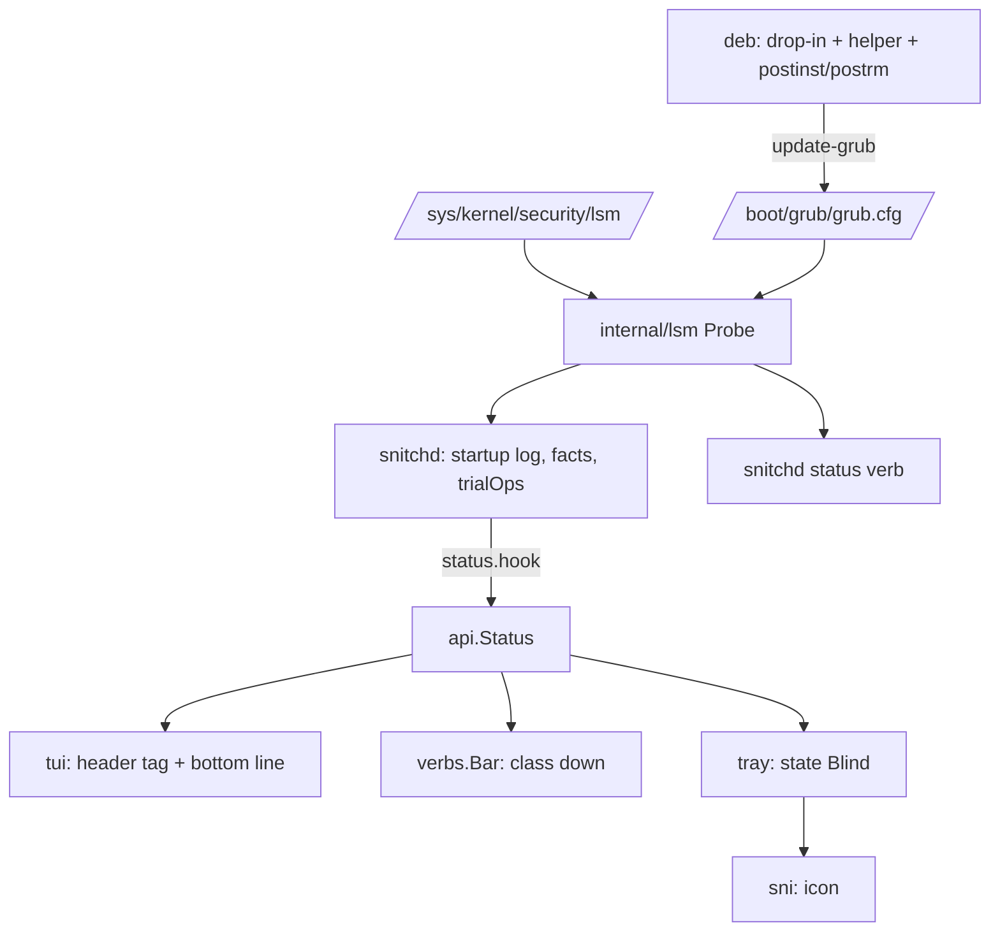
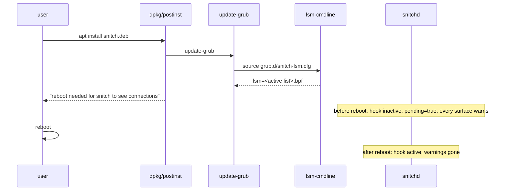

# Design Document: lsm-activation

## Overview

**Purpose**: make an inactive BPF LSM impossible to overlook, and let the package arrange the
fix. Today the daemon attaches, logs its hooks and reports monitor mode on a kernel that never
calls them.

**Users**: someone who installs the deb on a stock Ubuntu or Debian kernel; the operator on a
console; client authors reading the API.

**Impact**: one new status fact (`hook`), one refusal in the trial path, one warning on each of
four surfaces, one new tray state, and a package that for the first time ships maintainer
scripts (a GRUB drop-in, a helper, `postinst`, `postrm`).

### Goals
- The daemon states `active`, `inactive` (reboot pending or not configured) or `unknown`, from
  the kernel's active LSM list, at start and in its status.
- Every client surface warns while `inactive`; nothing warns when the fact is absent.
- A trial or keep is refused while `inactive`.
- Installing the deb on a GRUB host makes the next boot activate `bpf`, never dropping an
  active LSM; removing it undoes that.

### Non-Goals
- Boot loaders other than GRUB (instruction only), rebooting, kernels without
  `CONFIG_BPF_LSM`.
- Any change to the BPF programs, maps, rule engine, status file format, or the fail-safes.
- A new API message or state line; a self-test connection.

## Boundary Commitments

### This Spec Owns
- `internal/lsm`: the probe and its wording.
- `api.HookStatus` and `Status.Hook`; the daemon filling it; the `hook:` line of
  `snitchd status`; the start log line; the trial/keep refusal.
- The hook warning in `internal/tui` (header tag + bottom line), `internal/verbs` (bar),
  `internal/tray` (state `Blind`, row, note) and `internal/sni` (icon).
- `packaging/grub-snitch-lsm.cfg`, `packaging/lsm-cmdline.sh`, `packaging/postinst.sh`,
  `packaging/postrm.sh`, their place in the deb tree, the smoke group that proves them.
- `scripts/lsm-check.sh` (read-only host check) and the documentation listed below.

### Out of Boundary
- `bpf/`, `internal/bpf/`, `internal/rules`, `internal/dns`, `internal/trial`,
  `internal/status` (the status file stays byte-identical).
- The units, the operator file, `scripts/setup.sh`, the VM repository's deployment.
- `/etc/default/grub` itself: never edited.
- Release tagging and the reboot of any host.

### Allowed Dependencies
- `internal/lsm` imports the standard library only.
- `cmd/snitchd` imports `internal/lsm`; `cmd/snitch` and its packages do **not** (they read
  `api.Status.Hook`); `internal/api` gains a type and imports nothing new.
- Maintainer scripts and the helper use POSIX `sh`, `cat`, `command -v`, and `update-grub`
  when present. No new package dependency (`Depends` stays empty).

### Revalidation Triggers
- A change to `HookStatus` fields or the three state words: `examples/api.md`, tray, TUI, bar.
- A change to the helper's output contract: the drop-in, `postinst`, the smoke group, README.
- Moving the helper or the drop-in path: `packaging/conffiles`, `deb.go`, smoke group 2's list.
- A boot loader added to the automatic path: Requirement 7 and the smoke.

## Architecture

### Existing Architecture Analysis
- The daemon builds `api.Status` in `facts()`; clients decode with plain `json.Unmarshal`
  (unknown fields ignored). Exact-bytes tests pin the status without optional members.
- `trialOps` is the single implementation behind both the API's trial verbs and the CLI's.
- Client packages are pure over `api` types (`tui`, `tray`, `verbs`); adapters (`term`, `sni`)
  render. The fake daemon (`clienttest.StandIn`) drives every client test and both host checks.
- The deb is assembled by `debTreeScript` in `.dagger/deb.go`; the smoke runs group scripts in
  a privileged systemd container without a boot loader.

### Architecture Pattern & Boundary Map



- **Pattern**: probe once in the daemon, carry a fact, render everywhere. The package and the
  daemon meet only through the generated boot configuration.
- **Steering compliance**: egress-only and fail-open rules untouched; clients change no mode;
  one concern per package; injected readers keep tests root-less.

### Technology Stack

| Layer | Choice / Version | Role in Feature | Notes |
|-------|------------------|-----------------|-------|
| Daemon | Go, stdlib | probe, status, refusal | no new dependency |
| Clients | Go (`tui`, `verbs`, `tray`, `sni`) | warnings, icon | drawn pixmap, no theme icon |
| Package | POSIX sh, grub.d, dpkg maintainer scripts | next-boot configuration | `update-grub` optional at run time |
| Pipeline | Dagger module | deb tree, shellcheck glob, smoke group | pins unchanged |

## File Structure Plan

### Directory Structure
```
internal/lsm/
├── lsm.go              # State, Hook, Probe(read), Sentence(); grub.cfg scan
├── lsm_test.go         # states, pending, unreadable files, wording has no OS error text
└── helper_test.go      # runs packaging/lsm-cmdline.sh with fixture files (Req 7.1-7.5)
cmd/snitchd/
├── hook.go             # hookCache (30 s), hookStatus(lsm.Hook) *api.HookStatus, hookLine
├── hook_test.go        # facts carry hook; start log; recorded trial untouched
├── hook_refusal_test.go # refusal through trialOps, API and CLI
└── ctl_status_hook_test.go # the status verb's hook line
internal/tray/
├── hook.go             # hookInactive(st), hookRow(st), noteHook(old, cur)
└── hook_test.go
internal/sni/
├── icons_blind.go      # the Blind mark (moved out of icons.go's 300-line reach)
└── icons_blind_test.go
internal/tui/
├── hook.go             # withHookTag(m, l) for the header, withHookLine(m, lines) for the bottom line
├── hook_test.go        # + testdata/blind.golden, blind_pending.golden, hook_unknown.golden
internal/verbs/
└── bar_hook_test.go
internal/client/clienttest/
├── hook.go             # StandIn.SetHook(*api.HookStatus); command "hook active|inactive|pending|unknown|none"
└── hook_test.go
packaging/
├── grub-snitch-lsm.cfg # -> /etc/default/grub.d/snitch-lsm.cfg (conffile)
├── lsm-cmdline.sh      # -> /usr/lib/snitch/lsm-cmdline (0755)
├── postinst.sh         # -> DEBIAN/postinst
└── postrm.sh           # -> DEBIAN/postrm
scripts/
└── lsm-check.sh        # read-only: list, command line, drop-in, daemon's status.hook
```

### Modified Files
- `internal/api/types.go` — `HookStatus`, `Status.Hook` (last field, `omitempty`), constants
  `HookActive|HookInactive|HookUnknown`; `types_test.go` key set and a round-trip test.
- `cmd/snitchd/daemon.go` — one struct field `hook hookCache` and one call in `startup`.
- `cmd/snitchd/api.go` — `facts()` sets `s.Hook`.
- `cmd/snitchd/trialops.go`, `apiwrite.go`, `ctl.go` (`deps.hook`), `ctl_verbs.go` — `trialOps.hook`;
  `start`/`keep` refuse on inactive; fixtures in `trialops_test.go`, `ctl_verbs_test.go`,
  `contracts_trial_test.go` default to active.
- `cmd/snitchd/ctl_status.go` — `hook:` line after `kill:`; usage text; `ctl_status_test.go`
  key list.
- `internal/tray/model.go` — `Blind` after `Gone`, `String`, `Attention`, `RowHook`;
  `view.go` — `conditions`, `factRows`; `facts.go`/`notes.go` — the transition note.
- `internal/sni/icons.go` — `drawState`/`markOf` dispatch to the Blind mark; `icons_test.go`
  `allStates`, `stateNames` (`blind`).
- `internal/tui/overview.go` — the header's leading ` snitch |` becomes its own span inside
  the existing `Sprintf` line (no net lines; existing goldens unchanged as text) so that
  `withHookTag` can insert after it; `overviewBottom` calls `withHookLine`. `graph.go` reuses both.
- `internal/verbs/bar.go` — `barClass`, `buildTooltip`.
- `internal/client/clienttest/commands.go` — the `hook` command in the map.
- `scripts/tray-check.sh`, `scripts/tui-check.sh` — one step each for the inactive state.
- `packaging/conffiles`, `packaging/lintian-overrides` (only if the smoke shows a needed,
  justified override), `packaging/control` (description sentence).
- `.dagger/deb.go` — tree: drop-in, helper, `DEBIAN/postinst`, `DEBIAN/postrm`;
  `.dagger/checks.go` — shellcheck also globs `packaging/*.sh`;
  `.dagger/smoke.go` — group 2's payload list (11 files) and a new group 9 "boot setting"
  (lintian becomes 10).
- Docs: `README.md`, `docs/daemon.md`, `docs/tray.md` (+ `docs/tray-blind-{22,44}.png`),
  `docs/tui.md`, `docs/ci-debs.md`, `docs/development.md`, `examples/api.md`, `CLAUDE.md`,
  `.kiro/steering/{product,tech,structure,roadmap}.md`.

## System Flows

### Install to working, on a GRUB host


### Helper decision (`lsm-cmdline`)
Inputs: the active list file, the running command line file, and the GRUB command-line
variables as one argument. Output: one kernel parameter on stdout, or nothing.

| Case | Condition | Output | `--explain` says |
|------|-----------|--------|------------------|
| admin | the GRUB variables already contain `lsm=` (at the start or after whitespace) | nothing | add `bpf` to your own `lsm=`, or: already in your `lsm=` |
| unreadable | active list missing or empty | nothing | cannot read the active LSM list |
| default | list has `bpf`, running command line has no `lsm=` | nothing | already active |
| unsupported | (ours and add only) some installed kernel lacks support: for a `/boot/vmlinuz-<v>`, `/boot/config-<v>` is missing, unreadable, or has no `CONFIG_BPF_LSM=y`; or no kernel is found | nothing | names the first such kernel and why |
| ours | list has `bpf`, running command line has `lsm=`, every installed kernel supports it | `lsm=<list>` | active, kept |
| add | list lacks `bpf`, every installed kernel supports it | `lsm=<list>,bpf` | reboot needed |

The support check runs before `ours` and `add`, because the parameter lands on every boot
entry `grub-mkconfig` writes: a kernel built without BPF LSM would otherwise boot with an
LSM name it does not know. The check is conservative: a kernel whose build configuration
cannot be read counts as unsupported. `-k BOOTDIR` (default `/boot`) exists for tests.

## Requirements Traceability

| Requirement | Summary | Components | Interfaces | Flows |
|-------------|---------|------------|------------|-------|
| 1.1, 1.2, 1.7 | probe states, pending, unsupported | internal/lsm | `Probe` | — |
| 1.3, 1.4 | start log | cmd/snitchd hook.go, daemon.go | `hookLine` | — |
| 1.5, 1.6 | keeps running, never denies | cmd/snitchd (no change to mode, maps) | — | — |
| 2.1, 2.6 | status fact, API doc | internal/api, cmd/snitchd api.go, examples/api.md | `HookStatus` | — |
| 2.2, 2.3 | status verb line, exit code | cmd/snitchd ctl_status.go | `hookLine` | — |
| 2.4, 2.5 | old/new compatibility | internal/api (`omitempty`, nil) | — | — |
| 3.1, 3.2, 3.4 | refusal | cmd/snitchd trialops.go | `trialOps.hook` | — |
| 3.3 | recorded enforce + inactive | cmd/snitchd (probe only reads), tui/verbs/tray ordering | — | — |
| 4.1–4.5 | TUI warning | internal/tui hook.go, overview.go, graph.go | `withHookTag`, `withHookLine` | — |
| 5.1–5.3 | bar | internal/verbs bar.go | `Bar` | — |
| 6.1–6.5 | tray state, icon, row, note | internal/tray, internal/sni | `Blind`, `RowHook` | — |
| 7.1–7.5, 7.12 | boot setting cases, kernel support check | packaging/lsm-cmdline.sh, grub-snitch-lsm.cfg | helper table | helper decision |
| 7.6–7.8 | messages, non-GRUB, failure | packaging/postinst.sh | — | install flow |
| 7.9 | removal | packaging/postrm.sh, inert drop-in | — | — |
| 7.10, 7.11 | nothing else runs; installable | deb.go, smoke groups 2, 9, 10 | — | — |
| 8.1, 8.2 | docs | README, docs/*, examples/api.md | — | — |
| 8.3 | root-less tests | lsm_test, helper_test, client tests | — | — |
| 8.4 | smoke | .dagger/smoke.go group 9 | — | — |
| 8.5 | host check | scripts/lsm-check.sh, operator | — | — |

## Components and Interfaces

| Component | Layer | Intent | Req | Dependencies | Contracts |
|-----------|-------|--------|-----|--------------|-----------|
| internal/lsm | domain | probe + wording | 1.1–1.3 | stdlib | Service |
| api.HookStatus | wire | the fact | 2.1, 2.4, 2.5 | — | API |
| cmd/snitchd hook | daemon | cache, log, refusal, verb line | 1.3–1.6, 2.2, 2.3, 3 | lsm, api | Service |
| tui hook | client | header tag, bottom line | 4 | api | State |
| verbs.Bar | client | class and tooltip | 5 | api | Service |
| tray Blind + sni icon | client | state, row, note, pixmap | 6 | api | State |
| package boot setting | packaging | drop-in, helper, scripts | 7 | sh, update-grub | Batch |

### Domain

#### internal/lsm

##### Service Interface
```go
package lsm

type State string

const (
	Active   State = "active"
	Inactive State = "inactive"
	Unknown  State = "unknown"
)

// Hook is what the kernel will do with the daemon's LSM programs.
type Hook struct {
	State   State
	Pending bool // Inactive only: the generated boot configuration already carries bpf
	CanTell bool // Inactive only: false when the boot configuration could not be read
	// Unsupported: the running kernel's build configuration has no CONFIG_BPF_LSM=y, so no
	// reboot into this kernel can activate the hook. Read from /boot/config-<release>
	// (release from /proc/sys/kernel/osrelease), falling back to /proc/config.gz; when
	// neither is readable, support is not claimed either way and Unsupported stays false.
	Unsupported bool
}

// Probe reads ListPath and, when bpf is not active, the GRUB configurations.
// read is os.ReadFile in production. It never returns an error: an unreadable
// list is Unknown.
func Probe(read func(string) ([]byte, error)) Hook

// Sentence is the one human-readable line for h, fixed wording, no OS error text.
func (h Hook) Sentence() string

const ListPath = "/sys/kernel/security/lsm"
```
- Preconditions: `read != nil` (contract).
- `Active`: `bpf` is one comma-separated token of the trimmed list.
- `Pending`: some `linux`/`linuxefi` line of `/boot/grub/grub.cfg` or `/boot/grub2/grub.cfg`
  has an `lsm=` argument whose comma-separated value contains `bpf`.
- Sentences (exact, tested):
  - active: `kernel hook active`
  - inactive, pending: `kernel hook inactive: reboot to activate it; until then connections are neither seen nor blocked`
  - inactive, not configured: `kernel hook inactive: bpf is not in the kernel's LSM list and the next boot is not configured for it; connections are neither seen nor blocked`
  - inactive, unsupported: `kernel hook unavailable: this kernel is built without BPF LSM support, so no reboot can activate it; connections are neither seen nor blocked`
  - inactive, cannot tell: `kernel hook inactive: connections are neither seen nor blocked; run as root to see whether a reboot is pending`
  - unknown: `kernel hook not checked: the kernel's LSM list could not be read`

### Wire

#### api.HookStatus
```go
type HookStatus struct {
	State   string `json:"state"`             // "active" | "inactive" | "unknown"
	Pending bool   `json:"pending,omitempty"` // inactive only
	Unsupported bool `json:"unsupported,omitempty"` // inactive only: kernel built without BPF LSM
	Reason  string `json:"reason"`            // lsm.Hook.Sentence()
}
// in Status, after Counters:
Hook *HookStatus `json:"hook,omitempty"`
```
- nil means not reported (an older daemon, or the fake daemon by default): no warning.
- Clients switch on `State == "inactive"` for the warning and `"unknown"` for the short
  notice; any other value, including future ones, shows nothing.

### Daemon

#### cmd/snitchd hook.go
- `func (c *hookCache) now() lsm.Hook` (exposed as `d.hookNow`): returns the cached probe, re-probing when older than
  30 s (the state cannot change without a reboot; `Pending` can, after an install).
- `daemon.go` gains exactly one struct field, `hook hookCache` (type, reader delegate and
  timestamp defined in `hook.go`), and one call in `startup`, `d.hook.start(d.log)`, placed
  after `attach()` and before the existing start line; `daemon.go` is at 296 of 300 lines.
  `startupLine` itself is unchanged.
- `facts()`: `s.Hook = hookStatus(d.hookNow())` after counters.
- `trialOps.hook func() lsm.Hook` (daemon: `d.hookNow`; CLI: `c.deps.hook`, a new field of
  `ctl`'s `deps` in `ctl.go`, `lsm.Probe(os.ReadFile)` in production). Test fixtures of
  `trialOps` and `deps` default to a probe that answers `Active`, so no existing test reads
  the real `/sys`. `start` and
  `keep` return, before any other check or write, the error
  `refused: ` + Sentence when `State == Inactive`. `end` and `unkeep` never consult it.
- `snitchd status`: `hook:` line = Sentence of `c.deps.hook()`, printed after `kill:` in every state; the exit
  code logic is untouched.
- A recorded trial or kept enforce is never altered because of the hook state (3.3): the
  probe only reads.

### Clients

#### internal/tui
- `withHookTag(m Model, l Line) Line`: when `status.Hook` is inactive, inserts
  ` NO KERNEL HOOK |` with the Bad style directly after the leading ` snitch |`, so the tag is
  inside the first 30 columns and survives the header's truncation at 80 columns whatever the
  mode text (kept enforce included). One call in `overviewHeader`; `overview.go` is at 297 of
  300 lines, so each call site costs one line and the logic stays in `hook.go`.
- `withHookLine(m Model, lines []Line) []Line`: fills the bottom line (`lines[5]`) when no
  confirmation, search or notice occupies it. One call in `overviewBottom`. Fixed constants
  via `clean.Const`, each at most 78 columns plus the leading space:
  - inactive, pending: `kernel hook inactive: connections not seen or blocked - reboot to activate` (74)
  - inactive, otherwise: `kernel hook inactive: connections not seen or blocked - boot not configured` (75)
  - inactive, unsupported: `kernel hook unavailable: kernel built without BPF LSM - snitch cannot work` (74)
  - unknown: `kernel hook could not be checked` (32)
  The daemon's `Reason` is not printed in the TUI (width), so no hostile text enters (4.5).
- Goldens for this feature render at exactly 80x20 (the minimum), unlike the existing
  24-line goldens, and assert the tag and the line are complete at that width.
- State arrives through the existing `onFacts`; removal after a daemon restart needs no new
  message (4.3).

#### internal/verbs (bar)
- `barClass`: `down` when `st.Hook` is inactive (after the existing `down` causes).
- `buildTooltip`: first line `clean`-sanitised `Hook.Reason` when inactive.

#### internal/tray and internal/sni
- `State` order: `Gone, Blind, Kill, RulesError, Kept, Trial, Monitor`; `Blind.String()` is
  `kernel hook inactive`; `Attention()` includes `Blind`.
- `conditions`: `add(Blind)` right after the `Gone` test when `st.Hook` is inactive.
- `RowHook`: `Kernel hook: reboot pending`, `Kernel hook: boot not configured` or
  `Kernel hook: kernel lacks BPF LSM` (unsupported takes precedence); shown only
  while Blind.
- Note on the transition into Blind, modelled on `noteRulesError`; none on leaving beyond the
  existing state-change wording.
- Icon: the shield outline with one red horizontal bar across its middle, extending past the
  outline on both sides (distinct from Kill's diagonal slash and Gone's dashed outline); the
  existing distinctness and halo tests cover it once `allStates` includes it.

### Packaging

#### Batch / Job Contract
- **Drop-in** (`/etc/default/grub.d/snitch-lsm.cfg`, conffile, sourced by `grub-mkconfig`):
  if `/usr/lib/snitch/lsm-cmdline` is executable, append its output (given
  `"$GRUB_CMDLINE_LINUX $GRUB_CMDLINE_LINUX_DEFAULT"`) to `GRUB_CMDLINE_LINUX_DEFAULT`;
  otherwise do nothing. Recovery entries do not use `_DEFAULT`, so they boot without it.
- **Helper** (`lsm-cmdline [--explain | --manual] [-l LISTFILE] [-c CMDLINEFILE] [-k BOOTDIR] -- "GRUBVARS"`):
  the table above. Exit 0 always. `-l`/`-c` exist for tests; defaults are the real paths.
  - The admin case matches `lsm=` at the start of GRUBVARS or after whitespace. When the
    admin's own list already contains `bpf`, the explanation says so instead of asking to add it.
  - The active list (not the emitted `lsm=...` string) must match `^[a-z0-9_,]+$`; otherwise
    the helper treats it as unreadable.
  - Image builds: without `-l`, the helper emits nothing when `/` is not the root of PID 1
    (`/proc/1/root` resolves elsewhere or cannot be read), so a chroot with a bind-mounted
    `/sys` never bakes the build host's list into an image. A container that is its own PID
    namespace still reads its own kernel's list; documented as a limit.
  - `--explain` prints one sentence for the case; `--manual` prints the line for hosts without
    GRUB, always starting with the fixed prefix `snitch: add to the kernel command line: `
    followed by `lsm=<list>,bpf`, or `lsm=<your list>,bpf` when the list cannot be read. The
    PID-1 guard changes only the emitted parameter: `--explain` and `--manual` always print
    their line.
- **postinst** (`configure` only): if `update-grub` is on PATH and `${DPKG_ROOT:-}/boot/grub`
  exists, run it and report failure in one line without failing; then print
  `lsm-cmdline --explain`. Without GRUB, print `lsm-cmdline --manual`. Exit 0. Every absolute
  path is prefixed with `${DPKG_ROOT:-}` (dpkg's own variable, empty on a normal install), which
  is also how the root-less tests point the scripts at a temporary tree.
- **postrm** (`remove`, `purge`): run `update-grub` when present and `${DPKG_ROOT:-}/boot/grub`
  exists, ignoring its status. dpkg removes the package's files before `postrm remove`, so the
  helper is gone and the surviving conffile adds nothing (7.9); `purge` removes the conffile
  before `postrm purge`.
- **Idempotency**: every `update-grub` recomputes from the running kernel; repeated installs
  converge on the same line.

## Data Models

### Data Contracts & Integration
`status.hook` examples for `examples/api.md`:
```json
"hook": {"state": "active", "reason": "kernel hook active"}
"hook": {"state": "inactive", "pending": true, "reason": "kernel hook inactive: reboot to activate it; until then connections are neither seen nor blocked"}
"hook": {"state": "unknown", "reason": "kernel hook not checked: the kernel's LSM list could not be read"}
```

## Error Handling

### Error Strategy
The probe has no error path: unreadable inputs become `Unknown` or `CanTell=false`, with fixed
wording. Nothing in this feature can make the daemon exit, deny, or change a mode.

### Error Categories and Responses
- Trial or keep while inactive: refusal sentence over the API (error reply) and the CLI
  (stderr, exit 1), nothing written.
- `update-grub` missing or failing: one printed line; the install succeeds.
- Hostile or odd `grub.cfg` content: scanned as bytes, bounded by file size, no execution.

### Monitoring
The start log line and `snitchd status` `hook:`; `status.hook` for clients.

## Testing Strategy

### Unit Tests
- `lsm.Probe`: unsupported from `/boot/config-<release>` without `CONFIG_BPF_LSM=y`, from
  `/proc/config.gz` when the first is absent, and not claimed when neither is readable; list
  with and without `bpf` (also `bpfx`, leading/trailing whitespace); list
  unreadable; grub.cfg with `lsm=...,bpf`, with `lsm=` lacking `bpf`, absent, permission
  denied; every Sentence exact and free of `no such file`.
- `api`: status without hook is byte-identical to the golden; with hook the bytes are the
  existing ones followed by `,"hook":{`; key set updated.
- `trialOps`: `start` and `keep` refuse on Inactive and write nothing; accept on Active and
  Unknown; `end`/`unkeep` work in all three.
- `tray`: `conditions` order with Blind; attention; row text for pending and not configured;
  one note on entering Blind. `sni`: Blind pixmap differs from the six others at both sizes.
- `tui`: goldens for inactive, inactive-pending, unknown at 80x20 in overview and graph;
  hook nil leaves every existing golden unchanged; warning disappears on a later facts
  message with `active`.
- `verbs.Bar`: inactive gives `down` and the first tooltip line; unknown and nil unchanged.

### Integration Tests
- `helper_test.go`: `sh packaging/lsm-cmdline.sh -l F -c F -- "VARS"` for the five table cases,
  both admin variants, a forbidden character, `--explain` and `--manual` wording, and the
  PID-1 guard yielding nothing when `/proc/1/root` is unreadable.
- `clienttest`: the `hook pending` command (`inactive` with `pending`) changes what a connected client receives;
  `cmd/snitch` oneshot `status` against the stand-in in the inactive state.
- `scripts/tray-check.sh`, `scripts/tui-check.sh`: one step each driving the stand-in to
  inactive and asserting the title/tooltip and the screen text.

### Package Smoke (group 9 "boot setting", both distributions)
- After the fresh install: drop-in and helper present with the expected modes; `postinst`
  output (captured from group 2's `dpkg -i`) contains the no-GRUB instruction.
- With a stub `update-grub` first on PATH and a `/boot/grub` directory: `dpkg-reconfigure`-
  free re-run of `postinst configure` calls the stub once; a failing stub still exits 0.
- Helper table cases with fixture files inside the container.
- `dpkg -r`: helper gone, drop-in inert (sourcing it changes nothing), stub called;
  `dpkg -P`: drop-in gone. `systemctl is-enabled` for both units is not `enabled` throughout.
- Lintian (now group 10) stays at `--fail-on error`.

### Host Check (operator, chandali)
`scripts/lsm-check.sh` before the reboot (inactive, pending after install) and after (active;
`decisions` > 0 after a connection). Read-only; no sudo inside the script.

## Security Considerations
- The helper only echoes the kernel's own LSM names; its output is validated against
  `^[a-z0-9_,]+$` before it is emitted, so nothing else can reach the kernel command line.
- The drop-in executes a root-owned file under `/usr/lib`; no user-writable path is involved.
- The TUI prints constants only; the bar and tray sanitise `Reason` as they do every other
  daemon string.
- Refusing a trial removes a false sense of protection and cannot cut a session.

## Migration Strategy
- Upgrade from 1.1.0: `postinst configure` runs for the first time and behaves as on install.
- Hosts where `bpf` is active by kernel default (the dev VM): the helper adds nothing.
- The "nothing runs on install" statement in `docs/ci-debs.md` is replaced by: "the package
  runs `update-grub` on configure and on removal, and nothing else".
- Rollback: `apt remove snitch` then reboot restores the kernel's default list.
