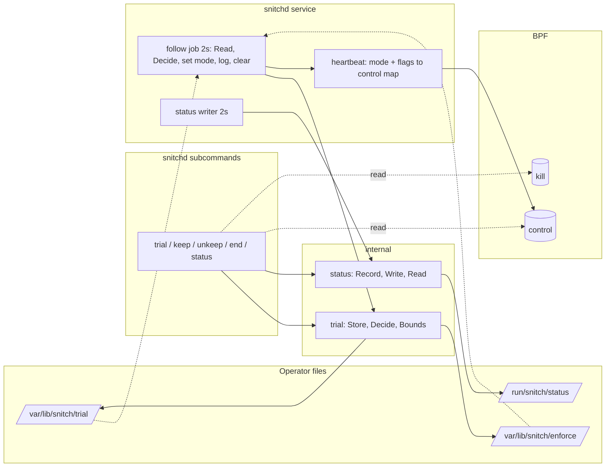

# Technical Design: persistent-trial

## Overview

**Purpose**: snitchd becomes a service that is always on in monitor mode, and deny-by-default
becomes a trial the operator starts for a bounded time: a deadline written to disk that the
daemon follows and ends by itself, that a daemon restart keeps, and that a reboot ends before
anything enforces. Keeping enforce is an explicit second step, itself a file any console can
delete. A status command shows the daemon's state. Fail-safe 5 of the steering, made real.

**Users**: the operator of the dev VM, later every fleet host, driving it with `snitchd trial`,
`keep`, `unkeep`, `end`, `status` as root, and the VM repo deploying the unit.

**Impact**: the daemon's mode becomes a runtime decision from two files when no `-mode` flag
is given; one new job on the heartbeat tick; a status file; subcommands on the same binary;
two unit files; a trial phase in the enforce test. No change to the kernel program, the rules
file, the resolver or the learning code.

### Goals
- A trial that cannot outlive its deadline, the operator's session or a reboot.
- Mode changes visible in the journal with their reason; state visible in one command.
- The decision logic pure and tested with a fake clock and a fake boot id.
- The way back from a console unchanged: `scripts/fail-open.sh`, the kill switch.

### Non-Goals
- Deploying or enabling the unit (VM repo), packaging, the API and TUI, per-program trials,
  changes to the kernel program or the rules file.

## Boundary Commitments

### This Spec Owns
- The trial and keep files under `/var/lib/snitch/` (format, meaning, lifecycle) and the
  status file under `/run/snitch/`.
- `internal/trial` (state, decision, bounds) and `internal/status` (the status record).
- The daemon's mode source ("flag" for bounded runs, "files" for the service), the follow job,
  the status writer, and the mode-change log lines.
- The `snitchd` subcommands `trial`, `keep`, `unkeep`, `end`, `status`.
- `systemd/snitchd.service`, `systemd/snitchd-trial-boot.service`.
- The trial phase of `scripts/enforce-test.sh`.

### Out of Boundary
- The kernel decision order, the maps, the heartbeat period (2 s) and staleness (15 s).
- The bounded `-mode enforce -duration` run (unchanged, still refuses without a duration).
- Learning mode's behaviour (learning never denies: it gates a trial start, and the decision
  is monitor while learning whatever the files say).
- The rules file, resolver, encoder, reload jobs.
- Enabling the service on any host; the VM repo does that after the trial phase passed.

### Allowed Dependencies
- Existing: `cilium/ebpf` (now also `LoadPinnedMap` + `Lookup` from the CLI), `x/sys/unix`
  (`CLOCK_MONOTONIC`, same clock as the heartbeat), `internal/jobs`, `internal/contract`,
  `internal/rules` (summary numbers for the status file). No new module.
- `/proc/sys/kernel/random/boot_id`, `/sys/fs/bpf/snitch/{control,kill}`.
- systemd `StateDirectory=snitch` (`/var/lib/snitch`) and `RuntimeDirectory=snitch`
  (`/run/snitch`).

### Revalidation Triggers
- Change of the trial/keep/status file formats or paths (the TUI/API spec will read them).
- Change of the subcommand names or exit codes (the VM repo and the test script call them).
- Change of the mode-source rule (flag vs files) or the keep-survives-boot decision.
- A change to heartbeat period or staleness in the C or daemon (the CLI's "running" test).

## Architecture

### Existing Architecture Analysis
- `cmd/snitchd/daemon.go`: `d.mode` is a plain field written by `beat()` every 2 s into
  `control_state.mode`, which the kernel reads per decision; today it is set once from `-mode`.
  Switching at runtime is a field write plus the next heartbeat. The field becomes atomic (the
  follow job writes it, the heartbeat job reads it).
- `config.go` `check`: enforce needs `-duration`; learning excludes enforce. Unchanged. A run
  with no `-mode` flag becomes source "files".
- Jobs: `watchFile` is the pattern for a 2 s poll of a file; the follow job copies it.
- `scripts/enforce-test.sh`: phases + trap; a third phase is added.

### Architecture Pattern & Boundary Map



- **Pattern**: files are the contract between the CLI and the daemon; no socket yet. Pure
  logic in `internal/trial`, wiring in the daemon, the CLI is a thin reader/writer of files and
  pinned maps.
- **Boundaries**: the daemon never writes trial/keep files except to clear an ended or
  malformed trial; the CLI never writes the control or kill maps; the status file is written
  only by the daemon.
- **Preserved**: kernel fail-safes; bounded run; `fail-open.sh`.

### Technology Stack

| Layer | Choice | Role | Notes |
|---|---|---|---|
| State files | plain `key=value` lines, atomic temp+rename | trial deadline + boot id, kept marker, status | readable and editable from a console |
| Clock | `time.Now()` for deadlines, `CLOCK_MONOTONIC` for heartbeat age | wall clock for operators, the kernel's clock for liveness | clock-jump cap: effective trial ≤ 60 min after start |
| Boot identity | `/proc/sys/kernel/random/boot_id` | distinguishes a restart from a reboot | plus a oneshot unit as belt and braces |
| Maps from the CLI | `ebpf.LoadPinnedMap` + `Lookup` | heartbeat age, mode, kill switch without the daemon | root only |
| Service | systemd unit, `Restart=on-failure`, `RestartSec=2`, `StateDirectory`, `RuntimeDirectory` | always on in monitor | no `-mode` flag ever |

## File Structure Plan

### Directory Structure
```
internal/trial/
├── trial.go         # Mode, Deadline, State, Decision, Decide(now, bootID, state, learning), bounds (Req 2.2, 3.x, 4.1, 5.x)
├── store.go         # Store{Dir, FS}: Read, StartTrial, Keep, ClearTrial, ClearKept; file format
├── trial_test.go    # Decide table: active, expired, clock-cap, other boot, kept, malformed; bounds
└── store_test.go    # round trip, malformed files → Problems, atomic write, clear
internal/status/
├── status.go        # Record (pid, mode, source, learning, trial deadline, kept, rules numbers, written), Write (atomic), Read
└── status_test.go
cmd/snitchd/
├── follow.go        # follow job: Store.Read → Decide → d.setMode(mode, reason) → clear; status writer job
├── follow_test.go   # with fake clock/boot id: mode flips and log lines on transitions only
├── ctl.go           # subcommands: parse verb, run trial/keep/unkeep/end/status, exit codes
├── ctl_maps.go      # pinned-map reads: heartbeat age, mode, flags, kill switch (root)
├── ctl_test.go      # verb parsing, refusals and messages with fake map/status/store readers
systemd/
├── snitchd.service              # the service (Req 1)
└── snitchd-trial-boot.service   # oneshot, Before=snitchd.service: `snitchd end -at-boot` (Req 4)
```

### Modified Files
- `cmd/snitchd/main.go`: dispatch: a first argument that is a verb runs `ctl`; otherwise the
  daemon as today. `main()` stays ≤ 60 lines.
- `cmd/snitchd/daemon.go`: `mode` becomes `atomic.Uint32`; `source` (flag | files); the follow
  and status-writer jobs join the list when source is files; mode-change log helper.
- `cmd/snitchd/config.go`: `source()` derived from whether `-mode` was given; paths
  `/var/lib/snitch`, `/run/snitch/status` as constants with flags `-state-dir`, `-status`.
- `scripts/enforce-test.sh`: phase 3 (trial flow) behind the same confirmation.
- `README.md`: service, trial commands; `CLAUDE.md` status.

## System Flows

### A trial, from start to its own end

```mermaid
sequenceDiagram
  participant Op as operator (root)
  participant CLI as snitchd trial 10m
  participant F as /var/lib/snitch/trial
  participant D as snitchd (service)
  participant K as kernel control map
  Op->>CLI: snitchd trial 10m
  CLI->>CLI: refuse if kill set / learning / not running / kept / trial running (no -extend)
  CLI->>F: deadline=now+10m start=now boot=<boot_id>
  CLI-->>Op: "enforce until 12:34:56; end early: snitchd end"
  loop every 2 s
    D->>F: Read
    D->>D: Decide(now, boot_id, state) → Enforce "trial until …"
    D->>K: heartbeat with mode 1
  end
  Note over D: deadline passes
  D->>D: Decide → Monitor, ClearTrial, "trial ended at its deadline"
  D->>F: remove
  D->>K: heartbeat with mode 0
```

- Transitions are logged once (the follow job remembers the last decision).
- A daemon restart re-reads the file: same boot id → trial continues (Req 3.3).
- A reboot: boot id differs → Monitor + ClearTrial, "trial ended at boot" (Req 4.1); the
  oneshot unit does the same before the service starts (Req 4.3), so either alone suffices.

### Decision table (`trial.Decide`)

| kept | trial | condition | mode | reason | clear trial |
|---|---|---|---|---|---|
| any | any | daemon in learning mode | Monitor | `learning: trial/kept files ignored` | no |
| yes | any | — | Enforce | `enforce kept` | yes if present (keep supersedes) |
| no | none | — | Monitor | `no trial` | — |
| no | some | `trial.Boot != bootID` | Monitor | `trial ended at boot` | yes |
| no | some | `now ≥ End` or `now − Start > MaxTrial` | Monitor | `trial ended at its deadline` | yes |
| no | some | otherwise | Enforce | `trial until <End>` | — |
| — | malformed | — | Monitor (as none) | `trial file unreadable: <why>, removed` | yes |

## Requirements Traceability

| Req | Summary | Components |
|---|---|---|
| 1.1 | unit: root, default rules, no mode flag | `systemd/snitchd.service` |
| 1.2 | missing rules file → start, report | existing `loadRules` (unchanged) |
| 1.3 | restart on error; allowed while down | unit `Restart=on-failure`; kernel heartbeat (existing) |
| 1.4 | log every mode change with reason | `daemon.setMode` log line; `follow.go` transitions |
| 1.5 | kill switch across restarts | pinned map (existing); CLI never writes it |
| 2.1 | trial command writes deadline; enforce ≤ 5 s | `ctl.go trial` → `Store.StartTrial`; follow job 2 s + heartbeat 2 s |
| 2.2 | 1–60 min, default 10 | `trial.Bounds`, `DefaultTrial` |
| 2.3 | refuse when kill set | `ctl_maps.killSet` |
| 2.4 | refuse when learning | `status.Record.Learning` |
| 2.5 | refuse second trial; `-extend` | `ctl.go` with `Store.Read`; extend rewrites start and deadline, so the 60 min cap counts from the extend, not from the first trial |
| 2.6 | refuse when daemon not running | `ctl_maps.heartbeatAge ≤ 15 s` |
| 2.7 | warn on zero rules, confirm | `status.Record.Rules == 0` → prompt (or `-y`) |
| 2.8 | print deadline and the way out | `ctl.go` output |
| 3.1 | enforce while deadline in future (service) | `Decide` row 5; follow job only when source = files |
| 3.2 | deadline passes → monitor ≤ 5 s, removed, logged | `Decide` row 4 + `ClearTrial` + log |
| 3.3 | restart keeps the trial | file + same boot id |
| 3.4 | file removed by hand → monitor ≤ 5 s, logged | `Decide` row 2 after a prior Enforce → transition log "trial ended by the operator (file removed)" |
| 3.5 | malformed → treat as none, remove, log | `Store.Read` Problems + `Decide` last row |
| 3.6 | bounded run ignores the files | `source = flag` → no follow job |
| 4.1 | boot ends an open trial before enforcing | `Decide` row 3 (boot id) and `snitchd-trial-boot.service` (`snitchd end -at-boot`) |
| 4.2 | boot without keep → monitor | `Decide` row 2 |
| 4.3 | independent of network/rules/daemon start | the oneshot unit needs none of them |
| 5.1 | keep during trial → kept file, trial removed, enforce stays | `ctl.go keep` → `Store.Keep` (writes enforce, clears trial); `Decide` row 1 |
| 5.2 | keep refused without trial | `ctl.go keep` check |
| 5.3 | boot with keep → enforce | `Decide` row 1 at startup |
| 5.4 | unkeep or file removed → monitor ≤ 5 s, logged | `Store.ClearKept`; follow job transition |
| 5.5 | keep prints the file and the rm command | `ctl.go keep` output |
| 5.6 | trial refused while kept | `ctl.go trial` check |
| 6.1 | end removes both → monitor ≤ 5 s | `ctl.go end` → `ClearTrial` + `ClearKept` |
| 6.2 | end with nothing → "already monitor", exit 0 | `ctl.go end` |
| 6.3 | end never touches the kill switch | `ctl.go` has no kill writer (test greps) |
| 7.1 | status fields | `ctl.go status`: maps + status file + store |
| 7.2 | daemon down: still files + kill | `ctl.go status` degrades |
| 7.3 | exit non-zero when daemon down | `ctl.go status` exit 1 |
| 7.4 | ≤ 1 s | map lookups + 3 file reads |
| 8.1 | test phase | `scripts/enforce-test.sh` phase 3 |
| 8.2 | fail-safes as in test 1 | reused steps C3/K/P in phase 3 |
| 8.3 | unit not enabled here | no install step in this spec |
| 8.4 | tests without root | `internal/trial`, `internal/status`, `follow_test`, `ctl_test` with fakes |

## Components and Interfaces

| Component | Layer | Intent | Req | Contracts |
|---|---|---|---|---|
| trial.Decide | internal/trial | pure mode decision | 3, 4, 5 | Service |
| trial.Store | internal/trial | the two files | 2, 3, 5, 6 | State |
| status.Record | internal/status | daemon → CLI facts | 2.4, 2.7, 7 | State |
| follow job | cmd/snitchd | apply decisions, log | 1.4, 3 | — |
| ctl | cmd/snitchd | the five verbs | 2, 5, 6, 7 | CLI |
| units | systemd/ | service + boot oneshot | 1, 4 | — |

### internal/trial

```go
package trial

type Mode uint8          // Monitor = 0, Enforce = 1 (the control map's values)
const (MinTrial = time.Minute; MaxTrial = time.Hour; DefaultTrial = 10 * time.Minute)

type Deadline struct {
    Start time.Time // when the trial was started (clock-jump cap)
    End   time.Time
    Boot  string    // boot id when started
}

type State struct {
    Trial    *Deadline  // nil: no trial file
    Kept     bool       // the enforce file exists
    Problems []string   // malformed files found by Read (the daemon logs and clears them)
}

type Decision struct {
    Mode       Mode
    Reason     string // the log line on a transition
    ClearTrial bool   // the trial file is spent (ended, foreign boot, malformed)
}

func Decide(now time.Time, bootID string, st State, learning bool) Decision
func Bounds(d time.Duration) error                 // 1 min ≤ d ≤ 60 min
func BootID(read func(string) ([]byte, error)) (string, error)

// Store is the two files, through delegates so tests use a memory map.
type Store struct {
    Dir string
    FS  FS // ReadFile, WriteFile (atomic), Remove, Stat as function values
}
func OSStore(dir string) Store
func (s Store) Read() State
func (s Store) StartTrial(d Deadline) error      // writes trial; whether Kept or a running trial allows it is the caller's check (Req 2.5, 5.6), not a contract
func (s Store) Keep(now time.Time) error         // writes enforce, removes trial
func (s Store) ClearTrial() error
func (s Store) ClearKept() error
```
- File `trial`: `start=<RFC3339>\nend=<RFC3339>\nboot=<uuid>\n`. File `enforce`:
  `kept=<RFC3339>\n`. Missing file = absent; unparsable = Problem.
- Contracts: the implemented set is listed once, under "Contracts" in Implementation Rules
  (`Decide`, `Store.require`, `StartTrial`); `Bounds` and `BootID` return errors, no contracts.

### internal/status

```go
package status

type Record struct {
    PID        int
    Mode       string // monitor | enforce
    Source     string // flag | files
    Learning   bool
    Trial      string // RFC3339 deadline or ""
    Kept       bool
    RulesFile  string
    Programs, Resolved, Executables, Rules int
    Written    time.Time
}
func Write(path string, r Record) error   // atomic temp+rename, key=value lines
func Read(path string) (Record, error)
```

### cmd/snitchd

**daemon.go**: creates the status file's directory (0700) when missing, so a hand-started
daemon works without systemd's `RuntimeDirectory`; `mode atomic.Uint32`; `source`; `setMode(m trial.Mode, reason string)` logs
`"mode: <monitor|enforce> (<reason>)"` on every call and stores (the follower alone dedupes); `beat()` reads the atomic. Startup with
source = files: `Decide` once before the first heartbeat so the first heartbeat already carries
the right mode (a kept enforce starts enforcing; an old-boot trial is cleared). Jobs added when
source = files: `follow` and `statusWriter`.

**follow.go**:
```go
type follower struct {
    store  trial.Store
    boot   string
    now    func() time.Time
    apply  func(trial.Mode, string)   // d.setMode
    log    func(string)
    last   trial.Decision
}
func (f *follower) tick(context.Context) error  // Read → Decide → apply on change → clear → remember
```
Transition detection: a change of `Mode` or of `Reason` family logs once; "trial until …" is
one family (the End is printed but a repeated identical decision is silent). The status writer
builds a `status.Record` from the snapshot summary numbers, the mode, source, learning flag and
the store state, every tick.

**ctl.go** (verbs; root; exit 0 ok, 1 refused or daemon down, 2 usage). Shared verb flags
`-state-dir` (default `/var/lib/snitch`) and `-status` (default `/run/snitch/status`), the same
defaults as the daemon, so the test script can point verbs and daemon at temp paths:
| Verb | Does | Refusals |
|---|---|---|
| `trial [-extend] [-y] [duration]` | bounds, checks, `StartTrial`, prints deadline + "end early: snitchd end" | kill set; learning; not running or source = flag; kept; running trial without `-extend`; zero rules without `-y` (prompt) |
| `keep` | `Store.Keep`, prints the file path and `rm` command | no running trial |
| `unkeep` | `ClearKept` | — |
| `end [-at-boot]` | `ClearTrial` (+ `ClearKept` unless `-at-boot`); prints the resulting state | — |
| `status` | running (heartbeat age ≤ 15 s), mode (control map), trial/kept (store), kill (map), rules summary + learning (status file) | exit 1 when not running |

**ctl_maps.go**: `openPinned(name) (*ebpf.Map, error)`; `controlState() (heartbeatAge
time.Duration, mode uint32, flags uint32, ok bool)` using `CLOCK_MONOTONIC`; `killSet() bool`.
Absent pinned maps = daemon never ran since boot = not running, kill clear.

**main.go** dispatch: `if len(os.Args) > 1 && isVerb(os.Args[1]) { os.Exit(runCtl(os.Args[1:])) }`.

### systemd
```ini
# snitchd.service
[Unit]
Description=snitch: egress control in the kernel (monitor unless a trial or kept enforce says otherwise)
After=snitchd-trial-boot.service
Wants=snitchd-trial-boot.service
[Service]
ExecStart=/usr/local/sbin/snitchd -rules /etc/snitch/rules.toml
Restart=on-failure
RestartSec=2
TimeoutStopSec=10
StateDirectory=snitch
StateDirectoryMode=0700
RuntimeDirectory=snitch
RuntimeDirectoryMode=0700
[Install]
WantedBy=multi-user.target

# snitchd-trial-boot.service
[Unit]
Description=snitch: an open deny-by-default trial at boot is ended before the daemon starts
Before=snitchd.service
[Service]
Type=oneshot
ExecStart=/usr/local/sbin/snitchd end -at-boot
StateDirectory=snitch
StateDirectoryMode=0700
[Install]
WantedBy=multi-user.target
```

### scripts/enforce-test.sh phase 3 (trial flow; daemon run with `-duration` as ceiling, no `-mode`)
Steps: `snitchd trial 2m` → curl DENY EPERM (enforce within 5 s) → `kill -TERM` + restart the
daemon → still EPERM within 5 s → `snitchd end` → curl ok within 5 s → `snitchd trial 1m` → wait
for the deadline → ok within 65 s → write a trial file with a foreign boot id → monitor within
5 s and "ended at boot" in the log → `snitchd trial 2m` + `snitchd keep` → trial file gone,
enforce stays → `snitchd unkeep` → ok within 5 s → kill switch and SIGSTOP steps as phase 2 →
`snitchd status` exit 0 while running and 1 after stop. Trap unchanged plus `snitchd end`.

## Implementation Rules (binding)
As in `rule-loading`: caps 40/10/300 (`scripts/caps.sh`), delegates (`FS`, `now`, `apply`,
`log`), immutable values, `internal/contract` assertions with a test per contract, jobs for
every loop, tasks as self-contained briefs.

### Contracts
The `internal/contract` conventions of the rule-loading design apply (`Require` on the inputs
of a function, `Ensure` before return; a violation is a bug, an operator error returns `error`
or exits 1). Where contracts go (the implemented set; every one has a `contracttest.Panics`
test that trips exactly it, named next to the bullet):
- `trial.Decide` requires a non-zero `now` and `bootID != ""`; ensures (in `spent`) that
  `ClearTrial` is set only when `st.Trial != nil` or a Problem exists, so the daemon never
  removes a file that was not there. `trial_test`: `TestContractDecideNeedsATime`,
  `TestContractDecideNeedsABootID`, `TestContractDecideSpentOnlyWithATrialOrAProblem`.
- `trial.Store.Read`, `StartTrial`, `Keep`, `ClearTrial`, `ClearKept` require (through
  `Store.require`) `Dir != ""` and a complete `FS` (`ReadFile`, `WriteFile`, `Remove`).
  `store_test`: `TestStoreContracts` (through `Read`; the other four call the same method).
- `trial.Store.StartTrial` also requires `d.End.After(d.Start)`,
  `d.End.Sub(d.Start) ≤ MaxTrial` and `d.Boot != ""`: a deadline the daemon could not
  follow is a bug in the CLI. `store_test`: `TestStoreContracts`.
- `trial.Bounds` and `trial.BootID` have no contracts: an out-of-bound duration and an
  unreadable boot id are operator or environment errors, returned as `error`.
- `status.Write` requires `path != ""` and no newline in `Mode`, `Source`, `Trial`,
  `RulesFile` (the line format could not carry the record back). `status_test`:
  `TestWriteContracts`.
- `status.Read` requires `path != ""`. `status_test`: `TestReadRequiresAPath`.
- `follower.tick` and `decide` (cmd/snitchd `follow.go`) require `boot != ""` and the `now`,
  `apply`, `log` delegates. `follow_test`: `TestFollowContracts`.
- `statusWriter.tick` requires `path != ""` and the `mode`, `snap`, `now`, `write`, `log`
  delegates. `follow_test`: `TestStatusWriterContracts`.
- `dispatch` (cmd/snitchd `ctl.go`) requires at least one argument, the verb. `ctl_test`:
  `TestContractDispatchNeedsAVerb`.
- `controlFrom` requires its `lookup` and `now` delegates; `killFrom` requires `lookup`
  (`ctl_maps.go`). `ctl_test`: `TestContractPinnedReadersNeedTheirDelegates`.
- Every verb handler (`runTrial`, `runKeep`, `runUnkeep`, `runEnd`, `runStatus`) requires
  (through `ctl.require`) the writers `out`, `errw`, the probes `control`, `kill` (one
  `Require`) and the six `deps` (a second). `contracts_trial_test`:
  `TestContractEveryVerbNamesTheMissingSlot` (each slot blank on its own, for every verb,
  asserting which line fired); `ctl_verbs_test`/`ctl_status_test`:
  `TestContractVerbsNeedACompleteCtl and TestContractStatusNeedsACompleteCtl`.
- Not contracts, pinned by ordinary tests: the verbs' refusals (keep without a running trial,
  trial while kept or while the kill switch is set, out-of-bound durations) are operator
  errors with exit 1 or 2; a status file with a wrong key set is a `Read` error; "identical
  decision → silent tick" is `follower.changed`'s table test.
- A violation inside the follow or status job goes through `guard()` (rule-loading 6.3/6.4):
  the run ends with exit 70 and the hooks detach, so a contract failure fails open.

## Error Handling

| Situation | Behaviour |
|---|---|
| trial/keep file unreadable or malformed | daemon: treat as absent, remove, log the reason; CLI: report and offer `end` |
| `/var/lib/snitch` missing (hand-started daemon) | daemon creates it (0700); CLI errors with the path |
| status file missing (daemon never ran) | CLI: "daemon not running", exit 1; still prints files and kill |
| pinned maps missing | CLI: not running, kill clear |
| CLI not root | exit 2 with a message (maps and files need root) |
| clock jumps back during a trial | effective end = min(End, Start + MaxTrial): never more than the bound |
| keep while the daemon is down | allowed? No: keep needs a running trial, which needs a running daemon |

## Testing Strategy

### Unit (no root)
- `trial_test`: `Decide` table above with a fixed `now` and boot id: active, expired, clock
  cap (`now − Start > MaxTrial` with End in the future), foreign boot, kept with and without a
  trial file, malformed → Monitor + ClearTrial; `Bounds` at 59 s, 1 min, 60 min, 61 min;
  contracts via `contracttest`.
- `store_test`: round trip of both files; malformed contents → `Problems`; `Keep` removes the
  trial; `Clear*` on absent files is fine; atomic write (inode changes).
- `status_test`: round trip; missing file error.
- `follow_test`: fake clock and store: trial start → one "enforce (trial until …)" log, repeated
  ticks silent, deadline → one "monitor (trial ended at its deadline)" and `ClearTrial`
  called; file removed by hand → "ended by the operator"; kept → enforce.
- `ctl_test`: with fake readers (`controlState`, `killSet`, status record, store): each
  refusal message and exit code; `-extend`; `end` on nothing; `status` exit 1 when down;
  `keep` output contains the `rm` command.

### VM (monitor or trial, operator present)
- Phase 3 of the enforce test, after the operator's go with the serial console open.

## Security Considerations
- Files under `/var/lib/snitch` are root 0600 in a 0700 directory; the CLI requires root.
- Nothing in this spec can set the kill switch; nothing can start enforce without a file the
  operator wrote through the CLI or by hand as root.
