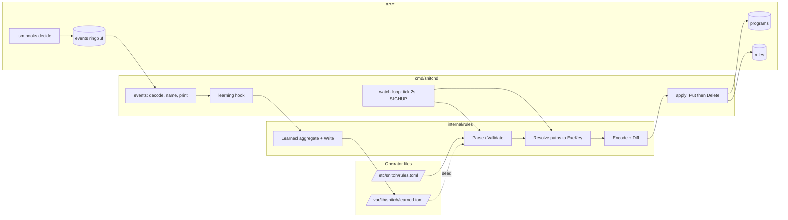
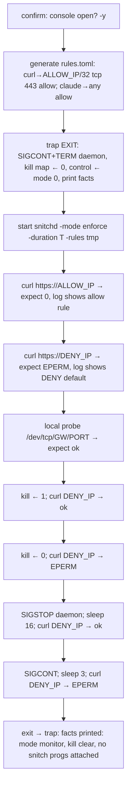

# Technical Design: rule-loading

## Overview

**Purpose**: `snitchd` gets its policy. A TOML rules file names programs (by executable path or
glob) and rules (program, destination prefix, protocol, port, verdict); the daemon resolves
executables to the identity the kernel uses (inode + superblock device), fills the `programs`
and `rules` BPF maps, keeps them current while the file and the executables change, and reports
each verdict with the program name and the rule that applied. A learning mode records what
programs connect to and writes it as a rules file for review. A repository script runs the
first enforce test on the dev VM under a trap.

**Users**: the operator of the dev VM (today) and of fleet hosts (later) who writes and reviews
rules files; the maintainer who needs the loader covered by CI tests.

**Impact**: extends the existing daemon and makes one bounded change to the BPF program (rule
id in the map value and in the event, executable path in the event). The kernel decision order
and all fail-safes are untouched.

### Goals
- Rules file → maps, correct on every filesystem (device identity from mountinfo).
- Reload without restart and without a ruleless window; executables re-resolved after upgrades.
- Events carry program name and rule; learning produces a loadable rules file.
- Enforce mode cannot run unbounded; the enforce test is repeatable and self-resetting.
- Parser, resolver, encoder and learning aggregation tested without root.
- Code shape: short idiomatic Go under mechanical caps, behaviour injected as function values
  (delegates), concurrency as jobs, contracts asserted in code (see Implementation Rules).

### Non-Goals
- Domain-name rules, parent/session rules, a persistent trial with deadline file and boot
  revert, the unix socket API, the TUI, byte counting, systemd units for `snitchd`.

## Boundary Commitments

### This Spec Owns
- The rules file format (TOML schema below) and its validation rules.
- `internal/rules`: file model, parse/validate, executable resolution, map encoding, diffing,
  learning aggregation and the learned-file writer.
- Daemon wiring: flags (`-rules`, `-learn`, enforce/duration/learning checks), the reload
  loop, map apply, event printing with program and rule, learning write-back.
- The BPF additions `rule_val`, `event.rule`, `event.path` and the regenerated bindings.
- `scripts/enforce-test.sh` and the CI additions (`go test`, shellcheck on `scripts/`).

### Out of Boundary
- The kernel decision order, local-net classification, heartbeat and kill-switch logic.
- Persistent enforce (service unit, trial deadline, boot revert).
- Any API or UI surface; the event line format stays a human log line, not a contract.
- Rule semantics beyond prefix/proto/port (names, parents, time windows).

### Allowed Dependencies
- `github.com/cilium/ebpf` v0.22 (maps, links, ringbuf), `golang.org/x/sys/unix` (statx,
  signals), new: `github.com/pelletier/go-toml/v2` v2.4.x. No other new modules.
- `/proc/self/mountinfo`, `statx(2)`, the pinned maps under `/sys/fs/bpf/snitch`.
- `bpftool`, `curl`, `bash` ≥ 5 on the dev VM for the test script.

### Revalidation Triggers
- Any change to `struct event`, `struct rule_key`, `struct rule_val`, `struct exe_key` (the
  TUI/API spec will decode events; fleet rules depend on the file schema).
- Change of the rules file schema or default paths (`/etc/snitch/rules.toml`,
  `/var/lib/snitch/learned.toml`).
- Change of program-id semantics (0 = any/unknown, ids from declaration order).
- A new runtime prerequisite (e.g. requiring `bpf_d_path`) for older kernels.

## Architecture

### Existing Architecture Analysis
- `bpf/snitch.bpf.c`: `decide()` → `lookup()` over the `rules` LPM trie in a fixed order;
  `programs` hash gives the program id; `event` to a ring buffer. Keys are already fixed-size
  and exported through BTF; value is a bare `u8`.
- `cmd/snitchd/main.go`: load with `PinPath`, heartbeat ticker (2 s), attach, print events.
  Links are not pinned (exit = detach). Nothing writes the `kill` map.
- Steering: logic needing tests goes to `internal/<domain>`; generated bindings are committed.

### Architecture Pattern & Boundary Map



- **Pattern**: pure library + thin daemon wiring. `internal/rules` has no BPF or syscall
  dependency except behind injectable functions (glob, statx, mountinfo reader), so it tests
  without root.
- **Boundaries**: the package produces entry sets; only `apply` touches maps. The kernel is
  the only place a verdict is decided; the daemon only names things afterwards.
- **Preserved**: pinned maps, unpinned links, heartbeat before attach, no writes to `kill`.
- **Steering compliance**: one domain package, committed regenerated bindings, fail-safes in C
  only, bounded enforce.

### Technology Stack

| Layer | Choice / Version | Role in Feature | Notes |
|---|---|---|---|
| Config | TOML via go-toml/v2 2.4.x | parse rules + learned files, line-numbered errors | strict (unknown fields rejected) |
| Daemon | Go 1.26, cilium/ebpf 0.22 | map Put/Delete, ringbuf, links | existing |
| Kernel | BPF LSM, CO-RE, `bpf_d_path` | rule id + exe path in events | regen with clang 21 on the VM |
| OS interfaces | `statx` + `/proc/self/mountinfo` | device identity | fallback: stat major/minor |
| Test | bash + bpftool + curl | enforce verification | root, interactive confirm |

## File Structure Plan

### Directory Structure
```
internal/rules/
├── file.go          # File/Program/Rule model, Parse, Load, validation (Req 1, 9.8)
├── resolve.go       # Resolve(File) → Resolved: glob, EvalSymlinks, statx, mountinfo (Req 2)
├── encode.go        # Resolved → map entries (RuleKey/RuleVal, ExeKey); Diff (Req 3, 4)
├── learn.go         # Learned aggregation (Observe), ToFile, WriteFile atomic (Req 9)
├── file_test.go     # valid/invalid files, line numbers, comments, learned fields round-trip
├── resolve_test.go  # fake glob/statx/mountinfo: symlinks, globs, conflicts, unresolved
├── encode_test.go   # precedence encoding, prefixlen, v4/v6, port ranges, diff puts/deletes
├── learn_test.go    # merge counts, naming, seed from file, output loads back
└── testdata/        # rules files for the parser tests, a mountinfo sample
internal/contract/
├── contract.go      # Require / Ensure / Invariant: panic with *Violation (always on)
└── contract_test.go
internal/jobs/
├── jobs.go          # Job func(ctx) error; Run(ctx, jobs...) (errgroup semantics); Every; OnSignal
└── jobs_test.go     # cancellation on first error, ticker stops with ctx, signal job
cmd/snitchd/
├── main.go          # flags, startup checks (6.1, 9.2), build the job list, Run (≤ 60 lines)
├── state.go         # atomic.Pointer[rules.Resolved] snapshot + Entries; apply(Changes) to maps
├── reload.go        # jobs: watchFile (2 s stat), reResolve (10 s), onHUP → publish snapshot
├── events.go        # job: pump ringbuf → decode (fixed layout) → name → print / learn sink
├── decode.go        # Event view over the raw record: zero-copy accessors, length checks
└── learn.go         # job: Learned sink + 60 s dirty writer + final write on ctx end
scripts/
└── enforce-test.sh  # Req 7 procedure, trap-protected
examples/
└── rules.toml       # documented example (curl, claude, apt, deny example)
```

### Modified Files
- `bpf/snitch.bpf.c`: `struct rule_val` as the trie value; `lookup()` returns the value
  pointer; `event` gains `__u32 rule` and `char path[256]` filled by `bpf_d_path`. Decision
  order and fail-safe checks unchanged.
- `internal/bpf/gen.go`: add `-type rule_val`; regenerate `snitch_x86_bpfel.{go,o}`.
- `cmd/snitchd/main.go`: event printing moves to `events.go`; adds flags and checks.
- `cmd/snitchd/reader.go`: removed (helper folded into `events.go`).
- `.github/workflows/lint.yml`: `go test ./...`; complexity caps (`gocyclo -over 10`, `funlen`
  40 lines, file length check); shellcheck `snitch-trial scripts/*.sh`.
- `.kiro/steering/tech.md`: caps and the contract/delegate/jobs rules (done with this design).
- `go.mod`/`go.sum`: go-toml/v2.
- `README.md`: rules file section, learning mode, enforce test; `CLAUDE.md` status update.

## System Flows

### Startup and reload

```mermaid
sequenceDiagram
  participant Op as operator
  participant D as snitchd
  participant RP as internal/rules
  participant K as BPF maps
  Op->>D: snitchd -rules F [-mode enforce -duration T] [-learn L]
  D->>D: checks: enforce needs duration; learn excludes enforce
  D->>RP: Load(F) → File (or exit 1 with file:line)
  D->>RP: Resolve(File) → Resolved (+ unresolved warnings)
  D->>K: heartbeat, apply(Diff(empty, Resolved)): puts
  D->>K: attach hooks
  D-->>Op: summary: programs resolved / executables mapped / rules effective
  loop every 2 s (heartbeat tick)
    D->>D: stat F changed? → Load+Resolve+Diff+apply, or log error and keep
    D->>D: every 5th tick or SIGHUP → Resolve+Diff+apply (executables)
  end
  Op->>D: SIGHUP → immediate Load+Resolve+Diff+apply
```

- Load errors at start are fatal; on reload they are logged and the previous `Resolved` stays
  (Req 4.2). `apply` puts before deletes (Req 4.1). A failing `Put` (e.g. `E2BIG`) aborts the
  apply, logs, and keeps the old `Resolved` as current.

### Enforce test (scripts/enforce-test.sh)



## Requirements Traceability

| Req | Summary | Components | Interfaces / Flows |
|---|---|---|---|
| 1.1 | file declares programs and rules | file.go | TOML schema |
| 1.2 | read from `-rules`, default `/etc/snitch/rules.toml` | main.go | flags |
| 1.3 | missing file → empty maps, report | main.go, file.go (`Load` returns `ErrNotExist`) | startup |
| 1.4 | invalid → refuse, file:line:reason | file.go (`*Error`), main.go | startup |
| 1.5 | comments | TOML | — |
| 2.1 | paths/globs → ExeKey | resolve.go | `Resolve` |
| 2.2 | correct on any filesystem | resolve.go (`devOf`: statx + mountinfo) | `DevOf` |
| 2.3 | unresolved → keep rules, report | resolve.go (`Resolved.Unresolved`), main.go | summary |
| 2.4 | many files → one program | resolve.go | `Resolved.Programs` |
| 2.5 | symlinks followed | resolve.go (`EvalSymlinks`) | — |
| 2.6 | exe in two programs → error | resolve.go (`ErrConflict`) | startup/reload error |
| 3.1 | rules effective, keyed | encode.go, state.go | `Encode`, `apply` |
| 3.2 | program-specific wins | C `lookup()` (existing), encode.go key `program` | — |
| 3.3 | proto+port > proto > any; longest prefix | C (existing), encode.go `prefixlen` | encode_test |
| 3.4 | v4 rules hit v4-mapped v6 | C (existing) family normalisation | — |
| 3.5 | deny rule denies in both modes | C (existing `V_DENY_RULE`) | — |
| 3.6 | summary counts | state.go `summary()` | log line |
| 4.1 | file change ≤5 s, no ruleless window | reload.go watch (2 s stat), Diff puts-then-deletes | reload flow |
| 4.2 | invalid reload keeps old | reload.go | reload flow |
| 4.3 | exe change ≤10 s | reload.go (re-resolve every 10 s) | reload flow |
| 4.4 | SIGHUP | reload.go `OnSignal` job → full reload | — |
| 4.5 | summary on reload | reload.go → state.go `summary()` | — |
| 5.1 | event shows program name | events.go (`Resolved.Names[id]`) | event line |
| 5.2 | unknown program → path + "unknown" | events.go (`event.path`, `/proc` fallback) | event line |
| 5.3 | which rule applied | C `rule_val.id` → `event.rule`; events.go (`Resolved.ByID`) | event line |
| 6.1 | enforce needs duration | main.go check | startup |
| 6.2 | duration elapses → exit, detach | main.go (existing `-duration`) | — |
| 6.3 | any exit → allow | unpinned links (existing) | script checks `bpftool prog show` |
| 6.4 | never writes `kill` | main.go (no code path; test greps) | — |
| 7.1 | trap, confirm, go | enforce-test.sh | test flow |
| 7.2 | allowed prefix ok + allow-by-rule logged | enforce-test.sh C1 | test flow |
| 7.3 | other public → EPERM + default deny logged | enforce-test.sh C2 | test flow |
| 7.4 | kill switch on/off | enforce-test.sh K1/K2 | test flow |
| 7.5 | SIGSTOP → open ≤15 s; SIGCONT → closed | enforce-test.sh P1/P2 | test flow |
| 7.6 | RDP/SSH up, local probe ok | enforce-test.sh C3 (+ operator observes session) | test flow |
| 7.7 | reset facts printed | enforce-test.sh trap | test flow |
| 7.8 | kept in repo | `scripts/enforce-test.sh`, CI shellcheck | — |
| 8.1 | parser tests without root | file_test.go | `go test` |
| 8.2 | device identity test | resolve_test.go (fake mountinfo); VM step in test script compares `exe_dev` | — |
| 8.3 | precedence encoding tests | encode_test.go | — |
| 9.1 | learning = monitor + record uncovered, non-local | learn.go (daemon) filters verdict `V_ALLOW_MONITOR` | event flow |
| 9.2 | learn + enforce refused | main.go check | startup |
| 9.3 | record exe/program, addr, proto, port; merge with count/first/last | learn.go `Learned.Observe` | `Observation` |
| 9.4 | write at end as rules file | learn.go `WriteFile` on exit | — |
| 9.5 | separate file, default `/var/lib/snitch/learned.toml`, never live file | main.go flag, learn.go | — |
| 9.6 | seed from existing learned file | learn.go `NewLearned(seed *File)` | startup |
| 9.7 | periodic write ≤60 s when dirty | learn.go (daemon) ticker | — |
| 9.8 | loadable without edits | same `File` model; learn_test round-trip | — |
| 9.9 | exited process still recorded | C `event.path` via `bpf_d_path`; fallback marks unknown | event flow |

## Components and Interfaces

| Component | Layer | Intent | Req | Dependencies | Contracts |
|---|---|---|---|---|---|
| rules.File / Parse | internal/rules | model + strict TOML parse + validation | 1, 9.8 | go-toml/v2 | Service |
| rules.Resolve | internal/rules | paths → ExeKey with mountinfo device | 2, 8.2 | x/sys/unix, injectable fs | Service |
| rules.Encode / Diff | internal/rules | Resolved → map entries; changes | 3, 4 | bpf bindings types | Service |
| rules.Learned | internal/rules | aggregate observations → File; atomic write | 9 | — | Service, State |
| snitchd state + reload jobs | cmd/snitchd | snapshot + map apply (state.go); poll + SIGHUP reload jobs (reload.go) | 4, 3.1 | cilium/ebpf, jobs | State |
| snitchd events | cmd/snitchd | decode, name, print | 5 | bindings | Event |
| snitchd learning hook | cmd/snitchd | filter events → Learned; timers | 9.1, 9.7 | rules.Learned | — |
| BPF additions | bpf/ | rule id + path in events | 5.3, 9.9 | — | Event |
| enforce-test.sh | scripts/ | Req 7 procedure | 7 | bpftool, curl | Batch |

### internal/rules

#### File model and parser (`file.go`)

| Field | Detail |
|---|---|
| Intent | Strict TOML → validated `File`; errors with file, line, reason |
| Requirements | 1.1–1.5, 9.8 |

**TOML schema** (`examples/rules.toml` documents it):
```toml
# programs: a name and the executables that are this program
[[program]]
name  = "curl"
paths = ["/usr/bin/curl"]              # absolute paths or globs (filepath.Glob syntax)
note  = "general purpose: only what the rules below say"

[[program]]
name  = "claude"
paths = ["/home/*/.local/share/claude/versions/*"]

# rules: most specific wins (see precedence); program "any" = every program
[[rule]]
program = "curl"
to      = "1.1.1.1/32"                 # IPv4/IPv6 prefix or bare address
proto   = "tcp"                        # tcp | udp | any (default any)
port    = 443                          # integer, "a-b" range (≤ 256 ports), or absent = any
verdict = "allow"                      # allow | deny
note    = "why this rule exists"

[[rule]]
program = "any"
to      = "0.0.0.0/0"
verdict = "deny"                       # explicit deny also applies in monitor mode

# learned files carry these optional fields on a rule (the loader accepts and ignores them):
# count = 12   first = 2026-10-10T06:00:00Z   last = 2026-10-10T06:30:00Z
```

```go
package rules

type Proto uint8      // 0 any, 6 tcp, 17 udp
type Verdict uint8    // 1 allow, 2 deny

type Program struct {
    Name  string
    Paths []string
    Note  string
    ID    uint32   // 1-based declaration order; 0 is reserved (any / unknown)
    Line  int
}

type Rule struct {
    Program string        // program name or "any"
    To      netip.Prefix  // bare address → /32 or /128
    Proto   Proto
    Ports   []uint16      // expanded range; nil = any
    Verdict Verdict
    Note    string
    Count   uint64        // learned-only, optional
    First   time.Time     // learned-only, optional
    Last    time.Time     // learned-only, optional
    ID      uint32        // 1-based declaration order
    Line    int
}

type File struct {
    Programs []Program
    Rules    []Rule
}

type Error struct { File string; Line int; Msg string }   // Error() = "file:line: msg"

func Parse(r io.Reader, name string) (*File, error)   // *Error on syntax/semantic problems
func Load(path string) (*File, error)                 // fs.ErrNotExist passes through
```
- Preconditions: UTF-8 TOML. Postconditions: names unique, every rule's program declared or
  "any", prefix canonical (`Masked()`), ports 1–65535, ≤ 256 ports per rule, `verdict` valid,
  unknown keys rejected. IDs assigned in declaration order.
- Invariant: `Parse` is pure and deterministic; the same input gives identical IDs.

#### Resolver (`resolve.go`)

| Field | Detail |
|---|---|
| Intent | Turn each program's paths/globs into the kernel's `exe_key` set |
| Requirements | 2.1–2.6, 8.2 |

```go
type ExeKey struct { Ino uint64; Dev uint32 }   // layout == bpf.SnitchExeKey (pad omitted)

type Unresolved struct { Program string; Pattern string; Reason string }

type Resolved struct {
    File       *File
    Programs   map[ExeKey]uint32      // resolved executables → program id
    Names      map[uint32]string      // id → program name
    ByID       map[uint32]*Rule       // rule id → rule
    Unresolved []Unresolved
}

// FS is what Resolve needs from the OS; tests inject fakes.
type FS struct {
    Glob        func(pattern string) ([]string, error)
    EvalSymlink func(path string) (string, error)
    Identity    func(path string) (ExeKey, error)   // statx ino + mountinfo device
}

func OSFS() FS
func Resolve(f *File, fs FS) (*Resolved, error)     // error only for ErrConflict
func DevOf(path string, mountinfo io.Reader) (uint32, error)   // exported for the VM check
```
- `Identity` default: `statx(STATX_INO|STATX_MNT_ID)` → `Mnt_id` → mountinfo row → `maj<<20|min`;
  if mountinfo has no row or is unreadable → `unix.Major/Minor` of `st_dev` with a one-time
  warning. Non-regular files are skipped with an `Unresolved` entry.
- Conflict (one `ExeKey` for two programs) → `*Error` naming both programs (2.6); reload keeps
  the old set.

#### Encoder and differ (`encode.go`)

| Field | Detail |
|---|---|
| Intent | Resolved → exact map entries; compute changes between two sets |
| Requirements | 3.1–3.3, 4.1 |

```go
type RuleKey = bpf.SnitchRuleKey      // {Prefixlen, Program, Family, Proto, Port, Addr[16]}
type RuleVal = bpf.SnitchRuleVal      // {Verdict uint8, Pad [3]uint8, Id uint32}

type Entries struct {
    Programs map[ExeKey]uint32
    Rules    map[RuleKey]RuleVal
}

type Changes struct {
    PutPrograms map[ExeKey]uint32
    DelPrograms []ExeKey
    PutRules    map[RuleKey]RuleVal
    DelRules    []RuleKey
}

func Encode(r *Resolved) Entries
func Diff(old, new Entries) Changes   // old may be zero value (first load)
```
- Encoding: `Family` = 2 (v4) or 10 (v6); `Prefixlen` = 64 + prefix bits; `Addr` v4 in bytes
  0–3; `Program` = id or 0 for "any"; `Proto` 0/6/17; `Port` host order, 0 for any; one entry
  per port in a range. A rule with ports but proto any becomes TCP and UDP entries per port:
  the kernel probes (proto, port), (proto, 0), (0, 0) and never (0, port). Invariant: the fixed 8 bytes are always inside the prefix (the C side
  assumes this).

#### Learning (`learn.go`)

| Field | Detail |
|---|---|
| Intent | Aggregate uncovered connections; emit a loadable rules file |
| Requirements | 9.3–9.9 |

```go
type Observation struct {
    Path    string      // executable path, "" when unknown
    Exe     ExeKey
    Program string      // configured program name when one maps the exe, else ""
    Addr    netip.Addr
    Proto   Proto
    Port    uint16
    At      time.Time
}

type Learned struct { /* entries keyed by (program-or-path-or-exe, addr, proto, port) */ }

func NewLearned(seed *File) *Learned           // seed may be nil
func (l *Learned) Observe(o Observation) (changed bool)
func (l *Learned) File() *File                 // programs: one per executable (name = basename,
                                               // "-2" suffix on collision; unknown path → name
                                               // "unknown-<ino>-<dev>", paths = []); rules:
                                               // one allow per (program, addr/32|128, proto, port)
func WriteFile(path string, f *File) error     // temp file + rename; header comment with time
```
- State: in-memory map; dirty flag cleared by `File()`. Seeding re-reads a learned file through
  `Parse`, so counts and times continue (9.6).

### cmd/snitchd (jobs encapsulation)

The daemon is a list of jobs run under one context; `main` only parses flags, builds the list
and calls `jobs.Run`. A job is a delegate:

```go
package jobs

type Job func(ctx context.Context) error

// Run starts every job; the first non-nil error (or ctx end) cancels the rest and is returned.
func Run(ctx context.Context, js ...Job) error
// Every calls tick on a period until ctx ends; a tick error ends the job.
func Every(d time.Duration, tick func(context.Context) error) Job
// OnSignal calls fn for each delivery of the given signals until ctx ends.
func OnSignal(fn func(os.Signal) error, sigs ...os.Signal) Job
// After ends the job (and so the run) with nil once d has elapsed; 0 = never.
func After(d time.Duration) Job
```

| Job | Source | Period / trigger | Does |
|---|---|---|---|
| heartbeat | main.go (existing `beat`) | 2 s | write `control` |
| watchFile | reload.go | 2 s stat of `-rules` | on change: Load → Resolve → Encode → Diff → apply → publish |
| reResolve | reload.go | 10 s | Resolve → Encode → Diff → apply → publish |
| onHUP | reload.go via `OnSignal` | SIGHUP | full reload now |
| pump | events.go | blocking `ringbuf.Read` | decode → name → print; hands `Observation` to the learn sink |
| learnWriter | learn.go | 60 s, if dirty | `WriteFile`; also once when ctx ends |
| deadline | `jobs.After(duration)` | once | ends the run (6.2) |
| stop | `OnSignal` INT/TERM | once | returns `errStop` → run ends |

**Shared state** (`state.go`): one `atomic.Pointer[snapshot]` where
`snapshot{res *rules.Resolved; ent rules.Entries}` is immutable once published. Reload builds
a new snapshot, applies the `Diff` to the maps (puts, then deletes), and only then stores the
pointer; the pump reads the pointer once per event. No mutex, no half-applied view (4.1).

**Event decoding** (`decode.go`): the ring buffer record is read through a fixed-layout view
(`unsafe.Pointer` cast to `*bpf.SnitchEvent` after a length check) rather than `binary.Read`;
accessors return `netip.Addr`, program id, rule id and the path as a string without copying
the 256-byte array when it is empty.

**Line format** stays as described above (human log, not a contract):
`DENY (default)  connect pid 4242 curl   tcp -> 9.9.9.9:443  program curl` and
`allow (rule)    connect pid 4242 curl   tcp -> 1.1.1.1:443  program curl  rule #1 curl 1.1.1.1/32 tcp 443 allow`.

**Startup checks** (main.go, before any BPF load): `enforce` without `-duration` → exit 2
(6.1); `-learn` with `enforce` → exit 2 "learning never denies" (9.2); learned file invalid →
exit 1. Order after checks: Load+Resolve → load objects → heartbeat → apply → attach → Run.

**Learning sink** (learn.go): events with verdict `V_ALLOW_MONITOR` become `Observation`s
(path from the event, `/proc` fallback, `unknown` marker). Startup seeds `Learned` from an
existing learned file via `Load` (9.6).

### bpf/snitch.bpf.c additions
```c
struct rule_val { __u8 verdict; __u8 pad[3]; __u32 id; };   // trie value (was __u8)
struct event { ...; __u32 rule; char path[256]; };          // rule 0 = none
struct control_state { __u64 heartbeat_ns; __u32 mode; __u32 flags; };  // flags bit 0: want_path
// in decide(): the exe as a trusted, acquired reference (kfuncs, Linux >= 6.12); a walk
// through task->mm->exe_file is untrusted and the verifier rejects it for bpf_d_path.
//   struct file *exe = bpf_get_task_exe_file(t);        ... ino/dev via BPF_CORE_READ(exe, ...)
//   e->path[0] = 0;
//   if (exe && (program == 0 || (c && (c->flags & 1))))
//       if (bpf_d_path(&exe->f_path, e->path, sizeof(e->path)) < 0) e->path[0] = 0;
//   ...; if (exe) bpf_put_file(exe);   // single exit after acquisition
```
- `lookup()` returns `struct rule_val *`; verdict mapping unchanged (1 allow, 2 deny).
- The path is produced only for unknown programs or when the daemon sets `want_path`
  (learning mode): resolved programs in enforce mode pay nothing extra beyond the larger
  record. `pad` becomes `flags`; the daemon writes it with the heartbeat.
- Nothing else changes: order kill → heartbeat → local → rules → mode default stays.

### scripts/enforce-test.sh
- Usage: `sudo scripts/enforce-test.sh [-y] [-d 120s] [-a 1.1.1.1] [-x 9.9.9.9] [-l GW:53]
  [-b /tmp/snitchd]`. Without `-y` asks "Hypervisor console open? Proceed with enforce for
  120s? [y/N]".
- Generates the rules file in a temp dir (curl allow to `-a`/32 tcp 443; `claude` glob allowed
  to `0.0.0.0/0` and `::/0`), starts the daemon with output to a log, runs steps C1…P2 with
  `curl -sS --max-time 5 -o /dev/null`, checks exit codes (curl 7 + "Operation not permitted"
  in stderr for EPERM) and greps the daemon log for the expected verdict lines.
- Pre-step (8.2): starts the daemon in monitor mode for 5 s with the same rules, runs one curl,
  and asserts the event shows `program curl` (identity matches), aborting before enforce if not.
- `trap` on EXIT: `kill -CONT`, `kill -TERM`, wait; `bpftool map update pinned …/kill … value
  0 0 0 0`; `bpftool map update pinned …/control … value <16 zero bytes>`; print
  `mode: monitor`, `kill: clear`, `attached snitch programs: 0` (from `bpftool prog show`).
  Exit code = number of failed steps.

## Implementation Rules (binding for every task)

These are the code-shape constraints the reviewer checks on every task. They are also recorded
in steering `tech.md` and enforced in CI where a tool exists.

### Size and complexity caps
| Cap | Value | Enforced by |
|---|---|---|
| function length | ≤ 40 lines (body) | `tools/caps` (go/ast) |
| cyclomatic complexity | ≤ 10 per function | `gocyclo -over 10` |
| file length | ≤ 300 lines | `tools/caps` over `*.go`, tests included (generated `internal/bpf` excluded) |
| `main()` in `cmd/snitchd` | ≤ 60 lines | review |
| package exports | only what another package calls | review |

### Delegates over interfaces
Behaviour that varies (OS access, time, output) is injected as a function value, not an
interface with one implementation:
`rules.FS{Glob, EvalSymlink, Identity}`, `Clock func() time.Time`, `Sink func(rules.Observation)`,
`jobs.Job`. Interfaces appear only where two implementations exist in this spec (none yet).
Values are immutable after construction (`File`, `Resolved`, `Entries`, `snapshot`); mutation
builds a new value. Small, precisely typed values (`Proto`, `Verdict`, `ExeKey`, `netip.*`),
no `any`, no stringly-typed state.

### Code contracts (`internal/contract`)
```go
package contract

type Violation struct{ Kind, Msg string }   // Kind: "require" | "ensure" | "invariant"
func (v *Violation) Error() string

func Require(ok bool, msg string)     // precondition on inputs of an exported function
func Ensure(ok bool, msg string)      // postcondition before return
func Invariant(ok bool, msg string)   // data-structure invariant (after build, after apply)
```
- All three panic with `*Violation`; they are always compiled in (the checks are cheap
  comparisons). A violation is a bug, never an operator error: operator errors return `error`.
- Where contracts go: `Parse` ensures ids are 1..n and dense; `Resolve` ensures no `ExeKey`
  maps to two ids; `Encode` requires `prefix.Bits() ≥ 0` and ensures `Prefixlen ≥ 64` and
  `Addr` zero beyond the prefix; `Diff` ensures `len(Put)+len(Del) == 0` for identical inputs;
  `apply` requires a snapshot has not been published before its diff is applied; `decode`
  requires `len(record) ≥ unsafe.Sizeof(event)`; `Learned.Observe` requires a valid address
  and a port ≤ 65535; `jobs.Run` requires at least one job.
- The daemon's top level recovers a `*Violation` only to log it with a stack and exit 70. An
  exit detaches the kernel programs, so a contract failure fails open (fail-safe 3).
- Tests assert violations with a helper (`contracttest.Panics(t, kind, func()) *Violation`, in the
  sub-package `internal/contract/contracttest`) for every documented contract. `Kind` is a named
  string type with constants `Precondition`, `Postcondition`, `InvariantKind`.

### Task briefs for an external implementer
Each task in `tasks.md` is written to be handed to a separate agent (Codex over MCP) with no
conversation context: it names the files it may touch (`_Boundary:_`), the contracts to assert,
the tests to add, and the exact command whose success means done.

## Data Models

### Domain model
- **File** is the aggregate: programs (unique names) and rules (reference programs). IDs are
  derived, never stored. **Resolved** adds the executable identity per program and is
  rebuilt on every reload. **Entries** is the kernel view (two maps). **Learned** is a
  working set that projects to a File.

### Physical (BPF maps)
| Map | Key | Value | Notes |
|---|---|---|---|
| `programs` (hash, 4096) | `exe_key{ino u64, dev u32, pad}` | `u32` program id | only resolved files |
| `rules` (LPM, 65536) | `rule_key{prefixlen, program, family, proto, port, addr[16]}` | `rule_val{verdict u8, id u32}` | one entry per port |
| `events` (ringbuf 1 MiB) | — | `event` + `rule` + `path[256]` | ≈ 320 B per event |

## Error Handling

| Situation | Behaviour |
|---|---|
| Rules file missing at start | start with empty maps; log `no rules loaded (path)` (1.3) |
| Rules file invalid at start | exit 1: `rules.toml:12: rule "curl": unknown proto "tpc"` (1.4) |
| Invalid on reload | log the same message, keep old set, keep running (4.2) |
| Unresolved path/glob | warning per entry in the summary, rules kept (2.3) |
| Exe in two programs | `*Error` naming both; fatal at start, kept-old on reload (2.6) |
| mountinfo unavailable | fallback to stat device with one warning (2.2) |
| Map Put/Delete fails | abort apply, log, keep old set; fatal only at first load |
| enforce without duration / learn with enforce | exit 2 before any BPF load (6.1, 9.2) |
| Learned file invalid | exit 1 (operator edited it); never overwritten silently |
| Learned write fails | log, retry next tick; never touches the live file |
| `bpf_d_path` fails | empty path → `/proc/<pid>/exe` → "unknown" (5.2, 9.9) |

Monitoring: the summary line after each apply and a per-event line are the only outputs in
this phase; the API spec will replace printing with a stream.

## Testing Strategy

### Unit (no root; `go test ./...` in CI)
- `file_test`: valid example loads with expected IDs; each invalid case (unknown key, bad
  prefix, port 0/70000, range > 256, undeclared program, duplicate name, bad verdict) yields
  `*Error` with the right line; comments ignored; learned fields round-trip (8.1, 1.4, 1.5, 9.8).
- `resolve_test`: fake FS: glob matches several files → same id (2.4); symlink → target (2.5);
  missing path → `Unresolved`, rules present (2.3); same file in two programs → conflict (2.6);
  `DevOf` with a sample mountinfo returns `maj<<20|min` for the file's mount id (2.2, 8.2).
- `encode_test`: key for `curl 1.1.1.1/32 tcp 443` has `Prefixlen 96`, `Family 2`, `Proto 6`,
  `Port 443`; `/0` gives 64; v6 /48 gives 112; port range expands; `Diff` yields puts for new
  and changed values and deletes for removed (3.1–3.3, 4.1).
- `learn_test`: repeated observations merge with count 2 and ordered first/last; two
  executables with the same basename get `-2`; unknown path gets `unknown-<ino>-<dev>`;
  `File()` → `WriteFile` → `Parse` gives the same entries (9.3, 9.8).

- `contract_test`: each helper panics with the right `Kind`; `jobs_test`: `Run` cancels the
  others on the first error, `Every` stops with ctx, `After(0)` never fires.
- Caps: CI runs `gocyclo`, `funlen` and the file-length check on every push.

### Integration (dev VM, monitor mode, no risk)
- Start with `examples/rules.toml`, run `curl` to an allowed and a non-allowed address: events
  show `program curl`, `rule #…` for the allowed one and `allow (monitor)` for the other
  (5.1, 5.3); run a program not in the file: path printed + unknown (5.2).
- Edit the file while running: summary reappears within 5 s; break it: error logged, rules
  still effective (4.1, 4.2). `cp /usr/bin/curl /tmp/curl2; ` add glob; new file matched
  within 10 s (4.3). `kill -HUP` reloads at once (4.4).
- Learning: `-learn` for 60 s with no rules, browse a bit; the written file loads with
  `-rules` and the same connections now show `allow (rule)` (9.1–9.8).

### Enforce (dev VM, operator present, `scripts/enforce-test.sh`)
- The eight steps of Req 7 with pass/fail per step and the reset facts; run once per change to
  the C program or the loader. Operator confirms the RDP session stayed up (7.6).

## Performance

| Path | Cost after this spec | Note |
|---|---|---|
| kernel, resolved program, enforce | existing lookups + one `rule_val` read; no `bpf_d_path` | gated by `program == 0 \|\| want_path` |
| kernel, unknown program or learning | + `bpf_d_path` (sub-µs) + 256 B copy | only where the path is needed |
| ring buffer | ≈ 320 B per event, 1 MiB buffer ≈ 3200 events | pump drains continuously |
| daemon per event | fixed-layout decode, one atomic load, one map lookup for names | no reflection, no `/proc` unless path empty |
| reload | `Put` per entry (one syscall each); 1000 rules ≈ ms | well inside the 5 s budget (4.1) |
| re-resolve | stat/glob of a few dozen paths every 10 s | negligible |

## Security Considerations
- Rules and learned files are root-owned (`0644` / `0600` dir `/var/lib/snitch`); the daemon
  never follows a learned file's suggestions automatically.
- `bpf_d_path` exposes executable paths in events read only by root (ring buffer fd).
- The test allows the session tooling to anywhere for its duration only, in a temp rules file.
