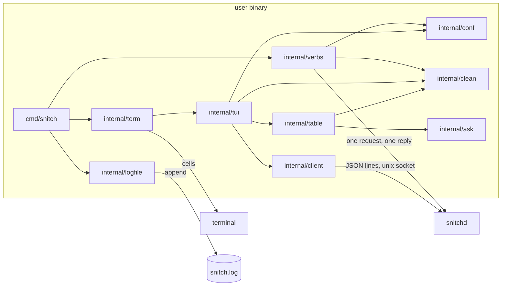
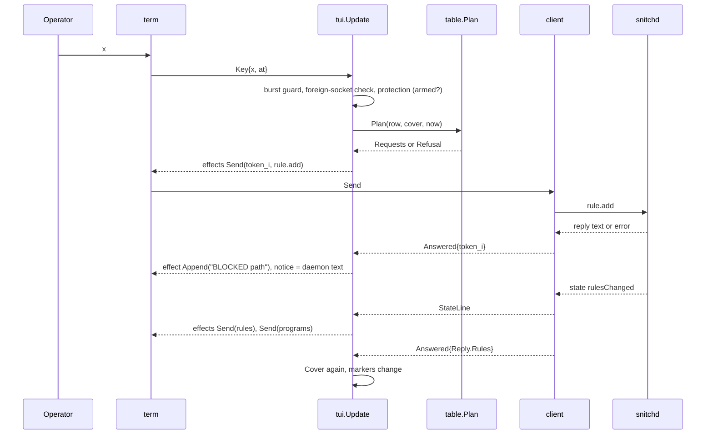
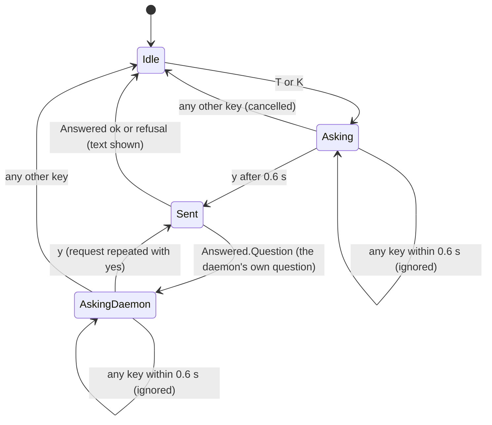
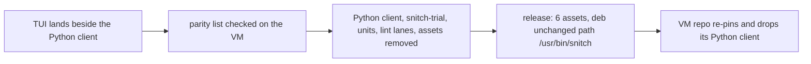

# Design Document: tui

## Overview

**Purpose**: `snitch` without a verb becomes the terminal UI of snitchd: the overview
(program › host › address), the egress graph, block and unblock with one key, the trial verbs,
and `snitch status` for a status bar. It replaces the Python client, key for key.

**Users**: the operator in a terminal on the host snitchd runs on; readers see the same
views, their writes end in the daemon's refusal.

**Impact**: adds seven packages under `internal/`, four verbs to `cmd/snitch`, two direct
dependencies (`charm.land/bubbletea/v2`, `charm.land/lipgloss/v2`), and four additive changes
to packages `kde-tray` owns (`internal/client`, `internal/ask`, two pin tests). At parity the
Python client, `snitch-trial`, four units, the ruff and CodeQL-python lanes and two release
assets leave the repository. `snitchd`, its API and the kernel programs are not changed.

### Goals
- Every key, view and verb of the Python client, or a listed deviation (`docs/parity.md`).
- A model that is provable without a terminal, a daemon or root: pure update and render
  functions, the terminal library confined to one package.
- No string from the daemon reaches the terminal unless a sanitiser produced it; the type
  system enforces this.
- No path by which the TUI changes the mode or writes a rule without the operator's key.

### Non-Goals
- Popups, the watcher, the process trace (popups-trace); allow rules from the TUI; trial
  extend; `snitch baseline`; new views (a bandwidth-over-time chart, for instance).
- The daemon's write gate (the mandatory follow-up `write-gate` of the requirements).
- Mouse support, themes, light-terminal detection, Windows or macOS.

## Boundary Commitments

### This Spec Owns
- The verbs of `snitch`: none (overview), `egress`, `status`, `default deny|allow [--keep]`,
  their flags, exit codes and usage text.
- `internal/clean`: the only producer of text that may be drawn or logged.
- `internal/conf`: the user's config file, its defaults, floors and validation.
- `internal/table`: the connection table as a tree, sorting, search, which rule covers a row,
  the rule requests a keypress stands for, the egress flows.
- `internal/tui`: the UI state machine (cursor, open rows, window, sort, search, confirmation,
  armed protection, pending requests, log lines) and its rendering into a `Screen`.
- `internal/term`: the Bubble Tea adapter. The only package that imports `charm.land/...`.
- `internal/logfile`: the user's log file, opened safely.
- `internal/verbs`: the one-shot verbs (`status`, `default`) and the status-bar line.
- `docs/tui.md`, `docs/parity.md`, `scripts/tui-check.sh`, and the removal of the Python
  client with everything that exists only for it.

### Out of Boundary
- Anything inside `snitchd`, `examples/api.md`, `internal/api`: read and imported, not edited.
  The TUI shows the daemon's `text` and `error` and does not parse them, with the two
  exceptions the client states (below).
- Authorisation. The daemon decides the role; the TUI never hides a key from a reader.
- Rule evaluation as truth. `table.Cover` predicts which rule covers a row to draw a marker;
  the kernel's verdict in the `verdict` column is the truth.
- The tray: its model, its bus adapters, its question policy. Only the additive changes
  listed under Modified Files touch `kde-tray`'s packages.
- The trial files, the kill switch, the boot revert.

### Allowed Dependencies
- `internal/api` (wire types), `internal/client`, `internal/ask` (`Local`, `Unknown`),
  `internal/jobs`, `internal/contract`, the standard library, `golang.org/x/sys/unix`,
  `github.com/pelletier/go-toml/v2` (in `internal/conf` only).
- `charm.land/bubbletea/v2` v2.1.3 and `charm.land/lipgloss/v2` v2.1.1 with their transitive
  modules (all MIT or BSD-3-Clause, no cgo), **in `internal/term` only**.
- Import direction, one way: `cmd/snitch` → `term` → `tui` → `table` → `clean`; `tui` also →
  `client`, `conf`; `verbs` → `client` types, `clean`, `conf`. `tui` and `table` import no
  terminal library; `term` imports no `client`.
- Forbidden: `charm.land/bubbles/v2` (its text input runs clipboard helpers found on
  `$PATH`), `ntcharts`, `golang.org/x/net/idna` (would add `x/text`), everything
  `imports_test.go` already forbids for `cmd/snitch`, any listening socket, named pipe or
  runtime file.

### Revalidation Triggers
- A change to `client.Config`, `client.Msg` or the subscribe line: the tray's tests and
  `scripts/tray-check.sh` run again.
- A change to the `rules`, `snapshot`, `summary` or `state` shapes in `examples/api.md`:
  `internal/table` and its coverage tests.
- A new Bubble Tea minor version: the hostile-input tests of `internal/term` (the renderer's
  handling of escape sequences changed between v1 and v2 and again in 2026-09).
- `write-gate` landing: Requirement 13's documentation and the refusal texts shown.
- popups-trace landing: the detail pane gains the trace; `docs/parity.md` loses a deviation.

## Architecture

### Existing Architecture Analysis
- `internal/client` runs as a `jobs.Job`, delivers `Msg` values to a `Sink`, and answers
  every `Send(token, req)` with one `Answered{Token}`. Today it subscribes with
  `summary:false`, refuses `snapshot`, returns only `Text`/`Err` of a reply, turns a
  `dropped` line into a silent status refresh, and does not look at the socket's owner.
- `internal/tray` is the pattern to copy: `Update(m, msg, now) (Model, []effect)` and
  `Render(m, now) View`, both pure, with a loop that runs effects. Its `Update` panics on an
  unknown message, so the client may send new message types only to a caller that asked.
- `cmd/snitch/pins_test.go` scans a fixed package list and allows three request types;
  `imports_test.go` forbids the kernel-side packages by dependency list.
- Code shape (`tech.md`): functions ≤ 40 lines, complexity ≤ 10, files ≤ 300 lines, delegates
  over interfaces, immutable values, every loop a job, contracts for programming errors.

### Architecture Pattern & Boundary Map



**Architecture Integration**:
- Selected pattern: the tray's pure core with an adapter. `tui.Update` and `tui.Render` are
  pure; `term` translates Bubble Tea messages in and a `Screen` out, and runs effects.
- Boundaries: `table` knows data and rules, no cursor; `tui` knows the cursor and the keys,
  no escape codes; `term` knows the terminal, no daemon.
- Existing patterns preserved: jobs, delegates (`Now`, `Dial`, `Peer`), immutable model
  values, contracts, tokens for requests.
- New components: each maps to one requirement area (see Components).
- Steering compliance: kernel decides, daemon configures, TUI displays; fail-safes untouched.

### Technology Stack

| Layer | Choice / Version | Role in Feature | Notes |
|-------|------------------|-----------------|-------|
| CLI / TUI | `charm.land/bubbletea/v2` v2.1.3 | event loop, raw mode, alt screen, bracketed paste, cell renderer | MIT; v2.2.0 is tagged but not on the proxy yet; pin v2.1.3 |
| Styling | `charm.land/lipgloss/v2` v2.1.1 | colours and bold; colour downsampling is done by Bubble Tea | MIT |
| Width / cut | `github.com/charmbracelet/x/ansi` (transitive) | `StringWidthWc`, `TruncateWc` | the `Wc` variants match the renderer's default width rule |
| Config | `github.com/pelletier/go-toml/v2` v2.4.3 | `config.toml` | already in `go.mod` |
| Daemon channel | `internal/client` (extended) | table, rules, state, writes | additive, opt-in |
| Runtime | static, `CGO_ENABLED=0`, PIE | unchanged release flags | verified: a v2 program links static, no cgo |

Rejected: `bubbles` (see Allowed Dependencies; a row list, a search line and a key line are
small), `ntcharts` for the bars (the Python client draws them in fifty lines; ntcharts stays
the option if a line chart is ever wanted), `teatest` (experimental, pinned to an rc; the
pure functions are tested directly). Details in `research.md`.

## File Structure Plan

### Directory Structure
```
internal/
├── clean/                # Requirement 13.3-13.7: the only source of drawable text
│   ├── safe.go           # type Safe; Text (strip C0, C1, ESC, bidi, zero-width); Const
│   ├── name.go           # Name: non-ASCII labels to punycode (RFC 3492 encoder, no deps)
│   └── cut.go            # Middle: shorten in the middle, keep the tail; Size, Age
├── conf/
│   └── conf.go           # Config, Default, Load(read), validate: windows, trial bounds,
│                         # protect floor; ignores the popup keys
├── table/                # pure data: no cursor, no time source of its own
│   ├── store.go          # Store: entries by Key, Upsert (summary), Replace (snapshot)
│   ├── tree.go           # Rows(store, opts) []Row: program › host › address, IP Addresses
│   ├── sort.go           # Rank (frozen activity order), byName, new rows on top
│   ├── search.go         # Filter(rows, text): matches and their parents
│   ├── cover.go          # Cover(rules, programs, key) (Rule, Level, bool): kernel order
│   ├── plan.go           # Plan(row, cover, now) Plan{Requests, Refusal}: what x stands for
│   └── egress.go         # Flows(store) top 10 x 5, Scale (log), Bar (1/8 cells)
├── tui/                  # pure UI state machine
│   ├── model.go          # Model, Options, New; message and effect types
│   ├── update.go         # Update(m, msg, now) (Model, []Effect): dispatch only
│   ├── keys.go           # key table: name -> action; the burst and repeat guard
│   ├── nav.go            # cursor, open, close, parent, page, window, sort, search line
│   ├── block.go          # x/space: protection, plan, batch bookkeeping, outcome text
│   ├── trial.go          # T K E U, Confirm (0.6 s gate, y), the daemon's question
│   ├── feed.go           # client messages: Up, Down, Facts, StateLine, SummaryLine,
│   │                     # Dropped, EventLine, Answered; resnapshot timer; log lines
│   ├── screen.go         # Screen, Line, Span, Style; Render(m, now, w, h) Screen
│   ├── overview.go       # header, table window, detail pane, log pane, key line
│   └── graph.go          # the egress graph as Lines
├── term/                 # the only package importing charm.land/...
│   ├── program.go        # Run(cfg) jobs.Job: tea.NewProgram, inbox command, effects
│   ├── input.go          # tea.KeyPressMsg/PasteMsg/WindowSizeMsg -> tui messages
│   └── paint.go          # Screen -> tea.View (lipgloss styles by tui.Style)
├── logfile/
│   └── logfile.go        # Open (0700 dir, 0600 file, O_NOFOLLOW, owner check), Tail, Append
└── verbs/
    ├── oneshot.go        # Ask(ctx, dial, peer, reqs) ([]api.Reply, error) with a deadline
    ├── bar.go            # Bar(status, entries, now, err) Line{Text, Class, Tooltip}
    └── mode.go           # Default(args, io, ask): deny, deny --keep, allow; the y/N prompt
cmd/snitch/
├── tui.go                # verbs overview and egress: flags, tty check, wiring, exit codes
├── oneshot.go            # verbs status and default: flags, wiring, exit codes
└── harden.go             # prctl(PR_SET_DUMPABLE, 0) before anything else
docs/tui.md               # keys, verbs, config, exit codes, waybar example, limits (13.12)
docs/parity.md            # the parity list (14.1, 14.2)
scripts/tui-check.sh      # the VM run of 15.4 (no root; a trial only with --trial)
```

Each package has `_test.go` files beside the code; `internal/clean` and `internal/conf` have
fuzz targets (`scripts/fuzz.sh` picks them up by name).

### Modified Files
- `internal/client/client.go`, `session.go`, `msg.go` — opt-in table feed (`Config.Table`),
  `Config.Peer`, `Up.PeerUID`, `Answered.Reply`, `Answered.Question`, `SummaryLine`,
  `Dropped`; `snapshot` allowed when `Table` is set. Zero values keep today's behaviour.
- `internal/ask/question.go` — export `Local(netip.Addr) bool` (the one list of fail-safe 2's
  prefixes); `local` stays as its caller.
- `cmd/snitch/main.go` — dispatch: no argument is the overview; `egress`, `status`,
  `default`; usage text; `harden()` first.
- `cmd/snitch/pins_test.go` — the new packages join the scanned list; the request-type
  allowance becomes per package (tray packages keep three; `tui` and `verbs` may name
  `snapshot`, `rules`, `programs`, `rule.remove`, `trial`, `keep`, `unkeep`, `end`;
  `table` may name `rule.add` and `rule.remove`, which its plans build); the
  network pin (no `"tcp"`, no listener) covers the new packages unchanged.
- `cmd/snitch/imports_test.go` — adds: only `internal/term` may depend on `charm.land/`.
- `go.mod`, `go.sum` — the two modules and their transitive set.
- `scripts/caps.sh` — nothing; the new packages fall under its default scope.
- At parity (last task group, Requirement 14): delete `snitch`, `snitch-trial`,
  `pyproject.toml`, `uv.lock`, the tracked `__pycache__/` file, `systemd/snitch-watch.service`, `systemd/snitch-trial.service`,
  `systemd/snitch-trial-boot.service`, `systemd/snitch-trial.timer`; edit
  `.github/workflows/release.yml` (asset list 8 → 6), `lint.yml` (ruff job), `codeql.yml`
  and `.github/codeql-config.yml` (python lane), `.gitignore` (the ruff cache), `.dagger/checks.go`, `composites.go`, `pins.go`, `rugged.go` (Ruff, the uv
  image, the frozen asset names; regenerate `dagger.gen.go`), `README.md`, `docs/ci-debs.md`,
  `docs/rugged.md`, `CLAUDE.md`, `.kiro/steering/{product,tech,structure,roadmap,fail-safes}.md`.

## System Flows

### Block from keypress to marker



A host-level press sends one request per address; the batch reports when its last answer
arrives (how many succeeded, the first refusal's text). The log line is written on the
daemon's acceptance, not on the keypress.

### Confirmation toward enforce



`E` and `U` go from Idle straight to Sent. While Asking, no other key acts (8.8). A paste
never produces `y` (13.2).

### Connection life

Up → `rules`, `programs`, `snapshot(window)`. `SummaryLine` → upsert. `StateLine` with
`rulesChanged` → `rules`, `programs`. `Dropped`, a window change, and every 30 s → `snapshot`
(the snapshot is what removes entries that left the window). Down → the table stays, marked
stale; writes answer locally with "the daemon is not reachable".

## Requirements Traceability

| Requirement | Summary | Components | Interfaces |
|-------------|---------|------------|------------|
| 1.1, 1.2, 1.3, 1.4, 1.5, 1.6 | overview layout, tree, columns, unknown row | table, tui | `table.Rows`, `tui.Render` |
| 1.7, 1.8 | header: window, mode, deadline, kill/stale | tui | `overview.go` header |
| 1.9 | change within 2 s, cursor stays | tui, client | cursor by `table.RowID` |
| 1.10 | too small notice | tui | `Render` (min 80×20) |
| 1.11, 1.12 | not a terminal, unknown verb | cmd/snitch | `tui.go`, `main.go` |
| 2.1, 2.2, 2.3, 2.4 | movement, open, close, parent | tui | `nav.go` |
| 2.5 | detail pane | tui, table | `overview.go`, `table.Cover` |
| 2.6 | q, ctrl+c, terminal restored | term, cmd/snitch | `term.Run` |
| 2.7 | 100 ms with 4096 rows | tui, table | row cache, windowed render |
| 3.1, 3.2, 3.3 | time window | tui, conf | `nav.go` |
| 3.4, 3.5, 3.6, 3.7, 3.8 | sort modes | table, tui | `table.Rank` |
| 3.9, 3.10, 3.11 | search | table, tui | `table.Filter` |
| 4.1, 4.2 | toggle, `snitch egress` | tui, cmd/snitch | `Options.Egress` |
| 4.3, 4.4, 4.5, 4.7, 4.8, 4.9 | graph content | table, tui | `table.Flows`, `graph.go` |
| 4.6, 4.10 | refresh, keys in the graph | tui | `Tick`, `keys.go` |
| 5.1, 5.2, 5.3, 5.5, 5.6 | the rule requests | table | `table.Plan` |
| 5.4, 5.7, 5.8, 5.9 | local network, enclosing rule, unnameable | table, tui | `Plan.Refusal`, notice |
| 5.10, 5.13, 5.14 | daemon text, batch outcome, one keypress | tui | `block.go` |
| 5.11, 5.12 | markers | table, tui | `table.Cover` |
| 6.1, 6.2, 6.3, 6.4, 6.5 | protection | tui, conf | `block.go`, `conf.Protect` |
| 7.1, 7.2, 7.3, 7.4, 7.5 | log | tui, logfile | `Append` effect |
| 8.1, 8.2, 8.3, 8.4, 8.5, 8.6, 8.7, 8.8, 8.9, 8.10 | trial keys | tui, client | `trial.go`, `Answered.Question` |
| 9.1, 9.2, 9.3, 9.4, 9.5, 9.6 | `snitch default` | verbs, cmd/snitch | `verbs.Default` |
| 9.7, 9.8, 9.9, 9.10, 9.11 | `snitch status`; stale heartbeat = no answer in time | verbs | `verbs.Bar`, `verbs.Ask` |
| 10.1, 10.2, 10.3, 10.4, 10.5 | following the daemon | client, tui | `feed.go` |
| 11.1, 11.2, 11.3, 11.4, 11.5, 11.6, 11.7 | configuration | conf, cmd/snitch | `conf.Load` |
| 12.1, 12.2, 12.3, 12.4, 12.5, 12.6 | fail-safes, roles | all | no state outside API and log; `ask.Local` |
| 13.1 | 0.6 s and typeahead | tui, verbs | `Confirm`, `mode.go` (flush) |
| 13.2 | paste is text | term, tui | `Paste`, burst guard |
| 13.3, 13.4, 13.6, 13.7 | cleaned strings, punycode, cut | clean, tui | `clean.Safe` |
| 13.5 | full path, undeclared mark, loose-directory mark | tui, term, cmd/snitch | `Inspect`/`Inspected`, `Config.Loose` |
| 13.8 | socket not root's | client, tui, verbs | `Config.Peer`, `Up.PeerUID` |
| 13.9 | no socket, pipe, runtime file | all | pin test |
| 13.10 | log file safety | logfile | `Open` |
| 13.11 | not attachable | cmd/snitch | `harden.go` |
| 13.12, 13.13 | documented limits, roadmap | docs | `docs/tui.md`, roadmap |
| 14.1, 14.2 | parity list | docs | `docs/parity.md` |
| 14.3, 14.4, 14.5, 14.6 | retirement, release | Modified Files | release.yml, .dagger |
| 15.1, 15.2, 15.3, 15.4, 15.5 | docs and verification | tests, scripts | Testing Strategy |

## Components and Interfaces

| Component | Layer | Intent | Req Coverage | Key Dependencies | Contracts |
|-----------|-------|--------|--------------|------------------|-----------|
| clean | text | drawable, loggable text | 13.3–13.7 | — | Service |
| conf | config | config file | 3.1, 6.5, 11 | go-toml (P0) | Service |
| table | domain | tree, sort, cover, plan, flows | 1–5 | clean, ask, api (P0) | Service |
| tui | core | UI state machine, Screen | 1–8, 10, 12, 13 | table, client, conf (P0) | Service, State |
| term | adapter | Bubble Tea | 2.6, 13.2 | bubbletea, lipgloss (P0) | Batch |
| logfile | I/O | the log file | 7, 13.10 | x/sys (P0) | Service |
| verbs | CLI | status, default | 9, 13.1, 13.8 | api, clean, conf (P0) | Service |
| client (ext.) | channel | table feed, peer, replies | 10, 13.8 | api (P0) | Event |
| cmd/snitch | binary | verbs, wiring, hardening | 1.11, 1.12, 13.11 | all (P0) | Batch |

### Text

#### clean

| Field | Detail |
|-------|--------|
| Intent | Turn untrusted strings into text that cannot act on a terminal or a log |
| Requirements | 13.3, 13.4, 13.5, 13.6, 13.7 |

**Responsibilities & Constraints**
- `Safe` is a string type whose values come only from this package. `tui.Span.Text` and the
  `Append` effect take `Safe`, so untrusted text cannot be drawn or logged without passing
  here; a test greps that no other package converts to `clean.Safe`.
- `Text` replaces every rune below 0x20, 0x7f, 0x80–0x9f, the bidi controls (U+061C,
  U+200E/F, U+202A–E, U+2066–9), zero-width and invisible formatters (U+200B–D, U+2060,
  U+FEFF) and invalid UTF-8 with `·`; newline and tab are among them, so one input is one
  line. Reason for the wide set: the v2 renderer still honours SGR, OSC 8 hyperlinks, APC/DCS
  strings, `\r` and `\n` in view content.
- `Name` lower-cases nothing and resolves nothing: a label with a rune ≥ 0x80 becomes
  `xn--…` by the RFC 3492 encoder; then `Text`.
- `Middle(s, w)` keeps the tail (the last labels, the file name): `head…tail`, by cell width.

##### Service Interface
```go
type Safe string

func Text(s string) Safe                 // any daemon string
func Name(host string) Safe              // a destination name, punycode where needed
func Path(p string) Safe                 // an executable path
func Middle(s Safe, cells int) Safe      // cut in the middle, tail kept
func Const(s string) Safe                // literals of this repo only (never daemon data)
func Join(parts ...Safe) Safe
func Size(n uint64) Safe                 // 0B .. 1024T, as the Python client
func Age(t, now time.Time) Safe          // now, 5s, 3m, 2h, 4d, -
```
- Postconditions: the result holds no rune of the replaced sets; `Width(Middle(s, w)) ≤ w`.
- Invariant: `Text(string(Text(s))) == Text(s)`.

**Implementation Notes**
- Validation: fuzz `Text`, `Name`, `Middle` for the postconditions; RFC 3492 section 7.1
  vectors for the encoder.
- Risks: `Const` is the hole. The grep test allows `clean.Const(` only with a string literal
  argument.

### Config

#### conf

| Field | Detail |
|-------|--------|
| Intent | The user's config file with defaults, floors and bounds |
| Requirements | 3.1, 3.6, 6.5, 8.2, 11.1, 11.2, 11.4, 11.5, 11.6, 11.7 |

```go
type Config struct {
    Periods []string        // subset of 15m 30m 1h 24h 7d, in file order
    Since   string
    Protect []string        // always contains hypr-rdp, sshd; the file adds
    Resort  []time.Duration // default 10s, 20s
    Trial   time.Duration   // 1m..1h, default 10m
}
func Default() Config
func Load(read func() ([]byte, error)) (Config, error) // os.ErrNotExist -> Default
func (c Config) WithSince(w string) (Config, error)    // --since
```
- `Load` ignores `temporary`, `snooze`, `session`, `terminal`; any other unknown key is
  ignored too (the Python client did). Errors name the key and the served windows.
- The file is attacker-writable (same user): it can lengthen `Protect`, never shorten it,
  and `Trial` is bounded by the daemon's own limits.

### Domain

#### table

| Field | Detail |
|-------|--------|
| Intent | Connections as a sorted, searchable tree; what covers a row; what a keypress means |
| Requirements | 1.2–1.6, 3.4–3.9, 4.3–4.5, 5.1–5.9, 5.11 |

**Responsibilities & Constraints**
- Pure and immutable: every function returns new values. No clock; `now` is an argument.
- Holds raw daemon strings (they go back to the daemon in requests). Only `Row.Title` and
  the like are `clean.Safe`.
- `Cover` follows the kernel's documented lookup order: program-specific before any-program;
  exact protocol and port, then protocol, then any; longest prefix. A name rule matches an
  entry whose `name` equals it or ends in `.` + it. Known limits, stated in `docs/tui.md`: a
  port-range rule is reported with port 0 and so looks wider than it is; a name the daemon no
  longer attaches to an entry does not match. The marker is advisory; the `verdict` column
  is what the kernel did.

##### Service Interface
```go
type Key struct{ Who, Addr, Proto string; Port uint16 } // Who: program, or path if unknown
type RowID string                                       // stable across refreshes
type Level int                                          // Program, Host, Group, Address, Bucket
type Row struct {
    ID RowID; Parent RowID; Level Level; Depth int
    Title clean.Safe; Open, HasKids bool
    Last time.Time; Sent uint64; Rate float64; Allow, Deny uint64
    Verdict clean.Safe; Blocked bool
    Keys []Key          // the address entries under this row
}
type Store struct{ /* entries by Key */ }
func (s Store) Replace(es []api.Entry) Store
func (s Store) Upsert(es []api.Entry) Store

type Sort struct{ ByName bool; Rank map[RowID]int }
func Rank(s Store) map[RowID]int
type View struct{ Open map[RowID]bool; Sort Sort; Search string }
func Rows(s Store, r Rules, v View) []Row

type Rules struct{ Views []api.RuleView; Programs []api.ProgramView; Overlay string }
type Covering struct{ Rule api.RuleView; Own bool; By Level; Found bool }
func Cover(r Rules, k Key, at Level) Covering

type Plan struct{ Requests []api.Request; Refusal clean.Safe; Unblock bool; Note clean.Safe }
func MakePlan(row Row, s Store, r Rules, now time.Time) Plan

type Flow struct{ Sender clean.Safe; Total uint64; Rate float64; Dests []Dest; More int; MoreBytes uint64 }
func Flows(s Store, top, per int) []Flow
func Scale(b, biggest uint64) float64
```
- `MakePlan` rules:

| Row | Not blocked | Blocked by own overlay rules | Blocked otherwise |
|-----|-------------|------------------------------|-------------------|
| Address | one `rule.add` deny: program or path, `addr/32` or `/128`, proto, port | one `rule.remove` by the same key | Refusal: which rule holds it (enclosing row, or the file) |
| Host, `IP Addresses` | one deny per unblocked, non-local address | one remove per own rule | Refusal as above |
| Program | two denies: `0.0.0.0/0`, `::/0`, any proto, port 0; `Note` says the local network stays reachable | two removes | Refusal |
| `unknown` bucket, unknown without path | Refusal: no rule can name it | — | — |
| local address (`ask.Local`) | Refusal: the local network is always allowed | — | — |

- Every `rule.add` carries `note = "snitch tui YYYY-MM-DD HH:MM"` (local time).
- A rule in the deployed file with exactly the row's own key is treated as own: the
  `rule.remove` goes out and the daemon's refusal (`edit /etc/snitch/rules.toml`) is shown
  (5.10).
- Invariants (contracts): no request names a local address; a plan has requests or a
  refusal, never both, never neither.

**Implementation Notes**
- Risks: for an unknown program blocked by path, the overlay declares a program named after
  the base name; later entries may carry that name or stay `unknown` with the path. `Cover`
  resolves through `Programs[].Paths` so both forms match. Verify against the stand-in and
  the VM daemon in the first block test.

### Core

#### tui

| Field | Detail |
|-------|--------|
| Intent | The UI state machine and its rendering, without a terminal |
| Requirements | 1, 2, 3, 4.1, 4.6, 4.10, 5.10–5.14, 6, 7, 8, 10, 12, 13.1, 13.2, 13.8 |

##### Service Interface
```go
type Options struct {
    Conf conf.Config; Egress bool; Loc *time.Location
    Socket clean.Safe; LogTail []clean.Safe; LogBroken bool
}
func New(o Options) Model

// inbound: every client.Msg, plus
type Key struct{ Name string; Text string; Repeat bool; At time.Time }
type Paste struct{ Text string }
type Resize struct{ W, H int }
type Tick struct{}                       // 500 ms
type LogFailed struct{ Err clean.Safe }
type Inspected struct{ Path string; Loose bool } // answer to an Inspect effect

// outbound
type Send struct{ Token uint64; Req api.Request }
type Append struct{ Line clean.Safe }    // to the log file
type Quit struct{}
type Inspect struct{ Path string }       // ask whether the executable's directory is loose
type Effect any                          // one of the four above

func Update(m Model, msg any, now time.Time) (Model, []Effect)
func Render(m Model, now time.Time) Screen

type Style int // Plain, Dim, Bold, Good, Bad, Warn, Head, Cursor, BarLow, BarMid, BarHigh
type Span struct{ Text clean.Safe; Style Style }
type Line []Span
type Screen struct{ Lines []Line; Title clean.Safe }
```
- `Update` panics (contract) on a message type it does not know; an unknown key is ignored.
- Key table (`keys.go`), the whole map:

| Keys | Action | Where |
|------|--------|-------|
| up, down, pgup, pgdown, home, end | move | overview |
| enter, right, l | open | overview |
| left, h | close, else parent | overview |
| x, space | block / unblock | overview |
| t, 1–9 | time window | both |
| s, S | sort | overview |
| / , enter, esc | search | overview |
| e | graph on / off | both |
| T, K, E, U | trial, keep, end, unkeep | both |
| y | answer a confirmation | confirmation |
| q, ctrl+c | quit | both |

- Guards before an **action key** (x, space, T, K, E, U, y) acts, in this order:
  1. `Repeat` is set → dropped (a held key does not toggle).
  2. It arrives less than 50 ms after the previous key → dropped. This covers a paste on a
     terminal without bracketed paste and a terminal reply misread as keys.
  3. A confirmation is open and younger than 0.6 s → dropped.
  4. The session's `PeerUID` is not 0 → notice "not the system daemon: writes are off".
  5. The daemon is down → notice "the daemon is not reachable".
- `Paste` goes to the search line when it is open (through `clean.Text`), nowhere else.
- The loose-directory mark (13.5): when the cursor lands on a row whose executable path the
  model has not asked about, `Update` emits `Inspect{Path}` once per path; `term` runs the
  delegate `Config.Loose` and feeds `Inspected` back; the model keeps the answers by path for
  the session and the detail pane marks the program when `Loose` is true. The model stays
  pure: it never touches the file system. A path that is empty asks nothing and gets no mark.
- The undeclared mark (13.5): the row's program is `unknown`, or no entry of the `programs`
  reply names it.

##### State Management
- State model: `Model` is a value; maps are copied on change. Fields: `store`, `rules`,
  `status`, `state`, `up`, `foreign`, `stale`, `window`, `view` (open, sort, search),
  `rows` (cache) and `dirty`, `cursor RowID`, `top`, `graph`, `search` (line or nil),
  `confirm` (or nil), `armed RowID`, `pending map[uint64]purpose`, `batches`, `notice`,
  `log []clean.Safe`, `denied map[string]time.Time`, `rankedAt`, `snapAt`, `lastKeyAt`,
  `size`.
- Consistency: rows are rebuilt when `dirty` and at most every 500 ms (on `Tick`), so a
  burst of summaries costs one rebuild; a movement key never rebuilds, it only moves the
  window over the cached rows (2.7). The cursor is a `RowID`; if its row is gone the cursor
  takes the nearest surviving index.
- Tokens: `Model` hands out tokens; `pending` says what an `Answered` is for (snapshot,
  rules, programs, batch member, trial verb). An answer for an unknown token is ignored.
- Stale heartbeat (1.8): an `EventLine` with verdict `allow-stale` in the last 15 s; kill
  switch: `Status.Kill`, or an `allow-kill` event.
- Denied log (7.3): `EventLine` with `deny-rule` or `deny-default`, once per 10 s per label.

**Implementation Notes**
- Integration: `Render` draws only the visible window of rows; every data string passes
  `clean` at row build or in `overview.go`.
- Validation: table-driven tests on `Update` per key and message; golden text of `Render`
  (spans flattened) per view.
- Risks: file cap. `update.go` only dispatches; each area file stays under 300 lines.

### Adapter

#### term

| Field | Detail |
|-------|--------|
| Intent | Bubble Tea as a job around the pure model |
| Requirements | 1.1, 2.6, 13.2, 13.3 |

```go
type Config struct {
    Model tui.Model
    In    <-chan any                    // client messages and LogFailed
    Send  func(uint64, api.Request)     // client.Send
    Log   func(clean.Safe) error        // logfile append
    Loose func(path string) bool        // 13.5; run off the update path
    Now   func() time.Time
    Input io.Reader; Output io.Writer   // os.Stdin, os.Stdout; buffers in tests
}
func Run(c Config) jobs.Job             // nil on Quit; ctx.Err() when cancelled
```
- The view sets `AltScreen`, no mouse, no cursor, a constant window title; it never calls
  `tea.Raw`, `tea.Println` or `RequestBackgroundColor`. Colours are the 16 ANSI colours plus
  the bar gradient; Bubble Tea downsamples and honours `NO_COLOR`.
- Inbox: one command blocks on `In`, drains what is waiting into one batch message, and is
  issued again after each batch (no `Program.Send` from other goroutines).
- `tea.KeyPressMsg` → `tui.Key{Name: msg.String(), Text: msg.Text, Repeat: msg.IsRepeat,
  At: now}`; `tea.PasteMsg` → `tui.Paste`; `PasteStartMsg`/`PasteEndMsg` are dropped.
- Effects become commands: `Send` calls `c.Send`, `Append` calls `c.Log` and feeds
  `LogFailed` back once, `Inspect` calls `c.Loose` and feeds `Inspected` back, `Quit` is
  `tea.Quit`.
- The program runs with `WithContext(ctx)` and `WithoutSignalHandler`; `cmd/snitch` owns
  signals through `jobs.OnSignal`, so a signal cancels the context and Bubble Tea restores
  the terminal before `Run` returns.

### I/O

#### logfile
| Field | Detail |
|-------|--------|
| Intent | Append to and read the tail of the user's log without following a planted link |
| Requirements | 7.1, 7.2, 7.5, 13.4, 13.10 |

```go
type Log struct{ /* fd */ }
func Open(path string, uid uint32) (*Log, []clean.Safe, error) // tail: last 5 lines, cleaned
func (l *Log) Append(line clean.Safe, now time.Time) error      // "2006-01-02 15:04:05  line\n"
```
- `Open`: `MkdirAll` 0700 (an existing directory is left as it is but must belong to `uid`),
  `openat` with `O_APPEND|O_CREAT|O_NOFOLLOW|O_CLOEXEC`, 0600; `fstat`: regular file, owner
  `uid`; a group- or world-accessible mode is narrowed with `fchmod` to 0600. Any failure
  returns the error; the TUI then runs with `LogBroken` and says so once (7.5).

#### verbs
| Field | Detail |
|-------|--------|
| Intent | `snitch status` and `snitch default` without the long-running client |
| Requirements | 9.1–9.11, 13.1, 13.8 |

```go
func Ask(ctx context.Context, dial Dial, peer Peer, reqs ...api.Request) ([]api.Reply, error)
type Line struct{ Text, Class, Tooltip string }          // marshalled as waybar JSON
func Bar(st *api.Status, hour []api.Entry, now time.Time, down string) Line
type IO struct{ In io.Reader; Out, Err io.Writer; IsTTY bool; Flush func() }
func Default(ctx context.Context, args []string, c conf.Config, ask Asker, io IO) int
```
- `Ask` dials, checks the peer's uid, writes the requests, reads as many replies; the context
  carries the deadline (800 ms for `status`, 5 s for `default`).
- `Bar`: class `down` when the daemon could not be asked (`down != ""`: no socket, a refused
  dial, or no answer within the deadline), when `Status.Kill` is set, or when the peer is not
  root; `deny` for enforce, `allow` for monitor. A stale heartbeat (9.8) has no field in
  `status` and needs none: a daemon that has stopped writing its heartbeat is a daemon that
  does not answer, so it falls under "no answer within the deadline", and the tooltip then
  says that the daemon does not answer and the kernel allows everything after 15 s. The
  count is the number of entries of the `1h` snapshot whose `lastBlocked` lies within the
  last hour. Symbols U+F0498 / U+F0499 as in the Python client. Tooltip strings pass
  `clean.Text`.
- The `[y/N]` check is not repeated here: `Default` calls the predicate `client.IsQuestion`
  that the client exports for its own `Answered.Question`.
- `Default`: `deny` → `trial` with `c.Trial`; on `Question` print it, `Flush` typeahead,
  wait 0.6 s, read one line, continue only on `y`, and only if `IsTTY`. `deny --keep` →
  `keep`. `allow` → `end` (the daemon's `end` clears the trial and the kept marker).

### Daemon channel (extension of kde-tray's package)

#### client

```go
type Config struct {
    // existing fields unchanged
    Table bool                               // subscribe with summary; allow snapshot
    Peer  func(net.Conn) (uid uint32, ok bool) // nil: not checked (the tray today)
}
type Up struct{ PeerUID uint32; PeerKnown bool }
type SummaryLine struct{ Entries []api.Entry } // only with Table
type Dropped struct{ Count int }               // only with Table
type Answered struct {
    Token uint64; Text, Err string; Role bool
    Question bool      // Err ends in "[y/N]": the daemon's own question (second exception)
    Reply    *api.Reply // the whole reply (when Table is true on a reply; nil on error/loss or Table false), pointer keeps Answered comparable
}
```
- With `Table` unset the subscribe line, the refused request types and the message set are
  byte for byte what the tray has today; its tests are the proof.
- `Question` is the second place a daemon text is inspected, next to `Role`; both are suffix
  checks on texts `examples/api.md` documents. The check is exported as
  `IsQuestion(errText string) bool` so the one-shot verbs use the same one.
- `cmd/snitch` supplies `Peer` from `SO_PEERCRED` on the dialled connection.

### Binary

#### cmd/snitch

- `runMain`: `harden()` (exit 1 with one line if `prctl` fails), then dispatch.
- Overview/egress: parse `-api`, `--since`/`-since`; load config (exit 2 on error); require
  stdin and stdout to be terminals (exit 1), because Bubble Tea would otherwise read
  `/dev/tty` behind a pipe; open the log; `jobs.Run(client.Job, term.Run, jobs.OnSignal)`.
- `Loose` (13.5) is supplied here: `Lstat` of the executable's directory; true when the
  directory's owner is not root or its mode has a write bit for group or others, and true
  when the directory cannot be read at all (it cannot be shown to be safe). It names no
  user: the question is whether someone other than root can replace the program.
- Exit codes: 0 quit or signal, 1 not a terminal / daemon refusal in a one-shot verb, 2
  usage or config, 70 contract violation. A violation in any job cancels the context first,
  so the terminal is restored before the stack is printed.

##### Batch / Job Contract
- Trigger: process start. Input: flags, config file, socket path. Output: the terminal, the
  log file. Recovery: none needed; the process holds no state the daemon lacks.

## Data Models

### Domain Model
- `table.Key` (who, address, protocol, port) is the daemon's own table key; a `Row` groups
  keys. `RowID` is derived from level and titles' raw values, so it survives a resnapshot.
- Rules are read-only copies of the daemon's `rules` reply; the overlay is recognised by
  `Status.Rules.Overlay == RuleView.Source`.

### Data Contracts & Integration
- Requests the TUI sends: `status` (by the client), `subscribe` (events, summary), `snapshot`,
  `rules`, `programs`, `rule.add`, `rule.remove`, `trial`, `keep`, `unkeep`, `end`. Never
  `learned`, never `unsubscribe`, never `trial` with `extend`.
- Log file line: `YYYY-MM-DD HH:MM:SS  <WORD> <text>`, WORD one of `BLOCKED`, `UNBLOCKED`,
  `denied`, `mode`; same format as the Python client's, so an existing file continues.
- Status-bar line: `{"text": "...", "class": "allow|deny|down", "tooltip": "..."}`.

## Error Handling

### Error Strategy
Operator errors are shown where the operator looks and never end the TUI; programming errors
are contracts and end it with the terminal restored.

### Error Categories and Responses
- **Usage, config** (exit 2): one line naming the flag, key or window, then the usage.
- **Daemon away**: header line with the client's reason, table kept and marked stale, writes
  answered locally; the client's backoff reconnects.
- **Daemon refusal**: the daemon's text as a notice, cleaned, nothing else changes.
- **Partial batch**: "3 of 5 blocked; first refusal: …".
- **Log file**: one line in the log pane, then silence; the TUI keeps working.
- **Socket not root's**: reads shown and marked, writes off, `status` says `down`.
- **Too small**: one line with the needed size; keys other than `q` are ignored.

### Monitoring
The daemon's journal records every write with the uid (unchanged). The TUI adds nothing but
its log file, which is a convenience (13.12).

## Testing Strategy

### Unit Tests
- `clean`: every rune class of `Text` is replaced; idempotence; `Name` against the RFC 3492
  vectors; `Middle` keeps the tail and the width bound; fuzz all three (15.3, 13.3–13.7).
- `table.Cover`: the kernel order (program before any, exact before proto before any,
  longest prefix), name rules, overlay vs file, the port-range limit pinned as known.
- `table.MakePlan`: one case per cell of the plan table, both address families, unknown by
  path, the local-address refusal, the contract "never a local address in a request".
- `table.Rows` / `Rank` / `Filter`: `IP Addresses` grouping, the frozen order with new rows on
  top, name sort without case, search keeps parents; 4096 entries under the time budget.
- `tui.Update`: every row of the key table; protection (arm, second x, disarm on any other
  key, unblock without arming); confirmation (keys inside 0.6 s ignored, `y`, cancel, the
  daemon's question needs a second `y`, no other key acts); `E`/`U` without confirmation;
  the five guards in order, including a paste containing `x`, `y`, `T` and a 10 ms key burst.
- `conf.Load`: defaults, the protect floor, unserved windows, trial bounds, popup keys
  ignored, a broken file; fuzz.
- `verbs.Bar`: the three classes, the count, the foreign socket, the kill switch.
- `logfile.Open`: a symbolic link, another owner (injected stat), a 0644 file narrowed.

### Integration Tests
- `tui` + `client` + `clienttest.StandIn` (extended to answer the trial verbs and to emit
  summaries): start, snapshot, summary changes a row within one tick, block and unblock on
  all three levels with the stand-in's recorded edits compared, rules change moves the
  marker, restart of the stand-in (stale mark, reload), a `dropped` line (resnapshot).
- Hostile strings in every daemon field (program, path, name, note, text, error, reason):
  the flattened `Screen` and the log contain none of the replaced runes (15.3).
- `term`: a program on buffers with `WithWindowSize`; `q` returns nil and the output ends
  with the alt-screen exit; a `PasteMsg` never reaches the action keys.
- `cmd/snitch`: verb dispatch and exit codes through `runMain`; not a terminal → 1;
  `status` against a stand-in, against a dead path within 1 s; `default deny` with the
  question and a non-terminal stdin → 1.
- The tray's whole suite, unchanged, as the proof that the client extension is additive.

### Host Check (`scripts/tui-check.sh`, dev VM, deployed daemon, monitor mode)
- `snitch status` prints valid JSON; the overview starts and quits under `script(1)`; one
  block and its removal on a TEST-NET address as the operator, checked with `rules` over the
  API; `ps`-visible process is not dumpable (`/proc/<pid>/status`); no file under
  `$XDG_RUNTIME_DIR/snitch`. With `--trial` and the operator's go only: `T`, the deadline,
  `E`, mode back to monitor before the script ends (15.5).

### Performance
- Benchmark: a movement key on a model with 4096 entries and all rows open stays under
  100 ms per `Update` + `Render` (2.7); a summary of 4096 changed entries costs one rebuild.

## Security Considerations

- **Stated limit**: the daemon authorises by uid on a 0666 socket; a program of the
  operator's account can write without the TUI. That is the mandatory follow-up
  `write-gate`; nothing here claims otherwise (13.12, 13.13).
- **Deception**: `clean.Safe` in the types of `Span` and `Append`; a constant window title;
  no hyperlinks, no raw writes. The renderer facts behind the rune set are in `research.md`.
- **Injection**: bracketed paste as its own message; the 50 ms burst guard and the repeat
  guard for terminals without it; the 0.6 s gate; no destructive action on `esc` or without
  one of the guarded keys.
- **Fake daemon**: `SO_PEERCRED` on the client's side; uid 0 or read-only with a mark.
- **Process**: not dumpable (no attach, no `/proc/<pid>/mem` for the same uid); static
  binary, so no preload; no helper binaries are executed (no `bubbles` text input).
- **Files**: no runtime files; the log opened without following links; the config file can
  only add protection.
- **Not solved here**: an X11 session; a terminal multiplexer whose owner reads the screen
  and types with human timing; `PATH` shadowing of `snitch` (documented: absolute paths).

## Performance & Scalability
The daemon's table holds at most 4096 entries. Rows are cached and rebuilt at most twice a
second; rendering touches only the visible window; the egress graph is recomputed every 2 s
while shown.

## Migration Strategy


- Until C, `go build -o /tmp/snitch` stays the rule (the repo root's `snitch` is Python).
- Rollback of C is a revert of one commit; nothing on a host depends on the removed units
  (Little Snitch is gone since 2026-10-11).
- The release notes of the tag that contains C name the write-gate gap (13.13) and that
  popups return with popups-trace (14.5).

## Open Questions
- Whether the daemon reports a path-blocked unknown program under its new name or as
  `unknown` afterwards (see table, Risks). Settled by the first integration test.
- Bubble Tea v2.2.0: take it when the proxy serves it, after the hostile-input tests pass.
