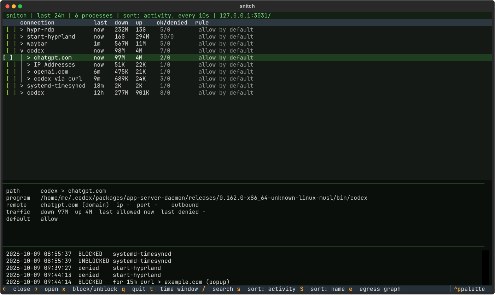

# snitch

See every connection your Linux machine makes, as program › host › address, and block the
ones you don't want with one key. snitch is an open source, Little-Snitch-style outbound
firewall: the decision happens in the kernel at `connect()`, per program and destination.



It only watches until you say otherwise. Out of the box nothing is blocked except what a rule
denies, and blocking everything unknown is a timed trial that ends by itself. See
[It will not lock you out](#it-will-not-lock-you-out).

Two programs:

- `snitchd`, the daemon, runs as root and decides in the kernel (eBPF, BPF LSM hooks).
- `snitch`, the program you use, runs as your user: a terminal UI, a KDE tray, and a few
  one-shot commands.

## What you need

- Linux 6.12 or newer, amd64, systemd.
- The `bpf` LSM active. Check with:

  ```sh
  cat /sys/kernel/security/lsm
  ```

  The list must contain `bpf`. If it does not, add `bpf` to the `lsm=` kernel parameter
  and reboot.
- For the tray: KDE Plasma 6. The terminal UI needs only a terminal of 80x20 or larger.

## Install

On Debian or Ubuntu, take the deb and its checksum from the
[releases page](https://github.com/norandom/snitch/releases):

```sh
sha256sum -c snitch_<version>_amd64.deb.sha256
sudo apt install ./snitch_<version>_amd64.deb
```

The package enables nothing. Start the daemon, and name yourself as the operator, the one
user besides root who may block, allow and start trials:

```sh
sudo systemctl enable --now snitchd-trial-boot.service snitchd.service
echo "$USER" | sudo install -m 644 /dev/stdin /etc/snitch/operator
```

Then look:

```sh
snitch
```

The daemon starts in monitor mode. Every other user on the machine can watch, but not change
anything.

On other distributions, the release also carries the two static binaries (`snitchd`,
`snitch-linux-amd64`); [docs/daemon.md](docs/daemon.md#service) has the steps by hand.

## Use it

### The overview

`snitch` shows the connection tree, the details of the selected row below it, and a log at
the bottom.

| key | |
|---|---|
| ↑ ↓ | move, the details follow |
| enter / → | open · ← close |
| `x` / `space` | block; again to unblock |
| `t`, `1`…`5` | time window 15m / 30m / 1h / 24h / 7d |
| `s` / `S` | sort by activity / by name |
| `/` | search |
| `e` | egress graph |
| `T` / `K` / `E` / `U` | trial / keep / end / unkeep deny by default |
| `q` | quit |

A block applies at once, in monitor mode too. Blocking `sshd` or `hypr-rdp` takes a second
`x`, so a slip does not cut your remote session; add your own programs to that list with
`protect` in `~/.config/snitch/config.toml`.

### Where does the data go?


`e`, or `snitch egress`, shows what each program sends and where to. The bars use a log
scale, so small flows stay visible next to large ones.

### The tray

`snitch tray` puts one icon into the KDE system tray. The icon shows the daemon's state, the
menu shows its facts, and when a program connects somewhere no rule covers, a notification
asks you to Allow or Block. To start it with your session:

```sh
cp /usr/share/applications/snitch-tray.desktop ~/.config/autostart/
```

The tray never changes a mode. It only writes the rule you clicked. The six icons and every
detail are in [docs/tray.md](docs/tray.md).

### A status bar

`snitch status` prints one line of JSON for a Waybar custom module.


## Deny by default

Monitor mode allows whatever no rule covers. To block everything you have not allowed, start
a trial:

```sh
snitch default deny          # a timed trial (10 minutes), ends at its deadline and on reboot
snitch default deny --keep   # keep it, across reboots too
snitch default allow         # back to monitor mode, now
```

In the overview the same is `T`, `K` and `E`. Try it for ten minutes, see what breaks, allow
what you need, and keep it only once the machine works.

## Rules

Blocks and allows you make in the overview or the tray land in
`/etc/snitch/rules.d/local.toml`. The base rules are `/etc/snitch/rules.toml`, and the
package installs a commented sample there. Edit it before your first trial: the sample's
programs are examples, not your machine. A rule names a program, a destination, and a
verdict:

```toml
[[program]]
name  = "gh"
paths = ["/usr/bin/gh"]

[[rule]]
program = "gh"
to      = "github.com"       # a name (allow only), an address, or a prefix
verdict = "allow"
```

The daemon picks up a changed file within 5 seconds, and a broken file keeps the previous
rules. Check a file first with `/usr/local/sbin/snitchd check -rules /etc/snitch/rules.toml` (no
root needed). Every field and the precedence are explained in
[examples/rules.toml](examples/rules.toml).

## It will not lock you out

A firewall that denies by default can cut the session you administer the machine through.
snitch is built around that not happening:

- Outbound only. Inbound SSH and RDP are never decided on.
- The local network (private ranges, link-local, loopback) is always allowed, inside the
  kernel program. No rule can change that.
- If the daemon stops or hangs, everything is allowed.
- Deny by default starts as a timed trial. A reboot ends it.
- A kill switch works from a root console with no network and no daemon:

  ```sh
  sudo bpftool map update pinned /sys/fs/bpf/snitch/kill key 0 0 0 0 value 1 0 0 0
  ```

  Everything is allowed until you clear it with `value 0 0 0 0`. A kept deny by default is
  one file: `sudo rm /var/lib/snitch/enforce` removes it.

## What it does and doesn't stop

| | |
|---|---|
| A program phoning home | You see it in the overview and block it with `x`, or answer the tray's question. |
| Unknown programs, in monitor mode | Allowed and shown. Only deny by default blocks what no rule covers. |
| Inbound connections | Not in scope. Use nftables or your distribution's firewall for those. |
| Rules by name | Names come from the machine's plain DNS answers (UDP port 53). With DNS over HTTPS or TLS, or `/etc/hosts`, write rules by address. |
| Another program running as you | It can write rules through the daemon like you can: writes are authorised by user today. Hardening this (`write-gate`) is the next planned change. |

Popups in the terminal (`watch`, `ask`) and the process chain behind a connection are
planned (`popups-trace`).

## For AI agents

snitch is meant as the network guardrail on a machine where AI agents run: an agent's `curl`
or `git` shows up as its own row and gets its own rules. Today it runs with deny by default
on a [thin client VM](https://github.com/norandom/hyperland-forky-worker-vm). Per-agent
policies and automatic baselining are planned, not shipped.

## Documentation

| If you want to | Read |
|---|---|
| Use the terminal UI: all keys, commands, configuration, exit codes | [docs/tui.md](docs/tui.md) |
| Use the tray: icons, menu, questions, autostart | [docs/tray.md](docs/tray.md) |
| Write rules | [examples/rules.toml](examples/rules.toml) |
| Run the daemon: service, trials, rules by name, fail-safes | [docs/daemon.md](docs/daemon.md) |
| Know what the deb installs and promises | [docs/ci-debs.md](docs/ci-debs.md) |
| Script against the daemon | [examples/api.md](examples/api.md) |
| Judge the security: kernel code hardening, known limits | [docs/c-hardening.md](docs/c-hardening.md), [docs/tui.md](docs/tui.md#limits) |
| Build, test and release | [docs/development.md](docs/development.md), [docs/rugged.md](docs/rugged.md) |

## License

MIT, see [LICENSE](LICENSE).
