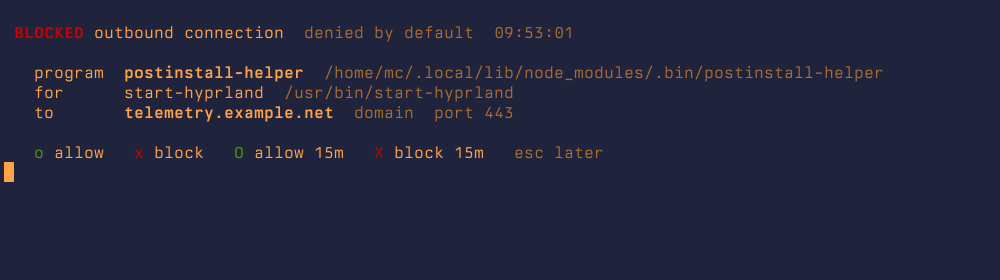

# snitch

A firewall you can see: every connection your machine makes, as process › host › address, with
one key to block it, a graph of who sends how much to where, and popups when something nobody
has decided on tries to connect.

Two pieces:

- **`snitchd`** (this repo, Go): the daemon. It decides at `connect()` in the kernel (BPF LSM),
  keyed by the program and the destination, from rules in a file. Monitor mode reports and
  denies by rule only; deny-by-default runs as a bounded trial you can keep. It also learns
  DNS names from the host's own plain-UDP answers, so a rule can say `to = "github.com"`
  instead of a list of IPs. The kernel programs carry runtime contracts that fail open and
  count their violations, and the daemon serves those counters in `status` (a non-zero
  contract counter means a bug, report it). See [docs/c-hardening.md](docs/c-hardening.md).
- **the client** (the `snitch` script at the repo root): the terminal UI, the tray item, and
  the alert popups. It started against
  [Little Snitch for Linux](https://obdev.at/littlesnitch-linux) over its WebSocket
  (`ws://127.0.0.1:3031/stream`), so every rule it writes is an ordinary Little Snitch rule,
  editable in the web UI; the snitchd-backed TUI and tray below are the Go rewrite.

**Agentic layer 7 filter.** snitch is built to be the network guardrail for AI agents running on
a machine: an agent's `curl` or `git` shows up as its own row, gets its own rules, and in
enforce mode a connection nobody allowed is blocked with a popup naming the process chain
behind it. That agentic featureset is work in progress: today the shipped piece is a thin
client over a VM (see the
[Hyprland thin client over RDP](https://github.com/norandom/hyperland-forky-worker-vm)), where
it runs with deny by default, and the rule engine, trial flow, and DNS learning described
below are what an agent host builds on. More agentic features (per-agent policies, automatic
baselining, popup triage) are planned on top of this.

## snitchd: the Go rewrite

`snitchd` replaces Little Snitch's daemon: it decides at `connect()` in the kernel (BPF LSM),
keyed by the program's executable and the destination. Rules from a file, learning mode,
bounded enforce. The TUI below still talks to Little Snitch until parity.

```sh
go build -o /tmp/snitchd ./cmd/snitchd
sudo /tmp/snitchd -rules examples/rules.toml -duration 60s           # monitor: report, deny by rule only
sudo /tmp/snitchd -learn -learned /tmp/learned.toml -duration 60s    # learn: write what connected, as rules
sudo scripts/enforce-test.sh --check-only                            # the enforce test's safe phase
```

* Rules: `examples/rules.toml` explains every field and the precedence. Programs are paths or
  globs, resolved to the executable's identity; rules are program (or `any`), address/prefix
  or name, proto, port, allow or deny (names are allow only). The file is reloaded within 5 s of a change, executables are checked
  every 10 s, `SIGHUP` reloads at once; a broken file keeps the previous rules.
* Fail-safes live in the kernel program, not in rules: the local network is always allowed,
  a stale heartbeat (daemon gone) allows everything, and the kill switch
  `bpftool map update pinned /sys/fs/bpf/snitch/kill key 0 0 0 0 value 1 0 0 0` allows
  everything until cleared. `scripts/fail-open.sh` does all of it from a console.
* Enforce (deny by default) runs only bounded: `-mode enforce -duration …` through
  `scripts/enforce-test.sh`, which resets everything in a trap, or as a trial (below).
  Needs Linux >= 6.12.

**Names.** A rule such as `program = "gh", to = "github.com", verdict = "allow"` allows
addresses learned for that name and its subdomains from this host's plain UDP DNS answers
(port 53, configured resolvers). The cache is host-wide: any matching name can allow a shared
CDN address for the rule's program. TCP 53, DoH, DoT and `/etc/hosts` supply no names; see
`examples/rules.toml` for the bounds and semantics. Egress decisions only: the DNS tap reads
answers to this host's own sockets, alters nothing, and can only add allow entries.
`-dns` defaults to true; `-dns=false` turns the tap off. Startup logs `dns tap on: N resolvers`
or `dns tap off: <reason>`. Events show names as `-> 1.1.1.1:443 (www.example.org)`;
`snitchd status` shows `dns: on seen N ignored N cache N names N compiled N` or
`dns: off: <reason>`.

**Service.** `systemd/snitchd.service` runs the daemon as root from boot with the default rules
file (`/etc/snitch/rules.toml`), restarts it on failure and never passes `-mode`: the daemon
starts in monitor mode with the DNS tap on by default and follows the trial and kept-enforce
files under `/var/lib/snitch`.
`systemd/snitchd-trial-boot.service` is a oneshot ordered before it that runs
`snitchd end -at-boot`, so a trial that was open at shutdown is gone before anything can
enforce. The runtime directory `/run/snitch` is 0755 so that the API socket in it is
reachable by every local user (the status file there stays 0600, the daemon's own); the
operator file `/etc/snitch/operator` names the one user besides root who may write over the
API (see **API** below). Neither unit is installed or enabled here: the `snitchd` task of the
[hyperland-forky-worker-vm](https://github.com/norandom/hyperland-forky-worker-vm) repo deploys
the binary (a release asset, pinned by version and sha256), the two units and the operator file
with the desktop user; that repo carries a copy of the two unit files, marked as copies of
these. By hand it would be:

```sh
sudo install -m 755 /tmp/snitchd /usr/local/sbin/snitchd
sudo install -m 644 systemd/snitchd.service systemd/snitchd-trial-boot.service /etc/systemd/system/
sudo systemctl daemon-reload
sudo systemctl enable --now snitchd-trial-boot.service snitchd.service
echo "$USER" | sudo install -m 644 /dev/stdin /etc/snitch/operator     # who may write over the API
```

**Trial.** With the service running (any daemon started without `-mode`), `sudo snitchd trial
10m` turns deny-by-default on for a bounded time (default 10 min, 1 to 60; verb flags such as
`-extend` go before the duration) and prints the deadline; `-extend` restarts the 60 minute cap from now. `snitchd status` shows the daemon,
mode, trial, kept, kill switch and rules, one line each (exit 1 when the daemon is not
running); `snitchd end` ends a trial early; `snitchd keep`, only during a trial, makes enforce
stay and prints the way back; `snitchd unkeep` takes it back. The daemon follows the two files
under `/var/lib/snitch` and ends a trial itself at its deadline; a reboot ends an open trial
(the boot oneshot above, and the daemon checks the boot id itself). A kept enforce is the one
exception, and it is a plain file: `rm /var/lib/snitch/enforce` from a console removes it, and
the kill switch (`scripts/fail-open.sh`) overrides it meanwhile. `scripts/enforce-test.sh`
runs the whole flow as its phase 3 (`--skip-trial` leaves it out). On a deployed host,
`sudo scripts/deploy-check.sh` checks the service read-only (active, version, status, a rule
event and a monitor event in the journal) and `--trial` adds a prompted two-minute trial with a
trap that ends it.

**API.** The daemon listens on `/run/snitch/api.sock` (`-api`; `-api ""` turns it off), JSON
lines in both directions: one request per line with an `id`, one reply or error with the same
`id`, and for subscribers the kernel's decisions as events (deduplicated within 10 s), a
summary of the changed connection-table rows every 2 s with bytes sent per socket, and a
`state` line on every mode, trial or rules change. Every local user reads (status, rules,
programs, learned, the table over a window of 15m to 7d); root and the user named in
`/etc/snitch/operator` also write: the four trial verbs, and rules added to or removed from
the overlay `/etc/snitch/rules.d/local.toml`, which is merged over the deployed file with
precedence. `examples/api.md` is the schema, with one example per message type, the limits
and the client one-liners; `scripts/api-check.sh`, run as the desktop user, proves it against
the running service.

**Release.** Before tagging, run the two-door suite ([docs/rugged.md](docs/rugged.md)):
`dagger call rugged --fuzz-duration 30s` (every lint check incl. the bindings check, then a
fuzz run of every target), then `sudo scripts/root-checks.sh --at <commit>` on a host with
the `bpf` LSM, which loads the kernel programs and runs the hostile-input corpus and a
bounded monitor run. A tag `vX.Y.Z` runs the lint checks (`.github/workflows/lint.yml`, the
same jobs as on every push) and then the release lanes (`.github/workflows/release.yml`): the
static amd64 builds (position-independent, `-buildmode=pie`) with the tag linked in, plus the
deb. The lanes dispatch into the repo's Dagger module, so CI and a local `dagger call` run
the same pipeline (see [docs/ci-debs.md](docs/ci-debs.md)); a failing check publishes nothing. The assets are
`snitchd`, `snitchd.sha256` (the form `sha256sum -c` reads), the tray binary
`snitch-linux-amd64` and its `snitch-linux-amd64.sha256` (see [The tray](#the-tray) below),
the Python client's `snitch` and `snitch-trial`, and the deb `snitch_<version>_amd64.deb` with
its `snitch_<version>_amd64.deb.sha256` — eight assets, published in one step.
`snitchd -version` prints the tag (`dev` for a plain `go build`), and `snitchd status` shows
it. The VM repo pins the version and the sha256 of the `snitchd` asset (see **Service** above).

`systemd/snitch-trial*.service`, `snitch-trial.timer` and `snitch-watch.service` belong to the
Little Snitch client below, not to snitchd.

## The tray

`snitch tray`, run as an ordinary user with no privileges, puts snitch into the KDE system
tray: one item whose icon tells the daemon's state at a glance, a menu with the daemon's
facts, and questions with Allow and Block. It talks to the **API** above — everything it
shows comes from `/run/snitch/api.sock` — and the only thing it ever writes is the rule an
operator clicked, through the daemon's `rule.add`.

By hand (never `go build -o snitch` in the repo root: the Python client owns that name
there):

```sh
go build -o /tmp/snitch ./cmd/snitch && /tmp/snitch -version
/tmp/snitch tray
```

`usage: snitch tray [-api PATH] [-ask all|enforce] [-operator-file PATH]`, the defaults
being `-api /run/snitch/api.sock`, `-ask all` and `-operator-file /etc/snitch/operator`
(the file that decides who may answer). The exit codes:

| exit | when |
|---|---|
| `0` | Quit in the menu, or SIGINT/SIGTERM: the item is removed, the name released, still-open notifications closed first |
| `1` | no desktop session (no session bus), the session bus lost, or a tray is already running (the message names its pid) |
| `2` | a usage error |
| `70` | a bug in the tray's own wiring (a contract violation; the kernel notices nothing) |

**States.** The icon alone tells whether anything is enforced or wrong; when more than one
condition holds, the first that holds in this order wins: daemon not running, kill switch
set, rules error, enforce kept, enforce trial, monitor. The first three also mark the item
as needing attention, so the desktop does not hide them among the inactive ones. The icon
set is drawn by the program, not loaded from a theme: the six states differ in shape and
every stroke carries a light halo, so they read on a light and on a dark panel. The images
here are the 44 px ones; `docs/` holds both sizes (the 22 px pair is the panel's), written
by the icon test into the directory `SNITCH_TRAY_ICONS` names — from the repo root,
`SNITCH_TRAY_ICONS=$PWD/docs go test ./internal/sni -run TestPixmapsPNGHelper` (the path
must be absolute: `go test` runs in the package's directory):

| | state | the icon says |
|---|---|---|
|  | **daemon not running** | dashed outline with a cross: snitchd's API is unreachable — not started, gone, or 10 s silent (the tooltip then says "not answering"). The tray retries on its own |
|  | **kill switch set** | red slash: the kernel allows everything until the switch is cleared |
|  | **rules error** | amber exclamation mark: the daemon's last rules load failed; the menu shows its error text in full |
|  | **enforce kept** | green shield: enforcement stays on, also across reboots, until it is unkept |
|  | **enforce trial** | shield half filled: a timed trial runs; the tooltip carries its deadline in local time and the minutes left |
|  | **monitor** | plain outline: deny by rule only; connections no rule covers are allowed and reported |

The tooltip names the state in words — and every other condition that holds too — plus
`learning` while the daemon learns and `questions paused` while questions are paused.

**Menu.** One click on the item opens the facts of `snitchd status`, with the state as the
first row (`snitch: monitor` — or whatever holds): the Mode, the Trial (its deadline and
time left, or `no trial`), Enforce kept, the Kill switch, Learning, Loaded (programs and
rules), the Rules file, the Overlay file, the DNS tap (on with its names and compiled
counts, or off with the daemon's reason), and snitchd's version and start time. The Role row
says whether this user may answer questions. Fact rows are information, never clickable —
while the daemon is gone the menu says so and lists nothing stale. The only actions are
`Pause questions` (a ticked row that pauses and resumes questions for the running tray;
while paused the tray asks nothing, keeps nothing waiting) and `Quit`.

**Questions.** When a connection that no rule covers is blocked (enforce) or allowed
because the daemon monitors, a notification asks: the program, its executable path, the
destination name when the daemon knows one, the address, the port, the protocol — and
whether it was blocked or allowed, not yet decided on. Nothing is asked for a connection a
rule decided, the local network, one allowed by the kill switch or a stale heartbeat, or
anything that connected before the tray started; `-ask enforce` leaves only the denied ones
in. One question is open at a time, up to 32 wait (the 33rd drops the oldest; the open one
says how many wait and were dropped), a question nobody answers closes after 60 s, and the
same program (or path, for an unknown program), destination, port and protocol is not asked
about again for 10 min. Closing a question or
clicking its body writes nothing; only Allow and Block do, both as one ordinary overlay
rule (the overlay `/etc/snitch/rules.d/local.toml`, see **API** above) through the daemon's
`rule.add` — the tray never edits a file itself:

| answer | the rule written |
|---|---|
| Allow, destination known by name | allow that program to that name (its subdomains included) for the connection's protocol and port |
| Allow, no name | allow that program to that single address, for the connection's protocol and port |
| Block | deny that program to that single address — by address even when a name is known (the API refuses a deny by name), and a deny rule applies in monitor mode too |

Every rule carries the note `snitch tray` and the time; the daemon answers with its outcome
sentence (`rule added: …`), shown as a notification that closes on its own. A refusal or 10 s
of silence writes nothing — "rule not added", and the same connection may ask again at once.
Allow and Block appear only for root and the user named in `/etc/snitch/operator`; with no
buttons the question says so (`No answer here: only the operator can decide`), and a program
that cannot be identified says that instead. For the button guess the operator file must be
world-readable (0644, as the deployment creates it): a file the tray cannot read shows the
tray as a reader (one line on stderr explains), while the daemon keeps the last word on the
write.

**Autostart.** Start the tray with the Plasma session by copying one file,
`desktop/snitch-tray.desktop`, to `~/.config/autostart/`:

```sh
cp desktop/snitch-tray.desktop ~/.config/autostart/
```

The entry runs `snitch tray` at KDE's earliest autostart phase (safe: the item appears
within 10 s of the tray host, whatever order Plasma starts in), and needs `snitch` on PATH:
the release ships the Go binary as `snitch-linux-amd64` with its `snitch-linux-amd64.sha256`
(the Python client owns the `snitch` asset name), so install it under that name:

```sh
install -m 755 snitch-linux-amd64 ~/.local/bin/snitch
```

Started by the session it behaves exactly as when started by hand (a second start still
exits 1).

**What it cannot do.** No mode ever changes from the tray: no menu entry and no verb starts,
keeps, unkeeps or ends a trial, sets or clears the kill switch, or changes the mode in any
other way — the operator decided against tray verbs; enforcement stays with `snitchd`. The
tray enforces nothing: the kernel decides with or without it, and hung, crashed or absent,
every verdict stays what it was. It writes only on the click: nothing but Allow and Block
reaches the daemon's `rule.add`, it edits no rule file, removes no rule, replaces no rule.
And a reader's tray cannot decide: without the operator role it shows and notifies but
answers nothing.

## Install

Needs Little Snitch for Linux (tested with 1.1.0, web UI on its default `127.0.0.1:3031`) and
[uv](https://docs.astral.sh/uv/): `snitch` is a single script that declares its dependencies
(Textual, websockets) inline, uv fetches them on the first start.

```sh
install -m 755 snitch ~/.local/bin/snitch
snitch                       # the overview
```

Alert popups (`snitch watch`, a user service) and the deny-by-default trial (`snitch-trial`,
root) are optional:

```sh
install -m 644 systemd/snitch-watch.service ~/.config/systemd/user/
systemctl --user enable --now snitch-watch.service

sudo install -m 755 snitch-trial /usr/local/sbin/snitch-trial
sudo install -d -m 700 /var/lib/snitch-trial
sudo install -m 644 systemd/snitch-trial*.service systemd/snitch-trial.timer /etc/systemd/system/
sudo systemctl daemon-reload
sudo systemctl enable snitch-trial-boot.service && sudo systemctl enable --now snitch-trial.timer
```

Popups open in `foot`; another terminal goes in `~/.config/snitch/config.toml` (`terminal = ...`,
see `snitch --help` for all options). On Hyprland, `~/.local/bin/hypr-launch` is used if present,
so a popup starts like a keybinding.

## The overview


`snitch` (or a click on the shield in the bar, see below) shows the daemon's own tree: process ›
host › address, with the details of the selected row below and the log at the bottom.

| key | |
|---|---|
| ↑ ↓ | move, the details follow |
| enter / → | open · ← close |
| `x` | block · `x` again unblocks (`[x]`) |
| `t`, `1`…`5` | time window 15m / 30m / 1h / 24h / 7d |
| `s` / `S` | sort by activity (re-sorted every 10 s, `s` again 20 s) / by name |
| `/` | search |
| `e` | egress graph |

Blocking a protected process (`protect` in the config: `hypr-rdp`, `sshd`, `littlesnitch`) takes a second `x`.

## Where does the data go?


`e` (or a right-click on the shield) shows what each program sends, and where to: btop-style
bars on a log scale, so 12 GB and 50 KB are both visible, plus the live rate. The sender is the
program that really talks (`ktop`), with the one that started it in brackets.

## Alerts



With **deny by default**, a connection no rule covers is blocked and a popup asks:

| key | |
|---|---|
| `o` / `x` | allow / block from now on |
| `O` / `X` | allow / block for 15 minutes (`temporary` in the config) |
| esc | decide later (asks again after `snooze`, 10 min) |

Below the destination the popup shows a **trace**: the running process behind the connection
and how it was started (`session › terminator › bash › claude`, with PIDs; the session itself is
known and shown as `session`), its command line and working directory. Little Snitch only names
the program, so `snitch` looks the process up in `/proc` the moment the block arrives;
short-lived programs such as `curl` may have exited by then, and the popup says so.

The popup ignores keys for its first 0.6 s, so it can't catch an `o` or `x` you were typing
somewhere else. The program has to retry after you allow it; nothing is held open.

Every answer is an ordinary Little Snitch rule (*"snitch popup …"*): listed, editable and
deletable in the web UI, and 15-minute rules expire inside the daemon itself. Decisions and
blocks are logged to `~/.local/state/snitch/snitch.log`.

```sh
snitch default deny          # a trial: baseline first, back to allow after 10 min and at the next boot
snitch default deny --keep   # keep it
snitch default allow         # back
```

**Deny by default locked the author's VM out once** (2026-10-09): RDP and SSH were cut, it took a
reboot and the Proxmox console. Right after Little Snitch (1.1.0) starts, and for connections
that already exist when it restarts, its per-program rules don't apply yet, so everything is
denied, the RDP session included. Hence:

* the local network is always allowed (a baseline rule for any program, both directions)
* Anthropic (Claude Code) is allowed for any program: rules with a program path take minutes to
  apply after Little Snitch starts, and some connections come without an identified program
* `snitch default deny` is only a trial: a root timer goes back to allow after `trial` (10 min),
  and an open trial at boot is ended before Little Snitch starts
* recommended: stay on allow, watch the overview and the egress graph, block with `x`

In waybar (`snitch status`, JSON for a custom module), the shield is solid for deny, an outline for allow, and red when the
popups aren't running (`snitch-watch.service`).


### Dev tools and overnight jobs

Nobody answers popups while you're away, so jobs that run overnight need their rules before:

```sh
snitch baseline --dev
```

adds allow rules for the dev tools, each to its own hosts only: Claude Code → Anthropic,
Codex → OpenAI, Copilot / `gh` → GitHub, `git` (https and ssh) → GitHub / GitLab / Codeberg /
Gitea, `apt` from the session (sudo, deploys) → its repositories, `npm` → npmjs.org, `uv` / `pip` → PyPI,
`cargo` → crates.io, `go` → golang.org, `podman` → the registries, `helm` → chart sources and
the cluster on the local network, `kubectl` / `k9s` / `ktop` → the cluster, and the bar's quota
module.
Versioned installs are matched with narrow wildcards (`~/.local/share/claude/versions/*`), so
the rules survive updates. Each tool gets a rule for "started in the session" and one for
"running on its own"; there is no session-wide rule, which would open those hosts to
everything. General-purpose tools such as `curl` are left out on purpose: they get a popup.
Running it again only adds what's missing.

## What this does and doesn't stop

| | |
|---|---|
| ⚠️ a package phoning home | only with deny by default (popups); on allow you see it in the overview and block it with `x` |
| ⚠️ deny by default | cut RDP and SSH once (rules don't apply right after Little Snitch starts): only as a 10-minute trial |
| ⚠️ wildcards in rule paths | Little Snitch expands them on disk: `/**` hung its web server once. `snitch` refuses paths without two fixed leading components |

## License

MIT, see [LICENSE](LICENSE). Little Snitch is a product of Objective Development; this is an
independent client of its web UI protocol.
