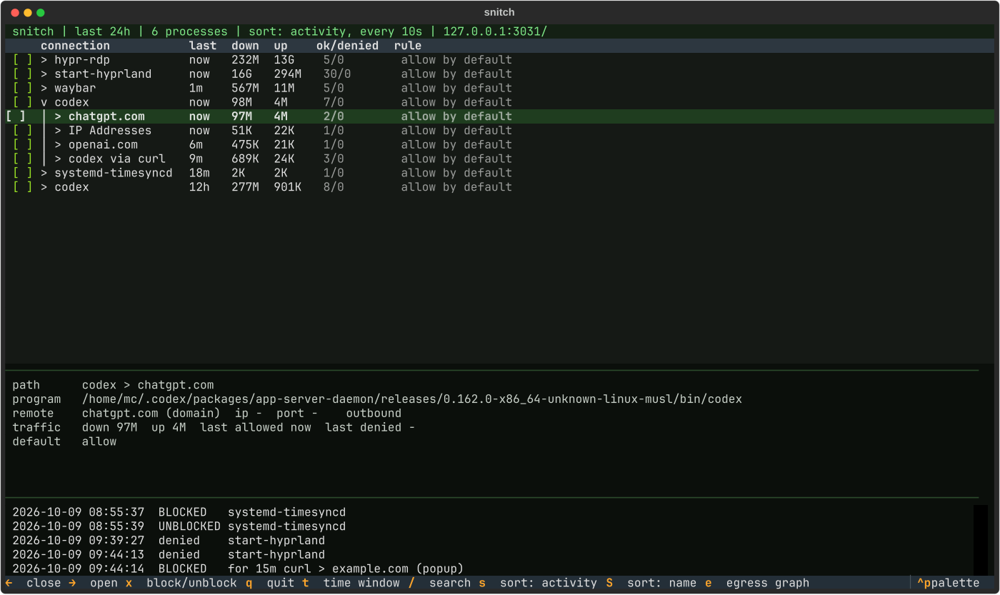
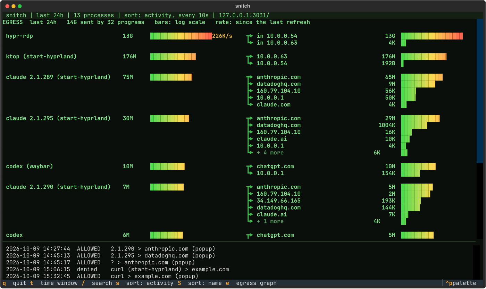
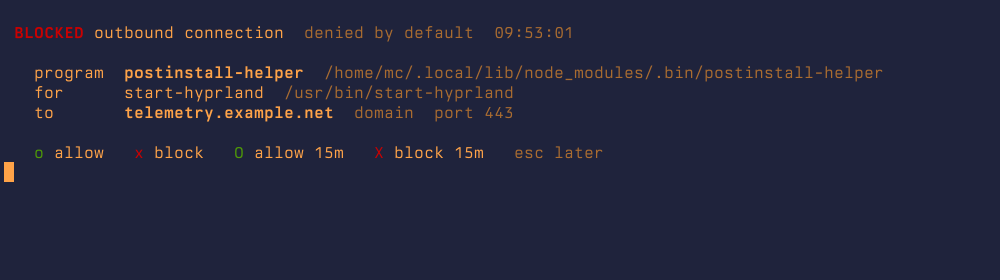

# snitch

[Little Snitch for Linux](https://obdev.at/littlesnitch-linux) in the terminal: every connection
as process › host › address, block or unblock with one key, an egress graph of who sends how
much to where, and popups for connections nobody has decided on yet, with a trace of the process
behind them.

It talks to the Little Snitch daemon over the same WebSocket its web UI uses
(`ws://127.0.0.1:3031/stream`), so everything it does is an ordinary Little Snitch rule: listed,
editable and deletable in the web UI. It started as part of a
[Hyprland thin client over RDP](https://github.com/norandom/hyperland-forky-worker-vm), where it
runs with deny by default.

## snitchd: the Go rewrite (in progress)

`snitchd` replaces Little Snitch's daemon: it decides at `connect()` in the kernel (BPF LSM),
keyed by the program's executable and the destination. Phase 1 is in: rules from a file,
learning mode, bounded enforce. The TUI below still talks to Little Snitch until parity.

```sh
go build -o /tmp/snitchd ./cmd/snitchd
sudo /tmp/snitchd -rules examples/rules.toml -duration 60s           # monitor: report, deny by rule only
sudo /tmp/snitchd -learn -learned /tmp/learned.toml -duration 60s    # learn: write what connected, as rules
sudo scripts/enforce-test.sh --check-only                            # the enforce test's safe phase
```

* Rules: `examples/rules.toml` explains every field and the precedence. Programs are paths or
  globs, resolved to the executable's identity; rules are program (or `any`), prefix, proto,
  port, allow or deny. The file is reloaded within 5 s of a change, executables are checked
  every 10 s, `SIGHUP` reloads at once; a broken file keeps the previous rules.
* Fail-safes live in the kernel program, not in rules: the local network is always allowed,
  a stale heartbeat (daemon gone) allows everything, and the kill switch
  `bpftool map update pinned /sys/fs/bpf/snitch/kill key 0 0 0 0 value 1 0 0 0` allows
  everything until cleared. `scripts/fail-open.sh` does all of it from a console.
* Enforce (deny by default) runs only bounded: `-mode enforce -duration …` through
  `scripts/enforce-test.sh`, which resets everything in a trap, or as a trial (below).
  Needs Linux >= 6.12.

**Service.** `systemd/snitchd.service` runs the daemon as root from boot with the default rules
file (`/etc/snitch/rules.toml`), restarts it on failure and never passes `-mode`: the daemon
starts in monitor mode and follows the trial and kept-enforce files under `/var/lib/snitch`.
`systemd/snitchd-trial-boot.service` is a oneshot ordered before it that runs
`snitchd end -at-boot`, so a trial that was open at shutdown is gone before anything can
enforce. Neither unit is installed or enabled here: the `snitchd` task of the
[hyperland-forky-worker-vm](https://github.com/norandom/hyperland-forky-worker-vm) repo deploys
the binary (a release asset, pinned by version and sha256) and the two units; that repo carries
a copy of the two unit files, marked as copies of these. By hand it would be:

```sh
sudo install -m 755 /tmp/snitchd /usr/local/sbin/snitchd
sudo install -m 644 systemd/snitchd.service systemd/snitchd-trial-boot.service /etc/systemd/system/
sudo systemctl daemon-reload
sudo systemctl enable --now snitchd-trial-boot.service snitchd.service
```

**Trial.** With the service running (any daemon started without `-mode`), `sudo snitchd trial
10m` turns deny-by-default on for a bounded time (default 10 min, 1 to 60; verb flags such as
`-extend` go before the duration) and prints the deadline; `-extend` restarts the 60 minute cap from now. `snitchd status` shows the daemon,
mode, trial, kept, kill switch and rules, one line each (exit 1 when the daemon is not
running); `snitchd end` ends a trial early; `snitchd keep`, only during a trial, makes enforce
stay and prints the way back; `snitchd unkeep` takes it back. The daemon follows the two files
under `/var/lib/snitch` and ends a trial itself at its deadline; a reboot ends an open trial
(the boot oneshot above, and the daemon checks the boot id itself). A kept enforce is the one
exception, and it is a plain file: `rm /var/lib/snitch/enforce` from a console removes it, and
the kill switch (`scripts/fail-open.sh`) overrides it meanwhile. `scripts/enforce-test.sh`
runs the whole flow as its phase 3 (`--skip-trial` leaves it out).

**Release.** A tag `vX.Y.Z` runs the lint checks (`.github/workflows/lint.yml`, the same jobs
as on every push) and then one static amd64 build with the tag linked in
(`.github/workflows/release.yml`); a failing check publishes nothing. The assets are `snitchd`,
`snitchd.sha256` (the form `sha256sum -c` reads) and the Python client's `snitch` and
`snitch-trial`. `snitchd -version` prints the tag (`dev` for a plain `go build`), and
`snitchd status` shows it. The VM repo pins the version and the sha256 of the `snitchd` asset
(see **Service** above).

`systemd/snitch-trial*.service`, `snitch-trial.timer` and `snitch-watch.service` belong to the
Little Snitch client below, not to snitchd.

## Install

Needs Little Snitch for Linux (tested with 1.1.0, web UI on its default `127.0.0.1:3031`) and
[uv](https://docs.astral.sh/uv/): `snitch` is a single script that declares its dependencies
(Textual, websockets) inline, uv fetches them on the first start.

```sh
install -m 755 snitch ~/.local/bin/snitch
snitch                       # the overview
```

Alert popups (`snitch watch`, a user service) and the deny-by-default trial (`snitch-trial`,
root) are optional:

```sh
install -m 644 systemd/snitch-watch.service ~/.config/systemd/user/
systemctl --user enable --now snitch-watch.service

sudo install -m 755 snitch-trial /usr/local/sbin/snitch-trial
sudo install -d -m 700 /var/lib/snitch-trial
sudo install -m 644 systemd/snitch-trial*.service systemd/snitch-trial.timer /etc/systemd/system/
sudo systemctl daemon-reload
sudo systemctl enable snitch-trial-boot.service && sudo systemctl enable --now snitch-trial.timer
```

Popups open in `foot`; another terminal goes in `~/.config/snitch/config.toml` (`terminal = ...`,
see `snitch --help` for all options). On Hyprland, `~/.local/bin/hypr-launch` is used if present,
so a popup starts like a keybinding.

## The overview



`snitch` (or a click on the shield in the bar, see below) shows the daemon's own tree: process ›
host › address, with the details of the selected row below and the log at the bottom.

| key | |
|---|---|
| ↑ ↓ | move, the details follow |
| enter / → | open · ← close |
| `x` | block · `x` again unblocks (`[x]`) |
| `t`, `1`…`5` | time window 15m / 30m / 1h / 24h / 7d |
| `s` / `S` | sort by activity (re-sorted every 10 s, `s` again 20 s) / by name |
| `/` | search |
| `e` | egress graph |

Blocking a protected process (`protect` in the config: `hypr-rdp`, `sshd`, `littlesnitch`) takes a second `x`.

## Where does the data go?



`e` (or a right-click on the shield) shows what each program sends, and where to: btop-style
bars on a log scale, so 12 GB and 50 KB are both visible, plus the live rate. The sender is the
program that really talks (`ktop`), with the one that started it in brackets.

## Alerts



With **deny by default**, a connection no rule covers is blocked and a popup asks:

| key | |
|---|---|
| `o` / `x` | allow / block from now on |
| `O` / `X` | allow / block for 15 minutes (`temporary` in the config) |
| esc | decide later (asks again after `snooze`, 10 min) |

Below the destination the popup shows a **trace**: the running process behind the connection
and how it was started (`session › terminator › bash › claude`, with PIDs; the session itself is
known and shown as `session`), its command line and working directory. Little Snitch only names
the program, so `snitch` looks the process up in `/proc` the moment the block arrives;
short-lived programs such as `curl` may have exited by then, and the popup says so.

The popup ignores keys for its first 0.6 s, so it can't catch an `o` or `x` you were typing
somewhere else. The program has to retry after you allow it; nothing is held open.

Every answer is an ordinary Little Snitch rule (*"snitch popup …"*): listed, editable and
deletable in the web UI, and 15-minute rules expire inside the daemon itself. Decisions and
blocks are logged to `~/.local/state/snitch/snitch.log`.

```sh
snitch default deny          # a trial: baseline first, back to allow after 10 min and at the next boot
snitch default deny --keep   # keep it
snitch default allow         # back
```

**Deny by default locked the author's VM out once** (2026-10-09): RDP and SSH were cut, it took a
reboot and the Proxmox console. Right after Little Snitch (1.1.0) starts, and for connections
that already exist when it restarts, its per-program rules don't apply yet, so everything is
denied, the RDP session included. Hence:

* the local network is always allowed (a baseline rule for any program, both directions)
* Anthropic (Claude Code) is allowed for any program: rules with a program path take minutes to
  apply after Little Snitch starts, and some connections come without an identified program
* `snitch default deny` is only a trial: a root timer goes back to allow after `trial` (10 min),
  and an open trial at boot is ended before Little Snitch starts
* recommended: stay on allow, watch the overview and the egress graph, block with `x`

In waybar (`snitch status`, JSON for a custom module), the shield is solid for deny, an outline for allow, and red when the
popups aren't running (`snitch-watch.service`).


### Dev tools and overnight jobs

Nobody answers popups while you're away, so jobs that run overnight need their rules before:

```sh
snitch baseline --dev
```

adds allow rules for the dev tools, each to its own hosts only: Claude Code → Anthropic,
Codex → OpenAI, Copilot / `gh` → GitHub, `git` (https and ssh) → GitHub / GitLab / Codeberg /
Gitea, `apt` from the session (sudo, deploys) → its repositories, `npm` → npmjs.org, `uv` / `pip` → PyPI,
`cargo` → crates.io, `go` → golang.org, `podman` → the registries, `helm` → chart sources and
the cluster on the local network, `kubectl` / `k9s` / `ktop` → the cluster, and the bar's quota
module.
Versioned installs are matched with narrow wildcards (`~/.local/share/claude/versions/*`), so
the rules survive updates. Each tool gets a rule for "started in the session" and one for
"running on its own"; there is no session-wide rule, which would open those hosts to
everything. General-purpose tools such as `curl` are left out on purpose: they get a popup.
Running it again only adds what's missing.

## What this does and doesn't stop

| | |
|---|---|
| ⚠️ a package phoning home | only with deny by default (popups); on allow you see it in the overview and block it with `x` |
| ⚠️ deny by default | cut RDP and SSH once (rules don't apply right after Little Snitch starts): only as a 10-minute trial |
| ⚠️ wildcards in rule paths | Little Snitch expands them on disk: `/**` hung its web server once. `snitch` refuses paths without two fixed leading components |

## License

MIT, see [LICENSE](LICENSE). Little Snitch is a product of Objective Development; this is an
independent client of its web UI protocol.
